# Lead report: mobile, gameplay and room flow pass

Branch `mobile-gameplay-pass` in `the repo root`, built on `main` (8b41075).
Nothing was pushed, no PR was opened, nothing was deployed.

Phase 1 (mobile, gameplay, customization) is sections 1 to 3. Phase 2 (the room create and join redesign) is section 9. Sections 4 to 8 cover both.

## 1. Mobile changes

Install and screen
- Added `manifest.webmanifest` and icons (192, 512, maskable 192 and 512, apple-touch 180). The app can be installed on Android and iOS and shows an icon.
- `index.html` links the manifest and the apple-touch-icon, sets `viewport-fit=cover` and the home-screen meta tags.
- Safe-area insets are read once into `--sat/--sar/--sab/--sal` and used by the body, bottom nav, overlays, toasts and the dice sheet.
- Modal heights use `dvh` with a `vh` fallback, so the browser toolbar does not cut them off.
- `sw.js` caches the manifest, the icons, `custom.js`, `room.js` and `qr.js`. VERSION went from v4 to v7 (three file-list changes).

Phone layout (360 to 430 px)
- The header stays on one row (it wrapped to two at 390 px). The wordmark stays for screen readers.
- The header room button always shows the room state and opens the Room view (section 9).
- Toasts moved to the top on phones. They used to sit on the HP and MP buttons above the bottom nav. Each has a 44 px dismiss target.
- An open modal locks page scroll, and modals keep their own overscroll.
- The floating d20 button covered the MP bar. On phones the nav Dice tab now opens the quick-roll sheet docked above the nav, and a button in the sheet opens the full Dice view. Desktop keeps the floating button.
- Every touch control has a 44 px target, and text inputs, selects and textareas use 16 px text so iOS does not zoom on focus. All of this sits behind one media condition, `(pointer:coarse),(max-width:720px)`.
- Status jump chips scroll a panel to below the sticky chip row.
- The HP amount label on combat cards stays on one line.
- Long loadout names are cut with an ellipsis (a 24 character name made the Status page 395 px wide on a 360 px phone).
- In GM mode the Attributes cards stay inside their panel (at 390 px the six cards with their plus and minus buttons were wider than the panel). Three columns from 375 px, two below.

Landscape phones (for example 844x390)
- A left nav rail and a compact header replace the desktop top nav for 721 to 1099 px wide and up to 500 px tall.
- Toasts sit on the top edge, right aligned, so they no longer cover combat Prev and Next.
- Loot and forge action bars are slimmer, and a focused field stays above the sticky bar.
- Onboarding fits the short screen.

Performance
- The header glyph pulse animates opacity on a pseudo element. It used to animate box-shadow and repaint every frame.

## 2. Gameplay changes

Each item was reproduced with a Playwright script before the fix and checked after it. The commit body of each has the full story.

Bugs
- Death saves survive removing Unconscious at 0 HP (a642bf4). Reason: removing the chip wiped the failures and re-enabled the save button on a fallen hunter.
- Negative XP takes back the ability points of the levels lost (b316845). Reason: +500 then -500 XP left a level 1 hunter with 6 free points, repeatable.
- Poisoned is -2 on attacks, not -4 (1b7fbee). Reason: the rule had a check penalty and an attack penalty and both landed.
- Reset rules keeps statuses made in the Status Forge (cd1353e). Reason: reset deleted them and their chips stopped working.
- Restoring a backup no longer clears skill cooldowns (b4bbf78). Reason: the reset matched "rest" inside "restore".
- The skill form accepts any dice text the roller accepts, for example 1d8+1d6 (ffa94e5). Reason: the form had its own narrower check.
- One Penalized chip after a missed daily, not two (6466246).
- Gate XP is paid once (2f91958). Reason: End encounter paid the monsters and Mark gate cleared paid the whole gate again. New saved field `gate.xpPaid`, default 0.
- Gate clear pays players in the room and shows the real per-hunter XP (8126b93). Reason: only hunters on the GM's own device were listed, and the split number was wrong.
- The job change quest chain no longer stalls when issued at level 10 or higher (a02caed).
- Pre-made hunters on a GM device are not penalized for dailies nobody plays (4016245). Reason: every starter and NPC sheet opened a PENALTY window each morning.
- Prev then Next starts a turn once (15d34fb). Reason: it ticked damage over time, status countdowns and cooldowns a second time. New saved field `encounter.begun`, default 0.
- Removing the combatant whose turn it is passes the turn on properly (8f0f3cb).
- Re-rolling initiative mid-fight keeps the current turn (4941de4).
- A defeated monster removed from the tracker keeps its XP (32f1a43). New saved field `encounter.bankedXp`, default 0.
- Prev on the first turn of round 1 does nothing (2c19258). Reason: it wrapped to someone who had not acted.
- The daily streak counts calendar days (b534355). Reason: the 25 hour day when clocks go back reset the streak.
- Hunter attacks roll with disadvantage at fatigue 80 or more (35b7ca2). Reason: the sheet says so and checks did it, attacks did not.

Balance
- E gates spawn 1 to 3 regular monsters plus the boss, down from 2 to 6 (6b0fd05). Reason: in an average-damage model the starter party of three level 1 hunters took 156 percent of its total HP from the old fight and 79 percent from the new one. The pack size is now a rule (`gateSpawn.regulars`) that a GM can override per rank.

Fix round after the adversarial review (two reviewers, only findings proven by a run were kept)
- Poisoned and Frightened monsters and shadows get the -2 on attacks (8617da8). Reason: after the Poisoned fix above the penalty only reached hunters, so a poisoned monster attacked at full strength.
- A turn re-sort keeps the "already started" marker on its combatant (c1745d4). Reason: Prev, then adding a combatant or re-rolling initiative, then Next ticked statuses twice for turns that had already started.
- Gate XP is paid once when the gate is cleared before the fight ends (f8ec960). Reason: Clear during a running fight and then End with Award XP paid twice. A gate now pays its XP once in total, also when a GM reopens and clears it again.
- Saved loadouts and perk picks survive a GM lowering `loadoutCap` or shortening a path (f09a7b8). Reason: load-time repair cut them to the current rules, so a temporary rule change deleted player data. Repair now only cuts at fixed safety limits (24 loadouts, 12 picks) and the UI applies the current rule.
- The GM can pick perks for a player from the board (3fce9df). Reason: with "Players pick" off a remote player's path stayed at 0 of 6 with no way to fill it.
- A room with default rules gets the build switches doc, and a player stops following a room after leaving it (c945dff). Reason: a player who had followed a builds-off room kept that setting in other rooms and in solo play.
- Loadout swaps are limited only when this hunter is in the room fight (461154c), and the room's build switches follow every way the GM's rules can change (1068a24). Both came from the first review round.

## 3. Customization added

Picked through an arena of two full designs. The winner was built and the best parts of the other were grafted in.

- Build paths. Status, Build panel. A player picks one of 6 paths and takes one of two perks at each rank tier (E, D, C, B, A, S). "Auto-place" spends unspent ability points by the path's weights. A respec costs gold (5 x level x level) and is refused in a fight. The bonus is stored as one ordinary skill, so an older app or an older GM reads the same numbers.
- GM control of builds. In GM mode the Build panel has "Builds on/off" and "Players pick" switches (sent to the room), free respec and Set path. Each card on the GM board shows the path, for example "Vanguard 3/6", and has a Build button that also works on a remote player. Awards and quest rewards can carry a path or a respec.
- Loadouts. Status, Loadouts panel under Equipment. Save the worn gear as a named set (up to 6) and swap it back in one tap. In a fight only weapon and off-hand change. A missing item is reported and its slot left alone.
- Hunter look. Status window, Look button. Pick an emblem (drawn in code, no image files) and a color. The badge shows on the status window, party rows, GM board cards and combat rows.
- Device settings. More, Device. Accent color (presets or "hunter", which follows the active hunter's color), text size, motion and vibration. These are stored per phone under their own key and never enter the save, exports or the sheet a GM sees.
- Rules. `build`, `paths`, `loadoutCap` and `gateSpawn` are ordinary rules, so the GM Rules editor can change them.

## 4. Save and sync compatibility proof

Servers: the branch on `http://localhost:3000` (called N below) and `main` on `http://localhost:3100` (called O, the old app and old server). All scripts are in `docs/agent-handoff` and drive real browsers with Playwright.

Run on the final head (`e99c2fd`), log in `docs/agent-handoff/wrap-run.log`, 16 commands, every exit 0:

| Command | Result |
|---|---|
| `node save-compat.mjs N` | 8/8. A GM save and a player save made on main load, a v1 save migrates, a main export imports (by API and through the UI), export round-trips, a backup restores, a junk save is tolerated. The only differences are added paths (`emblem`, `color`, `loadouts`, `build` per hunter). Nothing renamed or removed |
| `node sync-test.mjs N` | 8/8. GM creates a room, player joins, a sheet change reaches the GM card, a GM award and GM damage reach the player |
| `node sync-test.mjs N O` (new GM, old player) | 8/8 |
| `node sync-test.mjs O N` (old GM, new player) | 8/8 |
| `node room/s-api.mjs N` | ALL PASS. The room API contract: states, last room, checked join, GM rejoin, parseInvite |
| `node room/s-oldserver.mjs N O` | ALL PASS. The new app against the old server (no peek endpoint) |
| `node room/s-oldapp-lastroom.mjs O N` | ALL PASS. A save with `lastRoom` goes through the old app and keeps the field |
| `node room/rv-sync.mjs N` | ALL PASS (24 FAIL before the fix round) |
| `node room/rv-ui.mjs N` | ALL PASS (20 FAIL before the fix round) |
| `node room/r-view.mjs N`, `room/og-onboard.mjs N`, `room/og-gm.mjs N` | ALL PASS each. The Room view, both onboarding paths, the GM tab strip |
| `node fix3-build-doc-room.mjs N` | ALL PASS. Build rules follow the room document |

Run on head `b12cdda` (before the fix round, which touched only `sync.js`, `room.js`, `onboard.js` and `gm.js`), log in `docs/agent-handoff/final-run.log`:

| Command | Result |
|---|---|
| `node encounter-compat.mjs N O` | ALL PASS, 13 checks. An encounter shared between old and new apps |
| `node hwb-custom-safety-pinned.mjs N O` | "SAFETY: all PASS". A save with customization fields survives the old app |
| `node hwb-normalize-safety.mjs N O` | ALL PASS. `store.js` normalization fills defaults and keeps unknown keys |
| `node custom-check.mjs N`, `custom-smoke.mjs N`, `arena/prefs-leak.mjs N b`, `arena/zoom-check.mjs N b` | exit 0 each. Device prefs stay out of the save |

Wire format. One additive endpoint in `server.ts` (`GET /api/rooms/CODE?peek=1`). No request or response body changed. The fix round added a 20 s limit on the client side of each request and nothing on the wire.

Save shape. Added fields only, all with defaults from `store.js` normalization: `emblem`, `color`, `loadouts`, `build` per hunter, `settings.sync.lastRoom`, and the rules keys named in section 3. Device preferences live in their own key, `hunter-system-prefs`. The pending invite code lives in `sessionStorage` (`hunter-system-invite`) and never reaches the save.

## 5. Verification

`shots.mjs`, final head, all three exit 0, 64 screenshots each:

| Run | `console.txt` |
|---|---|
| `node shots.mjs N the repo root-shots/after` (390x844) | No console errors or warnings. Every overflow line is 0. One note: "skipped 31-player-combat-hud: table HUD not shown without a room" (same on main) |
| `node shots.mjs N the repo root-shots/after-360 360 780` | Same: no errors, all overflow 0, the one skip |
| `node shots.mjs N the repo root-shots/after-landscape 844 390` | Same: no errors, all overflow 0, the one skip |

`shots.mjs` keeps every old output name and adds 40 to 44 (device view, look picker, loadouts, build panels) and 50 to 61 (the room flow: GM first run, new room, large QR, invite link, joined player, Room view as player and as GM, GM tab strip, last room, wrong code, reopen from the GM tab).

I looked at the screenshots myself. In the last round: the room-flow shots at 390x844 (50, 51, 53, 56, 58, 59, 60), at 360x780 (51, 55, 57, 58, 60) and in landscape (51, 52, 53, 56, 58). Nothing needed fixing. Things I noticed and left: "Remove from room" looks like a normal button, and on localhost the link note takes three lines.

`audit-mobile.mjs` (94 states per size, head `b12cdda`, reports in `docs/agent-handoff/audit/`):

| Check | 390x844 | 360x780 | 844x390 |
|---|---|---|---|
| Tap targets under 44 px | 0 | 0 | 0 |
| Inputs under 16 px | 0 | 0 | 0 |
| Horizontal overflow | 0 | 0 | 0 |
| Modal does not fit | 0 | 0 | 0 |
| Scroll lock broken | 0 | 0 | 0 |
| Small text | 1 (10.8 px "STR · CON" in the build panel) | 1 | 1 |
| Fixed overlap (distinct) | 25 | 29 | 9 |
| Console errors or warnings | none | none | none |

The fixed-overlap rows are scrolled content passing under the bottom nav or sticky chips, toasts over the header, and landscape forms under their action bars. One state was not reached (`form-item-edit`: the test save has no item with an Edit button). See section 8 for the caveat on the GM tab states in these runs.

Other checks, last green runs (heads before the room fix round): `game-check-a.mjs` 15/15, `game-check-b.mjs`, `ga-level-hole.mjs`, `m1-check.mjs`, `m2-bottom.mjs`, `m2-desktop.mjs`, `pwa-check.mjs`, `attr-check.mjs`, `qr-check.mjs` (the QR encoder against known vectors and a jsQR decode), the `fix*`, `w*`, `hwa-*` and `hwb-*` scripts. `final.sh` runs all of them plus everything in section 4 in one go: `./final.sh http://localhost:3000 final-run.log`.

Reviews: phase 1 diffs were reviewed by me before each commit. Phase 2 had an arena for the design and two read-only reviews after the build (section 9).

## 6. Suggestions not done

Ordered by how much I think they matter.

Gameplay and balance
1. Gate XP pacing. After the double-pay fixes a gate pays about half of what it used to. That is the rule as written, but leveling will feel slower than before. Decide on purpose, for example by raising monster XP or adding a gate clear bonus in the rules.
2. Leveling down and up again can be used to place ability points again. Low risk at a table with a GM, so left alone.
3. Quests with a due time never fail on their own.
4. Short rests are unlimited, daily XP is flat at every level, and gold has few sinks. Each is a balance choice more than a bug.
5. Critical hits double only dice the form knows about. A written rule for crits would help.
6. Fun ideas that came up in review and were not built: boss enrage at half HP, red gates with higher stakes, a dungeon-break quest when a gate is ignored, shadow growth, scouting a gate before entering, A and S rank gates with their own tables.
7. The GM board could show a "PENALTY xN" chip, and the GM cannot clear Unconscious on a remote player from the board.
8. Reset rules also clears custom gate names (`rulesOverrides.gateNames`).

Room flow
9. "I have a room code" on the Welcome window would take one tap off the typed-code path for a new player (5 taps to 4). Left out to keep the first window to one choice.
10. A player who leaves a room stays on the GM's board as away until the GM removes the card. Sending a removal on Leave was considered and rejected because Leave has no confirm. A softer version would be a "left the room" mark on the card.
11. A memory-backed server forgets every room when it restarts. The app now says "room is gone" and keeps the code, but the GM has to make a new room and share it again. A server option to recreate a room under its old code would fix that. It needs a rule for who may claim a code.
12. An in-app camera scanner was rejected (needs a decoder at runtime, and the phone camera already opens links).

Mobile
13. Measure and trim paint cost on low-end phones: the `.win::before/::after` drop-shadow filters and the large blurred box-shadows are the suspects. Only the header pulse was fixed, because that one was measured.
14. "Follow device" in the Device panel wraps to two lines at 360 px.
15. A toast covers the header for the few seconds it shows.
16. In landscape the Look picker scrolls inside its window.

Customization
17. Builds are on by default and add up to 18 budget points over six ranks. A GM who wants the old numbers turns Builds off in the Build panel.
18. The Path bonus takes one row in the Skills list. It is stored as a skill so that older apps read the same numbers.
19. Saving raw Rules JSON without a `build` key turns builds back on.
20. With the "hunter" accent the very first frame is cyan before the hunter's color applies.

## 7. Copy tasks

See `docs/agent-handoff/copy-tasks.md`.

## 8. Failed or unsure

Not run or cut short
- Phase 2 was wrapped up early on the user's instruction. The full battery (`final.sh`, about 45 scripts) did not get a complete run on the final head. What ran on the final head is listed in section 5. The phase 1 scripts last ran green on earlier heads and the files they cover did not change after that, but that is an argument, not a run.
- The three `audit-mobile.mjs` runs are from head `b12cdda` (before the fix round). In those runs the GM tab states were recorded with the new "Open a room?" window on top. The script is fixed (it now records that step and taps Later) but was not rerun.
- Real phones. Nothing here ran on a real iPhone or Android phone. Unverified there: the scroll lock (`html:has`), `env()` safe-area insets, `dvh`, the standalone status bar, `:has()` (needs iOS 15.4 or newer; without it the landscape QR falls back to 185 px), scanning the QR with a phone camera (a jsQR decode in `r-view.mjs` passes), keyboards that compose text (the caret fix skips while composing), and focus behaviour of selects.
- The Postgres store in `server.ts` was not run here. Only the memory store was.

Flaky or unexplained
- `sync-test.mjs` with an old GM and a new player failed 6 of 8 once in a battery run. The request log shows both devices silent from 12.5 s to 414.2 s and then resuming together, which reads as a stall of the machine during a session interruption, not an app path. The other mixed config failed about one run in ten earlier, likely for the same reason. On the final head both mixed configs passed 8/8 (section 4), one run each.
- `rv-ui.mjs` printed `F10 exception: locator.focus: Timeout 30000ms` once in the writer's last full run. Three single reruns of F10 passed. Cause not found.
- `room/s-api.mjs` failed step 7a once in the writer's worktree and passed when rerun alone.
- Every `.sys-window` reports a scrollHeight 2 px above its clientHeight. Not investigated.
- In headless desktop shots `scrollbar-gutter: stable` shifts modal content slightly. Desktop pages are taller on the branch in a touch-emulated context. Neither was checked on a real desktop browser.

Behaviour changes to know about
- Gate XP pacing is roughly half of what it was, and a reopened gate pays 0 (section 2).
- Builds are on by default and add up to 18 budget points. Raw Rules JSON without `build` turns builds back on.
- Frightened now gives monsters -2. A GM override saved on main with the old `atk` op stacks to -4 on monsters.
- A player who was a solo GM with builds off, then follows a room and leaves it, gets the default build rules back.
- The old-app warning shows only on the GM card Build action.
- The nav Dice tab opens the dice sheet on phones instead of a view.
- Remove, Release and Allow back moved from the GM tab to the Room view. "Remove from room" looks like a normal button until hover.
- A device with exactly one hunter has no "+ New hunter" option in the Room view join.
- A request to the server is now given up after 20 s. A push that needs longer than that on a very slow link would be retried from the start each time. Sheets are small, so I think this cannot happen in practice, but it was not measured.

Other
- Deploy: if the Railway deploy uses the inliner (`__HUNTER_FILES`), it may need the new files: `manifest.webmanifest`, the icons, `custom.js`, `qr.js`, `room.js`.
- Git identity is set in this repo only, to Hunter Builder.
- The theming regex in `ui.css` and the first cyan frame with the "hunter" accent are in section 6.
- `31-player-combat-hud` is skipped by `shots.mjs` (no table HUD without a room). Same on main.
- The reconnecting state has no `shots.mjs` screenshot. It is in `the repo root-shots/room-after/`.
- The arena for the room design had no judge from another model family.
- The branch `mobile-gameplay-pass` is pushed to origin at `e99c2fd`. No PR, no merge, no deploy. Helper worktrees and branches are still on disk and can be deleted: `/workspace/room-fix` (branch `room-fix`), `/workspace/room-fix-sync` (`room-fix-sync`), `/workspace/room-og` (`room-og`), `/workspace/int-a`, `/workspace/int-b`, `/workspace/arena-a`, `/workspace/arena-b`, `/workspace/sg-custom`, `/workspace/sg-ga`, `/workspace/sg-gb`, and `/workspace/sg-main` (main, used as the old app in mixed tests). None of them was pushed.

## 9. Room flow (phase 2)

The before walk is in `docs/agent-handoff/room-flow-before.md` (script `room-walk.mjs`, screenshots in `the repo root-shots/room-before/`). The same walk on the new build is `room-walk-after.mjs`, with screenshots and the raw log `walk.txt` in `the repo root-shots/room-after/`. Both ran in Playwright at 390x844 with touch. A tap on a text field counts as a tap, and each field typed into counts as a field.

### Taps before and after

| Flow | Before | After |
|---|---|---|
| New GM, first open to something a player can use | 6 taps to a link in the clipboard (no QR existed) | 4 taps to the code and a QR on screen, 5 to a link in the clipboard |
| New player opens the invite link (or scans the QR) | 4 taps, 1 field, and the Data tab flashes by | 2 taps, 1 field (name, Join). Lands on Status |
| New player types the code | 5 taps, 2 fields | 5 taps, 2 fields. The code is now checked while it is typed, and a wrong code changes nothing |
| Existing player opens the invite link | 1 tap | 1 tap |
| Existing player, header button, typed code | 3 taps, 1 field | 3 taps, 1 field |
| The same with one wrong code first | 5 taps, 2 fields. The window closed and reopened | 3 taps, 2 fields. "No room with that code" shows under the field before Join is tapped |
| Leave the room | 4 taps and a 1548 px scroll | 2 taps, no scroll |
| Rejoin the room just left | 3 taps, 1 field (the code had to be typed again) | 1 tap from where Leave ends, 2 taps from any other view, 0 fields |
| GM leaves and comes back to the same room | About 4 taps and the same scroll (More, Data, scroll to "Your GM rooms", Rejoin as GM), and the GM tab offered only "Create room" | 1 tap in the GM tab ("Open CODE as GM"). No new room is created |

Screens: the room used to live in five places with different forms (header pill, onboarding field, link window, GM tab box, Data tab panel). It now lives in one view, `#/room`. The header button, the GM tab strip, the Data tab row and invite links all open that view.

### What changed, by friction point

Numbers refer to the list in `room-flow-before.md`.

- One place for the room (points 7, 14, 17). The header button always shows the room state and always opens the Room view. In a room it shows the code. Out of a room it reads "Join" for a player and "Room" for a GM.
- GM first run (1, 2). GM onboarding ends with one question, "Open a room?". Create room ends on the Room view with the code and the QR on screen. Later ends where onboarding ended before.
- Sharing (3, 4, 5). The Room view has a QR code of the invite link (drawn by a small encoder in `qr.js`, no library, no network). A tap enlarges it. Next to it are Copy link, Share (where the phone has a share sheet), Copy code, and the link as selectable text. On localhost a note says a phone cannot open that link.
- Player list (6). "Who is here" lists each player with online or away and the time last seen. Remove and Release are behind a Manage button per player, so the destructive button is no longer the first thing under each name. The GM tab keeps a one-row strip (code, state, "3 online, 1 away", Invite), so the party cards start higher.
- GM comes back (8). After leaving, the GM tab offers "Open CODE as GM" first and "New room" second. The Room view lists "Your rooms" with the same one-tap rejoin.
- Invite link for a new player (9, 10). The link opens one window with the room code, a "Room found" line, one name field and Join. The save is only changed once the server has confirmed the room. The app no longer drives the Data tab to join.
- Paste (11). The code fields accept a pasted invite link or a whole chat message and keep only the code. Among several words that could be codes, the one written like a code wins (capitals or a digit).
- Errors at the field (12, 13). The code is looked up 300 ms after it is complete, and the result shows under the field ("Room found", "No room with that code", "Cannot reach the server", or "You are GM of this room"). Join has a busy state. Nothing closes and reopens. All fields use the app's input style.
- Connection state (15). Six states behind one function (`off`, `ready`, `unreachable`, `connecting`, `live`, `reconnecting`). The header button shows a mark and the code. The Room view has a Connection card with the state in words, the time of the last sync, what is waiting to be sent, and a Try now button. Going offline shows at once, and coming back reconnects without a tap.
- Leave and rejoin (16). Leave is one button in the Room view and has no confirm, because nothing is lost. The room just left is remembered as "Last room" with a one-tap rejoin, also after a reload. If the server no longer has that room, the card says so and offers Dismiss.
- A reload keeps the room, as before.

### What shipped

Eleven commits on `mobile-gameplay-pass`, oldest first:

| Commit | What |
|---|---|
| `ec6d6be` | A small QR code encoder for invite links (`qr.js`) |
| `4380aa0` | The quiet room check on the server (`?peek=1`) |
| `046c5e4` | Connection states, the remembered last room, and a join that checks before it saves |
| `c6e0b7f` | An invite link opens a one-field join window for a new player |
| `a6b7ff1` | The GM tab room box becomes a one-row strip |
| `6b9a7ba` | The Room view (`room.js`) for joining, sharing and managing a room |
| `b12cdda` | A remembered room opens from the GM tab with its stored key |
| `eef8039` | Sync fixes from the review (GM never falls back to a player join on a network error, and six smaller ones) |
| `f2c709f` | Onboarding fixes from the review |
| `2877c66` | Room view fixes from the review |
| `e99c2fd` | GM tab strip fixes from the review |

The tap counts above did not change in the fix round. Phase 2 was wrapped up at this point on the user's instruction. What was left open is in the list at the end of this section and in section 8.

### How the design was picked

Arena with two full written designs: A (a bottom sheet behind the header button) and B (a Room view). B won on the point that it uses only layout the app already has on every view. A's sheet needed a text field in a fixed panel above the iOS keyboard, which cannot be tested here. A's state names, its GM first-run question, the localhost note and the debounced lookup were grafted into B. The verdict is in `docs/agent-handoff/arena-room/synthesis.md`. No judge from another model family was available, so I judged alone against the rubric. Treat that as a weakness of this arena run.

### Compatibility

- Wire format: one additive endpoint, `GET /api/rooms/CODE?peek=1`, answers `200 {"exists": true|false}`. It lets the app check a code without the 404 that browsers print as a console error. An old app never sends it. The new app on an old server falls back to the old request (a wrong code then logs one 404 line, as it did before).
- Save: one new field, `settings.sync.lastRoom` (`null` or `{ code, gone? }`). The old app's load keeps unknown keys under `settings.sync`, so a save that went through the old app still has it. No field was renamed or removed.
- Proof runs are in section 4.

### Review and fix round

Two read-only reviews of the phase 2 diff (one on the UI logic, one on sync and state) are in `room/review-ui.md` and `room/review-sync.md`. Each accepted finding was first reproduced by a failing script (`room/rv-ui.mjs`, `room/rv-sync.mjs`; outputs `room/rv-ui-before.txt` with 20 FAIL and `room/rv-sync-before.txt` with 24 FAIL), then fixed, then rerun.

Shipped from the sync review (`sync.js`):
- A GM could silently become a player of their own room. If the request with the GM key failed for any reason other than "no such room" (a dropped connection, a 502), the app went on to join without the key. It now stops and says it could not reach the server. Only a key the server refused (403) still falls back to a player join.
- A pasted invite link followed by punctuation (`...?room=ABC234.`, `)`, `,`, `!`) was not recognised. It is now.
- "Open CODE as GM" on a room the server no longer has now asks with the quiet check first, so the console gets no 404 line.
- The "claimed by another device" flag is reset on Leave, Create and Rejoin as GM.
- The invite code survives a reload of the tab (iOS drops background tabs). It is kept in `sessionStorage` for that tab only and never goes into the save.
- Two `create()` calls at the same moment make one room.
- A request that never answers is given up after 20 s. Before, one hung request stopped all polling and left "Try now" disabled for as long as the browser kept the connection.

Shipped from the UI review (`room.js`, `onboard.js`, `gm.js`):
- Onboarding no longer finishes and joins after the user tapped Back, "other options" or Skip while the room check was still out.
- After a join as "+ New hunter" the choice and the name are cleared, so the next join does not make a second hunter with the same name.
- "Playing as" shows the bound hunter again after a cancelled switch.
- The GM tab strip buttons have a busy state, and the strip stops offering a room the server said is gone.
- The invite card repeats its check when the connection comes back. Old error lines are cleared when the connection comes back or the room changes.
- Manage keeps keyboard focus. The code fields keep the caret when a letter is upper-cased. "Rejoin as GM" with a typed key has a busy state.
- The onboarding role step mentions the invite only when there is a server to join.

### Deferred sync findings

Not done. One line each for a later pass: severity, how to reproduce, suspected cause.

1. LOW, certain. A room check renews the room's 30-day expiry, and on Postgres it is a write. Repro: `curl 'http://HOST/api/rooms/CODE?peek=1'` and watch `touched` for that room. Cause: the peek line in `server.ts` calls `st.touch(code)`. Idea: a read-only `exists(code)` on both stores.
2. LOW, likely, not run. The header pill alternates Offline and Join every 5 s while a code sits in the Room view join field and the server answers `/api/health` but fails the peek with a 5xx (for example Postgres down). Repro: route `**/api/rooms/*peek=1` to a 500, type a real code, log `sync.conn()` for 30 s. Cause: `check()` sets `failing` on every error that is not a 404, the health poll clears it, and `room.js` checks again each time conn is `ready`. A fix in `check()` alone (count a 5xx as "server reached") would make the level-triggered re-check in `room.js` loop without a pause, so both need to change together.
3. LOW, speculative. Any 404 on the room GET is read as "room gone", evicts the device and saves `lastRoom.gone`. Repro: while live in a room, route `GET **/api/rooms/CODE*` to a 404 with an HTML body (a proxy during a redeploy). Cause: `pollOnce`, `joinRoom` and `rejoinGM` test only `e.status === 404`. Idea: also require `e.reason === 'no such room'`, which old and new servers both send.
4. LOW, proven as current behaviour (`rv-sync` S1e). A kept GM key that the server refuses (403): the check line said "Joining reopens it as GM", then the device joins as a player with the plain "Joined room" toast and the key is dropped from the ring. Cause: the 403 branch in `join()` continues to the player join. Idea: reject with its own kind and let the Room view say the key is no longer valid.
5. LOW, proven by the writer (`rv-ui` F7 A needed a 31 s wait to pass). In the first 30 s after leaving a room, a Rejoin that fails while `/api/health` still answers leaves "Could not reach the server." on screen until the next tap. Cause: `check()` answers from its 30 s cache, `join()` then fails without setting `failing`, conn never leaves `ready`, and the error lines are cleared only on `unreachable` to `ready`. Idea: let a failed `join()` in `joinRoom` set `failing` when out of a room, or clear the line on the next successful health poll.
6. LOW, not measured. The new 20 s request limit applies to every call. A push or a paged `headCursor` request that needs more than 20 s on a very slow link is aborted and retried from the start. Repro: throttle uploads so a sheet push takes more than 20 s. Cause: one fixed `REQ_MS` in `call()`. Idea: a longer limit for requests with a body.
7. LOW, not verified. The invite re-check on reconnect (`back` edge in `room.js`) was tested only out of a room (`unreachable` to `ready`), not for an invite card shown while in a room (`reconnecting` to `live`).
8. LOW, design. Switching rooms forgets the previous room. Repro: in room A, join B from an invite, leave B: "Last room" offers B, never A. Cause: `join()`, `rejoinGM()` and `create()` set `lastRoom = null`; only Leave writes it.
9. LOW, design. A player who leaves stays on the GM's board as away until the GM removes the card. Cause: Leave sends no tombstone on purpose (it has no confirm). Idea: a "left the room" mark.
10. LOW, certain. `parseInvite` turns a pasted text with exactly one six-letter word from the code alphabet into a code (`"thanks buddy"` gives `THANKS`). The check then says "No room with that code", so it is harmless. Cause: the word pass accepts any word that fits the alphabet when there is only one.
11. LOW, rejected, listed for completeness. `check()` caches "no such room" for 30 s. Codes are made by the server on Create, so a code typed before its room exists is not a real case. After a memory-server restart nothing brings a code back either.
12. LOW, not verified. The invite code now lives in `sessionStorage` until it is joined or dismissed. A user who skips onboarding with an invite pending sees the invite card in the Room view later in the same tab. Probably wanted, not checked against every onboarding exit.
13. Unexplained. The two mixed `sync-test.mjs` configs (old GM with new player, new GM with old player) timed out a few times with both devices silent for minutes (section 8). The user has said old clients no longer need to work, so this matters only if the stall is not the machine. Repro: run each mixed config ten times on an idle machine and read the request log the script prints on a timeout.
14. Not run. The Postgres store. Every room test here used the memory store.

## 10. Architecture (phase 3)

Before phase 3, the app kept its rules in many places at once. A fight's current turn was an array index and a packed number. A hunter's life was three fields that a repair function tried to keep in agreement. The room connection was about 15 loose variables read through a ternary. Nothing was tested, so each fix risked the last one.

Now each of these is one explicit state machine with one pure function that changes it, and a lint rule names the only code allowed to write it. The repo went from 0 tests to 1,285 bun tests in 34 files and 100 browser tests in 12 files, none skipped. Seven implicit state machines became explicit ones. 22 bugs were found and fixed, three of them by model tests before any screen could meet them. The phase took 278 commits since the end of milestone 2.

### How the code is laid out now

| Layer | Where | What it does |
|---|---|---|
| Core | `src/core/` | The rules of the game and the room. Pure functions and types. It may not touch the screen, storage or the network, and it imports nothing from the other layers. |
| Edge | `src/edge/` | The store (`localStorage`), the room link (the network), the rules the views read. It carries out what core asks for. |
| Views | `src/views/` | One module per screen or panel. They draw, read taps, call core and the edge. They do not decide a rule. |
| Server | `server.ts` | Serves the built app and the room API. It stores only what the parsers in core accept. |

The lint rules in `tests/lint.test.ts` fail the tests when code breaks a layer rule or writes a machine's state from outside. Two typechecks run on every test run. The first reads core, edge and the server in strict TypeScript. The second reads the views, which are still JavaScript, and checks every call they make into typed code.

### The state machines

`bun run charts` generates the charts below from the real code. It walks each machine the way its model test does. A test fails when `docs/state-machines.md` no longer matches the code, so a chart cannot go stale. A box is what a GM or player can see. An arrow is what makes it change.

#### The fight

A fight used to name whose turn it was with an index, and kept "which turns have started" as `round * 10000 + index`. Every re-sort, removal, Prev and Next had to patch both by hand. Five fixes in the history came from that. Now a fight is "building" or "fighting", the current turn is a combatant id, and one function answers the next fight and a list of things to do. Those are sheet changes, room messages and dice to roll.

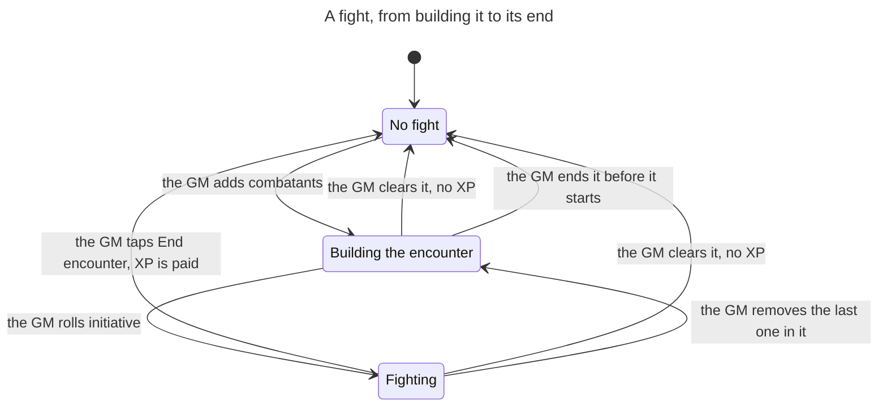

File `src/core/combat/encounter.ts`. Only `send()` in `src/views/combat.js` stores the result. Tests `tests/encounter.test.ts` and `tests/encounter-model.test.ts`.

#### A gate

A gate's status was written by hand in about seven places, including the Edit form, and "has this gate paid its XP" was guessed from the status. Three bugs came from that (rows 4 to 6 of the bug table below). Now every change goes through one table of what each event does in each status. A gate owes its roster's XP minus what it has paid, and nothing reads the status to decide a payment.

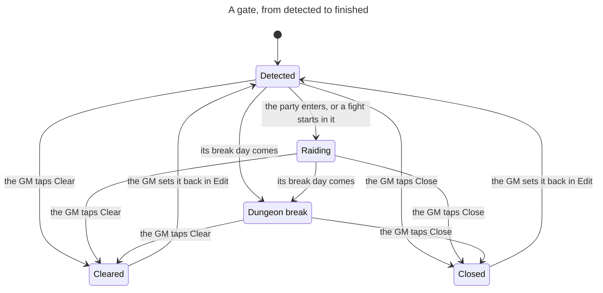

File `src/core/gates/gate.ts`. Only `transition` changes a gate. Test `tests/gate.test.ts`, which walks every event sequence up to length 4 from every status.

#### The room link

This is the phone's connection to a room. It lived in about 15 module-level variables in `sync.js`, and the pill's words came from a ternary over four of them. Create, join, rejoin and leave each reset a different set. A late reply for a room you had left and rejoined could be accepted. Now the link is one state, every request carries a generation number, and a reply from another generation changes nothing.

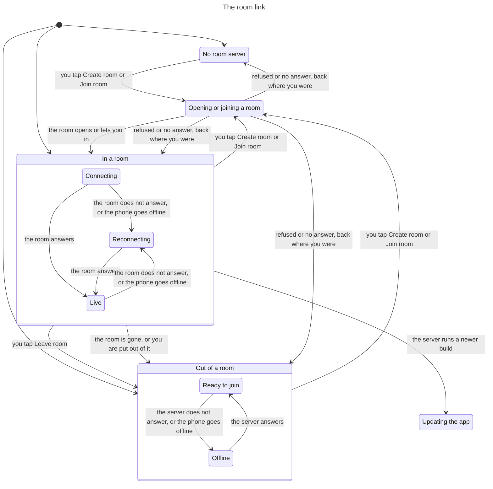

File `src/core/sync/link.ts`. Only `src/edge/sync.ts` holds the one current link. Tests `tests/link.test.ts`, `tests/link-findings.test.ts` and `tests/sync-model.test.ts`.

#### The sheet push

A player's phone sends its hunter to the room. Its retry flags (`pushing`, `pushAgain`, `pushFails`, `failKind`, `rejected`) were separate variables, and three places wrote one failing flag. Now it is a second machine that runs only while the link is live as a player.

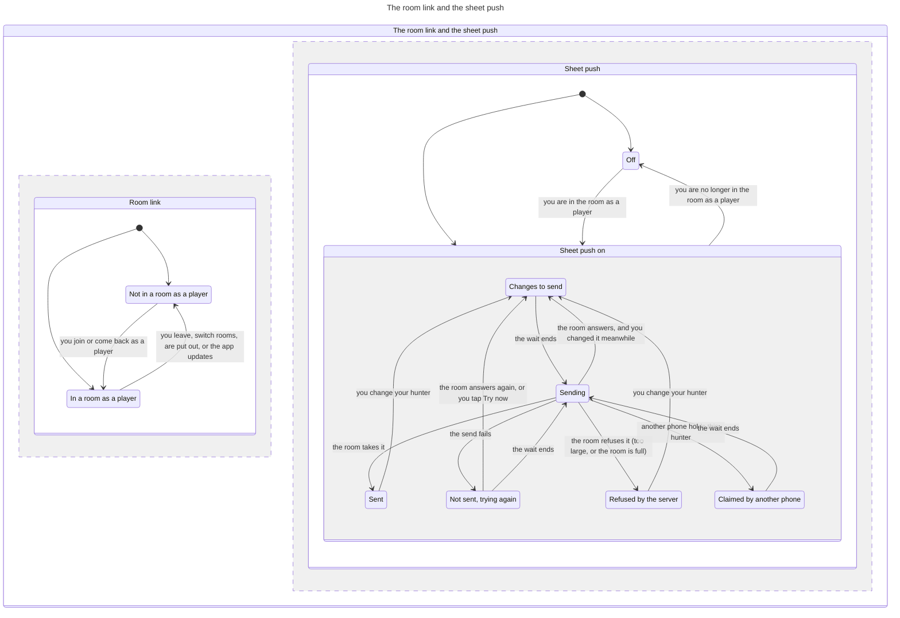

File `src/core/sync/push.ts`. Only `src/edge/sync.ts` holds the one current push. Tests `tests/push.test.ts` and `tests/sync-model.test.ts`. What the pill and the Room view show is one function, `connection(link, push)`.

#### A hunter's life

A hunter was "HP at 0", plus an Unconscious chip, plus a count of death saves. A function called `settle()` re-synced the three after every change. A hunter with three failed saves stood up on any heal. Now life is one state, and only the GM's Revive raises the dead.

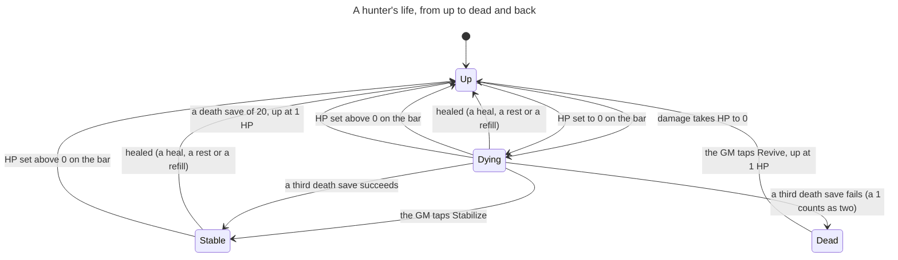

File `src/core/hunter/vitals.ts`. Only `lifeAfter` changes a life. Test `tests/vitals.test.ts`. Level, XP and ability points have their own small model in `src/core/hunter/progress.ts` (`tests/progress.test.ts`).

#### A missed daily's penalty

A missed daily was stored three ways, as a penalty record, a Penalized chip and an open Penalty Zone quest. Three hand writers kept them in step, and a cure, a combat card or a GM edit could leave them disagreeing. Now only the penalty record exists. The chip, the quest and the minus 2 on checks follow it, and the quest is tied to it by id.

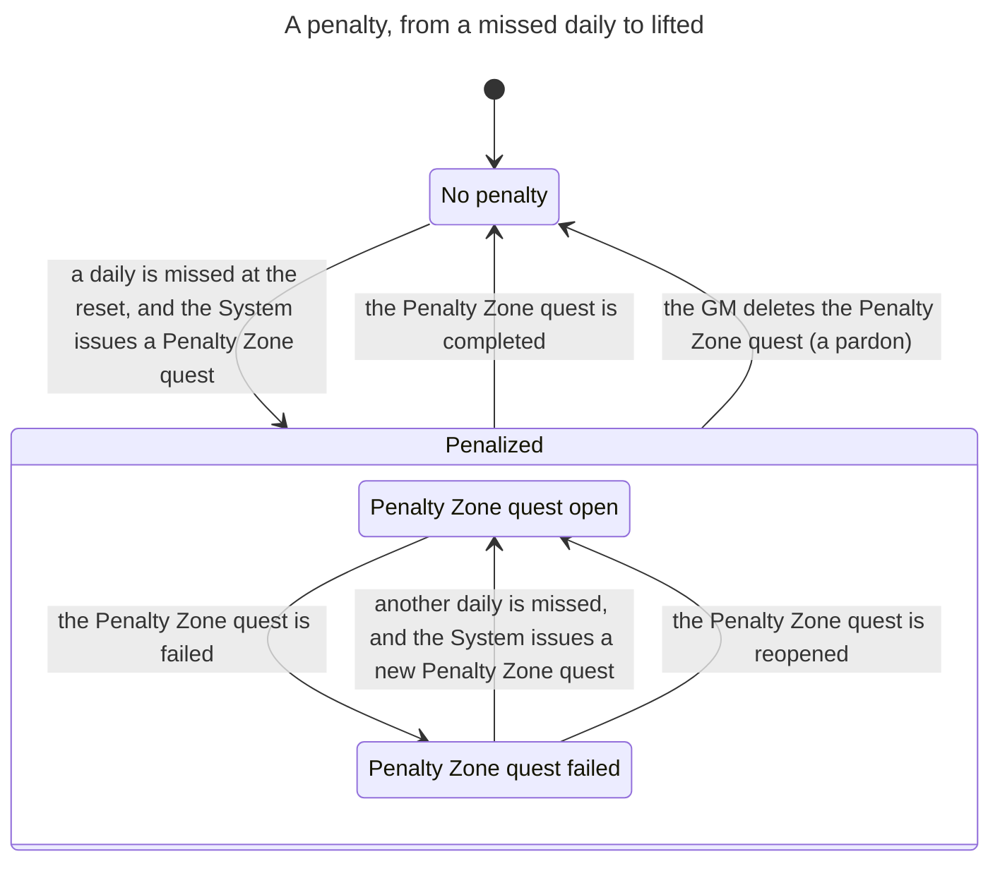

File `src/core/hunter/penalty.ts`. Only `penaltyAfter` changes a penalty, and `penaltyEvent` in `src/views/quests.js` assigns its answer. Test `tests/penalty.test.ts`.

#### A Job Change chain

The chain lived on three quest fields (`chainId`, `step`, `chainJob`). A `change` listener advanced it behind a `syncing` flag, and a failed step had no state at all. Now the chain is stored on the hunter with its step and its status, a failed one shows on the Quests tab, and only the GM reissues or abandons it.

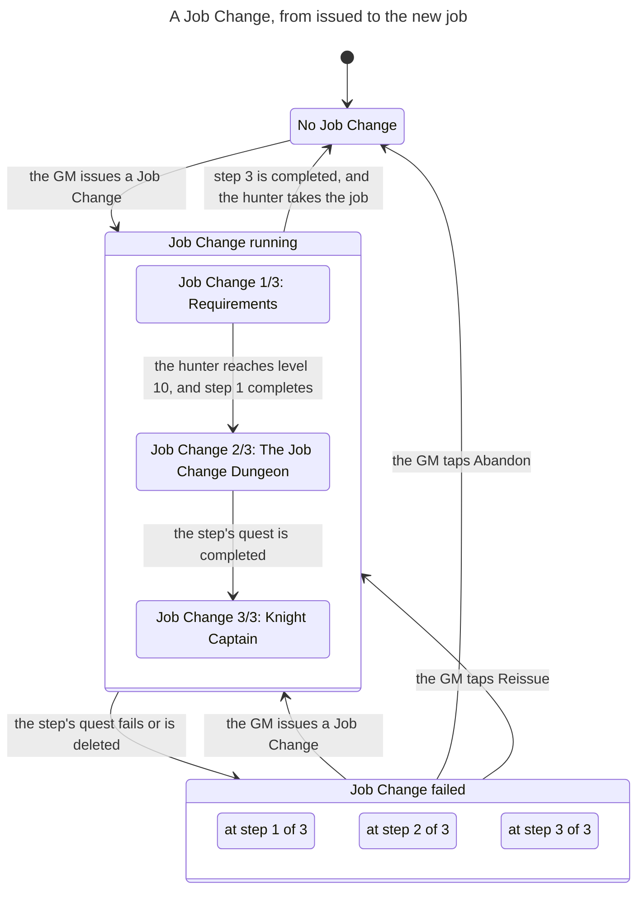

File `src/core/hunter/job-chain.ts`, with the jobs in `src/core/registry/jobs.ts`. Only `chainAfter` changes a chain, and `chainStep` in `src/views/quests.js` assigns its answer. Tests `tests/job-chain.test.ts` and `tests/jobs.test.ts`.

### What was removed

- The fight's turn index `e.turn` and the packed `e.begun`, with the hand patches for them. The fight names the current combatant by id and records the furthest point reached.
- `e.active` and the monster's `defeated` flag. A monster is up or defeated by its HP and one state.
- The copy of each hunter's statuses kept on the combatant (`mirrorConds`). The sheet is the only copy.
- `settle()` and its `change` listener. Eight places that guarded against removing Unconscious went with it.
- The three penalty stores. One penalty record remains.
- The quest fields `step` and `chainJob`, the `syncing` flag and the `change` listener that carried the job chain.
- The hunter's `points` counter. Points free are worked out from the levels held, the bonus points and the points spent.
- The stored `canExtract` flag on a hunter. A job's right to extract shadows is read from the rules.
- The 15 module-level variables of `sync.js` (658 lines of JavaScript), and `app.pendingRoom`, which five files wrote.
- The flags in four views (`gates.js`, `combat.js`, `custom.js`, `bestiary.js`) that each remembered what the room document last held. One publisher in `src/edge/sync.ts` replaces them.
- The Table feed's separate set of applied rolls. The mark is a field of the stored feed row.
- The rules global in core. Every core function takes the rules as its first argument, and `src/edge/rules.ts` binds the current rules for the views.
- `effects.js` as a place for rules. Its logic moved into `src/core/combat/status.ts` and the status table.
- 39 `app.api` members nothing used (the dependency map listed 41 unused; one was in use through a computed name the map could not follow, and one is kept for a browser test that needs it for speed) and 4 events nobody heard (`day`, `xp`, `quest:failed`, `daily:reset`).
- The `gate` room message, which nothing sent.
- Five different makers of an event id. `newEvent` in `src/core/protocol.ts` is the only one.
- The hand-written parsers of the world doc in `gates.js`, and three private copies of `oneOf`. The doc is parsed once where it enters, and `src/core/one-of.ts` holds the one `oneOf`.
- The Mode field in Settings. The role is worked out in one place (`roleOf`), and in a room it is the phone that holds the room's GM key.
- The `.github` workflow. CI is `bun run ci` on the dev box, run by a pre-push hook.
- The `starter.js` registration in `app.js`. It is a plain module that `onboard.js` imports.

### Bugs found and fixed

| The bug, in a GM's words | How it was found | State |
|---|---|---|
| A player farms ability points. Gain 500 XP, spend the 6 points, lose the XP, gain it again, and six more points appear. | Failing browser test, written at the start | Fixed. Points are derived from levels held. |
| A save that is valid but the wrong shape is thrown away without a word and a starter hunter appears. | Failing browser test | Fixed. The app shows a banner and keeps the old text in the backups. |
| On a phone the "Apply existing" list in the Status window has no height, so a built-in status cannot be tapped. Typing its name makes a second status. | Failing browser test | Fixed. A typed built-in name resolves to the built-in. |
| Clearing a gate with no hunters ticked, then ending the fight in it, loses the monster XP. | Suspected in the audit, reproduced as a failing test first | Fixed by the gate model. |
| A gate set back to detected and cleared again still says "Cleared on day 1". | Same | Fixed. |
| Setting a gate to cleared in the Edit form blocks the fight's XP award. | Same | Fixed. |
| A dead hunter stands up on any heal, rest or refill. | Inventory of the 15 HP writers | Fixed. Only the GM's Revive raises the dead. |
| A Penalized chip added by hand gives no minus 2 and cannot be removed. | Inventory of the penalty writers | Fixed. The chip cannot be added by hand. |
| A player escapes a penalty by deleting its Penalty Zone quest. | Left open by the penalty unit's notes | Fixed. Only the GM may delete it. |
| A replayed award paid twice (50 gold where 25 was due). | New browser test for applied ids | Fixed. Awards, quests, HP and status changes apply once per phone. |
| A player could post a roll or a quest update in another player's name. | The room protocol unit | Fixed. The server refuses it. |
| Going back a turn could land on a combatant whose turn never started after an initiative re-roll. | The fight's model test, before the reducer was wired in | Fixed, kept as a named test. |
| Revive on a monster at 0 HP left it up at 0 HP. | The fight's model test | Fixed. It is refused with "Heal it to bring it back". |
| A removed player is never told, and the sheet comes back later. The GM reloads before the server's answer reaches the GM's phone. | The room system model test | Fixed. The server writes the removal record in the same request that deletes the sheet. |
| The Hobgoblin's "+2d6" drew a "+2" attack button and the text "d6". | The monsters table test, then the screenshot comparison | Fixed in the ability reader. |
| The fight log said "is down" for a monster whose card said DEFEATED. | Screenshot comparison | Fixed. Both say "defeated". |
| The Status window opened scrolled down with a mouse pointer on a landscape phone. | Screenshot comparison, reproduced with a mouse | Fixed. The opening focus does not scroll. |
| A Job Change browser test failed once in a while. | The popup-delay switch (`E2E_POPUP_DELAY`) | Fixed. The test tapped before the app opened its next window. The switch found five more such gaps in other tests. |
| The Table feed forgot which rolls were applied after a reload, so the same roll could be applied twice. | The sweep for state kept by hand | Fixed. The mark is stored with the feed row. |
| A hunter changed from Necromancer to another job could still extract shadows, and a job the GM added to the extract list did not give it. | The same sweep | Fixed. The stored flag is gone and the job decides. |
| A Create or Join tap still running when the campaign was replaced said "Could not reach the server" and undid the wrong hunter. | The same sweep | Fixed. The link tells the tap the campaign was replaced. |
| A second tab stayed in a room after the first tab left it. | The same sweep | Fixed. A save from another tab that names another room or key moves the link. |
| A change sometimes took about 50 seconds to reach the other phone. | Browser runs | Not reproduced, and bounded. See the note below the table. |

The compiler's check of the views went from 572 errors to 0. It found four latent mistakes that no player could hit yet. A spawn weight keyed by something that is not a rank. Raw select values written to a gate. A wrong declaration of `effects.slug`. A view that read a finished fight's `round` and `list` without checking that the fight had not ended. Each is fixed.

The slow change (bug 2). On the old dev machine the whole box froze for minutes at a time, which the earlier investigation measured (`p3/stall-investigation.md`). On this machine it has not appeared in any CI run. The link and push model check proves that a changed sheet's next send attempt is never more than 60 seconds away.

### What keeps it this way

Every push runs `bun run ci`. A full run takes about 8 minutes and has four steps, the core typecheck, the typecheck of the views, the bun tests and the browser tests. The pre-push hook blocks the push if it fails or if the working tree is dirty.

- The first typecheck reads core, edge, the server and the tests in strict TypeScript. The second reads the views as JavaScript against the real signatures. Neither uses suppression comments.
- 18 lint tests in `tests/lint.test.ts` guard four kinds of thing. Layers, meaning core imports nothing from edge or views and touches no browser API. One writer per piece of state, such as the role, the fight, a gate, a hunter's progress, life, penalty and job chain, and the room fields of the save. One maker per message, a room event and its id. No hidden state, meaning no module-level `let` in core and only the named machines in `sync.ts`. A few single-purpose rules sit beside these, such as one `oneOf` and no `AbortSignal.timeout`.
- The fight's model test plays 2,500 random fights of up to 40 commands and checks the rules after every command (`tests/encounter-model.test.ts`).
- The link and push model check walks every reachable pair of states from four boots, 12,716 states and 304,484 steps, and checks the rules at each (`tests/sync-model.test.ts`).
- The room as a whole is tested with two or three phones and the real server handler. It runs 2,000 random walks and every three-move sequence from a live room, 4,247 of them, with replies lost, repeated or late (`tests/room-system-model.test.ts`, about 13 seconds).
- The dependency map `docs/dependency-map.md` lists, for 67 modules, what each imports and which `app.api` members and events it provides and uses. `tests/deps.test.ts` fails when it is stale, when a member nobody uses exists, and when an event has no emitter or no listener.
- The state charts above, with `tests/statecharts.test.ts`.
- Every content table has a test that every entry must pass. The tables are statuses, jobs, items, monsters, paths and perks, gate spawn weights and the rule numbers. A new entry needs no new test.
- The browser suite runs at phone sizes. `E2E_POPUP_DELAY=100` opens every window 100 ms late, and a test that taps past a window it did not wait for fails. A blocked tap fails in 15 seconds and names the window in its way.

### How to add things

Each recipe is in `AGENTS.md` with its steps. Where it says the typecheck or a table's test fails until a step is done, it does fail.

| To add | Open first |
|---|---|
| A status | `src/core/registry/statuses.ts` |
| An item | `src/core/registry/items.ts` |
| A monster | `src/core/registry/monsters.ts` |
| A job | `src/core/registry/jobs.ts` |
| A path or perk | `src/core/registry/paths.ts` |
| A rule number | `src/core/rules.ts` |
| A gate status or event | `src/core/gates/gate.ts` |
| A combat command | `src/core/combat/encounter-types.ts` |
| A room message | `src/core/protocol.ts` |
| A link state | `src/core/sync/link.ts` |
| An event | `src/core/events.ts` |
| An API member | `src/core/api.ts` |
| A view or panel | `src/app.js`, with the types in `src/views/app.ts` |
| A saved field | `src/core/save.ts` |

### What a table will notice

Fight.
- A monster put down by hand stays down when healed. Revive brings it back.
- Revive at 0 HP is refused with "Heal it to bring it back".
- Rolling initiative with nobody up is refused.
- Applying a status again no longer shortens it. The stronger source wins and the longer duration stays.
- A few log lines read differently, and none says "falls Unconscious" any more.

Gates.
- A second fight in a gate that has already paid its full XP pays nothing.

Room.
- A failing room is retried after 5, 10, 20 and then 30 seconds, not every 5 seconds forever.
- A GM key the server refuses ends the join with a message. It no longer joins the phone as a player.
- A sheet the server refused reads "not sent", not "reconnecting".
- A GM whose key stops working is told and leaves the room.
- Every new room code contains a digit, and "thanks buddy" is no longer read as the code THANKS.
- Each deploy reloads open phones once.

Hunter.
- Dead is real. Only the GM revives, from the sheet, the GM board or another phone's hunter.
- Exhausted ends only with a long rest.
- Unconscious, Exhausted and Penalized cannot be set or removed by hand.
- Regaining a lost level pays no points and gives no refill.
- A player cannot delete their penalty quest.
- A hunter has one Job Change at a time, and a failed one is visible and can be reissued.

Saves.
- A fight stored in an old save is dropped on load.
- Old `points` become bonus points with the same total free.
- A save of the wrong shape shows a banner and is kept in the backups.

### Numbers

| | Before phase 3 | Now |
|---|---|---|
| Bun tests | 0 | 1,285 in 34 files |
| Browser tests | 0 | 100 in 12 files, none skipped |
| Commits | | 278 since the end of milestone 2 |
| `combat.js` | 1,035 lines | 889 lines |
| Room link code | `sync.js`, 658 lines of JavaScript | `src/edge/sync.ts` 765 lines, `room-pill.ts` 68 and `forget-queue.ts` 43, on top of the pure machines in `src/core/sync/` |
| `AGENTS.md` | | 123 lines (195 before the sweep cut it) |
| Lint tests | | 18 |
| Full CI run | | about 8 minutes |

### Open, and why

- The fight tracker ignores a remote hunter's pushed sheet for 12 seconds after the GM changes it (`SENT_GRACE` in `combat.js`). A phone slower than that can undo the GM's change on the board until its next push. The fix has the sheet carry the ids of the GM events the phone applied. It changes the room wire format and the room model, so it was not started. The design is in `p3/notes-registries-sweep.md`.
- The room document publisher has browser tests but no unit test. The GM's side of `sync.ts` is not in the room model.
- `custom.js` still keeps one flag, `wasRoom` (with `wasGM`). A player who follows the old room's build switches gets the defaults back.
- Deferred sync finding 8 is half fixed. The phone remembers one room, not a list.
- Deferred sync finding 12 was left as it is on purpose. After a skipped onboarding, the app opens the Room view on the invite card, which has "Not this room".
- Deferred sync finding 14. The Postgres room store has never run under a test, and the deployed server uses it. It needs a real Postgres, or a plain word to the owner before launch. Tracked in `p3/notes-link.md` and `decisions.tsv`.
- Shipped content to read. All ten shop items and the Mana Crystal Shard are priced by hand, not by the formula (the shard costs 40 gold where the formula gives 100). Two different items are called Mana Potion (20 MP in the shop, 10 MP in the starter gear). The Giant Centipede's "Penalty Zone resident" ability has no name part, so its card shows plain text. A gate whose roster is worth 0 XP pays nothing for monsters the GM adds by hand.
- The screenshot comparison could not capture three states, a downed (Dying or Dead) hunter, the Penalized chip and the pill in a live room. The phone test covers them. Report in `p3/shots-report.md`.
- The views are still JavaScript. They are checked for names and signatures, not for nulls.

## 11. Status scaling (phase 4)

### In short

- A status now gets stronger with whoever or whatever applies it. A D-rank monster's Burning is 2d6 a turn and an S-rank monster's is 7d12. Before, it was 1d6 for everyone.
- The strength comes from the source's rank (E to S) or from an item's rarity (common to mythic). The target's rank never matters.
- Every damage, check, attack and AC number among the built-ins grows. Paralyzed, Stunned, Invisible and Stealth have no numbers and did not change.
- At rank E nothing changed except Blinded (-4 attack, was -2) and Bloodlust (it now also takes 1 off each hit). A first session plays as it did.
- The status cards, item cards and chips show the number for the rank that applied them.

### Before and after

Before, each number was flat at every rank. After is the value at the source's rank. Check, attack and AC numbers follow the rank bonus (E +2, D +3, C +4, B +5, A +6, S +8). The D, B and A values are in `src/core/registry/statuses.ts`.

| Status and effect | Before, all ranks | E | C | S |
|---|---|---|---|---|
| Burning, damage a turn | 1d6 | 1d6 | 3d8 | 7d12 |
| Bleeding, damage a turn | 1d4 | 1d4 | 2d6 | 4d8 |
| Poisoned, damage a turn | 1d4 | 1d4 | 1d6 | 1d12 |
| Poisoned, checks | -2 | -2 | -4 | -8 |
| Frightened, checks | -2 | -2 | -4 | -8 |
| Bloodlust, checks | -2 | -2 | -4 | -8 |
| Bloodlust, damage dealt | none | -1 | -5 | -19 |
| Blinded, attacks | -2 | -4 | -8 | -16 |
| Restrained, attacks | -2 | -2 | -4 | -8 |
| Slowed, AC | -2 | -2 | -4 | -8 |
| Prone, AC | -2 | -2 | -4 | -8 |
| Hasted, AC | +2 | +2 | +4 | +8 |

### Why each curve

The yardstick is a same-rank hit. A hunter's hit averages 5.5, 14.5, 27.5, 44.5, 63 and 84 from E to S. A monster's averages 6.5, 14, 26.5, 44, 69 and 102. The two stay close at every rank, so one yardstick measures a status in both directions.

- Burning is the signature damage status. A tick averages about half a hit at every rank (0.48 to 0.64 of a hit).
- Bleeding is a chip. From D up a tick is about a fifth of a hit.
- Poisoned barely scales as damage, one die that grows a size a rank from C. Its weight is the check penalty.
- Poisoned, Frightened, Restrained, Slowed, Prone and Hasted use the rank bonus of the source. A status moves a roll by what a rank is worth.
- Bloodlust is the stronger fear. Its damage penalty is about a fifth of a same-rank hit, and it is the one penalty that still bites from C up, where to-hit no longer does.
- Blinded is twice the rank bonus, the strong accuracy penalty.
- The numbers are written as six values per effect in `src/core/registry/statuses.ts`, not as a formula. A card can print what the table holds.

### Who decides the strength

| Where the status comes from | Tier it gets |
|---|---|
| A monster's ability chip | the monster's rank |
| A shadow's ability chip | the shadow's rank |
| The GM adds a status in a fight | whoever's turn it is |
| The GM adds a status with nobody acting, or from the GM board | the target's own rank (a "GM" source) |
| A hunter adds a status on their own sheet | the hunter's own sheet rank |
| An item with a status, used by a hunter | the item's rarity, common E to mythic S |

- The source now travels with the status to a player's phone. Before, the phone dropped it and read every status as E.
- A phone applies a received status by the same stacking rule as the GM. The stronger source wins, the longer duration stays, and a weaker or shorter one no longer replaces it.
- A hunter's tier is the rank on the sheet, which moves only on re-evaluation. A level 50 hunter who was never re-evaluated still applies at the old rank. A monster typed with no rank is E.
- A GM override with a flat number is flat at every rank. A forged status that has one flat number stays that number.

### The simulation

`tests/status-sim.test.ts` plays three hunters against one monster through the real fight reducer. It plays 400 seeded fights per row. On a hunter's turn, the attackers swing with the audit's attack and damage for that rank. The status party spends the whole turn applying one status, which always lands, for 3 rounds. The ticks are rolled as the app rolls them. The monster does not attack, since nothing here reacts to a hunter's HP. The score is the round in which the monster falls. Builds are the typical Vanguard at each rank from `p4/status-audit.md`.

Mean rounds to kill, with the ratio to the attackers (below 1 means faster):

| Target | Attackers | Three statuses | Burning only |
|---|---|---|---|
| E boss (60 HP) | 8.70 | 5.91, x0.68 | 6.81, x0.78 |
| E normal (20 HP) | 2.86 | 2.67, x0.93 | 2.54, x0.89 |
| C boss (450 HP) | 6.20 | 6.81, x1.10 | 6.08, x0.98 |
| C normal (150 HP) | 2.25 | 2.96, x1.32 | 2.48, x1.10 |
| S boss (6,000 HP) | 25.57 | 27.09, x1.06 | 23.98, x0.94 |
| S normal (2,000 HP) | 8.80 | 9.63, x1.09 | 8.48, x0.96 |

The bounds were first written by boss or normal. They are now written by how long the attackers need, because the design always meant that. On a target the attackers need 4 rounds or more for, each status party must be within 0.8 to 1.25 of the attackers' rounds. On a target they kill in under 3 rounds, no status party may be faster. The first run showed why. An S normal monster takes the attackers 8.8 rounds, so it is a long fight, and Burning rightly wins there. The test checks C and S against these bounds, and all pass. E is printed with no bound.

- On a long target from C up, a status party keeps pace with the attackers, within 0.94 to 1.10.
- On a short target, attackers win. C normal takes the status party 1.32 times as long.
- E favours statuses (x0.68 to x0.93). A rank E hunter hits AC 13 only about half the time (55%), so a status that is sure to tick beats a swing. These are the old E numbers, kept on purpose.

One instance per key per target also caps the archetype. A second status hunter with the same statuses adds nothing.

### Things the owner can choose

- Lower the E dice, for example Burning to 1d4. It is a one-value edit per effect in `statuses.ts`, and the tests that name the E numbers change with it. It changes what a first session plays like.
- Have a status apply only on a hit. The simulation lets a status always land, so an ability that deals damage and applies a status would be worth more than these numbers say. The customization phase can add it.
- A percent-of-health status. The quantity `3%` exists for damage and heal ops and for custom statuses and items, but no built-in uses it. Monster HP grows 100 times from E to S (20 to 2,000) while a hit grows 15 times (5.5 to 84). So 3% is 1 HP on an E normal monster (a hit is 5.5), 60 on an S normal (0.7 of a hit) and 180 on an S boss (2.1 hits). It would need a floor and a cap. That is two more numbers at the table.
- A rank picker when the GM applies a status by hand. It takes a few lines, since the GM board and the fight already send a source. Today it takes the target's rank.
- Enforce "cannot act" and disadvantage. They are text on the card today. Five descriptions promise disadvantage, and the code applies a plain penalty instead.
- To-hit is decided by the build from C up. A hunter's hit chance is at the 95% cap against a same-rank monster, so a bigger penalty to a roll matters less there. A to-damage penalty (Bloodlust) and ticks matter more.

### What a table will notice

- Blinded is -4 to attacks at E (was -2).
- Bloodlust takes 1 off each hit at E. It had no damage effect before.
- A weak monster's status is mild and a strong one's hurts. An A-rank Burning is 5d12 a turn.
- The status chips and cards say the number: "Applies Burning (3 rounds): 3d8 damage at turn start". A status's card in the rules reference shows all six values, E to S.
- A monster's Apply chip shows the numbers at its rank, "(4d10 damage at turn start)" for a B-rank monster.
- A rarer item's status is stronger than a common one's. A mythic Poisoned is -8 to checks and 1d12.
- A stronger Burning replaces a weaker one on a hunter, on the GM's phone and on the player's phone alike.
- The GM's fight card follows a player's sheet at once. Before, it held the GM's change for 12 seconds. The sheet now says how far it has applied the room's events, and the card follows a sheet that holds the GM's last change. That closes the old open item in section 10.
- Slowed and Hasted say "-2 AC" and "+2 AC" on their short description, which is now the E number.

### Left open

- The status descriptions for Slowed and Hasted still name the E number. A copy change.
- An item written with per-rank numbers is not resolved at the item's rarity. Neither forge writes one.
- A percent damage item has no target on the user's phone. It shows "Deal 3% of the target's max HP" and sends no roll.
- Items, forged statuses and forge copies made before this phase keep their E numbers.
- A hunter's tier lags until re-evaluation, and a monster with no rank is E.
- The simulation does not model monsters that hit back, saves, or a status that applies with damage.
- If a GM reloads mid-fight, a card may show the old number until the player's next push.

### Numbers

| | Before | Now |
|---|---|---|
| Bun tests | 1,285 | 1,378 |
| Browser tests | 100 | 106 |

## 12. Customization

### In short

- A GM can now make a status, an item, a skill, an enemy and a reward from a phone. Each one is checked by the same parser a built-in goes through, so it works in a fight, on a sheet, in a room, in a save and in a shared code.
- A skill or an item can hurt, heal or put a status on a target, and a custom enemy can carry skills, start a fight with statuses and drop loot.
- A reward can hold a title with its bonus, a skill, a status and a boon, which is a text reward the player redeems from their sheet. A GM can save a reward as a bundle and give it again.
- The GM is told when a player uses a boon, or an item marked "Tell me when it is used". The line appears in the Table feed, as a toast and in the session log, and "Reward uses" on the GM view counts the new ones. A GM who allows notifications also gets a notification while the page is hidden.

### Before and after

"Before" is `cz/inventory.md`, read from the code at 2eb5db5. Its tap counts were read, not run. "Now" taps count from the home screen on a 390 px phone, and the test named in the last column counts them. Typing is not a tap, and picking from a list is one.

| Kind | Before | Now | Taps from home to a saved one |
|---|---|---|---|
| Status | Flat numbers only, no preview, a built-in could not be edited. 5 taps | By rank (six values, E to S), percent of max HP, a live preview, an edit for a built-in with Reset, a strength asked when put on by hand | 8 for damage by rank. `makers.e2e.ts`, "a GM makes Frostbite with damage by rank in 8 taps" (the test allows 9). A flat one is 6 (not tested) |
| Item | A form with no bonus fields, flat numbers, a damage effect that only wrote a line, a by-rank value that rolled 0. 5 taps | Type, rarity, slot, the nine bonus fields, effects flat or by rarity, "Affects: The user or A target", "Tell me when it is used", a preview | 9 for a consumable with damage and a status on a target. `makers.e2e.ts`, "a GM makes the consumable Bottled Storm in 9 taps" |
| Skill | A form on the active hunter only. A use spent MP and rolled dice and did nothing else. 4 taps | Effects, a target, "Rolls to hit", a library, a preview, and "Give to" a hunter on this phone or a player in the room | 13 from the Skills panel. `makers.e2e.ts`, "a GM makes Frost Lance in at most 13 taps" |
| Enemy | Text abilities, no statuses, no loot. 5 taps | Skills, "Starts with" statuses, loot (gold and items), numbers that follow the rank table until typed | 10. `makers.e2e.ts`, "a GM makes the monster Ice Warden in at most 10 taps" |
| Reward | XP, gold, points, a title by name, one item. No status, no text reward. 5 taps | A reward editor with a row per part: items, a title with its bonus, skills, statuses, boons, a job | Not measured. `reward-room.e2e.ts` builds one in the Award form without counting taps |
| Reward bundle | None | Save the editor as a named bundle, edit, duplicate, delete and award it from the Workshop | 5 to send a saved one again (More, Workshop, Award…, the player, Send award). `reward-room.e2e.ts`, "sends it again from the Workshop in 5 taps". Saving one: not measured |
| Quest | A form with its own reward fields | Same form, its reward fields are now the reward editor | Not measured |
| Gate | Spawn and Edit, no reward of its own | Unchanged | Not measured |
| Job | Built-in jobs only. A Job Change chain could not be given to a player's phone | Unchanged list of jobs. The GM can now issue, reissue or abandon a chain on a player's phone | Not measured |
| Path or perk | JSON in the Rules editor | Unchanged | Not measured |
| Rule number | JSON in the Rules editor, not checked at load | Unchanged screen. A damaged or unknown override is now dropped at load | Not measured |

The Workshop is under More, so a status or an item costs one tap more than it did when the maker was reached from the GM tab (`cz/notes-4a-makers.md` counted 7 and 8, `notes-4b` 8 and 9).

### One rule for custom content

A custom entry is data of the same type as a built-in, read by the kind's one parser, kept in one place in the save, and found through the same lookup as a built-in.

| Kind | Type | The one parser (core) | Home in the save | Lookup |
|---|---|---|---|---|
| Status | `StatusDef` | `sanitizeDef` | `library.statuses` (a built-in key is an override) | `statusDef` through `rulesOf(...).conditions` |
| Item | `Item` | `parseItem` | `library.items` | copied by value |
| Skill | `Skill` | `parseSkill` | `library.skills`; built-ins in `registry/skills.ts` | copied by value onto a hunter or a monster |
| Enemy | `Monster` | `parseMonster` | `monsters[]` | `bestiary.get` |
| Reward bundle | `RewardBundle` | `parseRewards` inside `parseBundle` | `library.rewards` | by id |
| Rule number | `rulesOverrides` | `parseOverrides` | `rulesOverrides` | `rulesOf` |

It matters because a new field is one line in one parser, and it then works in saves, in room messages, in the pack a GM shares and in the screens. Before the phase an item had four readers and a status in the rules had none at load. `cz/notes-1-homes.md` lists the seven readers deleted. Two lint rules in `tests/lint.test.ts` keep it that way: only `parseItem` builds an item from outside data and only `parseMonster` a monster, and no screen reads statuses from the rule overrides.

### Abilities that act

One fight command, `use`, carries a rolled list of outcomes (damage, heal, MP, fatigue, a status, a cure, a note). The reducer applies them through the same single commands the buttons use, writes one log line, and applies a use whole or not at all. Tests: `tests/use.test.ts`, `tests/encounter.test.ts`, and `custom-skills.e2e.ts`.

| Who uses it | What happens |
|---|---|
| A hunter on the GM's phone, in a fight | A skill or an item with a target asks "Use NAME on…", pays MP, rolls to hit against the target's AC when "Rolls to hit" is on, then applies the damage, heal or status to the target. A miss is a log note and nothing is sent. A double tap uses it once (`custom-skills.e2e.ts`) |
| A player in a room | The player's phone applies what is on the player and reports a use on another to the GM. The GM's Table feed row has "Apply to…", which opens the fight's combatants and sends `use` (`used.e2e.ts`, the bomb test). If the player is not in the fight, the feed says so |
| An enemy | Each skill of an up monster is a button on its card, after its text abilities. It asks the target, rolls to hit with the monster's attack bonus, and acts at the monster's rank. A monster's starting statuses are on it when the fight is rolled (`custom-skills.e2e.ts`) |
| Outside a fight | A skill or item on the user applies at once. One on a target shows its outcomes in a toast, "On the target: 5 damage.", and the GM rules on it |

Still the GM's call: a save DC, anything written as a note, whether a crit doubles a skill's dice (it does not), a monster's cooldown (text), and an item or skill used on a target out of a fight. There is no formula or script language by design.

### When a player uses a reward

1. The GM gives something. A boon comes from the reward editor. For an item, the GM ticks "Tell me when it is used" in the item maker or on the item's row in the editor.
2. The player uses it. A boon is a Redeem button in the Titles panel with a confirm. An item is its Use button.
3. The player's phone sends a `used` message with who, what, the words and the outcomes.
4. On the GM's phone one line is written to the session log (kind "use"), a toast shows it, the Table feed gets a row, and "Reward uses" at the top of the GM view counts it. One tap on that button opens the log at "use" and marks them seen.
5. If the GM allowed notifications (a button next to "Reward uses") and the page is hidden, the phone also shows a notification with the same words. A tap on it focuses the app (no test taps one).

Why "tell me" is off for ordinary loot: a potion every fight would be noise, so the GM turns it on per item when giving it. A boon always tells, because a boon is the point of giving one. Making the item maker or the reward editor start with the box ticked is a one-line change.

Each use is told once. The GM's phone writes the line through `sync.once`, which puts the event id in the applied ring and writes the line in the same store update. A second copy of the id does nothing. The model test `tests/room-system-model.test.ts` plays every ordering of two phones, a repeated post and a reload, and checks no told use is in the log twice and every one is there once. The helper broke the guard by hand and that test failed (`cz/notes-3-rewards.md`, step 7). `used.e2e.ts` and `reward-room.e2e.ts` repeat it in the browser: the GM's cursor is set back to 0, the page reloads, and the log has the same lines.

The limits, plainly:

- A phone with its screen locked gets nothing until it is opened. The feed and the log then catch up.
- A hidden page checks the room every 30 seconds. Browsers may slow that further, to about one a minute. 30 is the design's number, not a measurement.
- Real push would need a push service and keys. It was not built.
- A GM who has not allowed notifications still gets the toast, the feed row and the log line. `used.e2e.ts` checks that no notification is asked for without permission.

### Sharing

A GM shares custom content as a pack: everything, one kind, or one entry. It goes out as a file (`hunter-library-DATE.json`) or as a code to copy, from the Data view's "Share custom content" or from "Share" on a Workshop row. An entry travels with the statuses it names. The other phone reads a file, or pastes a code under Data, and sees a line per kind before anything changes. Then it takes a backup and merges with one of two buttons.

- Add keeps both. A name or key already taken is renamed with " 2" ("Poisoned 2").
- Replace overwrites the entry with the same name or key.

A code is `HS1.` and the content compressed, with a check number at the end, so one changed character is refused rather than read as other content. The code for one of each kind is 821 characters, one item with its status 368 (`cz/notes-5-sharing.md`). Tests: `tests/pack.test.ts`, `tests/pack-code.test.ts`, `sharing.e2e.ts` (a code copied and pasted on a second phone, Add twice, Replace, a damaged code, a file, and a campaign file that offers its custom content). A pack holds 200 of a kind at most.

### What a table will notice

- A built-in status can be edited in the Workshop and reset. Reset rules no longer undoes that change. (unit 1)
- A damaged or unknown rule override in a save is dropped at load. (unit 1)
- An item with no name in a save is dropped at load. (unit 1)
- An item stack can hold 9999, and a room award carries that, where it was cut at 999. (unit 1)
- A room award item with one bad field arrives with the default for it, where it used to be dropped. (unit 1)
- An item's `atk` bonus is dropped. Nothing counted it. (unit 1)
- A potion or ring with a by-rarity value now heals or adds AC by its rarity. Before, the potion healed 0 and the ring added a NaN. A worn check modifier now counts. (unit 1)
- The Rules editor's refusal reads "p: must be a number." where it read "p must be a number." (unit 1)
- Dagger Rush and Mutilation deal their damage to a target in a fight, and Stealth puts Stealth on the hunter. Other seeds still do nothing in a fight. (unit 2)
- A skill's description is cut at 500 and a passive skill's bonus at 999. A skill's cooldown left is at most its cooldown. (unit 2)
- A skill that needs a target asks for it before MP is paid, and the target list includes allies. (unit 2)
- A use with one refused step is refused whole. (unit 2)
- A skill with a target and an item with a target stop acting on the user from the Use button: the player's phone reports the use to the GM. (unit 3)
- A GM's table feed shows "Mira used Item: Flash Bomb" with what it did on a second line. It replaces the old guessed roll row. A roll message no longer has a kind. (unit 3, 4c)
- An item that targets its user and has a damage effect sends no feed row. No built-in has one. (unit 3)
- A reward can give a title with its bonus, a skill, a status and a boon. An old quest's title by name becomes a title with the bonus the save's rules give it. (unit 3)
- A reward amount that is not a number reads as 0 where the room used to refuse it. (unit 3)
- A hunter holds at most 50 boons. The oldest go first. (unit 3)
- The GM can send, reissue or abandon a Job Change chain on a player's phone, and a failed chain shows in the Party quests with Reissue and Abandon. (unit 3)
- A GM's hidden page polls every 30 seconds once notifications are allowed. (unit 3)
- Applying an existing status is two taps: pick it to see what it does, then Apply. It was one. (unit 4a)
- A status put on by hand asks its strength (E to S), and a combat card lists what each status does at its source's rank. (unit 4a)
- The Status dialog's quick chips add a row where they toggled. (unit 4a)
- The Loot Forge and the inventory's item form are one item maker. A held item's Edit replaces the item's fields where it merged them. "Forge an item" is "New item". (unit 4a)
- Every bonus field has one set of labels and is empty for 0. (unit 4a)
- A skill has no grade. (unit 4b)
- The Skills panel's inline form is a maker, and the GM's Add skill starts with the active hunter pressed under "Give to". (unit 4b)
- The GM view's Status library and Item library panels are in the Workshop, under More. A built-in status that is unchanged sits in a fold. (unit 4b)
- The enemy maker replaces the bestiary's inline editor. A number follows the rank table until the GM types over it. (unit 4b)
- The end of a fight lists what the defeated enemies dropped. "Award loot…" opens the Award form holding it. Nothing is given on its own. (unit 4b)
- Editing a library skill, item or status does not change copies a hunter or monster already holds. (unit 4b)
- The Award form and the quest form share the reward editor. The quest form's item lines in the form "Name | rarity | qty" are gone. A quest now shows and edits its skills, statuses and boons. (unit 4c)
- The Award form's bundle select and "Delete bundle" are gone. Delete is in the Workshop. (unit 4c)
- "Reward uses" with a count is at the top of the GM view, and the notify button is beside it. (unit 4c)
- A GM can take a boon back from a hunter on the GM's own phone with the x. Nothing is reported. (unit 4c)
- An item marked "Tell me when it is used" keeps its own stack, so it does not merge with an unmarked copy. (unit 4c)
- A quest's end is written to the log once per event id. A progress tick can still be written twice on a replay. (unit 4c)
- The Data view reads a library file or a pasted code, previews it, takes a backup named `pre-import` and merges with Add or Replace. Adding hunters from a campaign file then offers its custom content. (unit 5)
- Add renames a status when its label matches one the library or the built-ins have, ignoring case. A pack's changed built-in arrives under Add as a copy, and under Replace as the change. (unit 5)

### Things the owner can choose

| Decided for him | What to say to change it |
|---|---|
| "Tell me when it is used" is off by default for an item, in the item maker and the reward editor. A boon always tells | "Start the box ticked", or "tell me about every potion". Each is one line |
| Applying an existing status is two taps, preview then Apply | "Apply on the first tap" brings back one tap and loses the preview |
| A player's phone reports a use on another target and the GM applies it with "Apply to…". The player's phone does not hurt an enemy itself | "Let the player's phone apply it", which needs the player to know the fight |
| No makers for jobs, paths or rule numbers. The Rules editor's JSON stays, now checked at load | "Make a path maker" or "a form for the rule numbers". Each is a unit of its own |
| No save DCs, no formulas, no scripts. A note is the way out | "Let a skill name a save" adds a stat, a DC and an outcome on a pass |
| The Workshop is under More, so a status or an item is one tap more than from the GM tab | "Put the Workshop on the GM tab" or "in the bottom bar" |
| A status's quick chips and Add effect have no control for when an op fires; an op keeps the time it came with | "Let me pick when" |
| Legacy heal, MP and fatigue on an item stay three fields beside the effects list. Folding them in is a clean follow-up (`cz/notes-4a-makers.md`) | "Make heal an effect row" |
| Editing a library entry does not change copies already given | "Update the copies" needs a link from a copy to its library entry |
| A code is not secret and not signed. Anyone with it can read and import it | "Sign my codes" is a larger job |
| What the helpers were unsure of is under "Open items" | Pick one by its first words |

### Numbers

| | Before the phase | Now |
|---|---|---|
| Bun tests | 1,378 | 1,657 |
| Browser tests | 106 | 148 |
| Browser run time | 8.4 min | 12.3 min |

The baseline is the trail row "baseline before any change" (`ci-0.log`). "Now" is the push-8 row, the full CI on the commit that holds unit 5.

| Unit | What | Helper time (trail) |
|---|---|---|
| Inventory | `cz/inventory.md`, read only | 13 min |
| 1 | One home and one parser per kind | 42 min |
| 2 | Skills that act, `use`, enemies with skills | 35 min |
| 3 | Rewards, boons, bundles, `used`, notifications | 55 min |
| 4a | The shared maker, status and item makers | 50 min |
| 4b | Skill and enemy makers, the Workshop, loot | 55 min |
| 4c | Reward editor, boons on screen, Reward uses | 50 min |
| 5 | Sharing | 45 min |
| 6 | This report and its screenshots | not timed |

The seven building units add to 332 minutes. The only box pause the notes record is in unit 4c: one Frost Lance test took 22 s against its usual 8 s and passed on a rerun (`cz/notes-4c-rewards-ui.md`, step 6).

### Open items

From the helpers' "Unsure" lists:

- A replayed quest progress tick can write its "Quest progress" line twice. Ends are once-only.
- The applied ring holds 200 ids. A GM who gets more than 200 told uses between a replay's two copies would log one twice. Replays come seconds apart.
- The reward window says "Item acquired: X" and the quest card says "Item: X". The copy pass can make them one.
- The quest form is a form, so Enter in one of the editor's text fields submits the quest.
- The Award form's Send award is not a sticky bar. On a phone with a long reward the GM scrolls to it.
- The item maker's by-rarity values read ", by rank E to S" in the preview and the Workshop.
- Outside a fight a percent of an unseen target's max HP is shown in words.
- A GM's hidden page polls on the first 5 second timer after it hides, then every 30 seconds.
- An imported campaign's very old `rulesOverrides.conditions` are not brought by "Add hunters".
- Add by name is case sensitive for items, skills, bundles and enemies. Statuses compare labels without case.
- More than 20 different items dropped in one fight show in the window, but an award carries 20.
- The Ice Warden test defeats the monster through setup, not by tapping damage.

From the screenshots (`cz/notes-6-report.md`), for the UI run:

- Stale toasts ("saved", "used") sit over the top of a screen for long enough to be in a shot.
- The enemy maker's remove "x" on a starting status wraps to its own line.
- In the session log the title and the text of a use run together ("...free reroll Reroll one die").
- The share code box shows six lines of the code and cuts the seventh.
- Send award sits under the bottom bar until the GM scrolls.
- The by-rank boxes are about 50 px wide at 390 px.
- No control height was measured in the shots. `makers.e2e.ts` checks every control in the reward editor is at least 44 px.

### Screenshots

The same nine images with a short summary are on a page a phone opens in one tap: https://claude.ai/artifact/E3SUHTnnmEErLp73VXiWXH (private to the owner).

Taken at 390 by 844 with `scripts/maker-shots.ts` against a fresh starter campaign: a GM and a player in one room.

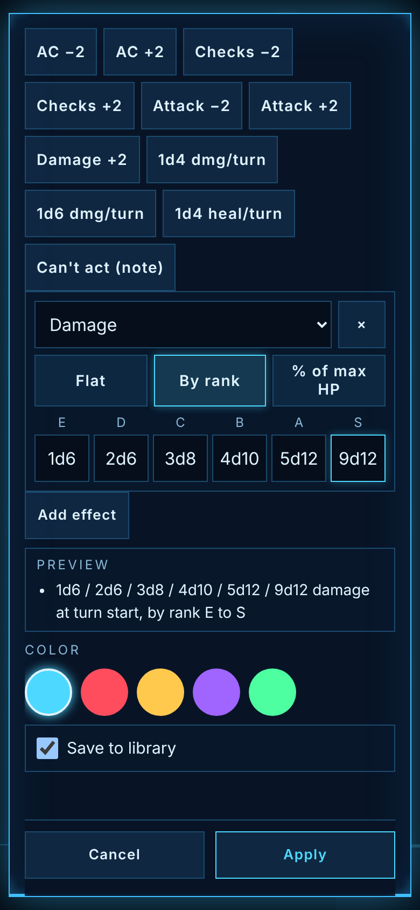

The status maker: Frostbite, damage by rank from 1d6 at E to 9d12 at S, and the preview line.

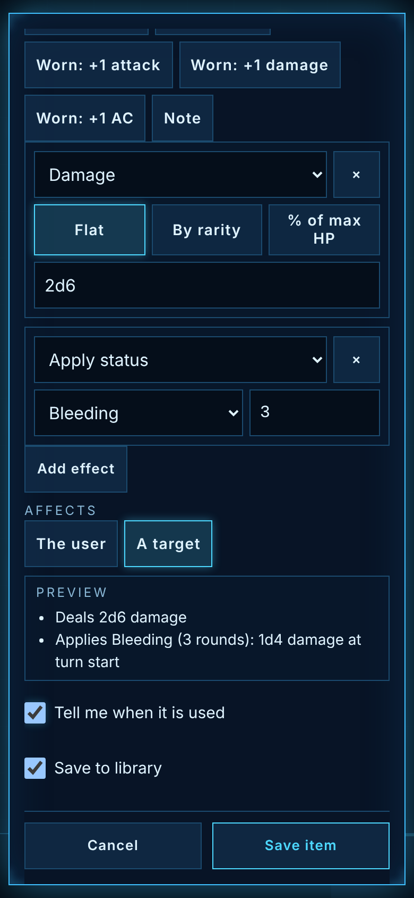

The item maker: Bottled Storm on a target, with damage and Bleeding, and the "Tell me when it is used" box ticked.

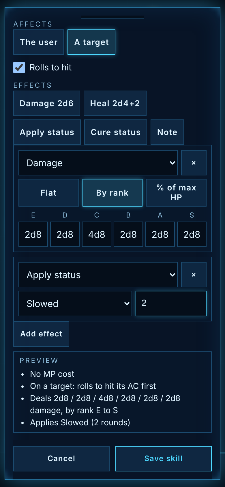

The skill maker: Frost Lance on a target, rolls to hit, damage by rank and Slowed, with the four-line preview.

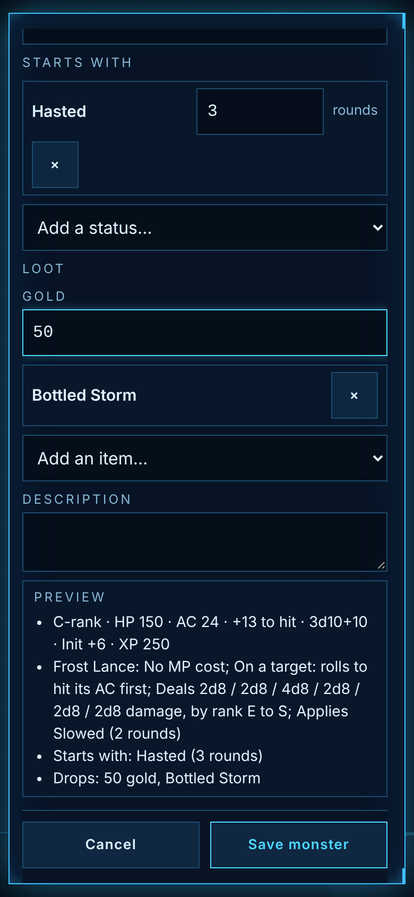

The enemy maker: Ice Warden, rank C, starting Hasted, 50 gold and a Bottled Storm as loot, and its preview.

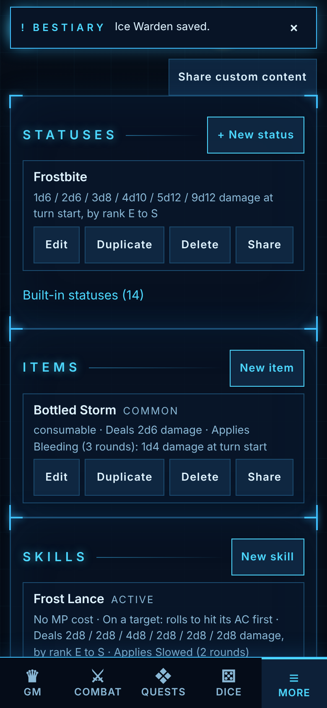

The Workshop: the GM's own statuses, items and skills, each with Edit, Duplicate, Delete and Share.

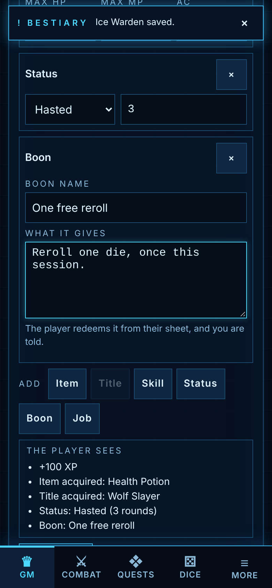

The reward editor in the Award form: a status row, a boon row and "The player sees" with five lines.

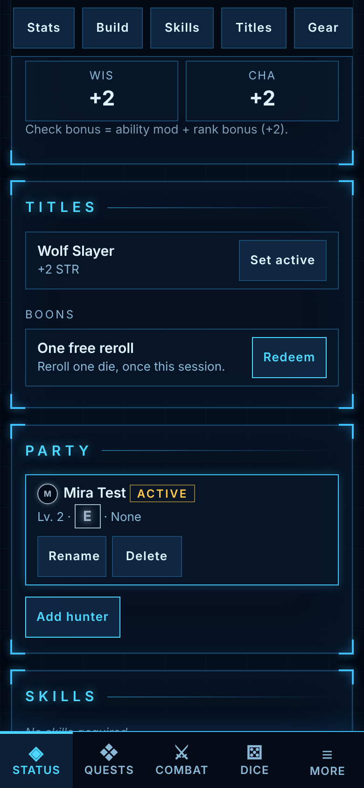

A player's Titles panel: the title with its +2 STR, and the boon with its Redeem button.

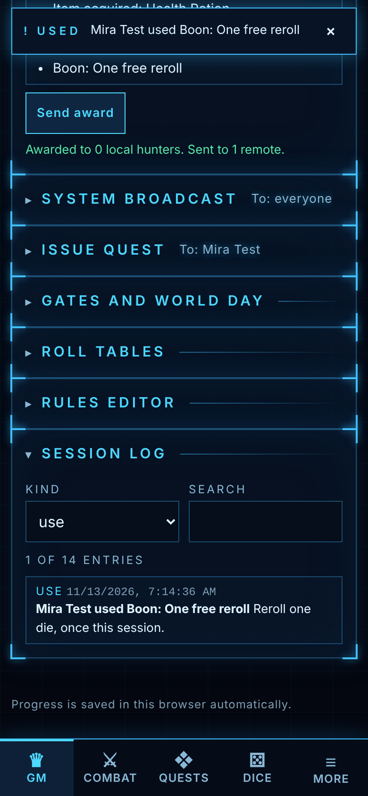

The GM view after tapping "Reward uses": the session log filtered to "use", with one line.

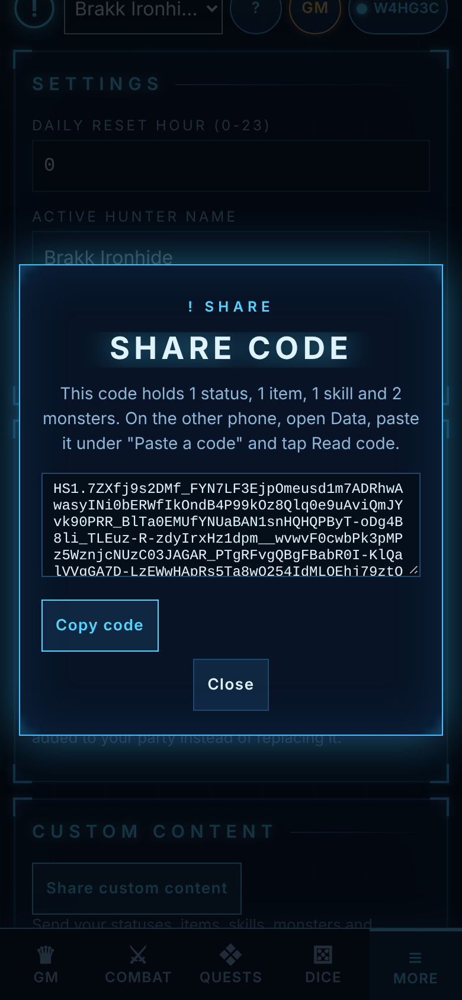

The Share code window: what the code holds, the code, Copy code.

## 13. UI and UX

### In short

- A player's first screen, the Status sheet, now shows the hunter's state: name, level, HP and the condition chips (Poisoned, Penalized, Dying) without a scroll. The identity fields are behind an Edit button and "Delete hunter" is in the Party panel.
- When the GM's Next reaches a player, the phone shows "Your turn" large and the status that landed as a toast. Before, two windows covered the turn.
- A GM's phone opens on the GM view, which starts with a Make row (Status, Item, Skill, Enemy, Reward). Each opens its maker in one tap.
- In a fight on a phone the turn order is at the top, the current row filled, and the Table feed is one line. The Award form's Send award button stays on screen.
- Everywhere, the main button of a window is filled cyan, Delete and Damage are red before you touch them, a chosen option is filled, and a field has an edge you can see.

### The audit

One helper (Opus, 32 minutes) wrote `scripts/ui-shots.ts`, which plays a GM and a player in one room and shoots 117 screens at three sizes: the GM at 1280 by 800 with a mouse, the GM at 390 by 844 with touch, and a player at 360 by 780 with touch. It read about 35 of the 117 images and the code behind them (`ui-pass/notes-audit.md`). The result is `ui-pass/audit.md`: 33 findings, A1 to A33, each with an image and a file and line.

| Severity | Meaning | Count |
|---|---|---|
| 2 | Felt every session | 9 (A1 to A9) |
| 3 | Felt now and then or looks wrong | 19 (A10 to A28) |
| 4 | A blemish | 5 (A29 to A33) |

No finding had severity 1 (a person blocked or misled). The "fixed" column is from the table at the end of `ui-pass/notes-4-fight-desktop.md`, where the unit named there did it.

| Id | Who | What was wrong | Fixed | Unit |
|---|---|---|---|---|
| A1 | GM | The Workshop's status maker was the fight's Status window, with Rounds and "Apply" | fixed | 2 |
| A2 | GM | The Table feed covered the combat card on a phone | fixed | 4 |
| A3 | GM | The turn order was below the card on a phone | fixed | 4 |
| A4 | Player | A player's turn started under windows and toasts | fixed | 3 |
| A5 | Player | The sheet opened on an edit form, the conditions 600 px down | fixed | 3 |
| A6 | Player | A player could edit and delete the GM's Job Change step | fixed | 3 |
| A7 | Player | Job Change step 1 had minus and plus | fixed | 3 |
| A8 | GM | Send award was not sticky | fixed | 1 |
| A9 | GM | A maker was two taps away under More | fixed | 2 (and 4 for the opening view) |
| A10 | Both | Toasts covered the top of the screen | fixed | 1 |
| A11 | GM | The item maker showed every field for every type | fixed | 2 |
| A12 | GM | A monster's skill printed all six by-rank values | partly | 2 |
| A13 | Both | A pressed chip barely differed | fixed | 1 |
| A14 | Both | Button kinds were not told apart | fixed | 1 |
| A15 | Player | The jump chip row was cut with no sign it scrolls | fixed | 3 |
| A16 | Player | "Delete hunter" was on the first screen | fixed | 3 |
| A17 | Player | "Monster info unlocked" windows mid-fight | fixed | 3 |
| A18 | Both | Control edges were 2.0 to 1 on the panel | fixed | 1 |
| A19 | GM | The desktop nav wrapped to two rows | fixed | 4 |
| A20 | GM | The desktop was a stretched phone | fixed | 4 (and 4c) |
| A21 | GM | The skill maker was one narrow column at 1280 | fixed | 2 |
| A22 | Both | Save and Cancel traded places | fixed | 1 |
| A23 | Player | Dying and Unconscious were two names for one state | fixed | 3 |
| A24 | GM | Applying a status took two taps | fixed | 2 |
| A25 | GM | The enemy maker's remove "×" wrapped to its own line | fixed | 2 |
| A26 | GM | Enter in a reward field submitted the quest form | fixed | 2 |
| A27 | GM | A dying hunter got no death save prompt at their turn | fixed | 3 |
| A28 | GM | The quest edit form let a GM change a Penalty Zone quest's kind | fixed | 3 |
| A29 | GM | The disabled Title chip gave no reason | fixed | 1 |
| A30 | Player | Two tabs lit with the dice sheet; d100 wrapped | fixed | 3 |
| A31 | GM | A log line ran title and text together; the share code box cut a line | fixed | 2 |
| A32 | Player | The rules reference said the wrong turn timing | fixed | 3 |
| A33 | GM | Four equal buttons on every Workshop row | fixed | 2 |

32 fixed, 1 partly, none left. A12 is partly because the skill rows inside the enemy maker's form still show all six values (`notes-2-makers.md`, step 5). The card in a fight and the maker's preview print the one value for the monster's rank.

### What changed

Each pair is the same screen from the same script, before and after. Phone shots are 360 or 390 px wide.

#### The shared look (unit 1)

Buttons, chips, field edges, toasts and the sticky action bar are one set of classes now (see "The shared set").

The quest form at 1280. Empty fields have an edge, the Cancel button is on the left, Save quest is filled and in a bar that stays at the bottom, and the remove "×" is red.

| Before | After |
|---|---|
| 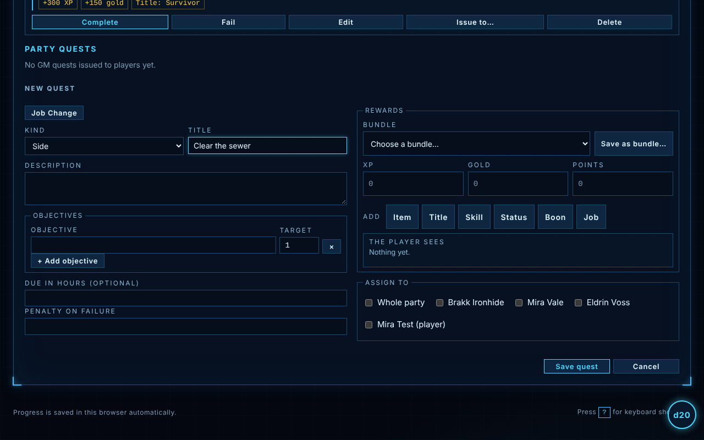 | 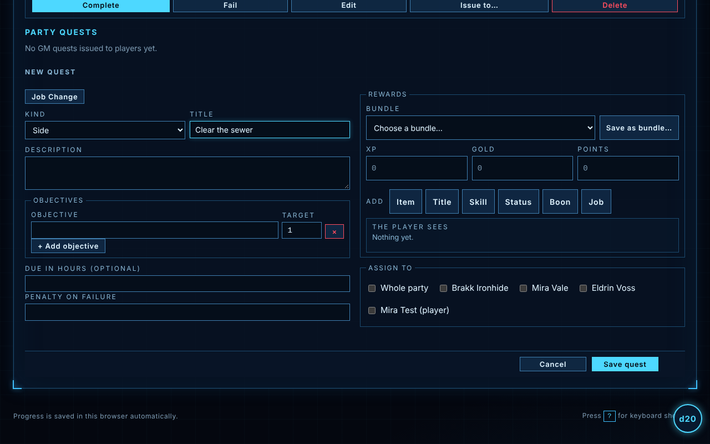 |

The Award form on a phone. Send award was a small button under the whole reward editor. It is a filled button in a bar above the bottom tabs, in view while the GM fills the form. The Award message after a send names who got it ("Sent to Mira Test."), not "Awarded to 0 local hunters". Test: `look.e2e.ts`, "on a 390 px phone, with an item, a title and a boon in the Award form, Send award is in view without scrolling and one tap sends it".

| Before | After |
|---|---|
| 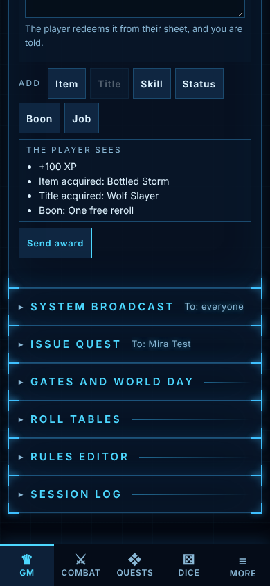 | 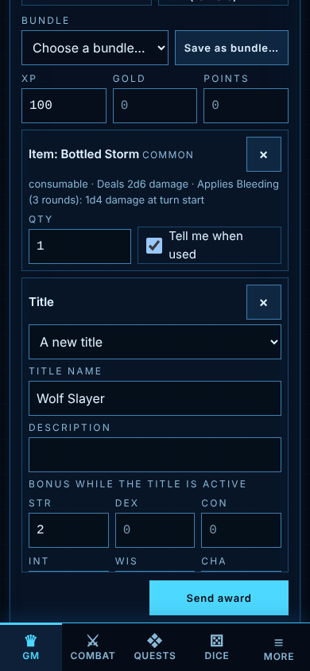 |

#### The creation flows (unit 2)

The Workshop's New status. It is a maker like the others: Name, Description, Effects, a preview, a colour, and "Save status". The Rounds field, the 14 "Apply existing" chips and "Save to library" are gone from it. The teal box over the Name field in the before image was the browser's tap flash, fixed in unit 4. Test: `makers.e2e.ts`, "from the Workshop, New status has no Rounds, no Apply existing and no Save to library, and one Save status button keeps it".

| Before | After |
|---|---|
| 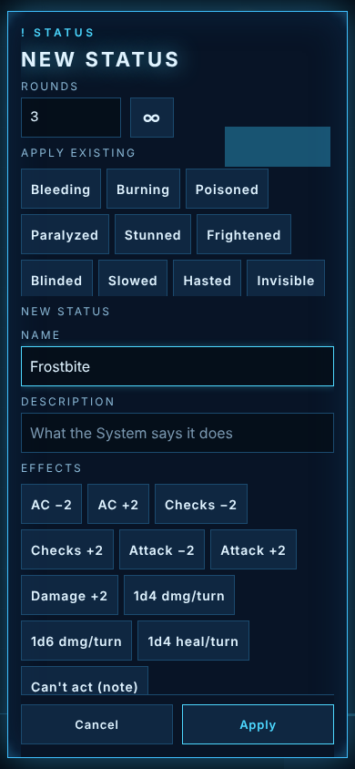 | 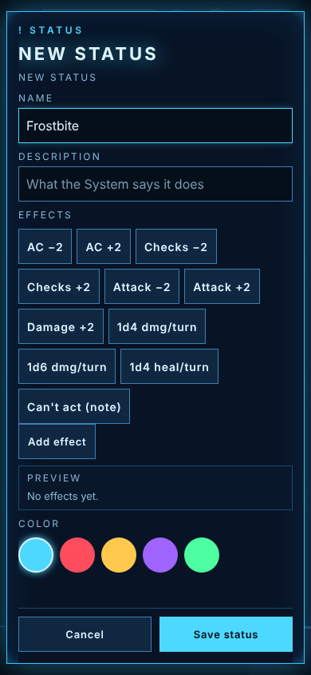 |

The Make row. The GM view starts with Status, Item, Skill, Enemy and Reward, and "Workshop" at the right. Each opens its maker in one tap. Test: `makers.e2e.ts`, "on a 390 by 844 phone, each button of the GM view's Make row opens its maker in one tap".

| Before | After |
|---|---|
| 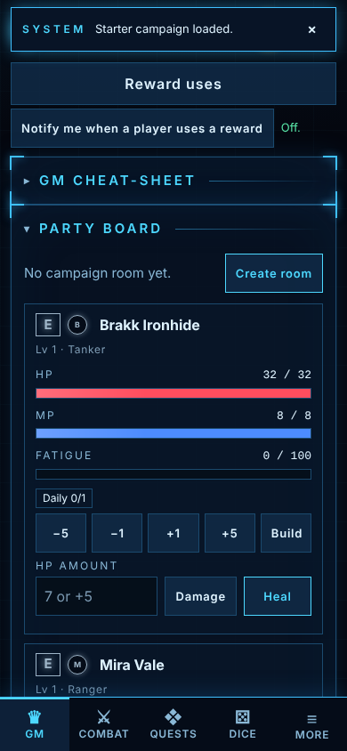 | 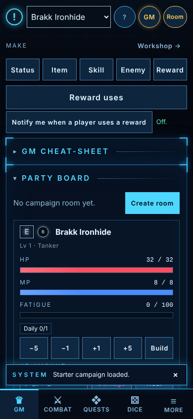 |

The item maker. A chosen type or mode is filled cyan, and the "Worn: +1 attack" quick effects are gone for a potion. A consumable shows no Slot and no nine "Bonus while worn" boxes. Healing is an effect row, and an item saved with the old Heals HP field still opens as a Heal row and still heals. Test: `makers.e2e.ts`, "an item saved before with Heals HP 10 opens in the maker with a Heal 10 row, and saved again it still heals 10 when used".

| Before | After |
|---|---|
| 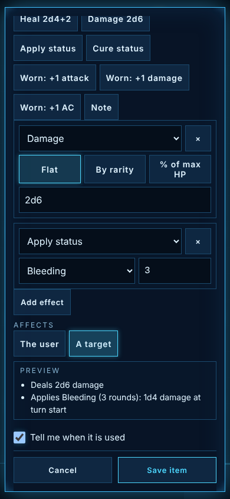 | 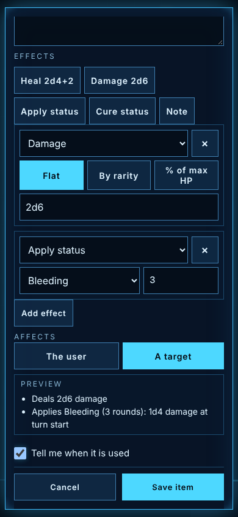 |

A monster's skill in a fight. Frost Lance on the C-rank Ice Warden reads "Deals 4d8 damage", not six values. The status it applies reads at the monster's rank too ("Slowed (2 rounds): AC -4"). Test: `tests/status.test.ts`, the C-rank Deals 4d8 case.

| Before | After |
|---|---|
| 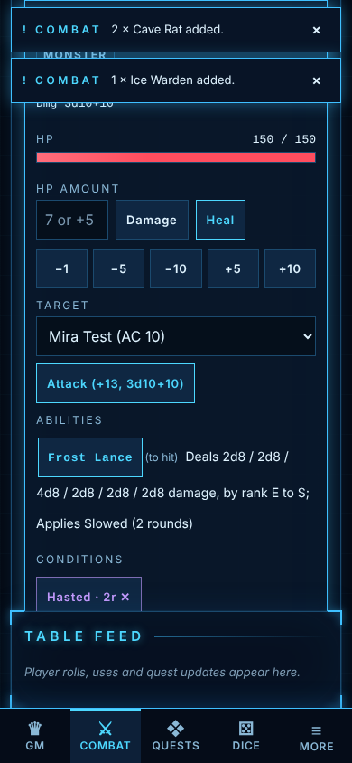 | 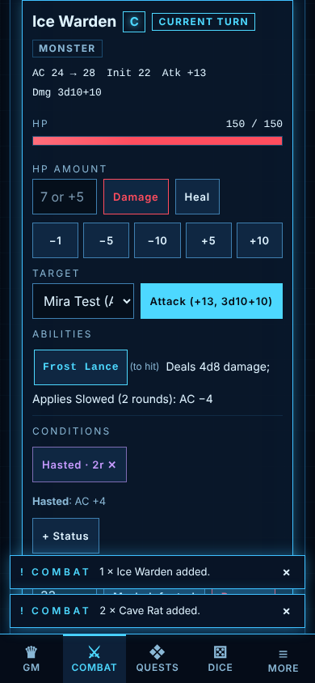 |

The skill maker at 1280. It is two columns, so the effects and the preview are in view with Save skill. A new skill starts with "Rolls to hit" ticked and "Affects" follows the first effect. Test: `makers.e2e.ts`, the Frost Lance test (at most 10 taps).

| Before | After |
|---|---|
| 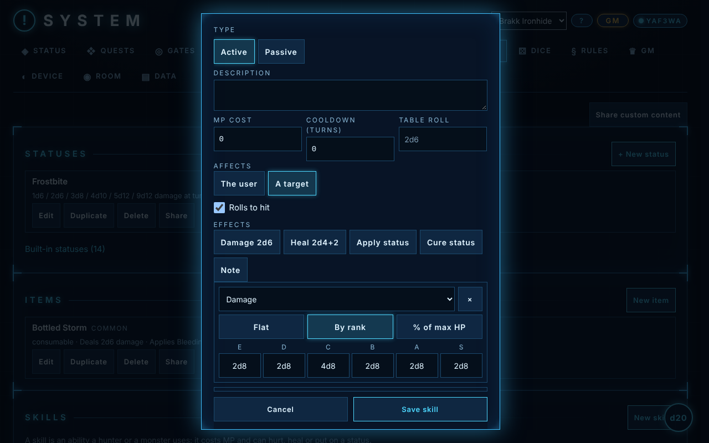 | 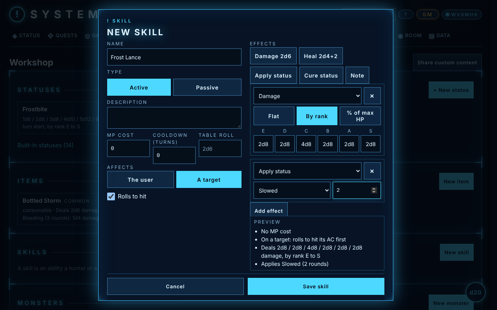 |

The Workshop on a phone. A row is one button that edits on a tap. Duplicate, Share and Delete are behind "..." and Delete is red and asks. "Give to..." stays on a skill. Test: `makers.e2e.ts`, the Workshop test.

| Before | After |
|---|---|
| 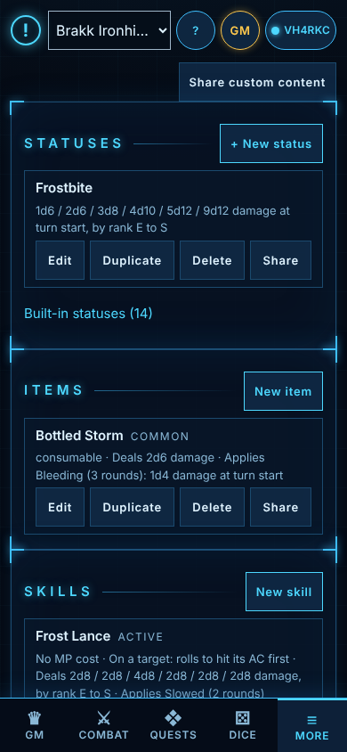 | 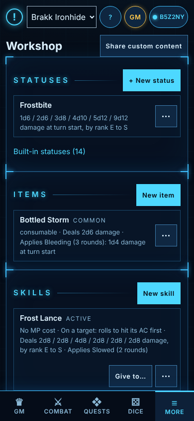 |

#### A player's screens (unit 3)

The Status sheet at 360. The name is text with Edit, level and XP, HP with its buttons, then the conditions (Poisoned 3r, Slowed 2r) on the first screen. "Delete hunter" is not here, and the jump row fades at its right edge. Test: `look.e2e.ts`, "on a 360 px phone a Poisoned, Penalized hunter sees both condition chips on the first screen of the sheet".

| Before | After |
|---|---|
| 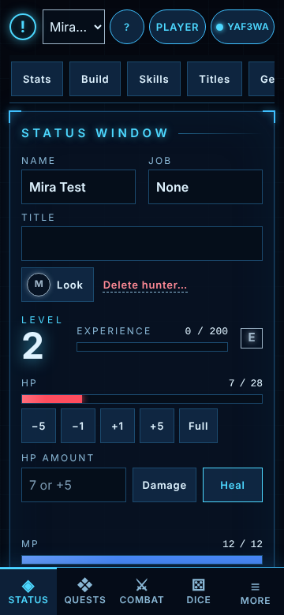 | 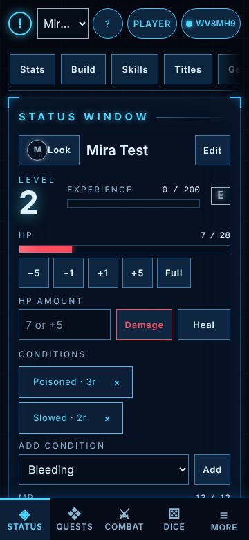 |

A player's turn. "Your turn · Round 1" is large and filled, with the status that landed ("Slowed: AC -4, 2 rounds") and "Your turn. Round 1." as toasts. Before, a Poisoned window sat over it. Test: `table-session.e2e.ts`, the two-phone fight (a "Your turn. Round 1." toast, the banner, no window open).

| Before | After |
|---|---|
| 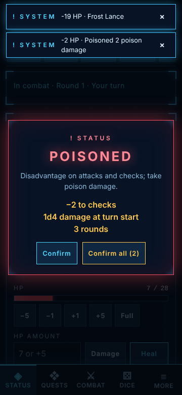 | 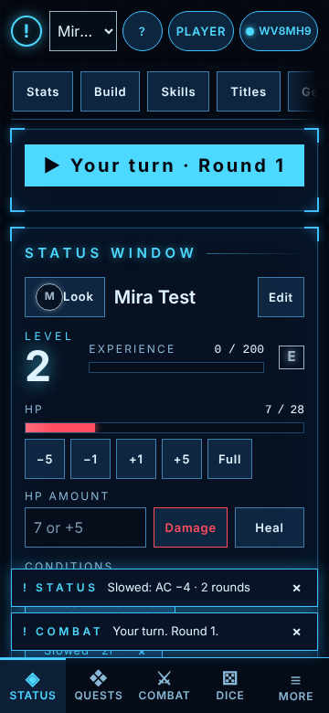 |

A Job Change step the GM issued. A player sees Complete and Fail. The Edit and Delete buttons and the minus and plus on "Reach Level 10" are gone. Before, a player's Delete on this step sent the chain to failed, and only the GM could put it back (reproduced in a browser test). Test: `rewards.e2e.ts`, "a player in a room gets no Edit, no Delete and no minus or plus on the Job Change step the GM issued".

| Before | After |
|---|---|
| 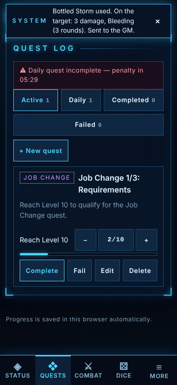 | 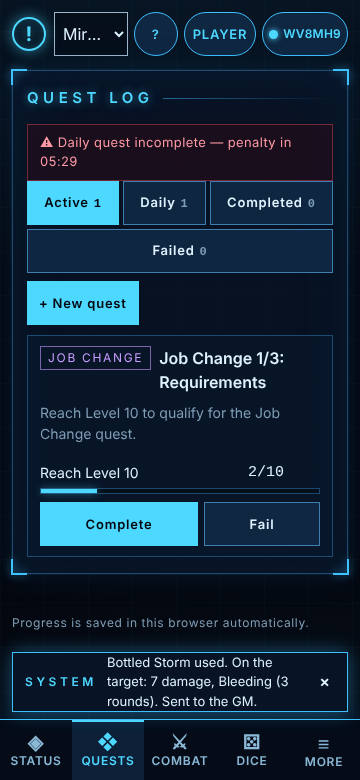 |

#### The GM's fight on a phone and the desktop (unit 4)

The fight at 390. The turn order is the first thing: ▶ Ice Warden filled at the top, status words and a thin HP bar on each row, a red "Down" tag on a combatant at 0 HP, and the selected card under it. The Table feed is one line at the end. Tests: `layout.e2e.ts`, "on a 390 px phone the GM sees whose turn it is at the top of the fight..." and "on a 390 px phone in a room, the empty Table feed is one line that covers none of the card...". The toasts in the after image are the script moving faster than a person: a toast is gone after 3.2 s.

| Before | After |
|---|---|
| 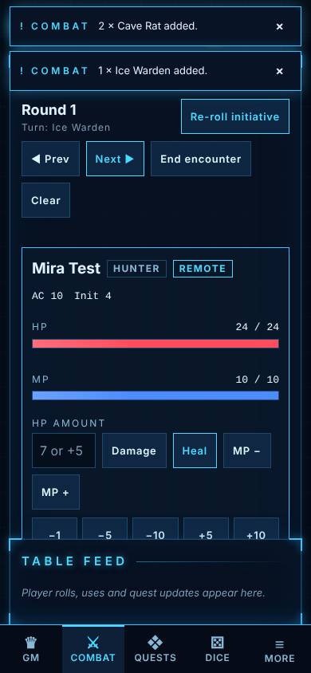 | 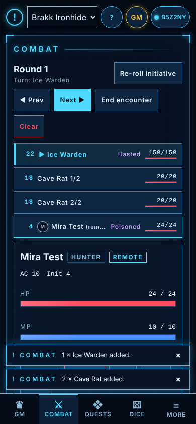 |

The desktop nav and the Workshop at 1280. The 13 views fit one row, and the content starts higher. The page has a "Workshop" heading with Share custom content in its header row, and rows are cards with "...". With more than one entry per kind the cards sit four across; this shot has one entry per kind, so it does not show that. Test: `layout.e2e.ts`, "at 1280 by 800 the GM's top nav is one row holding all thirteen views" and "at 1280 the Workshop shows its entries as cards, two side by side".

| Before | After |
|---|---|
| 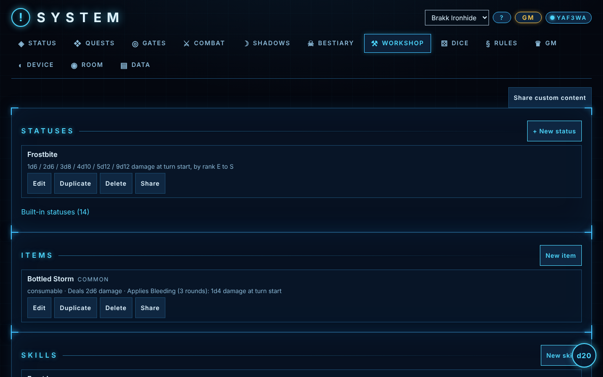 | 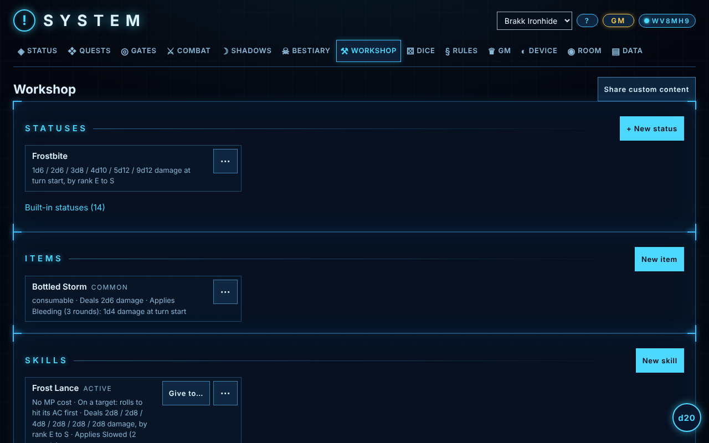 |

The Award form at 1280. It is a full-width row under the party columns, its reward rows flow in two columns, and Send award is in a bar at the bottom. Before, it filled the left half and left the right half empty. No test reads the layout; `scripts/ui-shots.ts` shows it.

| Before | After |
|---|---|
| 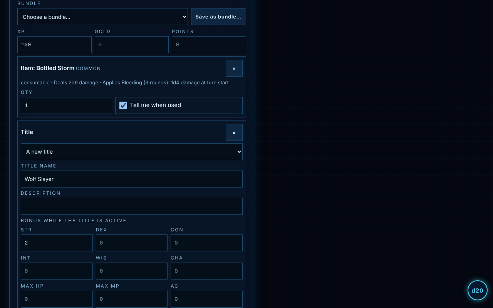 | 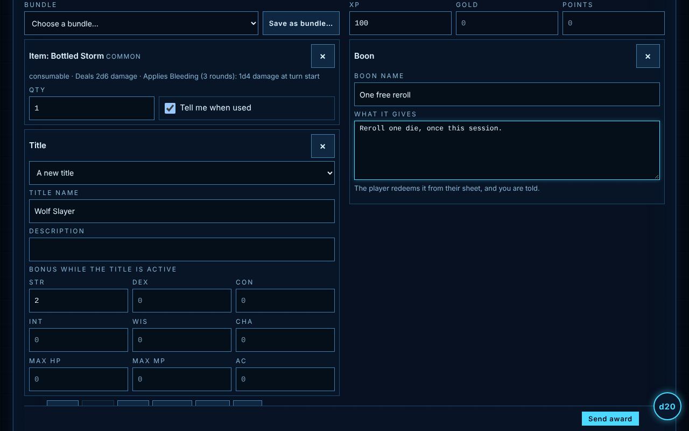 |

#### Eight small blemishes (unit 4c)

A Sonnet helper fixed eight things the after set still showed (`notes-4-fight-desktop.md`, "Unit 4c"). Tests are in `look.e2e.ts` for the first, second and fifth.

- A new hunter shows nothing under the name, not "None". An empty HP message takes no height, so the band between HP and Conditions is gone.
- "Save current gear" is a plain button, not filled, and the inventory's Store is 44 px tall.
- The Workshop has a "Workshop" heading and Share custom content in the header row. A card with two buttons wraps them under the text.
- "Reward uses" fits its text on a desktop.
- The status maker is two columns at 1100 px and wider: name, description and colour left, effects and a preview that stays in view right. The item maker's preview stays in view too.
- Toasts: nothing changed. The two "added" toasts over a fight card in the earlier shots were gone after 3.2 s, read from the code (no new shot).

### Taps

"From the view the app opens on" is Status for a player and, since unit 4, the GM view for a GM. Before is the audit's count; after is from the test named. "Counted" means from the screens and code, not run.

| Action | Who | Before | After | Source |
|---|---|---|---|---|
| Apply a built-in status once the window is open | GM | 2 (pick, Apply) | 1 | `makers.e2e.ts` and `combat-turns.e2e.ts` (run) |
| Apply a status in a fight from the order | GM | 5 on a phone, after a scroll past the card | 4, no scroll: the order is first (counted) | audit; `notes-4` |
| Make a status (Frostbite, damage by rank) | GM | 8 | 6 | `makers.e2e.ts`, "...in 6 taps from the home screen" |
| Make an item (Bottled Storm) | GM | 9 | 7 | `makers.e2e.ts`, "...in 7 taps from the home screen" |
| Make an enemy (Ice Warden) | GM | 10 | 8 | `makers.e2e.ts`, "...in at most 8 taps from the home screen" |
| Make a skill (Frost Lance), from the Skills panel | GM | 13 | 10 | `makers.e2e.ts`, "...in at most 10 taps from the home screen" |
| Open any maker from the GM view | GM | 3 (More, Workshop, New) | 1 | `makers.e2e.ts`, the Make row test |
| See whose turn it is in a fight on a phone | GM | a scroll past a 700 px card | 0, it is the top | `layout.e2e.ts` |
| See that a hunter is Poisoned or Penalized | Player | a scroll of about 600 px | 0 | `look.e2e.ts`, the two chips in view at scroll 0 |
| Send an award from the Award form on a phone | GM | scroll past the editor, then tap | 1 tap, button in view | `look.e2e.ts`, Send award |
| Take damage (−5 or −1) | Player | 1 | 1, unchanged | audit (read); not re-counted |
| Roll a die | Player | 2 | 2, unchanged | audit (read); not re-counted |
| Mark a quest step | Player | 2 | 2, unchanged | audit (read); not re-counted |
| Use a consumable | Player | 2 to 3 | not measured | audit (read); no unit changed the path |
| Award a saved reward | GM | 5 to 6 | not measured | audit (read); the Workshop is still under More |

### The shared set

Unit 1 made these in `public/app.css` and `src/views/ui.js` (`notes-1-look.md`). A new screen reaches for them and writes no colour or height of its own.

| Name | What it is | Use it for |
|---|---|---|
| `--edge` | `#3f7fb0`, 4.4 to 1 on the panel | the edge of a field, select or plain button. `--line` stays for rules and panel borders |
| `--control-h` | 44 px | the height and width of anything a thumb taps |
| `--z-toast` | 60, above the bottom bar (40) and windows (50) | only the toast box |
| `button.primary` | filled cyan, dark text | the one action a window or form exists for |
| `button.danger` | red edge and red text at rest | Delete, Remove, Forget, Damage, Clear. With `primary`, a filled red confirm |
| `button.quiet` | text only | a link-like action such as "Workshop" in the Make row |
| plain `button` | the default | everything else |
| `.icon-btn` | a 44 px square for one glyph | "×" and "..." buttons. Replaced `.rw-rm`, `.mk-fx-rm`, `.enm-rm` and `.x-btn` |
| `.seg` | a row of buttons, the chosen one filled | any one-of-n choice (makers' modes, Items and Shop, quest tabs, dice Adv/Normal/Dis, device settings) |
| `.mk-chip` with `aria-pressed` | a many-of-n chip, filled when on | a chip a person can switch on in a set |
| `.dlg-actions` | a sticky bar, Cancel or Close left, the action right | any form longer than a screen (Award, quest, gate edit) |
| `ui.toast(tag, msg)` | one line, two at most, bottom above the bar; at the top while a window is open | news that needs no answer. A reward or a choice is a window |
| `.field.chk`, `.row-full`, `.flush`, `.lbl.sec`, `.note` | a checkbox row, a full-line field, no top margin, a section label, a muted 13 px note | what was inline `style=` before |

`AGENTS.md` has the recipe "A screen's look" for this.

### What a table will notice

From the notes and the trail. Each line says what the person sees; the test is named in the unit's notes.

Players:

- The Status sheet opens on state. Name is text with Edit (Done closes it), then level, XP, HP, the conditions and Add condition, then MP and fatigue.
- "Delete hunter" is in the Party panel. It asks for the hunter's name and takes a backup first.
- The row of jump chips fades at its right edge to show it scrolls.
- The condition chip at 0 HP says "Dying" while the saves run and "Stable" when stable, the same words as the death panel. The chip's card still explains death saves.
- A new hunter with no job or title shows nothing under the name.
- When a player's turn starts, no window opens. "Your turn" is large on the combat HUD, the sheet shows "Your turn · Round N", and a toast says "Your turn. Round 1."
- A status that lands on a player is a toast with its numbers ("Poisoned: -4 on checks · 1d6 damage at turn start · 3 rounds"). Falling to 0 HP is a toast. "Monster info unlocked" is a toast on both phones.
- A reward, a quest offer, a Job Change offer and the level-up are still windows.
- A dying hunter whose turn it is sees "Roll death save" first, on the sheet's death panel and at the top of the player's own block in the combat HUD.
- A player in a room has no Edit or Delete on a quest the GM issued, and none on a Job Change step. Complete and Fail stay. A step the System counts (reach a level) has no minus and plus, for the GM too.
- Only one bottom tab is lit when the dice sheet is open, and the seven dice fit one row at 360 px.
- The rules reference says timed conditions count down at the start of the afflicted combatant's turn, which is what the fight does.
- The inventory's "Save current gear" is plain and Store is 44 px tall.
- A tap no longer flashes the browser's blue box over what it opened (no test: the flash is the browser's).

GM:

- A GM's phone opens on the GM view. A view named in the address still wins.
- The GM view starts with a Make row. Each button opens its maker in one tap.
- The Workshop's New status has no Rounds, no Apply existing, no Save to library, and says "Save status". The page has a "Workshop" heading, Share custom content in its header row, and cards four across on a desktop.
- A Workshop row opens its maker on a tap. Duplicate, Share, Delete and Reset are behind "...", and each still asks. A built-in status has no "...".
- In a fight, the Status window has Rounds (3) and Strength (the target's rank) on top, and one tap on a built-in status puts it on with them.
- The item maker shows Slot, Bonus while worn and the "Worn:" quick effects only for a weapon, armor or accessory. Heals HP, Restores MP and Removes fatigue are effect rows.
- The skill maker is two columns on a desktop. A new skill starts with Rolls to hit ticked and Affects "A target" when its first effect is Damage or Apply status, otherwise "The user". A new effect row's field takes the focus with its text selected.
- A monster's skill and the enemy maker's preview print the value for the monster's rank.
- In the enemy maker, a starting status's Rounds sits under its name and the "×" stays on the name's line.
- Enter in a reward field of the quest form no longer saves the quest. Ctrl or Cmd+Enter does.
- The edit form of a Penalty Zone quest has no Kind.
- The Award form has a sticky Send award bar, Cancel on the left, and a message that names who got it ("Sent to Mira and Brakk.", "Not sent to Mira: offline."). A full Title chip says "One title per reward." On a desktop the form is full width in two columns.
- The same Cancel left, action right order is in the quest form, the gate forms, the title form and the bestiary merge form.
- A remote hunter's name in the Award message and in the session log's award line is the name, not "h1".
- A session log line is the kind and time, then the title, then the text. The share code box shows the whole code up to 12 rows and scrolls past that.
- In a fight on a phone the order is first. The current row is filled with a ▶, a combatant at 0 HP has a red "Down" tag and a struck name, and a tap on a row scrolls its card to the top.
- The Table feed is one line on a phone: "Empty", a count, or "N new" in cyan. It sticks above the bar only while it holds something new.
- The desktop nav is one row at 1280. Data and Rules are a centred column of about 70 characters. "Reward uses" fits its text.
- Hunter, board and combat cards, and the status maker, show Damage, Clear, Delete and Remove in red, and one filled button per window.

### Things the owner can choose

The lead made each of these calls in `ui-pass/design.md` or a helper made it in its notes, so nobody had to ask. Each is reversible. Say the words in the last column to change it.

| What was decided | Now | To change it, say |
|---|---|---|
| Where toasts sit | Bottom, above the bar, two at most; at the top while a window is open | "Put toasts at the top again" or "Show three" |
| The main button | Filled cyan with dark text, one per window | "Make the main button outlined again" |
| Danger buttons | Red edge and text at rest | "Make Delete look like the other buttons" |
| Button order | Cancel left, action right, everywhere | "Put Save on the left" |
| A chosen option | Filled cyan | "Show a chosen chip with a border only" |
| Field and button edge | `#3f7fb0`, 4.4 to 1 | "Make the edges fainter" (it was 2.0 to 1, under the 3 to 1 the web standard asks) |
| A built-in status in a fight | One tap, Rounds 3, Strength at the target's rank | "Ask me for Rounds first". Rounds is 3 because a status has no duration of its own; giving it one changes the save |
| The Make row | On the GM view, opens a maker in one tap | "Remove the Make row" or "Put the Workshop in the GM's bottom bar" |
| Where a GM's phone opens | On the GM view | "Open on Status" |
| The item maker | Worn fields only for worn gear; no Heals HP field, only effect rows | "Show the worn fields for every type" |
| New skill defaults | Rolls to hit ticked; Affects follows the first effect until tapped | "Start Rolls to hit unticked" |
| A Workshop row | A tap edits; the rest behind "..."; Give to... and Award... stay on the row | "Show Duplicate and Delete on the row again" |
| The Workshop status maker | No Rounds or Apply, "Save status" | "Let me apply from the Workshop" |
| The sheet's first screen | State first; identity behind Edit; Delete hunter in Party | "Put the name fields back on top" |
| What a player gets as a window | A reward, a quest offer, a Job Change offer, the level-up. Status ticks, a fall, a monster unlock and "Your turn" are toasts and the HUD | "Show a window when a status lands" |
| A dying hunter | "Dying" or "Stable" on the chip; "Roll death save" on the card and HUD, no window | "Call it Unconscious" |
| A GM's quest on a player's phone | No Edit or Delete in a room; Job Change steps counted by the System have no minus and plus | "Let players edit the GM's quests" |
| The fight on a phone | Order first, card under it, Table feed one line | "Card first again" |
| The nav at 1280 | Tabs have less padding so 13 fit one row | "Hide two views from the desktop nav" for roomier tabs |
| A text view's width | About 70 characters on Data and Rules | "Let Data run the full width" |
| The Award message | Names only who got it | "Show the old counts" |

What the helpers were unsure of:

- Unit 2 would have the Rounds in the apply window start at the status's own duration, as the design says. A status has none, so it starts at 3 as before (`notes-2-makers.md`, Unsure).
- Unit 2 moved the reward bundle maker from `workshop.js` to `reward-editor.js` so the GM view can open it without a new API member.
- Unit 4 made a GM's phone open on the GM view, which was not in the first plan; unit 2 found a GM opened on Status, one tap from the Make row. The trail row of 09:42 records it.
- The last full green CI was on `89465b9` (unit 4, step 5). Unit 4's last change ran 169 of 171 browser tests, and the two that failed (`makers.e2e.ts:481`, `table-session.e2e.ts:71`) passed alone right after, read as load or a pause. Unit 1 saw `makers.e2e.ts` fail once the same way beside the screenshot run.
- Unit 3's container restarted during its last check; the lead ran the check (166 browser tests passed).

### Left on purpose

- Makers for jobs, paths and rule numbers (the customization phase decided this).
- A light theme.
- Icons beyond the ones in the bar.
- Merging the four ways a status is drawn into one chip, and the ten card classes into one. The audit shows both. They touch every view and change nothing a player feels. A later pass can take them.
- The skill rows inside the enemy maker's form still show all six by-rank values (`notes-2-makers.md`, step 5).
- A status has no duration of its own (see above).
- Inline styles that are computed at run time: bar widths, a hunter's or status's colour (`notes-1-look.md`, step 6).
- The pages the audit did not read closely: gates, bestiary, data, room and device. No unit changed them, and the audit's contrast, 44 px and focus checks found nothing there (`audit.md`, "Measured").
- Three shots do not show the change: A26 and A28 (read, tested, not shot) and the death save prompt on the card and HUD.

### Numbers

| | Bun tests | Browser tests | Source |
|---|---|---|---|
| Before the run (`d2101be`) | 1,657 | 148 | trail, 07:53, 12.2 m |
| After unit 1 | 1,657 | 150 | `notes-1-look.md`, step 7 |
| After unit 2 | 1,659 | 157 | `notes-2-makers.md`, step 8 |
| After unit 3 | 1,668 | 166 | trail, 10:43, run by the lead |
| After unit 4 | 1,668 | 171 | `notes-4-fight-desktop.md`, step 5 |
| After the run | 1,668 | 174 | the push that carries this section |

| Unit | What | Duration |
|---|---|---|
| Audit | the script, the before set, `audit.md` | 32 minutes (trail, 08:14) |
| 1 | the shared look | 49 minutes (trail, 09:04) |
| 2 | the creation flows | 37 minutes (trail, 09:42) |
| 3 | what a player touches | not measured; the trail row (10:43) gives none |
| 4 | the fight on a phone, the desktop, the after set | not measured; the trail row (11:34) gives none |
| 4c | eight small blemishes | not measured; no trail row yet |

The UI pushes are `push-1` to `push-4` in the trail (09:04, 09:42, 10:43, 11:16), each through the pre-push hook and green. The after set is `ui-pass/after/`: 117 images with the same names as `before/`.

## 14. First-run clarity (Nov 17)

A second lead's run on branch `first-run-clarity` (cut from the working branch at e7e68735), a PR into
`claude/zen-pasteur-ov4cgd`. The source is the owner's triage of the fresh-eyes review (`fresh-eyes/fable-response.md`,
`fresh-eyes/docs-comparison.md`). The design and its seven calls are `frc/design.md`; the helpers' briefs and notes are
beside it.

### What a new person meets now

| Where | Before | After |
|---|---|---|
| The Welcome window | "[SYSTEM] You have been chosen as a Player. Accept?" and nothing else | The same window, and under it one plain sentence saying what the site is (`ABOUT`) |
| The end of setup, a player | The window closed on the Status view without a word | "Hunter created": the hunter's name and job, three next steps (spend points, pick a path, join the GM's room), Open my sheet and Join a room |
| The end of setup, a GM | "Open a room?" with one line | "Campaign ready": what was loaded, what a room is, two next steps (create a room, invite players), Create room and Later |
| The room button at the top | "Join" for a player, "Room" for a GM | "Join room" for a player, "Create room" for a GM, the code once in a room |
| The doors to a room | The button, the Room tab, the Data view's "Campaign Room" panel | The Room view, reached by the button (and its tab); the Data panel is deleted |
| The Room view | "Join a room" and "Run a room", no word on what a room is | What a room is (`ROOM_IS`), each role's way to one (`ROOM_PATH`), "Create a room", and for a GM in a room "Invite players" over the code, link and QR code |
| The ? guide | One list of tips for both roles | The About sentence, this role's next steps, this role's tips |
| The Rules page | Opened with the GM quick card for everyone; four lines contradicted the game | A player's opens with "How checks work"; the four lines are worked out from the game's own functions |
| 0 HP | Unconscious, Dying and down, by place | Down, then "Down, stable" |

### How it is built

- **The setup machine** (`src/core/onboarding.ts`): two states, `hunterCreated` and `campaignReady`, replace the silent
  end and the old `room` step; events `sheet`, `join`, `later`, `created`. The save is marked onboarded on the one
  transition that leaves the setup steps, in the same write as the choice, so a reload on the confirmation does not
  start setup again. Chart: "First-run setup" in `docs/state-machines.md`.
- **The words** (`src/core/first-run.ts`): `ABOUT`, `ROOM_IS`, `ROOM_PATH`, `createdLine`, `LOADED`, `TIPS` and
  `nextSteps(facts, R)`, a pure function of what the phone knows (`FirstRunFacts`: points free, the path, the room, the
  players in it), so a step done reads as done. `onboard.js`, `room.js` and the ? guide read them; no sentence of these
  lives in a view.
- **The one door**: `src/edge/room-pill.ts` lost its Data panel and its one page variable; it keeps no state now.
- **The Rules page** (`src/core/rules-text.ts`): `checkExample`, `statBonusLine` (through `statBonus`, which `checksOf`
  now calls too), `naturalLines` (words from the coin's `VERDICT_WORDS` through `verdict`), `pointsLine`, `downLine`
  (the life machine's numbers, now named constants in `vitals.ts`). `tests/rules-text.test.ts` pins each line to the
  function that plays the rule (`checkBonus`, `checkResult`, `verdict`, `raise`/`lower`/`confirm`, `lifeAfter`), under
  an override too.
- **The term**: `LIFE_TAG` and `FELL_WORDS` in `vitals.ts` are the only words for 0 HP; the status key `unconscious` is
  `down`. The life machine's state names did not change (`play.ts` reads `dying`).

### Found on the way

- **The first daily check ran inside the Quests view's register** and asked `app.isGM()`, which reads the room link,
  registered later. On any visit where a rollover was due as the app opened, `register:quests` threw: the rollover came
  late and the page-shown listener was never added. It showed on this box as `save.e2e.ts:184` failing between 21:00
  and midnight local. Now `app.on('ready', checkDaily)`; a browser test opens a save three days old and meets the
  PENALTY window.
- **`tests/server-start.test.ts` left a server behind** on a box where `bun` on the path is a shell script, and
  `PORT=0` meant port 3000. The test starts `process.execPath`; `server.ts` takes `PORT=0` as any free port.
- **`used.e2e.ts:220` needs the full Chromium on this box** (the headless shell refuses notifications): `E2E_CHROMIUM`,
  now in AGENTS.md's setup.
- The Rules page's "Each shadow level adds +10% max HP" stated a rule the game does not have; deleted.

### Tests added

`tests/first-run.test.ts` (17), `tests/rules-text.test.ts` (14), the setup machine's table cell by cell in
`tests/onboarding.test.ts`; in the browser, `tests/e2e/room-onboarding.e2e.ts` (Hunter created and Campaign ready, the
steps done and not, Join a room landing on the Room page, the button's words, the Data page without the panel),
`tests/e2e/character.e2e.ts` (the Rules page per role, the chip's words), `tests/e2e/save.e2e.ts` (the late daily).

### Screens

`frc/shots/`: `before-*.png` from e7e68735 and `after-*.png` from this branch, the same taps at 390 by 844
(`scripts/first-run-shots.ts`). The PR body shows them side by side.

### Left for the owner

`for-the-owner.md`, "First-run clarity": the Room tab still listed, the later "GM cheat-sheet" section still shown to
players, the words themselves. Out of scope by his triage and untouched: what Player and GM mean on the role chooser,
and the "a phone not in a room runs its own game" line.

### Checks

PR 37 (https://github.com/the-owner/systemgaming/pull/37), open and not merged. The whole `bun run ci` passed
through the pre-push hook on a9deec6a: `bun test` 3574 passed, 3 skipped, 0 failed; the browser tests 339 passed; the
lag test, alone, 6 passed.

Two pushes were refused first, each by one test whose setup was at fault, not the app. Both are fixed in the test:

- `tests/protocol.test.ts`, the fight doc's size case, timed out at 5 s: its fixture copied 50 log lines of 10 MB each
  through JSON, half a gigabyte. The lines are now ten times the bound (fa7bceea). This was also the one failure after
  the merge that had no explanation then.
- `tests/e2e/battle-map.e2e.ts:145` read the hunter's place on the player's phone from the doc before the setup's: the
  start's doc already called the hunter's turn, so the wait for "YOUR TURN" let it through. The `fight` helper now
  waits for the hunter at its set place on both phones (a9deec6a).

`tests/odds.test.ts` "never chooses what the reducer refuses" takes about 3 s of the default 5 s on this box; it was
left as it is.
