# Implicit state machines in The Hunter System: the Neon hunt of 20 November 2026

**Audited commit:** `1732d2d1` on main, the merge of PR #47, which includes `dead-row` (NEW-rules-1). No code in the repo was changed. The proofs and models are kept on the audit box (paths below), not in the repo.

**How it was made:** Neon (gemini-4-neon-high, run through the Antigravity CLI on the owner's Google plan) ran four lanes in parallel: rules, sync, views and gates. Each lane first read docs/agent-handoff/landed.md, the 20 November re-audit (`docs/audit/2026-11-20-neon-reaudit.md`), the pstack skills (statechart, principle-model-the-domain, poteto-mode), AGENTS.md, docs/state-machines.md, docs/guide/machines.md and the world bible's machines (`docs/world/machines.ts` on `world-bible` at 2bf594d8). Each machine it reports is a lifecycle the code tracks as booleans, status strings, nullable fields or phase checks spread across files, with no single type or reducer that says which states and moves exist. The orchestrator then:
- re-ran every proof Neon wrote: 49 unit tests and 23 Playwright tests, all of which pass at 1732d2d1;
- merged 7 lane entries that describe the same machine into their twin;
- tagged every "should" that rests on a game rule;
- built TLA+ models of the top 4 machines and replayed each bug path against the real code.

## Legend

- **Severity.** high: a player or GM can reach a wrong state that changes the game's outcome or loses data. med: the wrong state is reachable but recoverable, or it is latent and a likely change would expose it. low: tidiness, or latent.
- **RAN**: a unit test against the real modules, or a Playwright drive of the app, actually reached the bad state. **READ**: the bad state was inferred from the code. Per-combination exceptions are noted under the machine.
- **COULD NOT REPRODUCE**: Neon or the orchestrator tried and failed to reach the state. The finding is kept at Neon's severity, and the note says what was tried.
- **NEW**: no id in the 20 November re-audit covers this lifecycle. **KNOWN**: it links to re-audit ids, and the machine is the shape behind those bugs, not a re-report of them.
- **settled (the owner, rule x)**: one of the owner's four rulings below. **proposed, needs the owner**: a game rule that the "should" assumes. It is not settled, and nothing should be built on it until the owner rules.
- **World**: the matching machine in the world bible (`docs/world/machines.ts`), and where the app disagrees with it.

The owner's settled rules: (a) the revive ladder: the first revive is free; after that, one revive on debt; after that, none unless the GM grants one or the hunter uses a revive bought before death. Gold does not help a hunter who did not buy the revive before dying. (b) Dailies do not recover you. (c) The GM can add skills outside a player's kit. (d) Every System message and reward must be editable and approved by the GM.

## Counts

- **Machines:** 38 distinct (17 high, 16 med, 5 low), from 45 lane entries: rules 10, sync 12, views 13, gates 10. Seven entries were merged into their twin (listed under each machine).
- **How known:** RAN 38 of 38, READ 0 at machine level (3 single combinations inside RAN machines are READ; see the notes). Re-run by the orchestrator: unit 49 of 49 pass, Playwright 23 of 23 pass.
- **COULD NOT REPRODUCE:** 0. The two sync drafts that failed before the quota stop (SMX-sync-4 and SMX-sync-5) were broken tests, not missing faults. SMX-sync-4 used `outcome: 'win'` where the code reads `'won'`. SMX-sync-5 expected the title as typed, but the server upper-cases chapter titles. Both faults reproduce once the tests are fixed. The gates file's import of a missing `addGate` was fixed, and all 14 of its tests pass.
- **New vs already reported:** 8 new, 30 known (linked to re-audit ids).
- **Rule calls:** 10 lines rest on a settled rule; 36 lines are tagged proposed, needs the owner.
- **TLA+:** 4 models (hunter life and the revive ladder, the GM's held Give… and End story, fight loot, a phone's ownership slot), 9 rules broken, and every bug path replayed against the real code.

## Top 5

1. **SMX-rules-1**: Finishing the daily quests stands a dying hunter up at full HP, which breaks settled rule (b). The app also has no revive ladder at all (no free revive, no debt revive), which breaks settled rule (a), and a crystal handed over after death still revives.
2. **SMX-sync-5**: When the GM removes one of a phone's two sheets, or releases a device, the next GET poll from any phone can claim that device. That phone then reads the player's full sheet and sealed chapters, and the player gets "not your sheet".
3. **SMX-gates-5**: A held Give… or End story lives only in the toast queue. Two unrelated notices push it off and commit it before Undo, End story can be held twice, and a shelf bundle is never editable, which breaks settled rule (d).
4. **SMX-gates-1**: Fight loot waiting for the GM is lost silently in three ways: the next fight's settle, a Send award that fails for want of a room, or an unrelated award sent while the form is still tied to the loot.
5. **SMX-gates-2**: A solo-gate run started in a room can settle against a different local gate (an E-rank run paid as an S-rank gate), runs against gates not open to solo are not refused, and a waiting run can never be dismissed.

## Rule calls that need the owner

Every line below is a "should" that Neon's finding assumes. None of them is settled. Each is listed by machine and combination number.

- `SMX-rules-1.2`: a dead hunter cannot rest, and a level-up gives a dead hunter no refill.
- `SMX-rules-1.3`: max HP is at least 1, and a status change clamps HP, mana and fatigue to the new maxima at once.
- `SMX-rules-2.1`: a status's passive effects stop the moment its time runs out, even if its last tick is still owed.
- `SMX-rules-2.2`: a delayed-end status goes off when its time runs out, rather than being cancelled as spent.
- `SMX-rules-2.3`: protection stops a channel break, cure rules gate a dispel, and boost dice from two statuses both count.
- `SMX-rules-3.1`: a broken channel costs its user no time and the user keeps the turn (docs/state-machines.md says so; the owner has not ruled).
- `SMX-rules-3.2`: a turn cannot end while dice are still owed.
- `SMX-rules-4.1`: a reaction's mana and fatigue costs hit the sheet like any action.
- `SMX-rules-4.2`: no further reactions or counterattacks against an attacker who is already down, and reaction kills count.
- `SMX-rules-4.3`: a hunter who is down cannot arm a reaction.
- `SMX-rules-5.1`: one item fills one slot, and a worn item is a single item (qty 1).
- `SMX-rules-5.2`: changing a worn item's slot, or its quantity above 1, unequips it.
- `SMX-rules-5.3`: items that differ in description or attack do not stack, and inventory is locked during a fight.
- `SMX-rules-6.1`: lowering max fatigue to or below current fatigue collapses the hunter at once.
- `SMX-rules-6.2`: a collapsed hunter is collapsed in a fight too.
- `SMX-rules-7.1`: unspent pending points are handed back when the level drops.
- `SMX-rules-7.2`: rank follows level unless the GM marks it as overridden.
- `SMX-rules-8.1`: levels go up to 9999 in a fight as on the sheet.
- `SMX-rules-9.1`: a feat's windowed count uses the day the fact happened, not the day the inbox drained.
- `SMX-rules-9.2`: a feat set to never show stays hidden after it unlocks.
- `SMX-rules-10.1`: a shadow at 0 HP is dismissed and cannot be summoned until it is healed.
- `SMX-sync-5.2`: a System whisper addressed to one hunter is sealed from other phones.
- `SMX-views-3.1`: settled (the owner, rule d) for "editable"; a held write runs only when its own Undo window runs out, never because other notices arrived.
- `SMX-views-3.2`: a story can only be ended once; a second End story while one is held does nothing.
- `SMX-views-5.1`: using a consumable in a fight takes the player's turn.
- `SMX-views-13.1`: the default check DC follows the active hunter's rank.
- `SMX-gates-1.3`: loot left for later survives the next fight (queued or merged).
- `SMX-gates-2.2`: a gate not open to solo runs refuses a solo run.
- `SMX-gates-3.3`: an urgent quest that runs out fails with its cost, and the room hears of it.
- `SMX-gates-4.1`: a quest with any hand-ticked objective keeps its Complete button.
- `SMX-gates-5.1`: a held write runs only when its own Undo window runs out.
- `SMX-gates-6.1`: a feat with an extra condition unlocks when the condition later becomes true.
- `SMX-gates-6.2`: a feat set to never show stays hidden.
- `SMX-gates-7.1`: the world day only moves forward, or moving it back reconciles the gates.
- `SMX-gates-7.2`: a gate past its break day breaks, whatever edit put it there.
- `SMX-gates-10.1`: a hunter has at most 3 personal gates open, and the clock pauses at 3.

Two more come out of the TLA+ life model:
- **proposed, needs the owner**: does a Resurrection Crystal handed over by another hunter after death count as "pre-purchased"? Today it revives (replayed: `handOver` to a dead hunter, then `useItem`, gives life `up`). The world bible's 'A death' says the crystal must be "bought before the death". The code's note in inventory.ts says the dead hunter may use one from the GM or another hunter, but cites no ruling from the owner for the hand-over case.
- **proposed, needs the owner**: where the free revive and the debt revive happen in the app (an automatic System raise within the hour, or a GM button that spends the step). Rule (a) settles that they exist; the app has neither, and how they appear on screen is a design call.

## World bible cross-check

Where an app machine matches one of the 21 machines in `docs/world/machines.ts` (world-bible 2bf594d8; unchanged at ba151abd), the table names it and says where they disagree.

| App machine | World machine | Disagreement |
|---|---|---|
| SMX-rules-1 + TLA+ life | Revive standing | The app has no Revive standing. Neither "Free revive left" nor "Debt revive left" exists (no field, no command). A dead hunter is raised only by the GM's Revive or a crystal. |
| SMX-rules-1 + TLA+ life | A death | The world raises from "Dead, within the hour" by the free revive, the debt revive, a crystal bought before death, or a GM grant, and after an hour the death is final. The app has no hour and no final death, and it accepts a crystal got after death. |
| SMX-rules-1, SMX-gates-3 | The daily quest | The world says finishing it "never heals HP, restores mana, or clears fatigue". The app defaults `dailyTemplate.recover` to true and refills on finishing, which also lifts a dying hunter. The app also silences a recurring counted daily after day 1 (SMX-gates-4). |
| SMX-sync-5 | A System message or reward | A GM-approved private/sealed story chapter or targeted System whisper ('Delivered' for one hunter's window) can be intercepted by another phone via GET-poll TOFU hijacking or unsealed system events. |
| SMX-gates-5 | A System message or reward | World 'A System message or reward' requires Drafted -> Under GM review (editable wording & reward) -> Delivered / Withheld. App Give… bypasses editable review for built-in roleplay bundles and relies on a 2-slot visual toast queue that involuntarily commits early when 2 plain toasts arrive or the app backgrounds. The world bible requires every System message or reward to move Drafted -> Under GM review (editable) -> Delivered or Withheld. In the app, GM Give… skips Under GM review editing and relies on a 2-slot toast queue where unrelated toast eviction immediately commits Delivered, and End story allows duplicate pending commits that survive Undo. |
| SMX-gates-1 | A System message or reward | World 'A System message or reward' requires Drafted -> Under GM review (editable) -> Delivered / Withheld, where failed delivery or rejection never silently loses the reward. In the app, fight loot is tracked across 4 uncoordinated flags (Save.dropped, pendingAward, dataset.drop, offerDrop modal), causing failed remote sends, unrelated awards, and subsequent fights to silently wipe Save.dropped. In 'A System message or reward', holding or abandoning a proposed reward moves it to Withheld without destroying unrelated pending loot; gm.js leaves dataset.drop='1' sticky on the DOM section so a later unrelated manual award silently wipes Save.dropped. |
| SMX-gates-2 | A world gate, A personal gate, A System message or reward | World 'A world gate' models Public/Rights held -> Party inside -> Cleared (or return to Public/Rights held on wipe/retreat) and 'A personal gate' transitions Hunter inside -> Gone on ANY exit (win, retreat, death), whereas the app keeps personal gates open after loss/stall (solo.ts:326), allows a room solo run to substitute and clear a same-id local world gate when seat flips, ignores g.solo=false on GM arrival, and violates 'A System message or reward' by auto-delivering solo clear loot/windows with zero GM review/approval. |
| SMX-gates-3 | The daily quest, A death, A scenario | World 'The daily quest' explicitly states 'Finishing it never heals HP, restores mana, or clears fatigue' and 'A death' allows raising only via revive ladder/crystal/GM; the app's daily completion refills HP/mana, revives dying hunters, and repeats recovery if a second daily is completed the same day. Additionally, overdue urgent quest auto-fail diverges from manual fail by omitting room sync to the GM. |
| SMX-sync-1 | A System message or reward | In the world bible, once the GM approves a System message or reward ('Delivered'), players see it in their windows. In a read-only tab, Link advances its poll cursor past Delivered GM rewards while store.apply refuses them, so the player sees nothing for the rest of the session; a read-only GM who opens a room also loses GM seat controls. |
| SMX-sync-2 | A System message or reward | A live GM-approved System reward ('Delivered') should appear in its own System window; conflating room-join time and hunter-bind time misroutes live Delivered rewards into a condensed 'WHILE YOU WERE AWAY' summary when the player switches hunters. |
| SMX-gates-4 | The daily quest, A System message or reward | World 'The daily quest' cycles Issued -> Done -> (day ends) -> Issued repeatedly, while the app silences recurring counted dailies after Day 1 via bare q.id memory; world 'A System message or reward' requires GM review/edit/approval before rewards/windows land, whereas noticed.ts:countQuests auto-grants rewards directly on the player's phone. |
| SMX-gates-9 | A System message or reward | World 'A System message or reward' expects the GM's authored/edited terms to be preserved intact when delivered; story-maker.js silently erases 'If it fails' (onFail) quest penalties on every save/chapter switch despite rendering the editor for them and core story.ts supporting them. In 'A System message or reward', the GM drafts and edits exact wording and reward terms under GM review before delivery. Story Maker renders the 'If it fails' (onFail) reward editor while drafting a chapter quest, yet silently discards onFail on fold/save and skips validation on collapsed chapters; stories.js openChapter also only previews chapter words/rewards with no inline edit step during review. Switching from GM to Player while the inline quest form is open leaves GM reward and 'If it fails' editors visible on screen while silently discarding their values on submit, and switching hunters duplicates a quest onto the wrong hunter. |
| SMX-rules-7 | A person and the System | 'A person and the System' models rank level caps (Hunter, below the cap <-> Hunter, at the cap <-> Offered a trial -> Uncapped, where XP stops at the rank's top until a step/open trial gate is passed). The app has no rank level cap or trial state at all: hunters level straight from 1 to 9999 regardless of rank, and rank is detached from level on demotion. |
| SMX-rules-9 | A System message or reward | 'A System message or reward' requires every System window notice and reward to pass through Drafted -> Under GM review (editable) -> Delivered / Withheld before players see it. When feats.on is true, noticed.ts auto-earns feats and immediately calls grant() + queues System feat popups on the player's phone with no GM review/approval state. World 'A System message or reward' requires GM review/edit/approval before players see any System window or reward, whereas noticed.ts evaluates feats and delivers rewards/windows autonomously on player phones whenever RULES.feats.on is true. |
| SMX-sync-4 | A System message or reward; A world gate | A GM-approved reward or a player's solo world-gate claim can become stranded in a zombie queued state for a dead room (disagreeing with WaitingRun 'gone') or leak delivery events across rooms. |
| SMX-gates-7 | A world gate, A break | World 'A world gate' advances monotonically to Broken on break day (and Cleared -> Closed/Standing open on break day) and 'A break' tracks Siren -> Cordon up -> Call-up -> Contained -> All clear/District lost. In the app, world.day can move backwards leaving future-dated breaks/clears, editGate and mergeWorld bypass break-day expiry, and cleared gates never close on break day. |
| SMX-rules-10 | Shadow extraction | 'Shadow extraction' models Corpse fresh (3 attempts, decays when mana fades) -> Extracted, unregistered -> Registered (Gravewardens register) / Lost. The app models Corpse extraction (extraction.ts) and Shadow resting/summoned/released (shadows.ts) with no corpse mana-fade timer (corpses stay extractable indefinitely in an ended fight) and no Gravewardens registration state. |
| SMX-gates-10 | A personal gate | World 'A personal gate' models one gate opened by a gate key or the GM that transitions Hunter inside -> Gone on win, beaten retreat, or death. The app instead runs an autonomous timed spawn clock with an unmodeled 3-gate ceiling and keeps personal gates open after a loss or stall. |

Not matched by any app machine: Registration, A guild contract, A guild gear lien, A party bond, A piece of gear's grade, A profession, A crystal cover policy, Sponsor patronage, A keepsake, The season. These are world lifecycles the app does not run yet, so they are gaps rather than disagreements.

## TLA+ models of the top machines

Each model is a TLA+ spec of what the code does, with the owner's rules (or a proposed rule, marked) as invariants. They are checked with the repo's statechart skill (`TLA2TOOLS=/home/box/tools/tla/tla2tools.jar JAVA=/home/box/tools/tla/jdk-21.0.13.1+2-jre/bin/java .claude/skills/statechart/scripts/statechart SPEC.tla --config SPEC.cfg --view view.ts --out <new folder>`). The specs live in `/workspace/sg-tools/statemachines/tla/<model>/` on the audit box. Each bug path was replayed against the real code, one step per action.

Note: the skill's SANY reader fails on any spec that extends Sequences or FiniteSets on this box (it reports "Cannot read properties of undefined (reading 'tag')"), so the held-toast model defines its own `Len`, `Append`, `SubSeq` and a counter.

### Hunter life and the revive ladder (SMX-rules-1, SMX-gates-3)

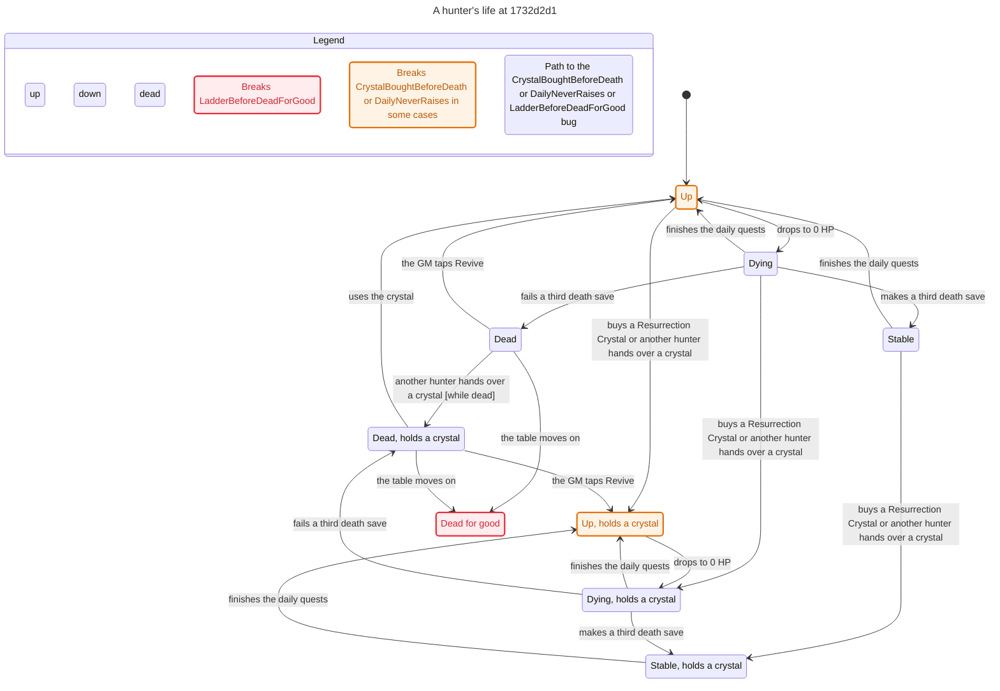

TLC report:

TLC reached 27 states and 74 steps. The chart draws 9 states and 19 arrows.
The view hides 16 steps, so the chart does not draw them.

**DailyNeverRaises breaks**
The shortest path has 2 steps:
0. Up
1. drops to 0 HP: Dying
2. finishes the daily quests: Up

**LadderBeforeDeadForGood breaks**
The shortest path has 3 steps:
0. Up
1. drops to 0 HP: Dying
2. fails a third death save: Dead
3. the table moves on: Dead for good

**CrystalBoughtBeforeDeath breaks**
The shortest path has 4 steps:
0. Up
1. drops to 0 HP: Dying
2. fails a third death save: Dead
3. another hunter hands over a crystal [while dead]: Dead, holds a crystal
4. uses the crystal: Up

**Rules that hold**
NoDeadlock

Replay and scope:
- DailyNeverRaises (settled b): replayed in `proofs/tla/life-replay.test.ts`. Damage of 9999 gives `dying`; `finishQuest` on the daily gives `{"at":"up","hp":45}` (recover default true). Also RAN by Neon in SMX-rules-1a and SMX-gates-3.
- CrystalBoughtBeforeDeath (settled a): replayed. Hunter B is dead and the shop refuses B (`dead`). Hunter A buys a crystal and `handOver` gives it to B; `useItem` gives `{"at":"up","hp":1}`. Whether a handed-over crystal counts as pre-purchased is a proposed rule (above).
- LadderBeforeDeadForGood (settled a): replayed. No hunter field names a revive or debt, and the life table moves a dead hunter only on `revive` (GM or crystal); every other event leaves `dead`.
- Leaves out: HP numbers, death-save counts, the fight's row (row-life.ts writes the same table), and gold.

### The GM's held Give… and End story (SMX-gates-5, SMX-views-3)

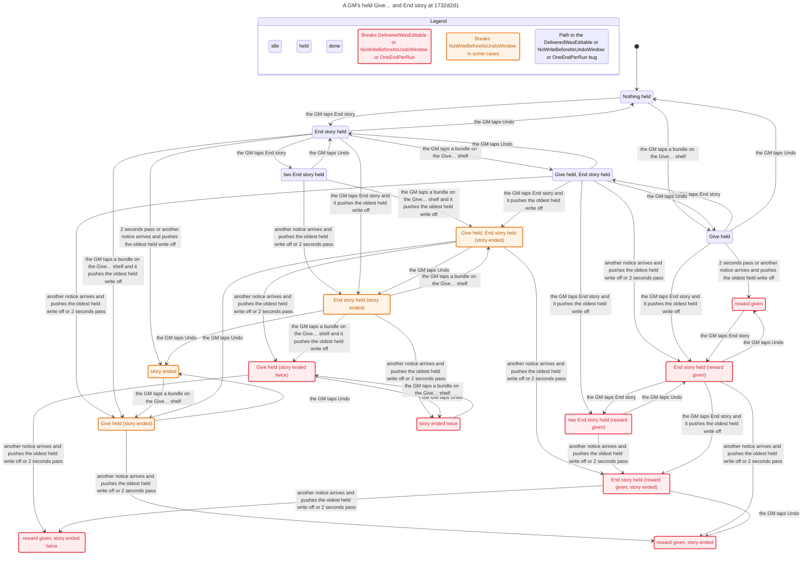

TLC report:

TLC reached 99 states and 329 steps. The chart draws 17 states and 44 arrows.
The view hides 133 steps, so the chart does not draw them.

**DeliveredWasEditable breaks**
The shortest path has 2 steps:
0. Nothing held
1. the GM taps a bundle on the Give… shelf: Give held
2. 2 seconds pass: reward given

**NoWriteBeforeItsUndoWindow breaks**
The shortest path has 3 steps:
0. Nothing held
1. the GM taps a bundle on the Give… shelf: Give held
2. the GM taps End story: Give held, End story held
3. the GM taps End story and it pushes the oldest held write off: two End story held (reward given)

**OneEndPerRun breaks**
The shortest path has 4 steps:
0. Nothing held
1. the GM taps End story: End story held
2. the GM taps End story: two End story held
3. the GM taps a bundle on the Give… shelf and it pushes the oldest held write off: Give held, End story held (story ended)
4. another notice arrives and pushes the oldest held write off: Give held (story ended twice)

**Rules that hold**
NoDeadlock

Replay and scope:
- DeliveredWasEditable (settled d): a shelf bundle is held, then 2 seconds pass, and the reward is given with no step to edit its words or numbers. Replayed by Neon's Playwright proof SMX-gates-5 (`proof-sm-gates-ui.e2e.ts`).
- NoWriteBeforeItsUndoWindow (proposed, needs the owner): a third toast pushes the oldest held write off and runs it. TLC's shortest path uses End story as the third toast; Neon's Playwright proofs SMX-gates-5 and SMX-views-3 replay the plain-notice path, which is the same line of code (ui.js:114).
- OneEndPerRun (proposed, needs the owner): End story tapped twice holds two ends of one run. Replayed by SMX-views-3 (two held toasts; Undo cancels one, the other ends the story).
- Leaves out: toast timing other than order, the room, and what Give… writes. The chart hides the plain toasts and timers that change nothing.

### Fight loot and the GM's Award form (SMX-gates-1, SMX-views-11)

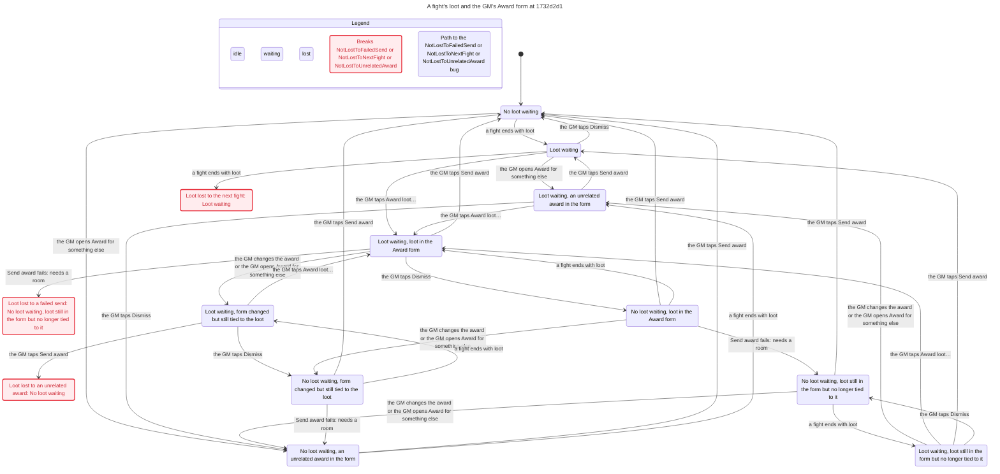

TLC report:

TLC reached 39 states and 150 steps. The chart draws 13 states and 32 arrows.
3 states outside the constraints each end a rule's path, and the chart includes them. TLC checks the rules in a state outside the constraints, but it does not explore past it.
The chart does not draw 45 steps that stay in one chart state.
The view hides 4 steps, so the chart does not draw them.

**NotLostToNextFight breaks**
The shortest path has 2 steps:
0. No loot waiting
1. a fight ends with loot: Loot waiting
2. a fight ends with loot: Loot lost to the next fight: Loot waiting

**NotLostToFailedSend breaks**
The shortest path has 3 steps:
0. No loot waiting
1. a fight ends with loot: Loot waiting
2. the GM taps Award loot…: Loot waiting, loot in the Award form
3. Send award fails: needs a room: Loot lost to a failed send: No loot waiting, loot still in the form but no longer tied to it

**NotLostToUnrelatedAward breaks**
The shortest path has 4 steps:
0. No loot waiting
1. a fight ends with loot: Loot waiting
2. the GM taps Award loot…: Loot waiting, loot in the Award form
3. the GM changes the award: Loot waiting, form changed but still tied to the loot
4. the GM taps Send award: Loot lost to an unrelated award: No loot waiting

**Rules that hold**
NoDeadlock

Replay and scope:
- NotLostToNextFight (proposed, needs the owner, gates-1.3): replayed by Neon's unit test SMX-gates-1b (a second fight with no loot sets `dropped` to null after the first fight's 900 gold was left for later). The with-loot variant is READ from pay.ts:115.
- NotLostToFailedSend (settled d): replayed by SMX-gates-1a. A send to a remote player with no room says "needs a room", sends nothing, and `dropped` is cleared anyway.
- NotLostToUnrelatedAward (settled d): replayed by Playwright SMX-gates-1 and SMX-views-11. After Award loot…, changing the form to +10 XP and sending clears the loot.
- Leaves out: amounts, which hunter, and the room. States past a loss are not explored (CONSTRAINT).

### A phone's ownership slot in a room (SMX-sync-5)

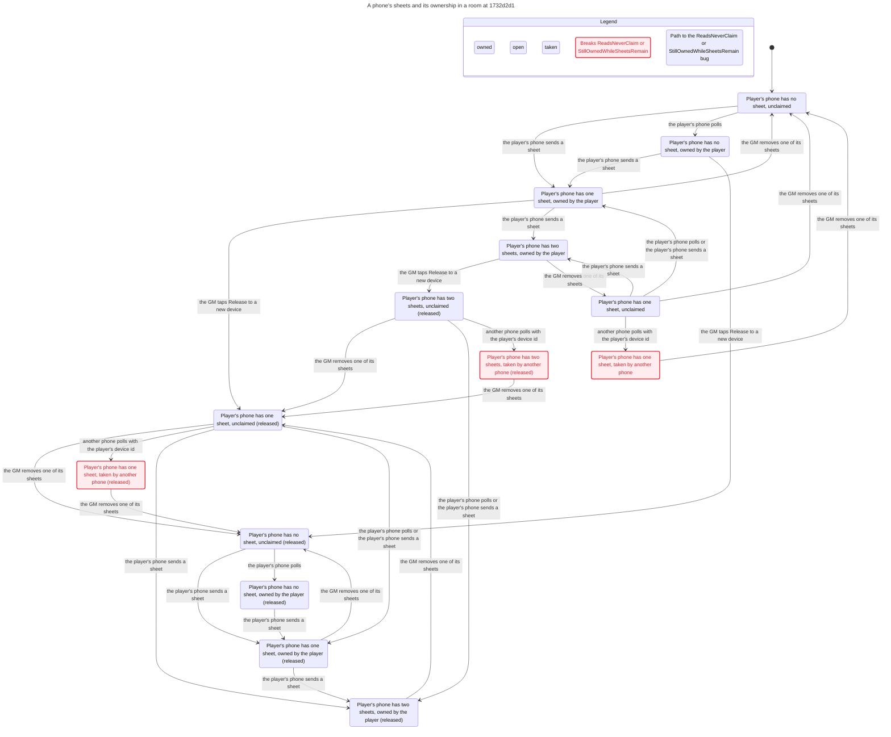

TLC report:

TLC reached 20 states and 68 steps. The chart draws 14 states and 29 arrows.
The chart does not draw 6 steps that stay in one chart state.
The view hides 5 steps, so the chart does not draw them.

**ReadsNeverClaim breaks**
The shortest path has 3 steps:
0. Player's phone has no sheet, unclaimed
1. the player's phone sends a sheet: Player's phone has one sheet, owned by the player
2. the GM taps Release to a new device: Player's phone has one sheet, unclaimed (released)
3. another phone polls with the player's device id: Player's phone has one sheet, taken by another phone (released)

**StillOwnedWhileSheetsRemain breaks**
The shortest path has 4 steps:
0. Player's phone has no sheet, unclaimed
1. the player's phone sends a sheet: Player's phone has one sheet, owned by the player
2. the player's phone sends a sheet: Player's phone has two sheets, owned by the player
3. the GM removes one of its sheets: Player's phone has one sheet, unclaimed
4. another phone polls with the player's device id: Player's phone has one sheet, taken by another phone

**Rules that hold**
NoDeadlock

Replay and scope:
- StillOwnedWhileSheetsRemain: replayed by Neon's server test SMX-sync-5 (real `serverOf(openDatabase(memoryStore()))`). After DELETE of d-vic1:h1, another token's GET `?d=d-vic1` gets d-vic1:h2's full sheet, and the player's PUT gets 403 "not your sheet".
- ReadsNeverClaim: replayed by the same test. After `/release`, the other token's GET claims d-vic1 and then receives the sealed chapter "SECRET CHAPTER".
- Leaves out: tokens' values, the GM's own device, rooms other than one. No rule call: this is data access, not a game rule.

## All 38 machines, ordered by importance

### 1. SMX-rules-1: Hunter life, vitals, refill, rest and maxima bypasses [high] [KNOWN] [RAN]

**Where it lives (at 1732d2d1):**
- `src/core/hunter/vitals.ts:17-86 (explicit Life table: up/dying/stable/dead)`
- `src/core/hunter/vitals.ts:179-199 (refilled, refill, rest, fitMaxima)`
- `src/core/hunter/grant.ts:178-188 (grant level-up refill bypasses sheetEdit and claims refill on dead hunter)`
- `src/core/hunter/grant.ts:247-250 (finishQuest daily recovery calls refill directly, raising dying hunter with no chronicle fact)`
- `src/core/hunter/grant.ts:342-354 (sheetEdit put/drop skip fitted(); rest runs on dead hunter)`
- `src/core/hunter/sheet.ts:188-194 (fitted and setMaximum unclamped hpAdj drift)`
- `src/core/hunter/use.ts:127-142 (Resurrection Crystal revive with no pre-death or rank gate)`
- `src/core/combat/fight.ts:496-503 (fight refill command refills dead hunter row mana)`
- `src/core/rules.ts:152-153 (dailyTemplate.recover defaults to true)`

**States and moves:** A hunter's life has 4 explicit states (up, dying, stable, dead), but vitals ownership, refills, rests, and maximum clamps are split across grant(), finishQuest(), sheetEdit(), fight.ts refill(), and setMaximum(). Instead of gating every vital mutation through one life-and-maxima reducer, direct helpers bypass Life guards (filling a dead hunter's mana/clearing collapse on level-up or rest), bypass chronicle recording (raising a dying hunter on daily completion), or skip fitMaxima (leaving HP/mana/fatigue above their maxima after status changes).

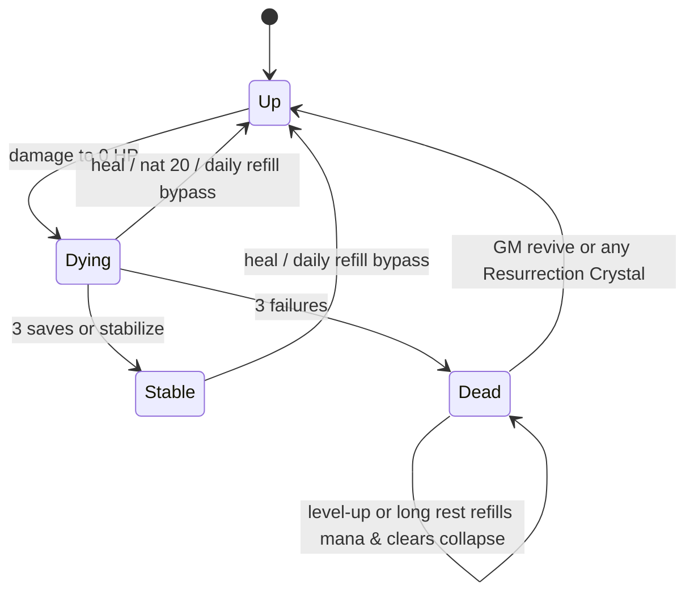

**Contradictory states the code allows:**
SMX-rules-1.1. **Dying hunter + completing daily quest -> stands up at full HP/mana with no life:raised chronicle fact**
   - Tap: Drop a hunter to 0 HP (dying, 2 death-save failures), open Quests, and complete the active daily quest.
   - Shows: Hunter immediately stands up at full HP (45/45) and full mana (10/10), with no life:raised fact recorded in Chronicle.
   - Should show: Completing a daily quest must never heal HP, restore mana, or stand a dying hunter up.
   - Rule: settled (the owner, rule b): dailies do not recover you.
SMX-rules-1.2. **Dead hunter + level-up or long rest -> mana refilled, collapse cleared, used reset, levelup.refill=true while staying dead**
   - Tap: Kill a hunter (3 failed death saves) with 0 mana and collapsed=true, then either award enough XP to level up or tap Long rest on the Status screen.
   - Shows: On level-up, the popup claims HP and mana were fully restored and mana jumps to 10 while the hunter remains Dead at 0 HP; on Long rest, mana jumps to 10, Exhausted/collapsed clears, rest-limited uses reset, and a rest fact is logged while Dead.
   - Should show: A dead hunter cannot take a rest and gets no vital refill or 'HP and mana fully restored' banner on level-up.
   - Rule: **proposed, needs the owner**: a dead hunter cannot rest, and a level-up gives a dead hunter no refill.
SMX-rules-1.3. **sheetEdit put/drop status lowering VIT/hpMax + no fitMaxima -> stored life.hp > hpMax; setMaximum(0) repeated -> unbounded negative hpAdj**
   - Tap: Apply a -20 VIT debuff status to a full-HP hunter (or remove a +VIT buff) via Status, or repeatedly set max HP to 0 in GM edit.
   - Shows: Stored life.hp remains 56 while sheet hpMax drops to 45 (56 > 45 until another edit clamps it); repeated setMaximum(0) drives hpAdj from 0 -> -45 -> -46 without bound.
   - Should show: Every status put/drop clamps vitals via fitted(), and setMaximum clamps target max >= 1 before computing adjustment delta.
   - Rule: **proposed, needs the owner**: max HP is at least 1, and a status change clamps HP, mana and fatigue to the new maxima at once.

**How it knows (SMX-rules-1):** RAN. .smaudit/proofs/rules/hunter-sm.test.ts | bun test ./.smaudit/proofs/rules/hunter-sm.test.ts | SMX-rules-1a: dailyRecover=true lifeAfter={"at":"up","hp":45} manaAfter=10 raisedFact=false | SMX-rules-1b: deadLevelupRefill=true deadLvMana=10 deadLvLife=dead deadRestLife=dead deadRestMana=10 deadRestCollapsed=false deadRestUsed=0 | SMX-rules-1c: storedHp=56 newHpMax=45 hpAdjDrift=0->-45->-46

**Proposed explicit model:**
```ts
type ReviveStanding = 'freeLeft' | 'debtLeft' | 'crystalOrGmOnly';
type DeadWindow = { at: 'deadWithinHour'; diedAt: string } | { at: 'deadForGood' };
type LifeV2 = { at: 'up'; hp: number } | { at: 'dying'; s: 0|1|2; f: 0|1|2 } | { at: 'stable' } | DeadWindow;
// Single vitalStep(h, ev, R): refuses rest/refill when dead; removes daily recovery; always chains fitted() after status/max edits; enforces revive standing + pre-death crystal rank check.
```

**What it would delete:**
- src/core/hunter/grant.ts:183-185 direct refill() bypass outside sheetEdit
- src/core/hunter/grant.ts:247-248 dailyTemplate.recover refill() bypass
- src/core/hunter/vitals.ts:179-180 unconditional mana refill for dead hunters
- src/core/hunter/vitals.ts:189-195 unguarded rest() on dead hunters
- src/core/hunter/grant.ts:350-351 unfitted putStatus/dropStatus returns
- src/core/hunter/sheet.ts:192 unclamped setMaximum delta

**Related re-audit ids:** BUG-rules-20, BUG-rules-21, NEW-orch-1, NEW-rules-2
**World:** A death; Revive standing; A crystal debt; The daily quest.
**Notes:** Confirmed all known sub-bugs plus NEW dead-hunter long-rest recovery and world-bible disagreements.

### 2. SMX-sync-5: Server device-ownership slot lifecycle (TOFU on GET poll and per-device wipe on per-sheet kick) [high] [KNOWN] [RAN]

_Severity:_ Neon rated it med. Raised by the orchestrator: the server test and the TLA+ model both reach a state where another phone at the table holds a player's sheet, locks the player out, and reads a sealed chapter.

**Where it lives (at 1732d2d1):**
- `server.ts:185-192,315-327 (setRemoval deletes sheet_owners for the entire deviceId on a single-sheet DELETE)`
- `server.ts:194-196,329-331 (owner / bindOwner / releaseOwner)`
- `server.ts:407-415,470 (GET poll calls proven(), which calls bindOwner TOFU on read)`
- `server.ts:506-513,519-522,532 (release, DELETE sheet, PUT sheet authorization)`
- `src/edge/sync.ts:848-852 (releaseSheet regex /^(d-[a-z0-9]+):/ rejects valid non-'d-' DeviceIds)`
- `src/core/protocol.ts:431-435,1026-1029 (targeted system whispers are not sealed in servedTo)`

**States and moves:** Each (room, deviceId) ownership slot moves implicitly between Unbound and Bound(tokenHash). Both write routes AND read-only GET polls transition Unbound -> Bound, while per-sheet DELETE wipes ownership for the whole device even when other sheets of that device stay on the board.

```mermaid
stateDiagram-v2
  state "Unbound" as U
  state "Bound(victimHash)" as BV
  state "Bound(attackerHash)" as BA
  [*] --> U
  U --> BV : victim PUT sheet
  BV --> U : GM release OR DELETE single sheet (dev:h1)
  U --> BA : attacker GET ?d=victimDev (TOFU on read!)
  BA --> BA : victim PUT dev:h2 -> 403 not your sheet; attacker reads sealed events & full sheet
```

**Contradictory states the code allows:**
SMX-sync-5.1. **Per-sheet DELETE /sheets/devA:h1 unbinds whole device devA while devA:h2 remains on board -> attacker GET ?d=devA hijacks devA**
   - Tap: Victim has two sheets (d-vic1:h1 and d-vic1:h2) in a room; GM removes only d-vic1:h1; another room client polls GET ?d=d-vic1 with its own token.
   - Shows: setRemoval deletes sheet_owners for all of d-vic1; attacker's GET poll TOFU-binds d-vic1 to attacker's token, receives Victim Two's full sheet (not a face) and sealed chapter events for d-vic1:h2, while real victim gets 403 'not your sheet' on d-vic1:h2.
   - Should show: Keep ownership bound while the device still holds another sheet, and never let read-only GET polls create new owner bindings (verify-only on GET; bind only on PUT/POST writes).
SMX-sync-5.2. **GM taps Release to a new device -> attacker GET ?d=devA claims slot before real player writes**
   - Tap: GM releases a player's device so they can reconnect from a new phone; another client polls GET ?d=<victimDev> first.
   - Shows: Attacker's GET poll binds victimDev, locking out the player and reading sealed story chapters/offers addressed to victimDev.
   - Should show: Separate verifyOwner (used by GET polls) from claimOwner (used only on authenticated write/join), and seal targeted system whispers in protocol.ts.
   - Rule: **proposed, needs the owner**: a System whisper addressed to one hunter is sealed from other phones.
SMX-sync-5.3. **Server accepts non-'d-' DeviceId (parseDeviceId) while client releaseSheet rejects it with NOT_GM**
   - Tap: GM taps 'Release to a new device' on a sheet whose valid deviceId does not start with 'd-'.
   - Shows: sync.ts:849 regex /^(d-[a-z0-9]+):/ fails and returns NOT_GM without calling /release.
   - Should show: Use parseSheetKey + deviceOf in releaseSheet so client and server agree on valid DeviceIds.

**How it knows (SMX-sync-5):** RAN. .smaudit/proofs/sync/core-server.test.ts | bun test ./.smaudit/proofs/sync/core-server.test.ts | pass: after DELETE d-vic1:h1, attacker GET ?d=d-vic1 received full hunter sheet for d-vic1:h2, victim PUT d-vic1:h2 got 403 {error:'not your sheet'}, and after /release attacker GET received sealed chapter 'SECRET CHAPTER'

**Proposed explicit model:**
```ts
type OwnerCheck = 'verify' | 'claim';
// proven(req, st, code, dev, mode: OwnerCheck): only 'claim' (PUT/POST) calls bindOwner; GET uses 'verify'.
// setRemoval('remove') deletes sheet_owners only when no remaining sheet in the room belongs to deviceOf(key).
```

**What it would delete:**
- server.ts:411 (unconditional bindOwner inside GET-poll proven())
- server.ts:188,321 (unconditional device owner deletion on single-sheet removal)
- src/edge/sync.ts:849 (ad-hoc /^(d-[a-z0-9]+):/ regex)

**Related re-audit ids:** AW-sync-9, BUG-sync-17
**World:** A System message or reward.
**Notes:** Verified end-to-end against real serverOf(openDatabase(memoryStore())).

### 3. SMX-gates-5: Held-toast commit-on-timeout delivery for GM Give… & End story [high] [KNOWN] [RAN]

_Also reported as:_ SMX-views-3 (Held-toast deferred commit queue & eviction-triggers-commit, high). Their locations, combinations and models are folded in below.

**Where it lives (at 1732d2d1):**
- `src/views/ui.js:65-115 (toasts Map holds delayed commit act(), slice(0, -2) evicts oldest toast by calling ended() -> act(), visibilitychange/pagehide calls heldNow() -> ended())`
- `src/views/gm.js:448-463 (giveFrom closes over id/key/b and schedules sendAward inside 2s held toast with no draft/edit step)`
- `src/views/give-shelf.js:49-112 (shelf pick returns built-in or saved bundle immediately without editable review)`
- `src/views/stories.js:225-232 (endStory schedules storyMove('end') in held toast with no in-flight guard per run)`
- `src/views/ui.js:77-90 (toasts Map storing { timer, act }, off(), ended(), heldNow() on visibilitychange/pagehide)`
- `src/views/ui.js:95-116 (toast() mixes plain and held toasts; line 114 evicts beyond 2 via ended(old) executing act() immediately)`
- `src/views/gm.js:454-463 (giveFrom() schedules sendAward inside 2000ms held toast with no review/edit step)`
- `src/views/stories.js:225-232 (endStory() schedules story end inside 2000ms held toast with no per-run pending guard)`

**States and moves:** Pending GM writes for roleplay awards (Give…) and ending a running story (End story) exist ONLY as closures inside ui.js's 2-slot visual toast queue (toasts Map). A held write starts in Held (2s timer, Undo button shown) and transitions to Committed on timer expiry, OR early eviction when 2 other toasts appear, OR page hide/backgrounding; or to Cancelled on Undo tap. Neither gm.js nor stories.js tracks an in-flight state. A held GM action (roleplay reward Give… or End story) lives as an entry in ui.js toasts Map alongside plain informational toasts. Transitions: created -> timer armed (2s); Undo click -> off() drops act; timeout / visibilitychange / pagehide -> ended() runs act(); 2 new toasts arrive -> slice(0, -2) calls ended(old) and commits act() immediately.

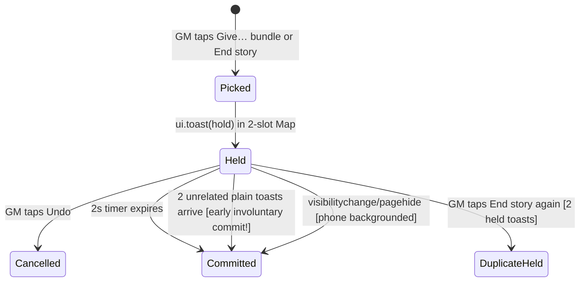

**Contradictory states the code allows:**
SMX-gates-5.1. **2 unrelated plain toasts arriving during the 2s Undo window immediately evict the held toast and commit the award involuntarily**
   - Tap: GM taps Give… on a hunter card, mis-taps a bundle on the shelf; before the GM can tap Undo, 2 routine toasts arrive (e.g. room/roll/action notifications).
   - Shows: ui.js:114 slices off the oldest toast and calls ended(old) -> held.act(), immediately committing the reward and removing the Undo button within milliseconds.
   - Should show: Plain informational toasts must never evict and prematurely commit a held Undo action.
   - Rule: **proposed, needs the owner**: a held write runs only when its own Undo window runs out.
SMX-gates-5.2. **GM Give… shelf skips editable review before scheduling delivery of built-in System window text and rewards**
   - Tap: GM taps Give… on a hunter card and taps a built-in roleplay bundle.
   - Shows: Delivery of the built-in System window words and reward numbers is immediately queued on a 2s timer with no opportunity to edit wording or amounts first.
   - Should show: Every System message and reward should allow GM wording/reward editing and explicit approval before delivery.
   - Rule: settled (the owner, rule d): every System message and reward is editable and approved by the GM.
SMX-gates-5.3. **Double-tapping End story spawns duplicate held commits (BUG-views-23) and Give… closure ignores room/hunter changes during 2s hold**
   - Tap: GM taps End story twice rapidly (or switches/leaves room during Give…'s 2s hold).
   - Shows: Two held toasts stack for the same story end (second produces refusal warning after first commits); Give… closure executes sendAward against whatever room is active 2s later.
   - Should show: Pending commits should be keyed by target entity (story run id / hunter+room) in an explicit pending-action state, never duplicated in a visual toast queue.
SMX-views-3.1. **Held Give… reward toast evicted by 2 unrelated toasts before Undo timer expires**
   - Tap: In GM view, tap Give… on a hunter card and tap a reward bundle (showing a 2s toast with Undo). Within 2s, two unrelated toasts arrive (e.g. player rolls, combat news, or rapid GM actions).
   - Shows: The held toast is evicted at ui.js:114 via ended(old), immediately executing sendAward() and granting the reward with no Undo window.
   - Should show: Plain toasts never evict or force-commit held Undo actions; GM rewards remain cancellable (and editable) until explicitly approved or their own Undo window expires.
   - Rule: settled (the owner, rule d) for "editable"; **proposed, needs the owner**: a held write runs only when its own Undo window runs out, never because other notices arrived.
SMX-views-3.2. **Double-tapping End story queues two held toasts for the same runId**
   - Tap: In GM view -> Stories, tap End story twice on a running story, then tap Undo on the first held toast.
   - Shows: Two held toasts appear; clicking Undo cancels only one, while the second remains armed and ends the story.
   - Should show: A run already pending end cannot queue a second held-end action; Undo cancels the pending end cleanly.
   - Rule: **proposed, needs the owner**: a story can only be ended once; a second End story while one is held does nothing.

**How it knows (SMX-gates-5):** RAN. tests/e2e/proof-sm-gates-ui.e2e.ts | timeout 600 bunx playwright test tests/e2e/proof-sm-gates-ui.e2e.ts --workers=1 -> PROOF[UI-SMX-gates-5] heldToastsLeft=0 logDelta=1 xp=0->0 gold=0->0
**How it knows (SMX-views-3):** RAN. tests/e2e/proof-sm-views-a.e2e.ts | timeout 600 bunx playwright test tests/e2e/proof-sm-views-a.e2e.ts --workers=1 --output=/tmp/pw-views-a | SMX-views-3 OBSERVED: Give award committed early on eviction (GM gave logs 0->1); double End story ended="ended" despite clicking Undo

**Proposed explicit model:**
```ts
type PendingCommit =
  | { readonly kind: 'give'; readonly id: string; readonly room: RoomCode | null; readonly to: HunterRef; readonly draft: EditableAward; readonly state: 'draft' | 'undoing' }
  | { readonly kind: 'endStory'; readonly runId: StoryRunId; readonly seen: number; readonly state: 'undoing' };
// Held undo banners live in their own non-evictable slot separate from plain informational toasts.
```
```ts
type PendingAction = { id: string; key: string; label: string; commit: () => void; state: 'pending' | 'cancelled' | 'committed' };
// Separate pending-commit slot(s) keyed by action key (e.g. `story-end:${runId}`) from ephemeral info toasts so info toasts only evict info toasts, never calling commit() on eviction; GM Give… enters explicit review/confirm before commit.
```

**What it would delete:**
- src/views/ui.js:114 (evicting held toasts via slice(0, -2) -> ended())
- src/views/gm.js:459-462 (unkeyed Give… closure without room check or draft review)
- src/views/stories.js:228-231 (unguarded duplicate End story held toasts)
- src/views/ui.js:77,114 (mixed toasts Map committing held writes on max-2 eviction)
- src/views/stories.js:225-232 (unguarded duplicate endStory held toasts)

**Related re-audit ids:** BUG-views-23, AW-views-9, SM-views-1
**World:** A System message or reward.
**Notes:** Proven in live Playwright browser: 2 plain toasts evicted the Give… held toast in <150ms and committed the write immediately. audit-views-3 replaced toast DOM expandos with the toasts Map, but left the mixed-queue commit-on-eviction machine unmodeled.

### 4. SMX-gates-1: Dropped fight loot & Award-form handoff [high] [NEW] [RAN]

_Also reported as:_ SMX-views-11 (GM Award drop context & unsaved editor dirty DOM flags, med). Their locations, combinations and models are folded in below.

**Where it lives (at 1732d2d1):**
- `src/core/save.ts:196 (Save.dropped nullable field holding un-awarded fight loot)`
- `src/core/gates/pay.ts:109-116 (settleEncounter unconditionally overwrites Save.dropped; dropDealt clears it)`
- `src/views/combat.js:159,468,483-495 (offerDrop modal: 'Award loot…' calls api.award.open(..., true), 'Later' leaves Save.dropped, 'Dismiss' calls dropDealt)`
- `src/views/gm.js:383-406,415-443,836 (pendingAward handoff variable, awardSec().dataset.drop DOM flag, doAward/sendAward unconditionally clearing Save.dropped via dropDealt on any successful grantWrite)`
- `src/views/gm.js:383-406 (pendingAward + awardSec().dataset.drop='1' cleared only when sendAward succeeds)`
- `src/views/gm.js:548,593,605,828-829,845 (Roll tables and Rules editor track ta.dataset.dirty='1' on DOM textareas without reset on campaign import/reset)`

**States and moves:** Fight loot moves implicitly across 4 uncoordinated storage layers: none (Save.dropped=null) -> dropped (settleEncounter writes Save.dropped) -> offered (combat.js offerDrop modal) -> handoff (gm.js module-level pendingAward) -> loadedInForm (DOM awardSec().dataset.drop='1') -> cleared (dropDealt sets Save.dropped=null and dataset.drop=''). There is no link between the drop's identity/contents and what the Award form actually sends, nor any queue for multiple fights' drops. The GM Award form implicitly carries a hidden DOM boolean awardSec().dataset.drop ('1' | '') set when opened from a fight's loot drop (award.open(..., drop=true)) and cleared only on sendAward() success or another award.open(..., drop=false). Collapsing/abandoning the form or manually replacing its contents leaves dataset.drop='1' armed.

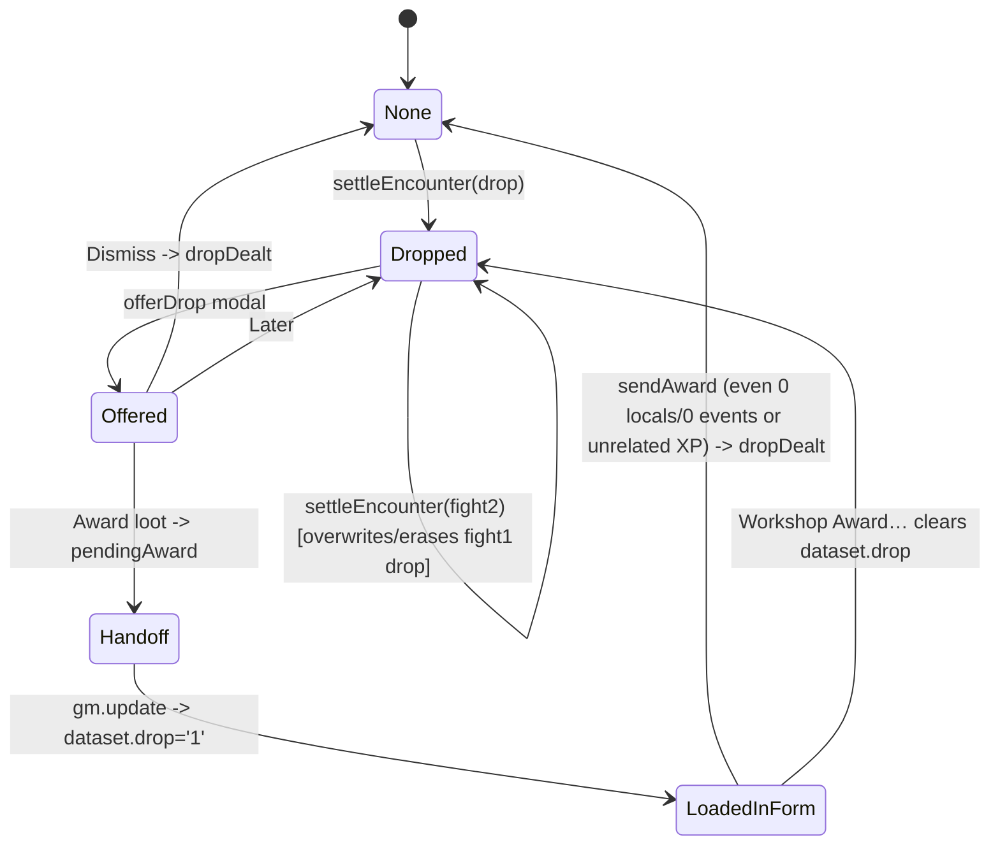

**Contradictory states the code allows:**
SMX-gates-1.1. **Failed remote-only sendAward (0 local hunters, 0 posted room events) still runs dropDealt and deletes Save.dropped**
   - Tap: After a fight drops loot, GM taps 'Award loot…', selects only a remote player while not in a room (or an unpostable award), and taps 'Send award'.
   - Shows: Error message 'needs a room: open one with the room button at the top' (not sent), yet Save.dropped is silently set to null and dataset.drop is cleared.
   - Should show: Save.dropped must remain intact until at least one intended recipient actually receives or queues the drop, or the GM explicitly dismisses it.
   - Rule: settled (the owner, rule d): loot leaves only by being given or by the GM's Dismiss.
SMX-gates-1.2. **Editing the Award form to send an unrelated reward (or picking a different bundle) while dataset.drop==='1' silently deletes Save.dropped**
   - Tap: GM taps 'Award loot…' (750 gold drop), changes their mind, sets gold to 0 and XP to 10 (or loads another bundle), and taps 'Send award'.
   - Shows: Hunter gets +10 XP, and the un-awarded 750 gold + item fight drop is permanently deleted from Save.dropped.
   - Should show: Switching bundle or clearing/replacing the loaded drop should detach dataset.drop so Save.dropped stays pending until actually given or dismissed.
SMX-gates-1.3. **Settling a second fight overwrites/erases the first fight's deferred ('Later') Save.dropped**
   - Tap: Fight 1 drops 900 gold; GM taps 'Later'. Fight 2 ends with 0 loot and GM settles Fight 2.
   - Shows: settleEncounter sets dropped: null, permanently destroying Fight 1's 900 gold drop with no warning.
   - Should show: Pending fight drops should queue or merge rather than silently overwriting an unhandled drop.
   - Rule: **proposed, needs the owner**: loot left for later survives the next fight (queued or merged).
SMX-views-11.1. **Abandoning a fight-drop Award form and later sending an unrelated manual award silently wipes Save.dropped**
   - Tap: After a fight drops loot, tap 'Award loot…' (opening GM Award with the loot). Decide not to hand out the loot yet, collapse Award, later open Award and change it to +25 XP (0 gold) for a hunter, and tap Send award.
   - Shows: Because awardSec().dataset.drop stayed '1', sending the unrelated +25 XP award executes dropDealt() and permanently clears Save.dropped (losing the unclaimed fight loot).
   - Should show: Track the drop association explicitly (showing a clear 'Fight drop' banner with a 'Clear drop link' / reset when the form is dismissed or cleared) so unrelated manual awards never wipe Save.dropped.
   - Rule: settled (the owner, rule d): fight loot is a reward, and it leaves only by being given or by the GM's Dismiss.

**How it knows (SMX-gates-1):** RAN. .smaudit/proofs/gates/sm-gates-proofs.test.ts | bun test ./.smaudit/proofs/gates/sm-gates-proofs.test.ts -> PROOF[SMX-gates-1a] granted=0 outbox=0 droppedBefore=750 droppedAfter=null; PROOF[SMX-gates-1b] priorDrop=900 afterSecondFightDrop=null || tests/e2e/proof-sm-gates-ui.e2e.ts | timeout 600 bunx playwright test tests/e2e/proof-sm-gates-ui.e2e.ts --workers=1 -> PROOF[UI-SMX-gates-1] dropAttrBefore=1 dropAttrAfter="" savedDropped=null
**How it knows (SMX-views-11):** RAN. tests/e2e/proof-sm-views-a.e2e.ts | timeout 600 bunx playwright test tests/e2e/proof-sm-views-a.e2e.ts --workers=1 --output=/tmp/pw-views-a | SMX-views-11 OBSERVED: sending unrelated +25 XP cleared Save.dropped -> null
_Note:_ The proofs RAN the empty second fight; a second fight WITH loot overwrites the same way (pay.ts:115 writes `dropped` from the new drop alone). That variant was READ and is in the TLA+ model.

**Proposed explicit model:**
```ts
type PendingDrop = { readonly id: DropId; readonly fightId: FightId; readonly gold: number; readonly items: readonly Item[]; readonly state: 'pending' | 'inAwardForm' | 'dismissed' };
// Save.drops: readonly PendingDrop[]; sendAward accepts dropId only when >=1 local granted or >=1 event queued, and only if editor still references that dropId.
```
```ts
type AwardDraftSource = { kind: 'manual' } | { kind: 'fight-drop'; dropSig: string };
// Reset to { kind: 'manual' } when the Award section is collapsed/reset or when Save.dropped no longer matches dropSig; show explicit UI indicator while linked to a fight drop.
```

**What it would delete:**
- src/views/gm.js:383 (pendingAward module variable)
- src/views/gm.js:392,405 (awardSec().dataset.drop DOM state flag)
- src/core/gates/pay.ts:110 (single-slot Save.dropped overwrite)
- src/views/gm.js:392,405 (implicit awardSec().dataset.drop='1' DOM attribute)
- src/views/gm.js:548,593,828-829,845 (unscoped ta.dataset.dirty DOM flags)

**Related re-audit ids:** none (new).
**World:** A System message or reward.
**Notes:** Fully reproduced in both core unit tests and live Playwright UI. New medium-severity data-loss bug in GM Award form state.

### 5. SMX-gates-2: Distributed room solo-gate run, route/identity binding & waiting-run lock [high] [KNOWN] [RAN]

**Where it lives (at 1732d2d1):**
- `src/core/gates/solo.ts:144-149,200-235,308-354,410-446 (SoloGate lacks room/route; soloKey hashes only Hunter; soloRan switches local vs room settlement on live seat; soloPlan ignores g.solo; soloTaken enters non-solo gates)`
- `src/core/gates/solo-wait.ts:45-107 (WaitingRun TABLE: taken has dismiss:null; waitingGates blocks re-entry forever if GM misses soloRun)`
- `src/views/gates.js:273-338 (player solo run completion checks live seat; GM incoming soloRun handler auto-rolls loot, auto-clears gate, and auto-sends soloAnswer with zero GM review/approval)`
- `src/edge/room-events.ts:199-214 (player soloAnswer landing hardcodes boss:true and omits gate chronicle fact)`
- `src/edge/sync.ts:433,663 (runsGone only on 404 roomGone, not on manual leave)`

**States and moves:** A solo run of a room world gate spans two phones and three disconnected state layers: player SoloRun (from=soloKey(hunter), no gate/route/room snapshot) -> soloRan (branches on current app.seat() rather than start route) -> WaitingRun (posted -> taken -> answered | lost) -> GM soloPlan/soloTaken (autonomous clear + loot roll + soloAnswer). Because route and gate identity are not frozen at run start and WaitingRun.taken has no reconciliation against worldDoc or dismiss escape, the two phones can diverge permanently.

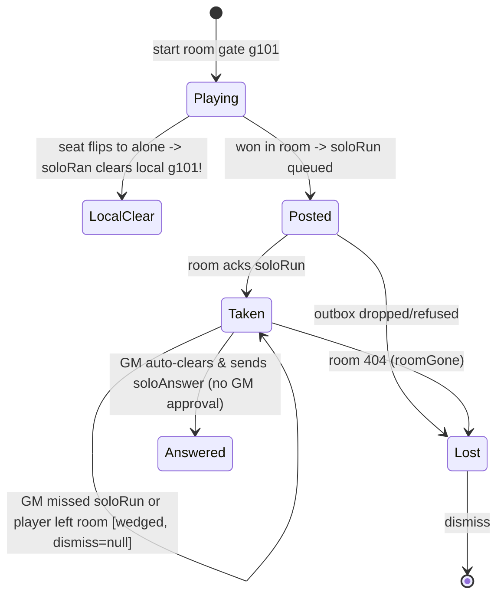

**Contradictory states the code allows:**
SMX-gates-2.1. **Cross-context gate substitution: room E-rank solo run settles player's local S-rank world gate sharing the same GateId (g101) when seat flips to 'alone'**
   - Tap: Player has a local S-rank gate g101 (every new save starts at seq:100), joins a room whose GM also spawned an E-rank solo gate g101, starts a solo run on the room gate, disconnects/leaves the room mid-run, and finishes the run.
   - Shows: soloRan sees soloRoute('alone')==='here', soloKey(h) still matches (hashes only hunter), and settles the E-rank room win against the player's local S-rank gate g101, clearing it and paying 120,000 XP.
   - Should show: A SoloRun must bind its route, roomCode, gateId, and roster hash at start; leaving the room or switching context must refuse settlement rather than substituting a local gate.
SMX-gates-2.2. **GM unticking 'Open to solo runs' mid-run still clears & pays the gate on win, and a lost/stalled soloRun moves a non-solo gate to raiding (BUG-gates-7)**
   - Tap: GM creates a gate with solo=false (or unticks 'Open to solo runs' before a player's soloRun arrives); player's soloRun arrives.
   - Shows: soloPlan returns { kind: 'paid' } and clears the gate on win, or soloTaken transitions the non-solo gate from detected to raiding on loss.
   - Should show: soloPlan and soloTaken must check g.solo and refuse runs against gates not open to solo runs.
   - Rule: **proposed, needs the owner**: a gate not open to solo runs refuses a solo run.
SMX-gates-2.3. **GM phone auto-clears world gate, auto-rolls loot, and auto-delivers soloAnswer rewards with zero GM review/edit/approval**
   - Tap: Player wins a room solo gate; soloRun arrives on GM phone.
   - Shows: gates.js:329-338 immediately rolls loot, clears the gate, and queues soloAnswer delivering XP, gold, and items directly to the player without GM confirmation or editing.
   - Should show: Incoming soloRun clear rewards and System window text should queue for GM review/edit/approval before delivering to the player.
   - Rule: settled (the owner, rule d): a solo run's clear rewards and System text wait for the GM.
SMX-gates-2.4. **WaitingRun stuck permanently in 'taken' state with dismiss:null, locking waitingGates forever**
   - Tap: Room accepts player's soloRun (WaitingRun -> taken), but GM tab is read-only when sync cursor advances (BUG-sync-7), GM clears the gate manually, or player leaves the room manually.
   - Shows: WaitingRun stays 'taken' ('Waiting for the GM's phone to pay it') forever; runDismissed refuses with 'no-run' and waitingGates blocks re-entry until room 404.
   - Should show: WaitingRun should reconcile against worldDoc (gate cleared/closed/gone) or manual room leave and offer a dismiss/retry transition.

**How it knows (SMX-gates-2):** RAN. .smaudit/proofs/gates/sm-gates-proofs.test.ts | bun test ./.smaudit/proofs/gates/sm-gates-proofs.test.ts -> PROOF[SMX-gates-2a] localGate="Local Jeju S-Rank" status=cleared paidXp=120000; PROOF[SMX-gates-2b] g.solo=false winPlan=paid lostGateStatus=raiding; PROOF[SMX-gates-2c] state=taken dismissRefused=no-run waitingGates=["g101"]

**Proposed explicit model:**
```ts
type SoloRunTarget =
  | { readonly route: 'personal'; readonly id: PersonalGateId; readonly rosterHash: string }
  | { readonly route: 'localWorld'; readonly id: GateId; readonly rosterHash: string }
  | { readonly route: 'roomWorld'; readonly room: RoomCode; readonly id: GateId; readonly rosterHash: string };
// WaitEvent adds { type: 'leftRoom' } | { type: 'gateGoneInWorldDoc' }; GM soloRun queues PendingSoloApproval { state: 'review' | 'approved' | 'withheld' }.
```

**What it would delete:**
- src/core/gates/solo.ts:144-149 (unscoped SoloGate union without route/room/rosterHash)
- src/core/gates/solo.ts:334 (live soloRoute(c.ready.seat) branch during settlement)
- src/views/gates.js:329-338 (autonomous GM soloAnswer auto-payout)

**Related re-audit ids:** BUG-gates-7, BUG-gates-8, BUG-gates-11, BUG-sync-7
**World:** A world gate, A personal gate, A System message or reward.
**Notes:** Cross-context local gate theft (120,000 XP from E-rank room win) and WaitingRun 'taken' permanent lock are newly discovered bugs in this lifecycle alongside BUG-gates-7/8/11.

### 6. SMX-gates-3: Daily rollover, recovery & overdue urgent quest clock [high] [KNOWN] [RAN]

**Where it lives (at 1732d2d1):**
- `src/views/quests.js:223-272,295-330,600-603 (wake timer, checkDaily ignores refused grantWrite and fails to re-arm; urgent auto-fail skips sendUpdate & hunter.granted; costs.find matches first cost per hunter)`
- `src/core/hunter/quests.ts:216-310 (completeQuest allDaily flag ignores lastCompleteKey===today; rollover overdue urgent handling)`
- `src/core/hunter/grant.ts:234-292 (finishQuest refills vitals & revives dying hunter on allDaily; rolledOver emits no room questUpdate events)`
- `src/core/hunter/penalty.ts:94-97 (penalty lifting)`

**States and moves:** The daily/urgent clock coordinates wall-clock timer (wake), world.lastDailyKey, per-hunter daily.{lastCheckedKey,lastCompleteKey,streak}, quest statuses, urgent dueAt, daily recovery, and room sync. On wake, checkDaily runs gates.tick() then calls grantWrite('daily-check', rolledOver) without checking refusal, fires System popups from captured outer arrays, and relies on store.subscribe(arm) to reschedule the clock.

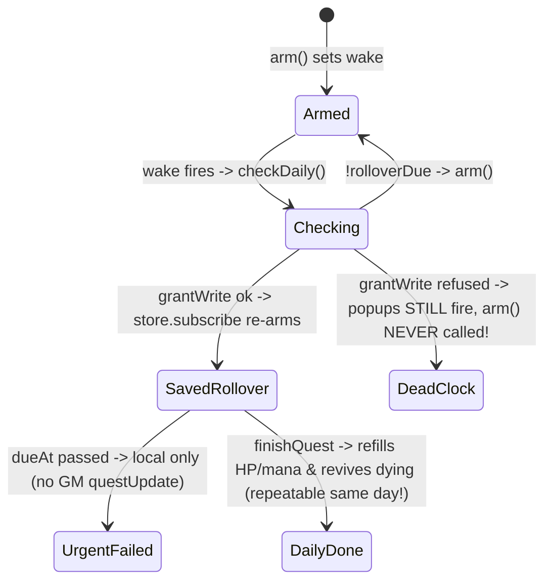

**Contradictory states the code allows:**
SMX-gates-3.1. **Completing a daily quest refills HP/mana, revives a dying hunter (NEW-orch-1/BUG-rules-21), and completing a 2nd daily on the same day triggers full recovery again**
   - Tap: A dying hunter (0 HP, 0 mana) completes their daily quest; later the same day they drain mana again, add/complete a second daily quest.
   - Shows: Daily 1 stands the dying hunter back up (life.at='up', recover='sheet'); Daily 2 on the same day triggers recover='sheet' again and refills mana to 10.
   - Should show: Finishing a daily quest must never heal HP, restore mana, clear fatigue, or revive a dying hunter.
   - Rule: settled (the owner, rule b): dailies do not recover you, and do not raise a dying hunter.
SMX-gates-3.2. **checkDaily() ignores refused grantWrite('daily-check'), pops false PENALTY/QUEST FAILED windows, and kills the wake timer permanently**
   - Tap: Midnight rollover or urgent deadline fires while a hunter is in an active fight whose row refuses the fail-cost write (or write is refused).
   - Shows: quests.js:315-329 never checks isRefused(out): it pops 'PENALTY' and 'QUEST FAILED' windows from mutated outer arrays for an unsaved rollover, and since store didn't notify, arm() is never called again until reload.
   - Should show: checkDaily() must abort popups on refused write and re-arm the wake timer (or retry on next change/visibility).
SMX-gates-3.3. **Auto-failed overdue urgent quests never notify GM via questUpdate and reuse Quest 1's cost lines on Quest 2's popup**
   - Tap: GM issues two urgent quests with different onFail costs to a player in a room; both pass dueAt and auto-fail on rollover.
   - Shows: rolledOver fails both locally with 0 outbox events (GM board still thinks they are active), hunter.granted is skipped for onFail, and quests.js:327 costs.find(c => c.hid === f.hid) shows Quest 1's cost lines on Quest 2's popup.
   - Should show: Auto-failing urgent quests should queue questUpdate(status:'failed') in the same write, run hunter.granted, and match each cost by quest id.
   - Rule: **proposed, needs the owner**: an urgent quest that runs out fails with its cost, and the room hears of it.

**How it knows (SMX-gates-3):** RAN. .smaudit/proofs/gates/sm-gates-proofs.test.ts | bun test ./.smaudit/proofs/gates/sm-gates-proofs.test.ts -> PROOF[SMX-gates-3a] dyingAfterDaily1=up recover1=sheet recover2SameDay=sheet manaAfterDaily2=10; PROOF[SMX-gates-3b] urgentStatus=failed toldFailed=1 outboxEvents=0
_Note:_ One combination was READ only: a refused daily-check write in quests.js:315-329 stops the wake timer.

**Proposed explicit model:**
```ts
type DailyState = { readonly status: 'issued' | 'done' | 'penalized'; readonly day: DayKey; readonly streak: number };
// finishQuest removes recover completely; rolledOver returns { save, told, costs: { hid, qid, granted }[], posts: RoomEvent[] } and quests.js checks !isRefused(out) with finally { arm(); }.
```

**What it would delete:**
- src/core/hunter/grant.ts:247-249 (daily recover full-vitals refill / dying revive)
- src/core/hunter/quests.ts:232 (repeatable allDaily recovery trigger)
- src/views/quests.js:313-329 (unchecked grantWrite mutation of outer arrays & hid-only costs.find)

**Related re-audit ids:** NEW-orch-1, BUG-rules-21
**World:** The daily quest, A death, A scenario.
**Notes:** Same-day repeat recovery, unchecked refused checkDaily() killing the wake clock, and missing room questUpdate on urgent auto-fail are newly identified alongside NEW-orch-1/BUG-rules-21.

### 7. SMX-rules-4: Reaction firing pipeline split across four call sites and dead-row arming [high] [KNOWN] [RAN]

**Where it lives (at 1732d2d1):**
- `src/core/combat/fight-react.ts:43-62 (reactStep has 4 states, Body.armed collapses fired+spent into one boolean)`
- `src/core/combat/fight-react.ts:101-117 (fireReaction ignores landOps().fired threshold bursts)`
- `src/core/combat/fight-turn.ts:402-403 (turnReaction fires and continues without calling consequences())`
- `src/core/combat/fight.ts:274-276,305-322 (afterReactions runs after tallied/triggered and checks !map.get(by) instead of !isUp)`
- `src/core/combat/fight.ts:328-338 (arm() never checks isUp(u), allowing dead rows to arm reactions)`
- `src/core/combat/fight-doc.ts:260-264 (armedOf publishes dead party rows with armed!=null as Ready to react)`

**States and moves:** Reactions have an explicit 4-state table (unarmed, armed, fired, spent), but actual lifecycle enforcement is split across arm() and 4 separate firing hooks (beforeReactions, lethal, afterReactions, turnReaction). Because each hook runs different subsets of post-processing (consequences, tallied, triggered, burst effects) and arm() omits the alive check, dead rows can stay armed and live reactions drop write-backs, kills, triggers, bursts, or waste resources on already-dead attackers.

```mermaid
stateDiagram-v2
  [*] --> Unarmed
  Unarmed --> Armed : arm() [no isUp check! dead row arms]
  Armed --> Spent : turnReaction [skips consequences/vitals!]
  Armed --> Spent : afterReaction [skips tally/triggers; fires on dead attacker!]
  Armed --> Spent : fireReaction [drops threshold bursts!]
  Spent --> Armed : turnStart restore
  Armed --> Unarmed : down edge only (isUp->!isUp)
```

**Contradictory states the code allows:**
SMX-rules-4.1. **Hunter fires a turn reaction -> fight row spends mana/cooldown/uses, but startTurn skips consequences() so sheet & remote phone get 0 vitals write-back**
   - Tap: Arm a mana-costing 'before turn' reaction on a monster, end the hunter's turn, and let the turn reaction jump ahead of the monster.
   - Shows: Fight row mana drops from 10 to 7 and armed.spent becomes true, yet ZERO vitals/sendRemote write-back effects are emitted (sheet/remote phone still shows 10 mana).
   - Should show: turnReaction routes through consequences() so mana/fatigue/statuses write back to the hunter's sheet and remote phone, and overIf/triggers/stealth reveal run.
   - Rule: **proposed, needs the owner**: a reaction's mana and fatigue costs hit the sheet like any action.
SMX-rules-4.2. **Two party members arm after-reactions; Reactor 1 kills attacker -> Reactor 2 still spends mana/uses attacking dead corpse, and Reactor 1 gets 0 kills in RowTally**
   - Tap: Have Hunter 1 and Hunter 2 both arm an 'after' counterattack costing 2 mana, then let a 20-HP Monster hit Hunter 1.
   - Shows: Hunter 1 counterattacks and kills Monster (mobLife=dead, h1Mana=8), but h1Kills is 0 (no kill/down triggers fire) AND Hunter 2 still fires and loses 2 mana (h2Mana=8, h2Spent=true) hitting the already-dead monster.
   - Should show: afterReactions stops once !isUp(map.get(by)), records kills/damage in RowTally, and fires kill/down/struck triggers.
   - Rule: **proposed, needs the owner**: no further reactions or counterattacks against an attacker who is already down, and reaction kills count.
SMX-rules-4.3. **Dead hunter or defeated monster + arm() -> dead row becomes armed and publishes as 'Ready to react'; reaction crossing stack threshold drops burst**
   - Tap: Call arm on a dead hunter row (e.g. player taps Arm reaction in HUD while dead) or trigger a reaction whose ops push a target past a stack threshold.
   - Shows: Dead row transitions to armed=parry and fightDoc.armed includes dead-hero ('Ready to react'); reaction threshold deals damage but emits 0 burst effects/animations.
   - Should show: arm() refuses with 'down' when !isUp(u), and fireReaction surfaces landOps().fired into fight burst effects and logs.
   - Rule: **proposed, needs the owner**: a hunter who is down cannot arm a reaction.

**How it knows (SMX-rules-4):** RAN. .smaudit/proofs/rules/combat-sm.test.ts | bun test ./.smaudit/proofs/rules/combat-sm.test.ts | SMX-rules-4a: heroMana=7 armedSpent=true vitalsEffects=0 | SMX-rules-4b: mobLife=dead h1Mana=8 h1Kills=0 h2Mana=8 h2Spent=true | SMX-rules-4c: deadHeroLife=dead armed=parry docArmed=["dead-hero"] | SMX-rules-4d: mobHpAfterReactionThreshold=45 burstEffects=0

**Proposed explicit model:**
```ts
// Gate arm() on isUp(u). Centralize reaction resolution in one helper applyReaction(f, reactor, aim, ctx, fx) that updates rows, tallies kills, emits bursts from landOps().fired, runs triggered() and consequences(), and checks isUp(target) before firing.
```

**What it would delete:**
- src/core/combat/fight-turn.ts:402-403 bare continue bypassing consequences()
- src/core/combat/fight.ts:313 `!map.get(by)` guard that ignores !isUp
- src/core/combat/fight.ts:329-337 arm() missing isUp(u) guard
- src/core/combat/fight-react.ts:113 discarded landOps().fired

**Related re-audit ids:** BUG-rules-5, BUG-rules-14
**Notes:** Reproduces BUG-rules-5 & BUG-rules-14 and adds NEW proofs for dead-row arming (4c) and dropped threshold bursts (4d).

### 8. SMX-rules-3: Channel release turn-steal and Running fight owed sub-phase bypass [high] [KNOWN] [RAN]

**Where it lives (at 1732d2d1):**
- `src/core/combat/fight.ts:354-381 (release uses cmd.by === f.currentId instead of c.state === 'holding' to decide turn cost and turn end)`
- `src/core/combat/fight.ts:669-672 (TABLE.running allows act/move/endTurn while owed(f) is non-empty)`
- `src/core/combat/fight.ts:685-700 (owed(f) implicitly defines an awaiting-dice/broken-release sub-phase)`
- `src/core/combat/fight-channel.ts:39-44 (explicit channel machine has holding vs broken, but release ignores which state it released from)`
- `src/core/combat/fight-turn.ts:413-426 (startTurn sets currentId=who.id before settleRow/triggered can break who's channel)`

**States and moves:** A Running fight implicitly has two sub-phases: AwaitingOwed (pending per-round/spread dice or broken channels waiting to fire) and ReadyForTurn. TABLE.running does not gate turn commands on owed(f).length === 0, allowing turns to advance past unpaid settles. Worse, release() conflates 'holding release on user's turn' with 'cmd.by === f.currentId', so when a channel breaks on its bearer's own turn (e.g. via startTurn settleRow end-effect or turnStart trigger), releasing the broken channel charges a.cost.time and steals the bearer's entire turn.

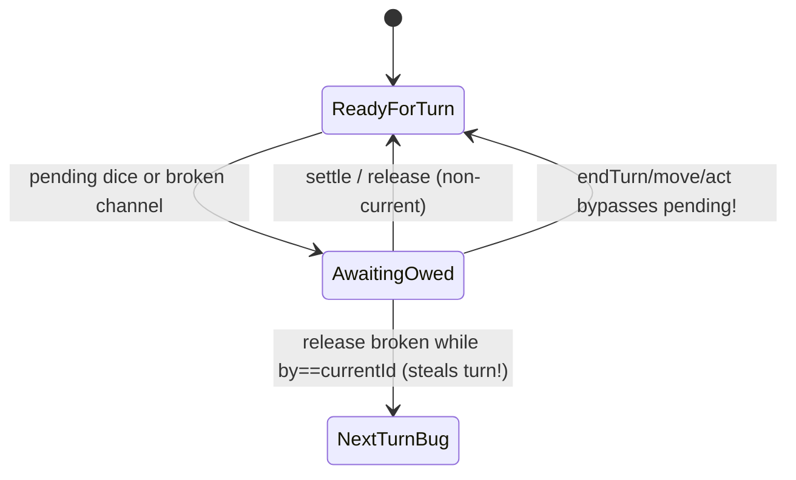

**Contradictory states the code allows:**
SMX-rules-3.1. **u.id === f.currentId AND u.channel.state === 'broken' -> release charges a.cost.time and ends u's turn**
   - Tap: Hunter begins channeling an ability on turn 1. On Hunter's next turn start, a delayed end effect or turnStart trigger breaks the channel (state='broken'). The app immediately auto-releases the owed broken channel.
   - Shows: The broken channel fires at half charge AND advances Hunter's timeline tick from 1000 to 2000, immediately passing the turn to Monster so Hunter loses their whole turn.
   - Should show: Per docs/state-machines.md and fight.ts:355-356, a broken channel fires at once and costs its user no time; Hunter keeps their turn at tick 1000.
   - Rule: **proposed, needs the owner**: a broken channel costs its user no time and the user keeps the turn (docs/state-machines.md says so; the owner has not ruled).
SMX-rules-3.2. **f.pending.length > 0 (owed settle dice) + endTurn/act/move dispatched -> fight advances now and turns with stale pending entries left unpaid**
   - No user-visible symptom. Developer trigger: Any caller (e.g. remote player pass/cast arriving before GM settles owed, or a direct reduce() caller / reload mid-settle) dispatching act/move/endTurn while f.pending is non-empty.
   - Rule: **proposed, needs the owner**: a turn cannot end while dice are still owed.

**How it knows (SMX-rules-3):** RAN. .smaudit/proofs/rules/combat-sm.test.ts | bun test ./.smaudit/proofs/rules/combat-sm.test.ts | SMX-rules-3a: brokenRelease currentBefore=hero currentAfter=mob heroAtBefore=1000 heroAtAfter=2000 | SMX-rules-3b: owedBefore=1 owedAfterEndTurn=1 nowMoved=950->1000 cur=mob

**Proposed explicit model:**
```ts
// 1) In release(): const costsTurn = c.state === 'holding'; (never infer from cmd.by === f.currentId).
// 2) Model Running as discriminated sub-phase or guard TABLE.running: type RunningPhase = { sub: 'owed'; queue: readonly Owed[] } | { sub: 'turn'; currentId: CombatantId }; only settle/release/gm-cancel allowed in 'owed'.
```

**What it would delete:**
- src/core/combat/fight.ts:369 `const turn = cmd.by === f.currentId;` conflating broken vs holding
- src/core/combat/fight.ts:685-700 ad-hoc owed(f) scan outside phase enforcement

**Related re-audit ids:** SM-rules-2
**Notes:** SMX-rules-3a is a NEW high-severity bug inside the explicit Channel/Running interaction (fight.ts:369); SMX-rules-3b reproduces SM-rules-2.

### 9. SMX-rules-2: Status expired-but-owed purgatory, settle decay-vs-expiry race, and land/resolve divergence [high] [KNOWN] [RAN]

**Where it lives (at 1732d2d1):**
- `src/core/combat/fight-turn.ts:78,95-99 (owes(s) keeps expired statuses on Body.statuses until bearer's own turn)`
- `src/core/combat/standing.ts:19-23,64-71,88-90,175-195 (reads Body.statuses without s.until === null || s.until > now)`
- `src/core/combat/effect-ops.ts:539-558 (settle runs leave:'round' stack decay before until<=now expiry)`
- `src/core/combat/effect-ops.ts:581-630 (modsOf reads all statuses without filtering expired-but-owed)`
- `src/core/combat/land.ts:187-195 (landOps records gained on Safeguard-refused statuses; cureStatus reads pre-loop snapshot)`
- `src/core/combat/land.ts:310-312 (landOne channel:break ignores protect; dispel bypasses cureLands)`
- `src/core/combat/resolve.ts:370-371,403-415 (multiple die-based boost statuses collide by CombatantId)`

**States and moves:** A combat status implicitly occupies an unmodeled 'ExpiredAwaitingSettle' state between its until tick passing (during another body's turn in advance()) and its bearer's own next turn (settleRow()). Because owes(s) retains expired statuses in Body.statuses and neither standing.ts nor modsOf() checks s.until > now, expired wards/shares/stealth/stats stay mechanically live on intervening turns. Separately, settle() checks round stack decay before time expiry, and land.ts duplicates resolve.ts status rules with missing guards.

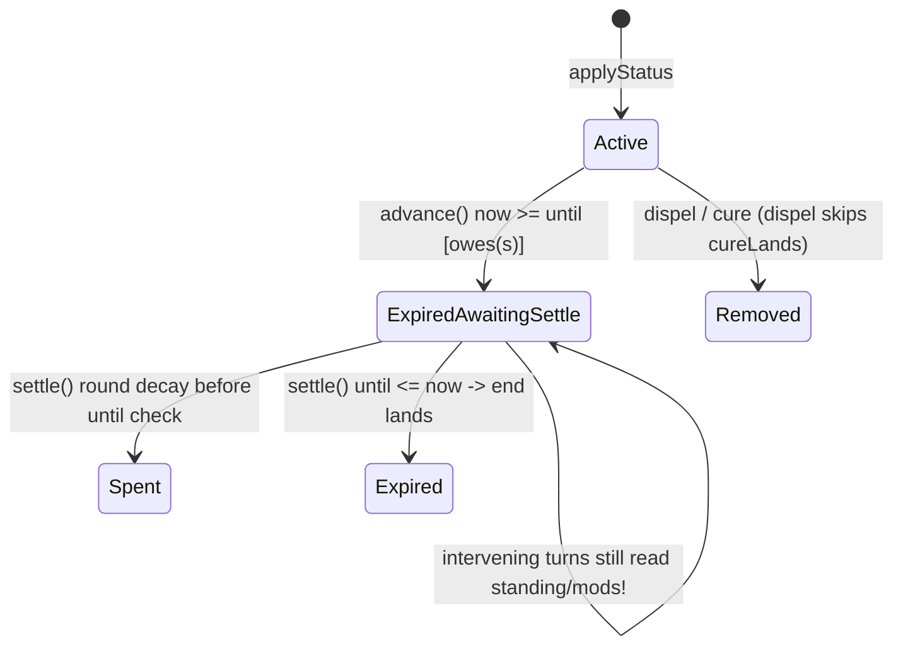

**Contradictory states the code allows:**
SMX-rules-2.1. **now >= s.until with owes(s)===true (e.g. invulnerable/share/safeguard + end bomb or per-round op) -> expired status still blocks lethal damage on intervening foe turn**
   - Tap: Give Hero a 1-round (until=1000) status carrying invulnerable (or -50% taken / safeguard / hidden) plus a delayed end effect or per-round tick. Let Monster take a turn at tick 1250 before Hero's next turn and deal 200 lethal damage.
   - Shows: At tick 1250 (250 ticks after until=1000 expired), Hero survives 200 damage at 1 HP because standing.ts holds(b, 'invulnerable') still sees the expired-but-owed status.
   - Should show: Once now >= s.until, the status's passive standing/stat/ward effects stop immediately; only its unpaid per-round ticks and delayed end wait for settleRow().
   - Rule: **proposed, needs the owner**: a status's passive effects stop the moment its time runs out, even if its last tick is still owed.
SMX-rules-2.2. **1-stack leave:'round' status + delayed end bomb reaching its final round -> settle() emits spent instead of expired, cancelling detonation**
   - Tap: Apply a 1-stack status with leave:'round' and an end damage effect lasting 1 round (until=1000), then advance to the bearer's turn at tick 1000.
   - Shows: settle() decays stacks 1 -> 0 first and places the status in spent (spent=1, expired=0), so settleRow() never detonates its end damage.
   - Should show: When now >= s.until on a delayed-end status, time expiry runs (or triggers end) rather than silently cancelling the bomb as spent.
   - Rule: **proposed, needs the owner**: a delayed-end status goes off when its time runs out, rather than being cancelled as spent.
SMX-rules-2.3. **Safeguard-refused status emits gained; channel:break in landOne breaks protected channel; dispel skips cleanse:'land' detonation; two die boosts collide**
   - Tap: In combat, trigger an applyStatus against a Safeguard bearer, trigger channel:break against a channel:protect bearer, dispel a cleanse:'land' bomb, or stack two die-based attack boosts (d6 + d8) on one attacker.
   - Shows: landOps reports gained=['poison'] even though poison was blocked; channel breaks despite protect; dispel removes the bomb with 0 damage instead of detonating; needs() asks for only one d6 boost die and drops the d8.
   - Should show: gained reflects only admitted statuses, channel:break honors channelBreaks(), dispel honors cureLands(), and boost dice key by (id, statusKey).
   - Rule: **proposed, needs the owner**: protection stops a channel break, cure rules gate a dispel, and boost dice from two statuses both count.

**How it knows (SMX-rules-2):** RAN. .smaudit/proofs/rules/combat-sm.test.ts | bun test ./.smaudit/proofs/rules/combat-sm.test.ts | SMX-rules-2a: now=1250 status.until=1000 heroHpAfter200Dmg=1 life=up | SMX-rules-2b: spent=1 expired=0 remaining=0 | SMX-rules-2c: safeguardGained=["poison"] hasPoison=false channelAfterProtectBreak=broken dispelBombGone=true hpDelta=0 boostDice=[{"id":"mob","sides":6}]

**Proposed explicit model:**
```ts
type StatusPhase = { at: 'active'; until: Tick | null } | { at: 'owedOnly'; endedAt: Tick };
// Or move owed ticks/ends out of Body.statuses into Body.owedStatuses (or filter activeStatuses(b, now) everywhere in standing.ts/modsOf). In settle(): check until<=now before leave:'round'. Key boost rolls by `${id}:${statusKey}`.
```

**What it would delete:**
- src/core/combat/fight-turn.ts:78,95 retaining expired statuses inside live Body.statuses
- src/core/combat/standing.ts:21,66,88,178,193 unfiltered Body.statuses loops
- src/core/combat/effect-ops.ts:549-555 decay-before-expiry ordering
- src/core/combat/land.ts:190,310,312 duplicate unchecked landOne branches

**Related re-audit ids:** SM-rules-6, BUG-rules-19, BUG-rules-13, BUG-rules-15, BUG-rules-23, AW-rules-2
**Notes:** Upgrades SM-rules-6 from latent ('no user-visible symptom') to HIGH live combat bug via SMX-rules-2a proof.

### 10. SMX-rules-5: Equipment slot, stack, loadout and fight-lock ownership invariants [high] [KNOWN] [RAN]

**Where it lives (at 1732d2d1):**
- `src/core/hunter/inventory.ts:28-33 (stackKey omits desc/attack/penFlat)`
- `src/core/hunter/inventory.ts:75-78 (editItem only unwears when !it.slot, ignoring slot change or qty>1)`
- `src/core/hunter/inventory.ts:90-99 (equip moves already-worn ring1 into ring2)`
- `src/core/hunter/hunter.ts:224-225 (fixHunter checks existence only, not slot fit, uniqueness across slots, or qty===1)`
- `src/core/hunter/sheet.ts:81-82 (worn() maps Object.values(equipped) without deduplicating item IDs)`
- `src/core/hunter/loadouts.ts:24-25,63-88 (swapLoadout enforces fits + inFight in core, unlike inventory.ts)`
- `src/views/inventory.js:103-109,249-260 (fighting(hid) guards equip/unequip only, not sell/del/edit; unequipItem clears only first matching slot)`

**States and moves:** An item's ownership, worn slot, and stack count are distributed across Item.slot, Item.qty, Hunter.equipped[slot], Loadout.slots[slot], and view-level fighting(hid) checks, with no single invariant enforcing that each equipped pointer references a unique, qty===1 item whose slot fits. Mutations and save repair can therefore create items worn in wrong slots, worn as stacks, worn simultaneously in multiple slots (double-counting stats/armor), silently merged across distinct descriptions, or sold/edited mid-fight.

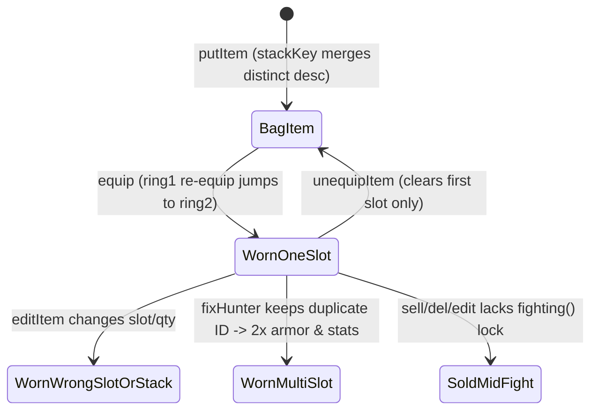

**Contradictory states the code allows:**
SMX-rules-5.1. **Same ItemId in two equipped slots (e.g. ring1 & ring2) -> passes repairSave/fixHunter and double-counts armor & stat bonuses in hunterSheet()**
   - Tap: Import or sync a hunter save where equipped.ring1 and equipped.ring2 both reference the same Iron Ring (+15 armor, +5 STR).
   - Shows: repairSave/fixHunter keeps ring1='i1' and ring2='i1' intact, and hunterSheet() grants +30 armor and +10 STR (double the single ring).
   - Should show: fixHunter enforces unique ItemId across slots (as it already does for loadouts at hunter.ts:242-246), slot compatibility via fits(), and qty===1.
   - Rule: **proposed, needs the owner**: one item fills one slot, and a worn item is a single item (qty 1).
SMX-rules-5.2. **editItem changes worn weapon's slot to 'chest' and qty to 3 -> remains worn in equipped.weapon while slot='chest' and qty=3**
   - Tap: Equip a sword in the weapon slot, then edit that item in Inventory to change its slot to Chest and quantity to 3.
   - Shows: equipped.weapon still holds the item ID even though the item is now a stack of 3 chest pieces.
   - Should show: editItem unequips the item whenever !fits(edited, currentSlot) or edited.qty !== 1 (or splits/unwears cleanly).
   - Rule: **proposed, needs the owner**: changing a worn item's slot, or its quantity above 1, unequips it.
SMX-rules-5.3. **Re-equipping worn ring1 jumps it to ring2; stackKey merges distinct slotless items; sell/del/edit bypasses fight-lock**
   - Tap: Equip a ring (lands in ring1), call equip on it again while ring2 is empty; or add two slotless Tokens with different descriptions; or sell/delete/edit a worn item while in an active fight.
   - Shows: Ring jumps from ring1 to ring2; second Token silently merges into the first and loses its description ('Opens Vault B' overwritten by 'Opens Gate A'); sell/del/edit succeeds mid-fight while equip/unequip/loadout are locked.
   - Should show: Re-equipping an already-worn ring is a no-op; stackKey includes desc/attack/penFlat; core inventory mutations enforce inFight consistently with swapLoadout.
   - Rule: **proposed, needs the owner**: items that differ in description or attack do not stack, and inventory is locked during a fight.

**How it knows (SMX-rules-5):** RAN. .smaudit/proofs/rules/hunter-sm.test.ts | bun test ./.smaudit/proofs/rules/hunter-sm.test.ts | SMX-rules-5a: equipped.weapon=i-1 item.slot=chest item.qty=3 | SMX-rules-5b: ring1=i1 ring2=i1 items=[{"id":"i1","armor":15,"bonus":{"str":5}}] armor=15->30 str=15->20 | SMX-rules-5c: ringJump ring1=null ring2=i-r1 mergedTokenCount=1 qty=2 desc=Opens Gate A
_Note:_ One combination was READ only: the view-side fight lock in inventory.js:250-260.

**Proposed explicit model:**
```ts
function normalizeEquipped(items: readonly Item[], eq: Record<Slot, ItemId | null>): Record<Slot, ItemId | null> {
  const seen = new Set<ItemId>();
  // keep slot only if item exists, fits(item, slot), item.qty === 1, and !seen.has(id)
}
// Run normalizeEquipped in fixHunter, editItem, equip, and deduplicate worn() in sheet.ts; pass inFight into core inventory steps.
```

**What it would delete:**
- src/core/hunter/hunter.ts:225 existence-only slot repair loop
- src/core/hunter/inventory.ts:77 `it.slot ? h.equipped : unwear(...)` incomplete check
- src/core/hunter/inventory.ts:94 unguarded ring slot pick before checking if already worn
- src/views/inventory.js:105,109 view-only fighting(hid) checks missing from sell/del/edit

**Related re-audit ids:** BUG-rules-9, BUG-rules-27, BUG-sync-2
**Notes:** Reproduces BUG-rules-9 & BUG-rules-27 and adds NEW high-impact fixHunter duplicate-slot double-counting (5b), ring jump (5c), and mid-fight sell/del/edit gap.

### 11. SMX-sync-1: Store readOnly vs Room Link, Seat, Push, Attempt, and Outbox split-brain [high] [KNOWN] [RAN]

**Where it lives (at 1732d2d1):**
- `src/core/store-life.ts:37-41,134 (StoreLife ready/keeping/readOnly/noStorage and mayChange)`
- `src/core/role.ts:20 (seatOf reads linkRoom() from Link alongside settings.sync.gmKey from Store)`
- `src/core/sync/link.ts:382,424-429 (Link advances cursor and emits save effects without StoreLife awareness)`
- `src/edge/store.ts:265-296,304-312 (store.apply refuses read-only; comments claim sync uses store.update; newHunter mutates state.seq)`
- `src/edge/sync.ts:301,424-428,459,477-491,525,566-571,631-643,661-666 (save, landPage, bindJoin, boxDo drop read-only refusals; sendSheet fakes sent when !bound; postLetter returns noRoom)`
- `docs/state-machines.md:1510 (claims room link bookkeeping still changes memory in readOnly)`

**States and moves:** Two independent machines run in parallel with split authority: StoreLife (ready/keeping/readOnly/noStorage) and Link+Push+Attempt+Outbox. Every sync write goes through store.apply (which refuses readOnly), yet Link, Attempt, Push, and seatOf keep transitioning in memory. seatOf pairs Link's in-memory room code with Store's frozen settings.sync.gmKey.

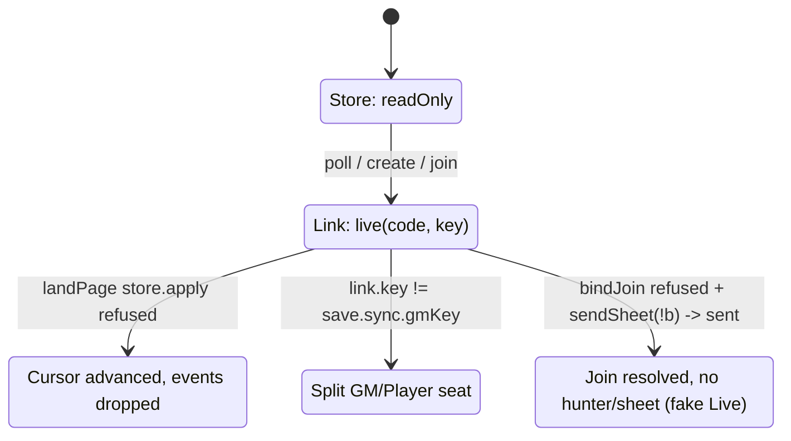

**Contradictory states the code allows:**
SMX-sync-1.1. **life.at === 'readOnly' && link.at === 'live' && link.cursor > save.settings.sync.cursor**
   - Tap: Player has a read-only tab open in a room (newer-schema save or overtaken by another tab), GM sends a 50-gold award, then player tries to post a roll.
   - Shows: Tab polls the award and advances ?after= past it while gold stays 0, savedCursor stays 0, no award window appears, and sync.post returns { ok: false, why: 'noRoom' }.
   - Should show: Read-only tab either pauses room polling/cursor advance or clearly blocks room participation until writable, and distinguishes read-only from noRoom.
SMX-sync-1.2. **life.at === 'readOnly' && link.at === 'live' && link.key !== null && save.settings.sync.gmKey === null**
   - Tap: GM in a read-only tab opens Room and taps Create room (or Rejoin as GM).
   - Shows: sync.create() succeeds and sync.room() is the new code (Link holds the GM key), yet app.seat() returns 'player', app.isGM() is false, and the Room view hides the GM roster and GM tools.
   - Should show: Creating or rejoining a room is refused with 'Not saved' in a read-only tab, or seatOf reads the Link's active authority so Link and Seat never disagree.
SMX-sync-1.3. **life.at === 'readOnly' && joinRoom({ name }) resolves 'player' && bound() === null && push.at === 'clean' (conn === 'live')**
   - Tap: Player in a read-only tab joins a room by typing a new hunter name.
   - Shows: store.newHunter mutates state.seq, bindJoin's store.apply fails silently, joinRoom resolves 'player' without creating the hunter, sendSheet sees !bound() and fakes push 'sent', and the room pill shows Live while nothing was pushed.
   - Should show: Failed bindJoin aborts the join and tells the player this tab cannot save, leaving the phone out of the room.

**How it knows (SMX-sync-1):** RAN. tests/e2e/proof-sm-sync-browser.e2e.ts | timeout 600 bunx playwright test tests/e2e/proof-sm-sync-browser.e2e.ts --workers=1 | pass (16.3s): readOnly player polled GM 50g award (after=1, gold=0, savedCursor=0, post={ok:false,why:'noRoom'}); readOnly GM create() gave room=code, seat='player', isGM=false, savedGmKey=null, [data-who] hidden; readOnly joinRoom({name:'Phantom Hero'}) resolved 'player', bound=null, conn='live'

**Proposed explicit model:**
```ts
type RoomWriteAccess = { readonly at: 'writable' } | { readonly at: 'readOnly'; readonly why: ReadOnlyWhy };
// Link accepts { type: 'storeAccess'; access: RoomWriteAccess }:
// in readOnly: refuses create/join/post with 'read-only', pauses poll cursor advance, and Seat reads Link's own seat ('alone'|'gm'|'player') directly instead of save.settings.sync.gmKey.
```

**What it would delete:**
- src/core/role.ts:20 (reading settings.sync.gmKey beside Link's room())
- src/edge/sync.ts:424-426,566-571,631-632 (unchecked store.apply calls in save/bindJoin/boxDo)
- src/edge/sync.ts:525 (faking pushDo({ type: 'sent' }) when !bound())
- src/edge/store.ts:265-267 (stale comment claiming sync uses store.update in readOnly)

**Related re-audit ids:** SM-sync-5, BUG-sync-7, BUG-sync-12, BUG-sync-11
**World:** A System message or reward.
**Notes:** Expanded beyond SM-sync-5/BUG-sync-7 to include split GM/Player seatOf vs link.key and fake-Live join-new-hunter after audit-sync-2.

### 12. SMX-sync-2: Player room binding, join-epoch, deletion, and switchTo lifecycle [high] [KNOWN] [RAN]

**Where it lives (at 1732d2d1):**
- `src/core/save.ts:139,142,164,166,421-422,474-480 (boundHunterId owned by 'campaign', joinedAt owned by 'phone'; repair & keepPhone)`
- `src/core/sync/bind.ts:89-92 (boundTo overwrites joinedAt for both room-join and hunter-rebind)`
- `src/core/party.ts:42-53 (removeHunter rebinds boundHunterId and drops tombstones without updating bind time or notifying Push)`
- `src/edge/sync.ts:235,417-421,455,462,566-571,693-709,935 (sheetText, removedSinceJoin, apply away check, bindJoin, switchTo stale await, change listener only fires Push 'changed')`

**States and moves:** Which hunter a player's phone plays in a room and since when is spread across save.settings.sync.boundHunterId, save.settings.sync.joinedAt (conflating room-join time for away-detection with hunter-bind time for kick-filtering), sync.ts sheetText, Push state, and an unguarded async switchTo modal.

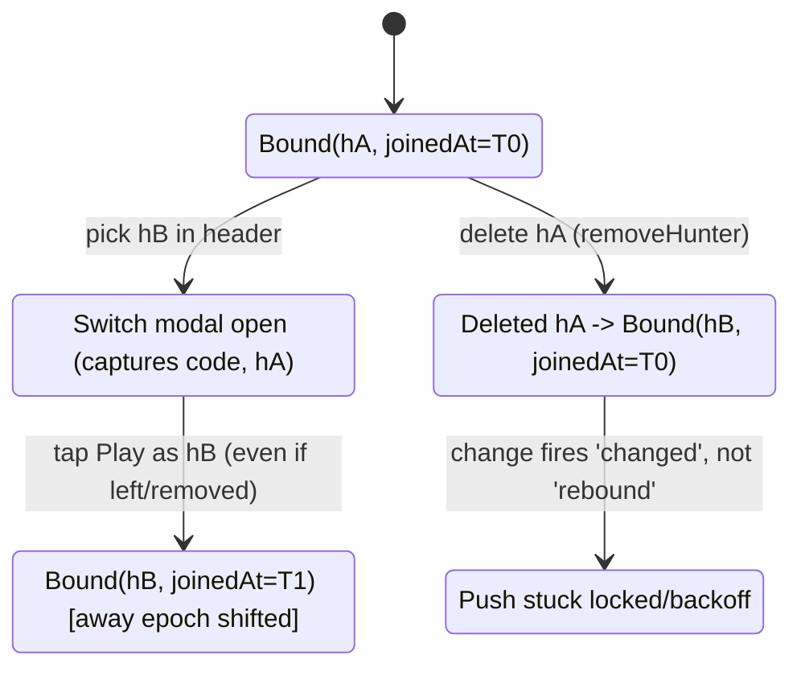

**Contradictory states the code allows:**
SMX-sync-2.1. **removeHunter rebinds boundHunterId to hB while push.at === 'locked' (or 'backoff') && joinedAt unchanged**
   - Tap: In a room, Hunter A is locked by another device (or sheet push is in backoff); player deletes Hunter A so the save rebinds to Hunter B.
   - Shows: sync.ts change listener only emits pushDo({ type: 'changed' }), which Push ignores in 'locked' and 'backoff' (only 'rebound' wakes them). Push stays stuck showing Hunter B as locked/failing; also joinedAt is not updated, so any older kick of Hunter B after T0 immediately kicks the player on the next poll.
   - Should show: Deleting the bound hunter transitions binding cleanly (advancing boundAt for Hunter B and emitting pushDo({ type: 'rebound' })) so Hunter B pushes immediately and is not hit by stale state.
SMX-sync-2.2. **switchTo overwrites joinedAt to srvNow() while live in room**
   - Tap: Player is live in a room with two hunters; GM sends a live award; before the next poll arrives, player switches hunters via header dropdown ('Play as Hunter Two').
   - Shows: When the next poll arrives, the live award opens a 'WHILE YOU WERE AWAY' modal claiming 'These were sent while this phone was out of the room.'
   - Should show: Keep joinedAt (room join time for away detection) separate from boundAt (hunter bind time for removedSinceJoin) so switching hunters never turns live events into away notices.
SMX-sync-2.3. **switchTo awaits ui.system while room membership changes**
   - Tap: Player opens 'PLAY AS Hunter Two?' modal; before answering, player leaves the room (or is removed / switches rooms), then taps 'Only view Hunter Two' (or 'Play as Hunter Two').
   - Shows: Tapping 'Only view' still toasts 'Hunter One stays synced to room CODE' even though sync.room() is null; tapping 'Play as' still calls boundTo and forget(oldHunter) against whatever room is now active.
   - Should show: Re-check live room code and bound hunter after await ui.system and fall back to plain setActive if the phone left that room.
SMX-sync-2.4. **keepPhone copies campaign room/cursor/boundHunterId from imported save while keeping phone's joinedAt from a prior room**
   - Tap: Phone A was in Room X (joinedAt = T_X); player imports a campaign file belonging to Room Y (cursor = 0).
   - Shows: keepPhone pairs Room Y with Room X's joinedAt = T_X, misclassifying Room Y's events before T_X as 'WHILE YOU WERE AWAY' and comparing Room Y's kicks against Room X's timestamp.
   - Should show: Store per-room join/bind timestamps or reset joinedAt/boundAt when replaced swaps into a different room.

**How it knows (SMX-sync-2):** RAN. .smaudit/proofs/sync/core-server.test.ts + tests/e2e/proof-sm-sync-browser.e2e.ts | bun test ./.smaudit/proofs/sync/core-server.test.ts && bunx playwright test tests/e2e/proof-sm-sync-browser.e2e.ts --workers=1 | pass (11.4s): removeHunter kept joinedAt unchanged & pushReduce(locked/backoff, changed) ignored; keepPhone paired room BBB333 with old joinedAt; browser switchTo ('Play as Hunter Two') opened false 'WHILE YOU WERE AWAY' for live 25g award and stale modal after leave() toasted 'stays synced to room CODE'

**Proposed explicit model:**
```ts
type RoomBinding = { readonly room: RoomCode; readonly joinedAt: string; readonly hunterId: HunterId; readonly boundAt: string };
// One writer step rebindHunter(save, hid, at) updates boundAt (never joinedAt) and returns { save, rebound: true } so sync.ts always emits pushDo({ type: 'rebound' }) whenever boundHunterId changes (including via removeHunter).
```

**What it would delete:**
- src/core/party.ts:49-51 (inline boundHunterId mutation without bindAt/rebound signal)
- src/core/sync/bind.ts:89-92 (overwriting joinedAt on hunter switch)
- src/edge/sync.ts:696-708 (stale pre-await code/bound captures in switchTo)
- src/core/save.ts:164,166 (splitting room/boundHunterId as 'campaign' from joinedAt as 'phone')

**Related re-audit ids:** BUG-sync-13
**World:** A System message or reward.
**Notes:** Proven in both unit tests and live Playwright browser session.

### 13. SMX-sync-3: GM doc publisher un-aborted cross-room flight and sticky tooBig beside publish.ts [high] [NEW] [RAN]

**Where it lives (at 1732d2d1):**
- `src/core/sync/publish.ts:28,47-64 (tooBigAfter keeps tooBig on 'unsent'; Publish has no link-leave/abort event)`
- `src/edge/sync.ts:753-767 (putDoc reads live gmRoom()/link.gen without AbortSignal from track(gen))`
- `src/edge/sync.ts:775-816 (publishing map not reset on room change; publishNow retries putDoc(name, short) without checking link.gen === gen)`
- `src/edge/sync.ts:879 (conn() reads publishing.values().some(p => p.tooBig === link.gen))`

**States and moves:** publish.ts models idle/waiting/sending/sendingStale per doc, but sync.ts runs putDoc outside track(gen) without aborting on room leave/switch, retries truncated short docs by re-reading the current gmRoom(), and never clears tooBig when the doc becomes null/unsent.

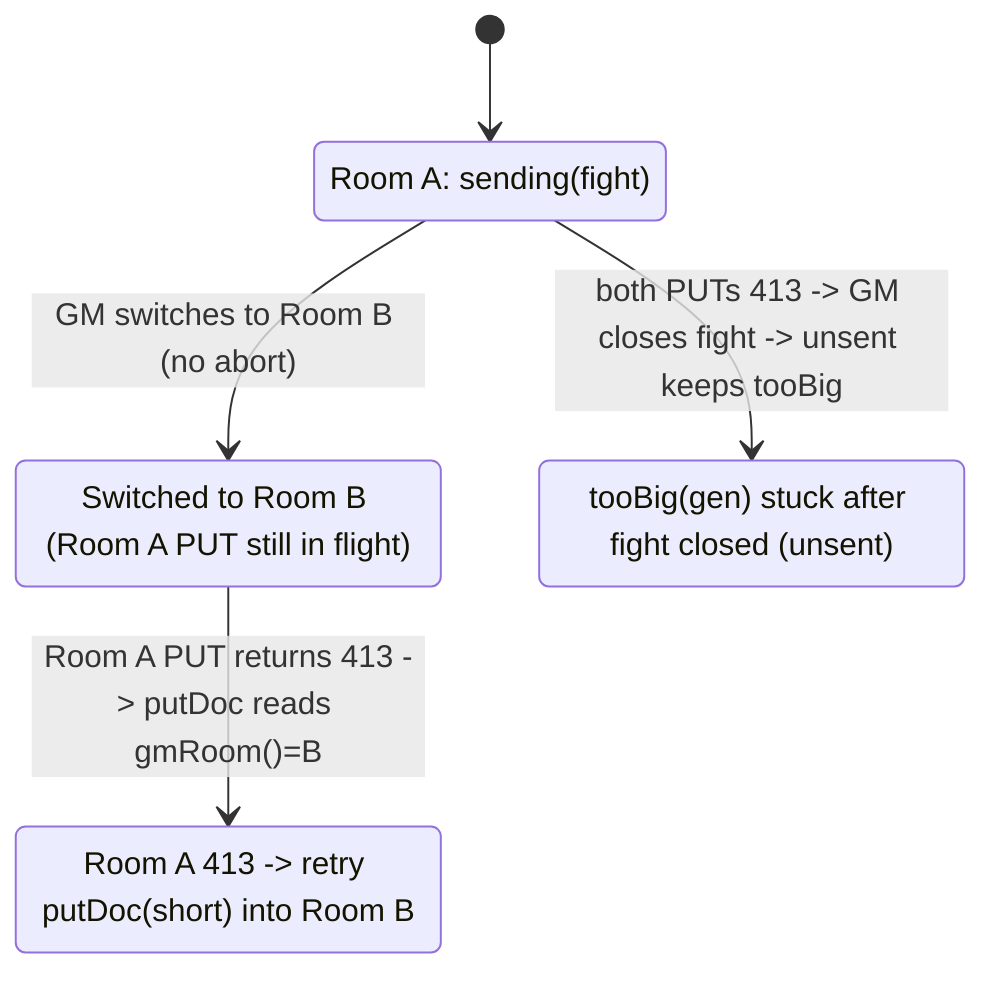

**Contradictory states the code allows:**
SMX-sync-3.1. **Room A fight PUT returns 413 after GM switched to Room B -> publishNow retries putDoc('fight', short) against Room B**
   - Tap: GM starts a fight in Room A whose fight doc PUT is delayed and gets 413 too large while GM switches to Room B.
   - Shows: publishNow does not abort on gen change and does not re-check link.gen === gen before calling putDoc('fight', short); putDoc reads gmRoom() === Room B and writes Room A's truncated fight doc into Room B.
   - Should show: Abort in-flight doc PUTs via track(gen) on room leave/switch, reset publish state on gen change, and never retry a doc from an old gen into a new room.
SMX-sync-3.2. **fight doc refused as tooBig (p.tooBig === gen) && GM closes fight (fight === null) -> publishNow returns 'unsent'**
   - Tap: GM's fight doc is refused as too big (413 even without log) so the pill turns orange 'tooBig'; GM then closes the fight completely.
   - Shows: fightDoc returns null -> publishNow returns 'unsent' -> tooBigAfter keeps p.tooBig === gen, so the room pill and Room view remain stuck on 'Live, the fight is too big to share' for the rest of the room session.
   - Should show: Clear tooBig when the doc is no longer oversized or no longer exists ('unsent' because want === null or matches room).
SMX-sync-3.3. **Slow PUT in Room A holds publishing.get(name) in 'sending'/'sendingStale' across switch to Room B**
   - Tap: GM leaves/switches rooms while a doc PUT to Room A hangs until REQ_MS (20s).
   - Shows: Because putDoc is not tracked in track(gen) and publishing is not reset on room change, Room B cannot publish that doc for up to 20 seconds.
   - Should show: Abort putDoc via track(gen) and reset publishing to idle when leaving a stretch of the link.

**How it knows (SMX-sync-3):** RAN. .smaudit/proofs/sync/core-server.test.ts + tests/e2e/proof-sm-sync-browser.e2e.ts | bun test ./.smaudit/proofs/sync/core-server.test.ts && bunx playwright test tests/e2e/proof-sm-sync-browser.e2e.ts --workers=1 | pass (5.0s): Room A fight PUT 413 after rejoinGM(Room B) wrote truncated fight doc (log: []) into Room B's /sheets/_fight; in Room C closing fight (s.fight=null) left sync.conn()==='tooBig' and #sync-pill [data-conn='tooBig'] stuck permanently

**Proposed explicit model:**
```ts
type PublishEvent =
  | { readonly type: 'changed' } | { readonly type: 'due' }
  | { readonly type: 'answered'; readonly gen: Gen; readonly put: PutAnswer }
  | { readonly type: 'reset' }; // fired on Link abort(gen), clears timer & in-flight state
// putDoc takes (gm, gen, signal) from track(gen) instead of re-reading gmRoom(); tooBigAfter clears tooBig when put === 'unsent' && nothingToSend.
```

**What it would delete:**
- src/edge/sync.ts:754 (putDoc re-reading mutable gmRoom()/link.gen on retry)
- src/edge/sync.ts:782 (untracked setTimeout with no clear on room leave)
- src/core/sync/publish.ts:62 (preserving stale tooBig when doc disappears as 'unsent')

**Related re-audit ids:** none (new).
**Notes:** Brand-new machine beside the publish.ts reducer introduced in PR #39 (SM-sync-3).

### 14. SMX-gates-4: Counted-quest System completion & mixed manual/counted lifecycle [high] [NEW] [RAN]

**Where it lives (at 1732d2d1):**
- `src/core/hunter/quest-rights.ts:45 (systemCompletes = q.objectives.some(o => !!o.count))`
- `src/core/hunter/counts.ts:159-166 (objectiveStep returns null whenever o.progress >= o.target)`
- `src/core/hunter/noticed.ts:128-156 (countQuests auto-calls finishQuest only when a counted objective advances, discarding levelup/Job Change/streak/lifted UI feedback)`
- `src/core/hunter/quests.ts:168-173,318-320 (questNews filters by bare q.id not in told)`
- `src/views/quests.js:274-292,366,443-454 (Complete button hidden when systemCompletes(q); tellDone records bare q.id in quest-told:<hid>)`

**States and moves:** A quest's completion ownership is split implicitly between manual UI (quests.js Complete button + setProgress auto-prompt) and background chronicle evaluation (noticed.ts countQuests). Ownership is inferred from a single boolean systemCompletes(q) = objectives.some(o => !!o.count), while completion announcements are deduplicated by bare q.id in device memory quest-told:<hid>.

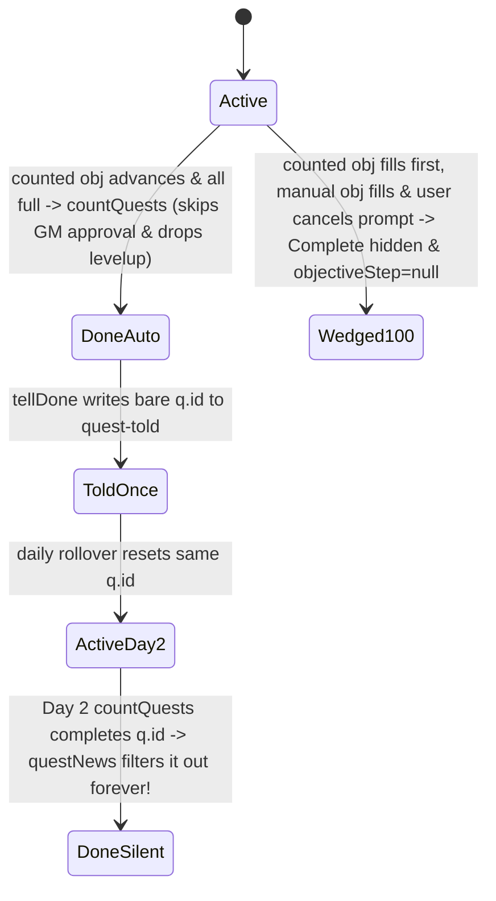

**Contradictory states the code allows:**
SMX-gates-4.1. **Mixed counted + manual quest permanently wedges at 100% progress with no way to complete**
   - Tap: GM creates a quest with Obj 1 System-counted (Kill 1 foe) and Obj 2 manual (Report to guild). Player kills 1 foe (1/1), then taps '+' on Obj 2 (1/1) and taps Cancel on 'Complete quest?' (or reloads).
   - Shows: Both objectives show 1/1 (100%), yet the Complete button is hidden (systemCompletes=true) AND killing more foes never triggers completion because objectiveStep returns null once progress >= target.
   - Should show: A quest with any manual objective should keep its Complete button (or re-evaluate completion on any objective reaching target), and completion should be driven by a single explicit completion mode.
   - Rule: **proposed, needs the owner**: a quest with any hand-ticked objective keeps its Complete button.
SMX-gates-4.2. **Recurring counted daily quest (or reopened counted quest) is permanently silenced after Day 1**
   - Tap: GM creates a Daily quest with a System-counted objective. Player completes it on Day 1 (QUEST COMPLETE popup fires and writes bare q.id into quest-told:<hid>). Day 2 rolls over, resetting the same quest to active, and player completes it again.
   - Shows: Day 2 marks the quest done silently: questNews filters !told.includes(q.id) so no QUEST COMPLETE window and no quest:done event ever fire again.
   - Should show: Completion notice tracking should key on (q.id, completedAt) or clear q.id from quest-told on rollover/reopen.
SMX-gates-4.3. **System-completed quests bypass GM reward approval and drop level-up / Job Change / streak popups**
   - Tap: Player finishes a System-counted quest whose XP triggers a level-up or Job Change step.
   - Shows: noticed.ts:countQuests auto-grants rewards without GM approval, drops g.levelup and out.done, and tellDone displays template q.rewards instead of actual granted lines.
   - Should show: Rewards/windows should pass through GM approval (or if pre-approved at issue time, surface the actual granted result including level-up and Job Change steps).
   - Rule: settled (the owner, rule d): a quest's rewards and System window wait for the GM.

**How it knows (SMX-gates-4):** RAN. .smaudit/proofs/gates/sm-gates-proofs.test.ts | bun test ./.smaudit/proofs/gates/sm-gates-proofs.test.ts -> PROOF[SMX-gates-4a] systemCompletes=true objectiveStep=null statusAfterKill=active; PROOF[SMX-gates-4b] day1Told=["qd1"] day2Status=done day2NewsCount=0

**Proposed explicit model:**
```ts
type QuestCompletion = { readonly mode: 'manual' } | { readonly mode: 'system'; readonly requireAllCounted: true };
type QuestDoneKey = `${QuestId}@${string}`; // keyed by id + completedAt ISO timestamp instead of bare QuestId
```

**What it would delete:**
- src/core/hunter/quest-rights.ts:45 (heuristic objectives.some(o => !!o.count))
- src/views/quests.js:287 (bare q.id deduplication in quest-told)
- src/core/hunter/noticed.ts:141-147 (duplicate finishQuest path discarding levelup/done)

**Related re-audit ids:** none (new).
**World:** The daily quest, A System message or reward.
**Notes:** Both the mixed-quest 100% deadlock and Day 2 counted-daily silence are newly discovered and proven by unit tests.

### 15. SMX-gates-9: Story & Quest editor form lifecycles (story-maker.js accordion & quests.js inline form) [high] [KNOWN] [RAN]

_Severity:_ Neon rated it med in the gates lane; the views lane rated the same machine high (SMX-views-1, SMX-views-4). The higher one is kept.
_Also reported as:_ SMX-views-1 (Story Maker accordion draft & silent onFail drop, high), SMX-views-4 (Inline Quest form mode & hunter/role desync, high). Their locations, combinations and models are folded in below.

**Where it lives (at 1732d2d1):**
- `src/views/story-maker.js:32-34,47-53,78-166 (chapterQuestOf drops v.onFail; mayClose/blocked ignore onFail.blocked(); save() calls quest.check() only on currently open chapter)`
- `src/views/quest-fields.js:47,53,100,127 (renders 'If it fails' onFail editor for use:'chapter' and returns onFail in value(), but omits onFail from returned QuestFields object)`
- `src/core/story/story.ts:102,174 (parseChapterQuest and chapterBody support onFail)`
- `src/views/quests.js:335,384-441,536,573-597 (inline form editId/f.hidden/who.hidden/autoTitle survive active-hunter switch)`
- `src/views/reward-editor.js:188-207 (pickItem/pickSkill capture array index i across async modal await)`
- `src/views/story-maker.js:32,34 (blankQuest and chapterQuestOf omit onFail)`
- `src/views/story-maker.js:47-53 (open index, mounted rewards and quest editors for expanded chapter only)`
- `src/views/story-maker.js:88,121-137 (keep, mayClose only checks rewards.blocked and quest.rewards.blocked)`
- `src/views/story-maker.js:153,155-165 (blocked and save only validate expanded chapter's quest.check)`
- `src/views/quest-fields.js:46-53,100,109,127 (renders GM onFail reward editor for use:'chapter' but omits onFail from returned handle)`
- `src/core/story/story.ts:48,102 (ChapterQuest and parseChapterQuest support onFail)`
- `src/views/quests.js:335,406-408 (module-level editId, autoTitle, questForm)`
- `src/views/quests.js:384-405 (openForm toggles f.hidden, who.hidden, preset.hidden and mounts questFields for current role)`
- `src/views/quests.js:413-441 (submitForm looks up editId on store.active() and branches on current app.isGM())`
- `src/views/quests.js:518-597 (update/render never resets open form when active hunter or GM/player mode changes)`

**States and moves:** story-maker.js holds an array of collapsed chapter data objects while mounting live reward/quest editors ONLY for the single `open` chapter index. Folding, switching, adding, or saving copies the open chapter back through `chapterQuestOf(quest.value())` and validates only the live `quest` editor, leaving collapsed chapters unvalidated and silently stripping `onFail` from every chapter quest. In quests.js, the inline Edit/New form tracks `editId` in closure state outside the active-hunter selection. Each story chapter is either folded (data-only in chapters[]) or expanded (live DOM editors rewards and optional quest mounted for index open). Transitions: open/fold/add/reorder chapter (gated by mayClose -> keep -> draw), toggle Issues-a-quest (mount/unmount quest), Save (keep -> problem -> quest.check on open chapter only -> parseStory). The inline quest form is implicitly Closed (f.hidden=true, editId=null), New (f.hidden=false, editId=null, role captured in questForm and who.hidden), or Edit (f.hidden=false, editId=qid, who.hidden=true). Switching active hunter or toggling GM/Player mode does not close or reconcile the form.

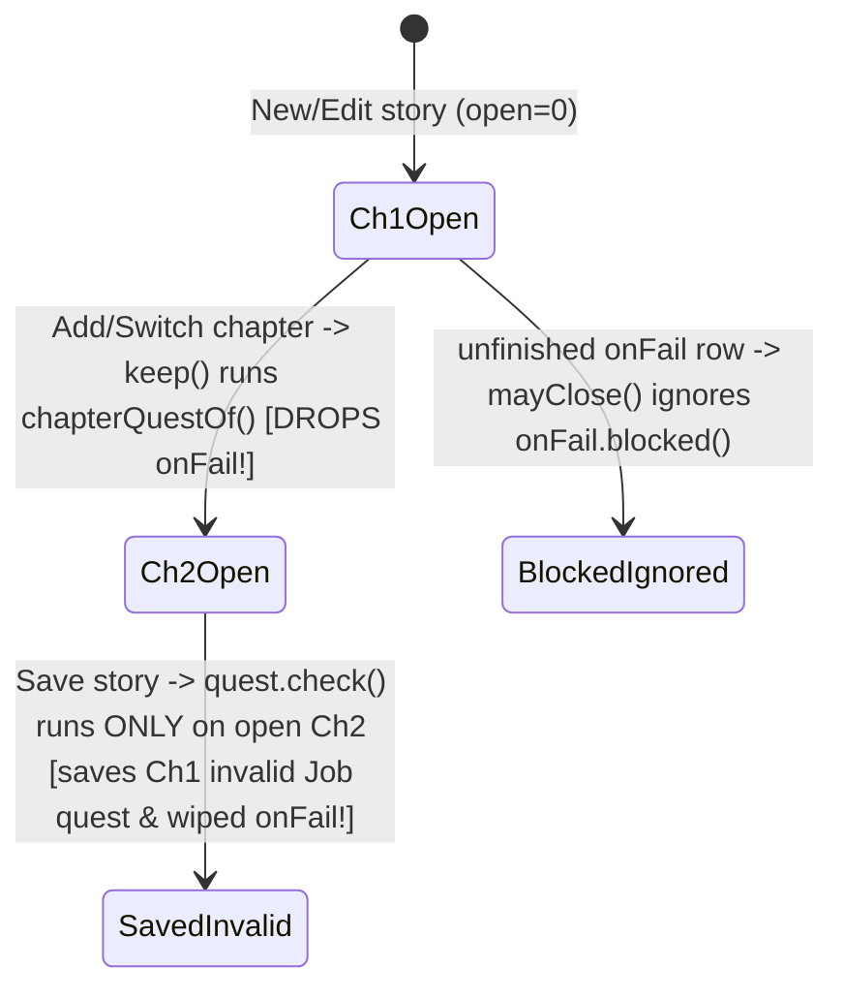

**Contradictory states the code allows:**
SMX-gates-9.1. **story-maker.js:34 chapterQuestOf silently drops quest.onFail on every chapter fold, switch, or save**
   - Tap: GM opens Workshop -> Stories -> New story, enables 'Issues a quest', enters -100 gold in 'If it fails', adds Chapter 2 (or taps Save story).
   - Shows: Story saves with no error, but Chapter 1's quest.onFail.gold is silently wiped to 0 (even though quest-fields.js rendered the 'If it fails' editor and story.ts supports onFail).
   - Should show: chapterQuestOf must preserve onFail: v.onFail, and mayClose()/blocked() must check onFail.blocked().
   - Rule: settled (the owner, rule d): the GM's "If it fails" terms are kept.
SMX-gates-9.2. **story-maker.js save() skips quest.check() on collapsed chapters, saving invalid Job quests with job=null (BUG-views-17/SM-views-10)**
   - Tap: In Story Maker, GM sets Chapter 1's quest kind to 'Job Change' without choosing a job, adds Chapter 2, and taps 'Save story'.
   - Shows: Story saves successfully with Chapter 1 quest kind='job' and rewards.job=null.
   - Should show: save() must validate every chapter's quest (and onFail) via one core validator regardless of which chapter is currently expanded.
SMX-gates-9.3. **Switching active hunter while quests.js inline Edit form is open duplicates quest onto another hunter (SM-views-6/BUG-views-15)**
   - Tap: GM opens Edit on Hunter A's quest, switches active hunter to Hunter B, and saves.
   - Shows: editId is not cleared on hunter change, mis-targeting Hunter B or leaving the form's who-picker hidden.
   - Should show: Model the quest form as { mode: 'closed' } | { mode: 'new' } | { mode: 'edit', hunterId, questId } and bind writes to hunterId.
SMX-views-1.1. **Chapter quest with GM 'If it fails' (onFail) rewards filled or unfinished, then folded or saved**
   - Tap: In GM -> Stories -> New story, enter story name and Chapter 1 window title, check 'Issues a quest', enter quest title, type -50 in 'If it fails' Gold (and add an unfinished item row under 'If it fails'), then fold Chapter 1 or tap Save story.
   - Shows: Save stays enabled and chapter folds without warning even with an unfinished 'If it fails' row; on Save, story.chapters[0].quest.onFail.gold is 0 (-50 silently lost).
   - Should show: Saving or folding a chapter preserves onFail in chapterQuestOf(), and mayClose()/blocked() check onFail.blocked() alongside rewards.blocked().
   - Rule: settled (the owner, rule d) (the GM's edited terms, including "If it fails", are what the player gets).
SMX-views-1.2. **Expanded chapter has invalid Job Change quest (no job chosen), then chapter is folded before Save**
   - Tap: In Story Maker, check 'Issues a quest' on Chapter 1, give it a title, pick Kind = Job Change without choosing a job, click Chapter 1's header to collapse it, then tap Save story.
   - Shows: Story saves with chapters[0].quest.kind === 'job' and rewards.job === null because quest is null when open === -1.
   - Should show: Save validates every chapter's quest data regardless of which chapter is expanded, reopening the offending chapter and showing 'Choose a job for a job quest.'
SMX-views-4.1. **Edit form opened on Hunter A, active hunter switched to Hunter B, then submitted**
   - Tap: Open Quests as Player, click Edit on Hunter A's quest, switch the header hunter dropdown to Hunter B, and tap Save.
   - Shows: editId is not found in Hunter B's quests, so submitForm falls into the New-quest branch and silently duplicates Hunter A's quest onto Hunter B (as GM, fails with 'Pick at least one hunter.' while [data-who] is hidden).
   - Should show: Switching active hunter either closes the form (asking if dirty) or explicitly edits Hunter A's bound (hid, qid) target.
SMX-views-4.2. **New quest opened in Player mode, then switched to GM mode before Submit**
   - Tap: In Player mode on Quests, tap New quest, type a title, click the PLAYER pill to switch to GM mode, and tap Save.
   - Shows: Submit fails with 'Pick at least one hunter.' while the recipient checkboxes ([data-who]) remain hidden.
   - Should show: Switching GM/Player mode closes or rebuilds the inline quest form for the new role.

**How it knows (SMX-gates-9):** RAN. tests/e2e/proof-sm-gates-ui.e2e.ts | timeout 600 bunx playwright test tests/e2e/proof-sm-gates-ui.e2e.ts --workers=1 -> PROOF[UI-SMX-gates-9] savedStory="Cursed Trial" ch1Kind=job ch1Job=null ch1OnFailGold=0 || .smaudit/proofs/gates/sm-gates-proofs.test.ts -> PROOF[SMX-gates-9] coreOnFailGold=-100
**How it knows (SMX-views-1):** RAN. .smaudit/proofs/views/views-sm.test.ts + tests/e2e/proof-sm-views-a.e2e.ts | bun test ./.smaudit/proofs/views/views-sm.test.ts & timeout 600 bunx playwright test tests/e2e/proof-sm-views-a.e2e.ts --workers=1 --output=/tmp/pw-views-a | unit: parseChapterQuest kept onFail.gold=-50; browser: SMX-views-1 OBSERVED: saved story quest kind=job, job=null, onFail.gold=0 (entered -50)
**How it knows (SMX-views-4):** RAN. tests/e2e/proof-sm-views-a.e2e.ts | timeout 600 bunx playwright test tests/e2e/proof-sm-views-a.e2e.ts --workers=1 --output=/tmp/pw-views-a | SMX-views-4 OBSERVED: Hunter B got duplicate Hunt Wolves count=1; Player->GM role switch trapped submit with whoHidden=true, err="Pick at least one hunter."

**Proposed explicit model:**
```ts
type StoryEditorState = { readonly chapters: readonly ChapterDraft[]; readonly open: number | null };
// chapterQuestOf copies onFail: v.onFail; QuestFields exposes onFail; problem(r) validates every chapter's quest (including kind==='job' => !!rewards.job) in core before save.
```
```ts
type ChapterAccordion = { chapters: ChapterDraft[]; expanded: number | null };
// Pure validateChapters(chapters, openBlocked): checks all chapters (including kind==='job' => !!q.rewards.job, rewards.blocked, onFail.blocked);
// chapterQuestOf copies onFail: v.onFail; QuestFields exposes blocked(): boolean covering both rewards and onFail.
```
```ts
type QuestFormState =
  | { at: 'closed' }
  | { at: 'new'; role: Role; openedFor: HunterId }
  | { at: 'edit'; role: Role; hid: HunterId; qid: QuestId };
// Transition to { at: 'closed' } (or prompt) on activeHunterId or role change; submit always targets state.hid/state.qid.
```

**What it would delete:**
- src/views/story-maker.js:34 (manual allow-list chapterQuestOf omitting onFail)
- src/views/story-maker.js:122,153,159 (open-chapter-only blocked/check guards)
- src/views/quests.js:335,384-441 (loose editId + DOM hidden flags)
- src/views/story-maker.js:32,34 (lossy blankQuest / chapterQuestOf omitting onFail)
- src/views/story-maker.js:49-53 (parallel open/rewards/quest mutable variables)
- src/views/story-maker.js:121-125,153 (ad-hoc blocked checks ignoring onFail)
- src/views/story-maker.js:159-160 (open-only quest.check() gate)
- src/views/quest-fields.js:127 (partial handle omitting onFail / unified blocked())
- src/views/quests.js:335,406-408 (editId, autoTitle, questForm loosely synced with f.hidden/who.hidden)
- src/views/quests.js:418 (lookup of editId against current store.active() instead of bound hid)

**Related re-audit ids:** SM-views-10, BUG-views-17, SM-views-6, BUG-views-15, AW-views-1
**World:** A System message or reward.
**Notes:** Silent erasure of chapter quest onFail in story-maker.js:34 is a newly proven data-loss bug in this accordion machine alongside BUG-views-17. Extends known SM-views-10/BUG-views-17 with a new high-severity data-loss bug: chapterQuestOf() silently drops onFail rewards even though quest-fields.js renders the onFail editor and core parseChapterQuest keeps it. Known as SM-views-6/BUG-views-15; also proven with a new role-switch trap (Player->GM leaves [data-who] hidden and blocks submit).

### 16. SMX-views-5: Player combat turn hold & consumable/outbox bypass [high] [KNOWN] [RAN]

**Where it lives (at 1732d2d1):**
- `src/views/table.js:230-243 (hold = {at:'free'}|{at:'sent',from,id}, waitsFor, canAct, sent(), sync:outbox only handles at==='refused')`
- `src/views/table.js:323-333 (click handler routes consumables to inventory.use without sent())`
- `src/views/table.js:413-436 (mapSource move/use/pass/release entry points)`
- `src/views/uses.js:67-84 (uses.cast awaits ui.system target picker while hold is already 'sent' and captures pre-await t.doc)`

**States and moves:** Player turn action lock is implicitly 'free', 'posting' ({at:'sent', from, id:null}), or 'waiting' ({at:'sent', from, id}). Intended to prevent double-submission until the GM's fight doc advances past doc.at, releasing on post failure or outbox refusal. Missing transitions: outbox 'dropped', room switch ('sync:room'), and consumable casts.

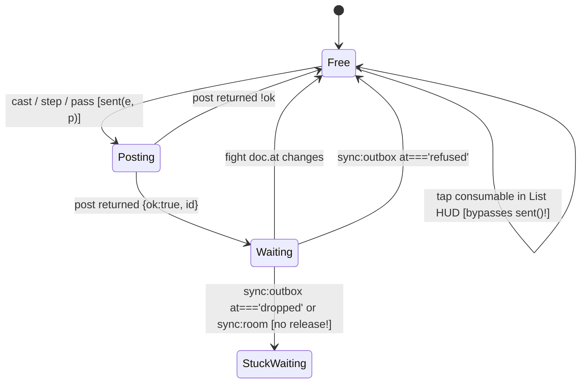

**Contradictory states the code allows:**
SMX-views-5.1. **Consumable tap bypasses hold while outbox 'dropped' leaves hold permanently locked**
   - Tap: In a room fight on the player's turn in List HUD: (1) tap Use on a consumable -> turn buttons stay enabled; (2) tap End turn while offline/disconnected and let the outbox drop the event.
   - Shows: Consumable use leaves hold='free' (End turn stays enabled); after sync:outbox emits at='dropped', End turn remains removed (count 0) and ability buttons remain permanently disabled.
   - Should show: All turn-consuming actions (including consumables) enter the turn hold, and outbox 'dropped' or 'sync:room' transitions hold back to 'free'.
   - Rule: **proposed, needs the owner**: using a consumable in a fight takes the player's turn.

**How it knows (SMX-views-5):** RAN. tests/e2e/proof-sm-views-b.e2e.ts | timeout 600 bunx playwright test tests/e2e/proof-sm-views-b.e2e.ts --workers=1 --output=/tmp/pw-views-b | SMX-views-5 OBSERVED: consumable kept passBtn enabled; after sync:outbox dropped, passCount=0, castDisabled=true

**Proposed explicit model:**
```ts
type TurnHold = { at: 'free' } | { at: 'picking'; from: string } | { at: 'posting'; from: string } | { at: 'waiting'; from: string; outboxId: string };
// Pure turnHoldStep(hold, event) handling startPick, post, posted, outboxRefused, outboxDropped, docChanged, roomChanged.
```

**What it would delete:**
- src/views/table.js:230-243 (ad-hoc hold object and partial sync:outbox listener)
- src/views/table.js:327,330 (unwrapped inventory.use calls bypassing sent())

**Related re-audit ids:** SM-views-4, BUG-views-16, BUG-views-11
**Notes:** Known as SM-views-4/BUG-views-16; uses.cast also awaits target picker while hold is already 'sent' with pre-await doc snapshot.

### 17. SMX-views-2: Maker shell dirty/discard lifecycle blind to map tile painting & ability zendErr [high] [NEW] [RAN]

**Where it lives (at 1732d2d1):**
- `src/views/maker.js:883 (shell.done calls finish(v) without guarding v !== undefined)`
- `src/views/maker.js:907-919 (form = 'clean'|'edited', touched listener on input/change/button click, asking boolean, leave())`
- `src/views/maker.js:941,946 (Cancel bypasses leave()/asking; backdrop listens on mousedown)`
- `src/views/map-maker.js:62,91,131-134 (grid cells are <div> painted on pointerdown/move/up calling shell.changed(), never marking form='edited')`
- `src/views/maker.js:748-812 (buildAbility lazy zendFx/zendErr; line 811 input listener ignores [data-zend-fx])`

**States and moves:** A maker dialog tracks form ('clean' | 'edited') and asking (boolean for Discard confirm) plus sub-editor state (map painting boolean; skill zendFx/zendErr). Transitions: trusted input/change/button click -> 'edited'; Escape/backdrop while 'clean' -> close immediately; Escape/backdrop while 'edited' & !asking -> asking=true -> confirm -> close or stay; Cancel -> close directly; shell.done(v) -> close unconditionally.

```mermaid
stateDiagram-v2
  [*] --> Clean
  Clean --> Clean : paint map tiles via pointerdown/move [blind to dirty]
  Clean --> Edited : input / change / button click
  Clean --> Closed : Escape / backdrop / Cancel [no confirm!]
  Edited --> ConfirmDiscard : Escape / backdrop [!asking]
  ConfirmDiscard --> Edited : Cancel discard
  ConfirmDiscard --> Closed : Discard
  Edited --> Closed : Cancel / Save / shell.done(undefined)
```

**Contradictory states the code allows:**
SMX-views-2.1. **Map Maker tiles painted via pointer drag while Maker shell form === 'clean'**
   - Tap: Open Workshop -> Maps -> New map (or Edit an existing map), paint walls on the grid by dragging/tapping tiles (without clicking brush buttons or typing in inputs), then press Escape or tap outside the dialog.
   - Shows: The Map Maker closes immediately with no 'Discard changes?' prompt and every painted tile is silently lost.
   - Should show: Painting tiles marks the maker dirty (form = 'edited'), so Escape or a backdrop press asks 'Discard changes?' before losing the GM's map edits.
SMX-views-2.2. **Skill Maker zone-end effect added in [data-zend-fx] while zendErr remains shown**
   - Tap: Open Skill Maker, enter a name, open the Field group, tick 'Leaves a field' and 'Something lands when it ends', then add an effect inside [data-zend-fx].
   - Shows: Save button becomes enabled while the red error text 'Add what lands when it ends.' stays stuck on screen.
   - Should show: Editing [data-zend-fx] clears zendErr as soon as an effect is added.

**How it knows (SMX-views-2):** RAN. tests/e2e/proof-sm-views-a.e2e.ts | timeout 600 bunx playwright test tests/e2e/proof-sm-views-a.e2e.ts --workers=1 --output=/tmp/pw-views-a | SMX-views-2 OBSERVED: painted 3 walls then Escape closed map-maker with 0 confirm dialogs; Skill Maker save enabled while zendErr="Add what lands when it ends."

**Proposed explicit model:**
```ts
type MakerShellState = { at: 'clean' } | { at: 'dirty' } | { at: 'confirming' } | { at: 'closed' };
// shell.dirty() (or shell.changed({ dirty: true })) transitions clean -> dirty for non-input editors like map-maker's pointer canvas;
// shell.done(v) guards v !== undefined; buildAbility derives zendErr in one refresh() called from all sub-editor listeners.
```

**What it would delete:**
- src/views/maker.js:907-911 (implicit form + asking flags + DOM event heuristic)
- src/views/maker.js:883 (unguarded finish(v) in shell.done)
- src/views/maker.js:811 (narrow dataset filter missing [data-zend-fx])

**Related re-audit ids:** SM-views-9, BUG-views-14
**Notes:** Map Maker tile painting bypassing maker.js dirty tracking is a new high-severity data-loss bug; zendErr and shell.done are linked to SM-views-9/BUG-views-14.

### 18. SMX-rules-6: Fatigue and collapse latch split across fitMaxima, fight rows, and rest [med] [NEW] [RAN]

**Where it lives (at 1732d2d1):**
- `src/core/hunter/vitals.ts:127,157-164 (collapsed latch set only in setFatigue/changeFatigue)`
- `src/core/hunter/vitals.ts:189-195 (rest clears collapsed only if fatiguePast is false after subtracting R.rest.long.fatigue%)`
- `src/core/hunter/vitals.ts:198-199 (fitMaxima clamps fatigue to fatigueMax without evaluating collapseAt)`
- `src/core/hunter/sheet.ts:177-188 (checksOf reads fatiguePast; fitted calls fitMaxima)`
- `src/core/hunter/grant.ts:348-349 (sheetEdit totals calls setFatigue, latching collapsed=true on intermediate fight write-backs)`
- `src/core/combat/effect-ops.ts:357 (Body tracks fatigue number only, omitting collapsed)`
- `src/core/combat/fight-turn.ts:212-214 (writeBack emits sheet totals on every fatigue change)`

**States and moves:** Fatigue standing progresses Fresh -> Tired (>=penaltyAt) -> Disadvantaged (>=disAt) -> Collapsed (>=collapseAt, sticky until long rest). However, collapsed is stored as a separate boolean latch updated only by setFatigue(), omitted from fitMaxima() and completely absent from combat Body rows. As a result, lowering fatigueMax into collapse range leaves collapsed=false until an unrelated 0-delta edit, while mid-fight fatigue spikes permanently latch collapsed=true on the sheet even while the fight ignores collapse and even if fatigue is restored before the fight ends.

```mermaid
stateDiagram-v2
  [*] --> Fresh
  Fresh --> Tired : fatigue >= penaltyAt
  Tired --> Disadvantaged : fatigue >= disAt
  Disadvantaged --> Collapsed : setFatigue >= collapseAt
  Disadvantaged --> FullButUncollapsed : fitMaxima lowers fatigueMax to fatigue!
  FullButUncollapsed --> Collapsed : unrelated +0 fatigue edit
  Collapsed --> Collapsed : fight row ignores collapse; mid-fight restore stays collapsed
  Collapsed --> Fresh : long rest [if remaining < collapseAt]
```

**Contradictory states the code allows:**
SMX-rules-6.1. **fatigue === fatigueMax (100% >= collapseAt) AND collapsed === false after unequipping +VIT gear**
   - Tap: Equip +20 VIT armor (raising fatigueMax from 100 to 113), raise fatigue to 100 (not collapsed), then unequip the armor.
   - Shows: Fatigue is now 100 / 100 (100% >= collapseAt) yet collapsed stays false (no Exhausted chip); a subsequent +0 fatigue edit suddenly flips collapsed to true.
   - Should show: fitMaxima() evaluates collapseAt when fatigueMax decreases so 100/100 fatigue immediately latches collapsed=true consistently.
   - Rule: **proposed, needs the owner**: lowering max fatigue to or below current fatigue collapses the hunter at once.
SMX-rules-6.2. **Fight row reaches 100% fatigue mid-fight -> sheet latches collapsed=true permanently even though fight row ignores collapse and later fatigue healing drops fatigue to 70%**
   - Tap: In a fight, dash/act until fatigue hits 100/100, then use a fatigue-restoring potion/op down to 70/100 before the fight ends.
   - Shows: During the fight the hunter fights unimpeded (fight rows have no collapsed field), yet the intermediate totals write-back already latched collapsed=true on the sheet so the hunter ends at 70/100 fatigue permanently Collapsed.
   - Should show: Either combat rows model collapsed (or apply its penalty/block) consistently with the sheet, or collapse latches at a single consistent boundary.
   - Rule: **proposed, needs the owner**: a collapsed hunter is collapsed in a fight too.

**How it knows (SMX-rules-6):** RAN. .smaudit/proofs/rules/hunter-sm.test.ts | bun test ./.smaudit/proofs/rules/hunter-sm.test.ts | SMX-rules-6a: highMax=113 baseMax=100 afterUnequipFatigue=100/100 collapsed=false afterZeroDeltaCollapsed=true | SMX-rules-6b: midCollapsed=true endFatigue=70/100 endCollapsed=true

**Proposed explicit model:**
```ts
type FatigueState = { at: 'normal'; value: number } | { at: 'collapsed'; value: number };
// Derive tiredness/disadvantage from value/max; unify setFatigue + fitMaxima via clampFatigue(state, value, max, R) so lowering max into collapseAt transitions to 'collapsed'; mirror collapsed on HunterRow or settle collapse explicitly.
```

**What it would delete:**
- src/core/hunter/vitals.ts:199 unlatched fatigue clamp inside fitMaxima
- src/core/hunter/vitals.ts:127 decoupled `fatigue: number; collapsed: boolean` pair

**Related re-audit ids:** none (new).
**Notes:** Brand-new implicit state machine not covered by any reaudit ID.

### 19. SMX-rules-7: Progress pending stat allocation, negative balance, level demotion and rank standing [med] [KNOWN] [RAN]

**Where it lives (at 1732d2d1):**
- `src/core/hunter/progress.ts:55-57 (balance can go negative while pending > 0; available clamps to 0)`
- `src/core/hunter/progress.ts:102-109 (grantPoints clamps deduction to -available ignoring pending; setPoints lacks finite/trunc guard)`
- `src/core/hunter/progress.ts:154-159 (lower removes pending without checking negative balance)`
- `src/core/hunter/record.ts:39-44 (setRank/reevaluate allow upward-only sync; demotion leaves stale high rank)`
- `src/core/hunter/build.ts:36-40 (choosePath lacks buildsOn/mayPick/inFight guards)`
- `src/core/hunter/sheet.ts:94-99 (pathPerks reads h.rank, keeping A-rank perks on a demoted level-1 hunter)`

**States and moves:** Progression couples level, peakLevel, xp, bonusPoints, spent, pending, rank, and build.picks across 4 modules without enforcing balance >= 0 or rank/level alignment. Points held in pending disappear from available(), shielding them from quest failure deductions and silently vanishing into negative balance if lowered after a level demotion; setPoints accepts NaN; and demoting a hunter's level leaves their old high rank and open build perks intact.

```mermaid
stateDiagram-v2
  [*] --> FreePoints
  FreePoints --> PendingAlloc : raise() [available drops]
  PendingAlloc --> PendingAlloc : grantPoints(-n) shielded because available==0!
  PendingAlloc --> NegativeBalance : level demotion [balance < 0, pending > 0]
  NegativeBalance --> NegativeBalance : lower() destroys pending point!
  PendingAlloc --> Confirmed : confirm()
  Confirmed --> RankAboveLevel : atLevel(1) keeps Rank A & open perks
```

**Contradictory states the code allows:**
SMX-rules-7.1. **Points parked in pending + negative grantPoints(h, -3) -> penalty deducts 0; level demotion + lower() -> unconfirmed point vanishes without returning to available**
   - Tap: At level 2 with 3 free points, tap + three times on STR without tapping Confirm. Fail a quest with -3 points onFail, or have GM lower level to 1 and tap - on STR.
   - Shows: The -3 point quest penalty deducts 0 bonusPoints because available() is 0 while 3 points sit in pending; after demotion to level 1, tapping - drops pending.str from 3 to 2 while available stays 0 (the point vanishes).
   - Should show: Pending points are either auto-reconciled/returned when level or bonusPoints change, or deductions apply cleanly against unconfirmed balance.
   - Rule: **proposed, needs the owner**: unspent pending points are handed back when the level drops.
SMX-rules-7.2. **setPoints(h, NaN, R) -> bonusPoints becomes NaN; level demotion from 50 (Rank A) to 1 -> retains Rank A (+6 bonus & A-rank perks) while reevaluate() refuses**
   - Tap: Have GM demote a Rank-A level-50 hunter with 2 path perks down to level 1; or pass NaN/float into setPoints().
   - Shows: Hunter is Level 1 with Rank A (+6 check bonus and all A-rank perks active) and reevaluate returns 'not-eligible'; setPoints(NaN) corrupts bonusPoints to NaN.
   - Should show: setPoints validates finite integers, and level/rank/perk eligibility either stays synchronized or explicitly marks GM-overridden rank.
   - Rule: **proposed, needs the owner**: rank follows level unless the GM marks it as overridden.

**How it knows (SMX-rules-7):** RAN. .smaudit/proofs/rules/hunter-sm.test.ts | bun test ./.smaudit/proofs/rules/hunter-sm.test.ts | SMX-rules-7a: penaltyDeducted=0 afterDemotePending=3 afterLowerPending=2 availAfterLower=0 | SMX-rules-7b: setPointsNaN=NaN demotedLevel=1 rank=A picks=2 reevalRefused=not-eligible

**Proposed explicit model:**
```ts
type AllocationState = { confirmed: Stats; spent: number; pending: Pending };
// On level/bonusPoints change, reconcile pending (or track explicit debt). Guard setPoints with Number.isFinite + Math.trunc. Model rank standing explicitly as { kind: 'earned'; rank: Rank } | { kind: 'gmOverride'; rank: Rank } (and optional CapState matching world bible).
```

**What it would delete:**
- src/core/hunter/progress.ts:103 deduction clamp using available() instead of balance including pending
- src/core/hunter/progress.ts:108 unvalidated setPoints arithmetic
- src/core/hunter/record.ts:41-44 one-way reevaluate() disconnected from level demotion

**Related re-audit ids:** SM-rules-7, BUG-rules-24, AW-rules-7
**World:** A person and the System.
**Notes:** Reproduces SM-rules-7 & BUG-rules-24 and adds NEW pending-point shield/vanishing proof (7a) plus world-bible cap disagreement.

### 20. SMX-rules-8: Polymorphic combat Body flat record allowing cross-kind illegal states and level>200 rejection [med] [KNOWN] [RAN]

**Where it lives (at 1732d2d1):**
- `src/core/combat/effect-ops.ts:338-403 (BodyBase keeps origin/holder/threat/stagger/intent/extraction/xp/owner/until flat across all kinds; only kind+life are discriminated)`
- `src/core/combat/fight-parse.ts:656 (originOf caps hunter level at 200 vs progress.ts MAX_LEVEL 9999)`
- `src/core/combat/fight-parse.ts:702-764 (rowOf parses stagger, intent, threat, holder, extraction, owner, until independently of kind and life.at)`

**States and moves:** The landed dead-row unit narrowed Body.life by kind (HunterRow vs OtherRow), but every other kind-specific field remains flat and uncoupled in both TypeScript types and parseFight(). A parsed Body can simultaneously claim kind='hunter' with monster stagger/extraction, kind='monster' with a local hunter holder and extraction while alive, or kind='summon' with no owner; meanwhile a valid level-201 hunter causes parseFight() to reject the entire saved fight as null.

```mermaid
stateDiagram-v2
  [*] --> ParsedRow
  ParsedRow --> HunterWithMonsterFields : stagger/extraction accepted on hunter
  ParsedRow --> MonsterWithHunterHolder : holder=local & up+extraction accepted
  ParsedRow --> OwnerlessSummon : kind=summon & owner=undefined accepted
  ParsedRow --> WholeFightDropped : hunter level 201..9999 -> parseFight returns null
```

**Contradictory states the code allows:**
SMX-rules-8.1. **Cross-kind Body fields accepted by parseFight; level 201 hunter causes parseFight to return null and wipe active fight on reload**
   - Tap: Start a fight with a hunter leveled past 200 (legal under MAX_LEVEL=9999) and reload the page; or load/import a fight with mismatched row fields.
   - Shows: parseFight() returns null for the level-201 hunter fight (dropping the entire active fight on reload), while silently accepting a hunter carrying stagger+extraction, a live monster carrying local holder+extraction, and an ownerless summon.
   - Should show: Body is a full discriminated union by kind (hunter | monster | shadow | summon) validated per-kind in rowOf(), and originOf uses MAX_LEVEL (9999).
   - Rule: **proposed, needs the owner**: levels go up to 9999 in a fight as on the sheet.

**How it knows (SMX-rules-8):** RAN. .smaudit/proofs/rules/combat-sm.test.ts | bun test ./.smaudit/proofs/rules/combat-sm.test.ts | SMX-rules-8: hunterHasStagger=true hunterHasExtraction=true monsterHolder=local monsterUpExtraction=gone summonOwner=undefined fightWithLv201=null

**Proposed explicit model:**
```ts
type Body = (BodyCommon & (
  | { kind: 'hunter'; life: Life; origin: HunterOrigin; holder: LocalHolder | RemoteHolder; threat: null; stagger: null; intent: null; extraction?: never }
  | { kind: 'monster'; life: FoeLife; origin: MonsterOrigin; holder: null; threat: Threat; stagger: Stagger | null; intent: Intent | null; extraction?: Extraction }
  | { kind: 'shadow'; life: FoeLife; origin: MonsterOrigin; holder: ShadowHolder; threat: null; stagger: null; intent: null }
  | { kind: 'summon'; life: FoeLife; origin: MonsterOrigin; holder: null; owner: CombatantId; until?: Tick }
));
```

**What it would delete:**
- src/core/combat/fight-parse.ts:656 hardcoded 200 level cap
- src/core/combat/fight-parse.ts:716-753 kind-blind parsing of stagger/intent/holder/extraction/owner
- src/core/combat/effect-ops.ts:368-403 flat optional/nullable cross-kind fields on BodyBase

**Related re-audit ids:** SM-rules-3, BUG-rules-18
**Notes:** Credits dead-row for narrowing Body.life; proves remaining cross-kind flat fields and whole-fight loss at level 201.

### 21. SMX-rules-9: Chronicle inbox held-vs-drained time-shift and feat visibility/streak counting [med] [KNOWN] [RAN]

_Also reported as:_ SMX-gates-6 (Chronicle inbox & autonomous feat/notice evaluation pipeline, med). Their locations, combinations and models are folded in below.

**Where it lives (at 1732d2d1):**
- `src/core/hunter/noticed.ts:6-14,70-104,163-169 (inbox buffers unstamped Facts while held by a fight and stamps them with drain-time day/session)`
- `src/core/hunter/noticed.ts:78-82 (broke passes { ...from, n: 0 } retaining from.vals)`
- `src/core/hunter/feats.ts:76-88 (TABLE.hidden.unlocked unconditionally returns 'shown', ignoring show.at==='never')`
- `src/core/hunter/feats.ts:173 (parseFeat allows reach > VALS_MAX 200 for distinct measures)`
- `src/core/hunter/counts.ts:74-78,164 (distinct evicts past VALS_MAX; objectiveStep clears vals on broke whereas noticed.ts does not)`
- `src/core/hunter/noticed.ts:63-105,158-185 (noticeHunter skips featStep when countStep returns from; drops grant levelup/done popups; released/held gate)`
- `src/core/hunter/feats.ts:70-96 (featStep TABLE unlocks show:'never' feats to 'shown'; broke keeps distinct vals)`
- `src/core/hunter/counts.ts:56-81 (distinct countStep returns same object reference when value already in vals)`
- `src/core/hunter/chronicle.ts:65-118 (unstamped fight-held inbox)`
- `src/core/hunter/chronicle-view.ts:166-192 (featsSeen wipes seen record when remoteSheets() is transiently empty)`
- `src/edge/store.ts:289-294 (noticed runs automatically inside store.apply)`

**States and moves:** Chronicle.inbox is a 2-state buffer (empty vs waiting while held by a fight) that stores unstamped Facts and stamps them only upon draining, shifting facts recorded on an earlier day/session/rest into the drain moment's window. Simultaneously, featStep's 3-state table (hidden/shown/earned) ignores show.at==='never' on unlocked, and noticed.ts resets n=0 on broke without clearing distinct vals. Facts are appended unstamped to chronicle.inbox, held while the hunter is in a fight, then drained synchronously inside store.apply by noticed(). Each fact steps both feat counts (counts.ts -> feats.ts TABLE) and counted quests, immediately granting feat rewards and recording a 'feat' fact back into the inbox. Separately, the GM phone tracks remote players' earned feats via featsSeen() in device memory.

```mermaid
stateDiagram-v2
  [*] --> Empty
  Empty --> Waiting : record(fact) while held by fight [no timestamp!]
  Waiting --> Empty : drain on later day [Day-1 fact stamped Day-2!]
  [*] --> FeatHidden
  FeatHidden --> FeatShown : unlocked [leaks even when show.at=='never'!]
  FeatShown --> StreakBroken : broke [n=0 but vals kept!]
```

**Contradictory states the code allows:**
SMX-rules-9.1. **Fight-held inbox drained on next day -> Day-1 kill counted as Day-2 kill, earning a '2 kills in one day' feat across two days**
   - Tap: Record a kill on Day 1 during a fight that stays open overnight; end the fight on Day 2 and get 1 more kill.
   - Shows: The Day-1 kill is stamped with Day 2 when the inbox drains, unlocking the 'Two Today' within:'day' feat with only 1 kill per day.
   - Should show: Each fact carries its own stamp (day/session/longRest count) when recorded so delayed draining never time-shifts windowed counts.
   - Rule: **proposed, needs the owner**: a feat's windowed count uses the day the fact happened, not the day the inbox drained.
SMX-rules-9.2. **show:{at:'never'} feat + unlocked event -> transitions to 'shown'; distinct+within:'row' feat + broke -> retains prior vals, blocking re-counting in new streak**
   - Tap: Kill an E-rank Goblin (streak 1/2), break the streak with a D-rank Orc, then kill another E-rank Goblin; or send unlocked to a show:'never' feat.
   - Shows: After breaking the streak, killing Goblin again leaves n=0 because vals still holds ['goblin']; featStep moves a show:'never' feat to 'shown' on unlocked.
   - Should show: broke clears vals (matching objectiveStep at counts.ts:164), and TABLE.hidden.unlocked keeps 'hidden' unless def.show.at==='feat'.
   - Rule: **proposed, needs the owner**: a feat set to never show stays hidden after it unlocks.
SMX-gates-6.1. **Distinct-count feat at reach whose 'also' predicate initially failed permanently ignores duplicate facts even after 'also' becomes true**
   - Tap: Feat requires 1 distinct kill name while holding >= 500 gold. Hunter kills 'Goblin' at 0 gold (vals=['goblin'], n=1, also=false). Hunter gains 1000 gold (also=true) and kills 'Goblin' again.
   - Shows: countStep returns the unchanged object `from`, noticed.ts:80 hits `if (moved === from) continue`, and the feat stays 'shown' instead of becoming 'earned'.
   - Should show: When a count is already at or above reach and a matching fact arrives, noticed() must re-evaluate `also` and call featStep even if `vals` did not grow.
   - Rule: **proposed, needs the owner**: a feat with an extra condition unlocks when the condition later becomes true.
SMX-gates-6.2. **featStep transitions show:'never' feat to 'shown' on unlocked (SM-rules-1/BUG-rules-11) and featsSeen wipes GM seen-state on transient empty sheets**
   - Tap: A hidden feat (show:'never') receives 'unlocked'; or a player briefly disconnects from a GM's room so remoteSheets() is [], earns a feat, and reconnects.
   - Shows: show:'never' becomes 'shown'; featsSeen({}, []) returns {}, so on reconnect the player's sheet is treated as 'first sight' and the newly earned feat produces 0 GM notifications.
   - Should show: TABLE.hidden.unlocked must keep show:'never' hidden; featsSeen must retain previously seen sheet keys per room instead of wiping them on empty polls.
   - Rule: **proposed, needs the owner**: a feat set to never show stays hidden.
SMX-gates-6.3. **Autonomous feat grants bypass GM approval and silently drop level-up / Job Change UI windows**
   - Tap: With RULES.feats.on=true, a player's fact earns a feat with XP that crosses a level threshold.
   - Shows: noticed.ts:100-101 grants rewards immediately on the player's phone with no GM edit/approval step, and discards g.levelup and g.done.
   - Should show: Feat rewards/System windows should queue for GM review/approval (or when auto-granted, surface level-up/Job Change popups).
   - Rule: settled (the owner, rule d): feat rewards and System windows wait for the GM.

**How it knows (SMX-rules-9):** RAN. .smaudit/proofs/rules/hunter-sm.test.ts | bun test ./.smaudit/proofs/rules/hunter-sm.test.ts | SMX-rules-9: showNeverLeak=shown distinctRowAfterBrokeN=0 vals=["goblin"] crossDayEarned=earned
**How it knows (SMX-gates-6):** RAN. .smaudit/proofs/gates/sm-gates-proofs.test.ts | bun test ./.smaudit/proofs/gates/sm-gates-proofs.test.ts -> PROOF[SMX-gates-6a] step1At=shown step1Vals=["goblin"] step2AtWith1000Gold=shown; PROOF[SMX-gates-6b] showNeverUnlockedAt=shown seenAfterEmpty={} toldOnReconnectWithNewFeat=0

**Proposed explicit model:**
```ts
type StampedFact = Fact & { readonly at: string; readonly day: DayKey; readonly session: number; readonly longRests: number };
// Store StampedFact in Chronicle.inbox. In noticed.ts: broke -> { n: 0, mark: from.mark } (drop vals). In feats.ts TABLE.hidden.unlocked: guard c.def.show.at === 'feat'. Cap distinct reach <= VALS_MAX.
```
```ts
type CountStepResult = { readonly kind: 'unchanged'; readonly matched: boolean; readonly count: Counted } | { readonly kind: 'moved'; readonly count: Counted } | { readonly kind: 'broke'; readonly count: Counted };
// noticed evaluates featStep whenever kind==='moved' || (matched && count.n >= def.rule.reach); featsSeen keyed by RoomCode with explicit prune-on-kick rather than wipe-on-empty.
```

**What it would delete:**
- src/core/hunter/noticed.ts:72 late drain-time stamping of inbox facts
- src/core/hunter/noticed.ts:81 `{ ...from, n: 0 }` preserving stale vals
- src/core/hunter/feats.ts:80 unguarded unlocked -> 'shown' cell
- src/core/hunter/noticed.ts:80 (reference equality `moved === from` shortcut skipping `also` re-check)
- src/core/hunter/feats.ts:80 (unguarded hidden->shown on unlocked ignoring show.at==='never')
- src/core/hunter/chronicle-view.ts:184-191 (rebuilding seen map from scratch on each poll)

**Related re-audit ids:** SM-rules-4, SM-rules-1, BUG-rules-10, BUG-rules-11, BUG-rules-29, BUG-rules-30
**World:** A System message or reward.
**Notes:** Reproduces SM-rules-4, SM-rules-1/BUG-rules-11, and BUG-rules-10 in one deterministic proof; flags GM-approval world disagreement. Distinct+also wedge (noticed.ts:80) and featsSeen transient-empty wipe are newly proven alongside SM-rules-1/BUG-rules-10/11/SM-rules-4.

### 22. SMX-sync-4: Outbox untracked in-flight delivery vs room expiry, room switch, and solo-wait [med] [KNOWN] [RAN]

**Where it lives (at 1732d2d1):**
- `src/core/sync/outbox.ts:88-100,117-120 (roomGone only matches at === 'queued', skipping 'sending'; post drops oldest queued on overflow)`
- `src/edge/sync.ts:433,637-680 (deliver() runs outside track(gen) without AbortSignal or gen guard; answered() fires chase linkDo('sent') and sync:outbox even after room change; postLetter never emits dropped)`
- `src/core/gates/solo-wait.ts:52-58,95 (runsGone marks WaitingRun 'gone' while its sending outbox letter survives)`

**States and moves:** Outbox entries move queued -> sending -> sent|refused|dropped in save.settings.sync.outbox, while deliver() holds an untracked network promise in sync.ts with no link gen, room check, or abort controller. roomGone ignores 'sending' entries and postLetter drops overflow entries without notifying sync:outbox listeners.

```mermaid
stateDiagram-v2
  state "Outbox: sending(Room A)" as SEND
  state "Room A gone (runsGone -> gone, roomGone skips sending)" as GONE
  state "Zombie queued(Room A) forever" as ZOMB
  state "Switched to Room B while deliver() in flight" as SW
  state "Late 200 -> chase & sync:outbox in Room B" as LEAK
  [*] --> SEND
  SEND --> GONE : poll 404 gone
  GONE --> ZOMB : deliver() fails/times out or reload
  SEND --> SW : join Room B (no abort)
  SW --> LEAK : deliver() answers 200 OK
```

**Contradictory states the code allows:**
SMX-sync-4.1. **roomGone skips entry.at === 'sending' -> timeout/5xx/reload flips entry back to queued for deleted room while WaitingRun is 'gone'**
   - Tap: Player posts a soloRun or roll while the room expires (404 on poll), and the in-flight POST times out or the tab reloads.
   - Shows: roomGone leaves the sending entry intact while runsGone marks the WaitingRun 'gone'; on failure or reload the entry flips back to 'queued' for the deleted room permanently, consuming an OUTBOX_MAX slot forever.
   - Should show: roomGone refuses both 'queued' and 'sending' entries for the dead room, and deliver() aborts via track(gen).
SMX-sync-4.2. **In-flight deliver() from Room A answers after player switched to Room B**
   - Tap: Player posts a fight move (step/cast/pass/deathSave) in Room A while the POST is slow, then switches to Room B before the POST resolves.
   - Shows: When Room A's POST returns 200 OK, answered() calls linkDo({ type: 'sent', ... }) on Room B (starting fight chase polling in Room B) and emits sync:outbox { at: 'sent' } while in Room B.
   - Should show: Track deliver() by link.gen (or gate chase/toast/sync:outbox on link.at === 'live' && link.code === e.room).
SMX-sync-4.3. **postLetter overflow evicts queued entry without emitting sync:outbox { at: 'dropped' }**
   - Tap: Offline player queues over OUTBOX_MAX (100) messages, evicting an earlier pending combat action.
   - Shows: postLetter toasts that oldest messages were dropped but never emits sync:outbox { at: 'dropped' } for evicted entries.
   - Should show: Emit sync:outbox { id, at: 'dropped' } for every entry dropped by postIn so UI holds release.

**How it knows (SMX-sync-4):** RAN. .smaudit/proofs/sync/core-server.test.ts + tests/e2e/proof-sm-sync-browser.e2e.ts | bun test ./.smaudit/proofs/sync/core-server.test.ts && bunx playwright test tests/e2e/proof-sm-sync-browser.e2e.ts --workers=1 | pass (6.1s): roomGone kept soloRun entry 'sending' then flipped back to 'queued' for dead room DED234 while WaitingRun.shownOf={state:'lost',why:'gone'}; browser deliver() for Room A resolved after joinRoom(Room B) and emitted sync:outbox {at:'sent'} while activeRoom===codeB

**Proposed explicit model:**
```ts
// outbox.ts: roomGone matches e.room === room && (e.at === 'queued' || e.at === 'sending').
// sync.ts: deliver(code, key, e, gen) passes track(gen).signal; answered(e, c, gen) ignores chase/UI effects when link.gen !== gen; postLetter emits sync:outbox 'dropped' for each dropped entry.
```

**What it would delete:**
- src/core/sync/outbox.ts:119 (at === 'queued'-only filter in roomGone)
- src/edge/sync.ts:675-680 (untracked deliver() without gen/AbortSignal)

**Related re-audit ids:** BUG-sync-4, BUG-views-16
**World:** A System message or reward; A world gate.
**Notes:** Proven in both unit tests and live Playwright browser session.

### 23. SMX-sync-6: App update edge runner re-entrancy, missed registration.waiting, and sessionStorage overwrite [med] [KNOWN] [RAN]

**Where it lives (at 1732d2d1):**
- `src/edge/upgrade.ts:18-71 (let update, let quiet, unqueued re-entrant send(), look() checks only registration.installing, noteReload runs before state check)`
- `src/edge/sync.ts:195-199 (Link enters upgrading before upgradeRefused runs)`
- `src/views/room-pill.ts:28-35,44,47 (reads sync.conn() === 'upgrading' alongside updateNow())`

**States and moves:** src/core/upgrade.ts defines an explicit Update machine (none -> installing -> ready -> reloading | stuck), but src/edge/upgrade.ts runs effects synchronously without an event queue, ignores registration.waiting, attaches SW listeners permanently, and mutates sessionStorage before checking update.at.

```mermaid
stateDiagram-v2
  state "none" as N
  state "installing (effects: look, wait)" as I
  state "reloading (quiet timer STILL armed!)" as RL
  state "stuck (premature reload under old SW)" as ST
  [*] --> N
  N --> I : refused(reload)
  I --> RL : no SW -> sync look -> reload -> outer loop arms quiet!
  I --> RL : registration.waiting!=null -> installing:false -> old SW reload
  RL --> ST : next load serves old SW -> 426 again -> stuck
```

**Contradictory states the code allows:**
SMX-sync-6.1. **update.at === 'reloading' && quiet timer still armed (no serviceWorker)**
   - Tap: On a browser without serviceWorker, a room request returns 426 upgrade.
   - Shows: send() runs 'look' synchronously which re-enters send({ type: 'looked', installing: false }) -> 'reloading' + location.reload(), then the outer loop runs 'wait' and arms a 4s quiet timer after reload.
   - Should show: Queue re-entrant events in send() (matching sync.ts drain()) so no stale effect runs after transitioning to 'reloading'.
SMX-sync-6.2. **registration.installing === null && registration.waiting !== null -> premature reload under old SW**
   - Tap: Deploy lands while player is in a room; new service worker finishes installing into registration.waiting right before registration.update() resolves.
   - Shows: look() checks only registration.installing !== null, reports installing: false, and reloads immediately under the old active SW, risking a 426 loop into permanent 'stuck' ('Out of date').
   - Should show: Treat registration.installing !== null || registration.waiting !== null as an update in progress.
SMX-sync-6.3. **upgradeRefused('build-3') called while already in 'reloading' for 'build-2' overwrites sessionStorage note**
   - No user-visible symptom. Developer trigger: Call upgradeRefused('build-2', cb) then upgradeRefused('build-3', cb); updateNow() stays { at: 'reloading', build: 'build-2' } while sessionStorage holds 'build-3'.

**How it knows (SMX-sync-6):** RAN. .smaudit/proofs/sync/edge-upgrade.test.ts | bun test ./.smaudit/proofs/sync/edge-upgrade.test.ts | pass: armed.size===1 after reloading (part 1); reloads===1 despite registration.waiting!==null (part 2); sessionStorage overwritten with 'build-3' while reloading 'build-2' (part 3)

**Proposed explicit model:**
```ts
// Queue re-entrant events inside upgrade.ts send() (like sync.ts drain()); guard upgradeRefused with if (update.at !== 'none') return; check registration.installing !== null || registration.waiting !== null in look().
```

**What it would delete:**
- src/edge/upgrade.ts:36-40 (re-entrant unqueued effect loop)
- src/edge/upgrade.ts:59 (installing-only check ignoring waiting)
- src/edge/upgrade.ts:69-70 (unconditional noteReload before state check)

**Related re-audit ids:** BUG-sync-10
**Notes:** All three combinations proven directly against src/edge/upgrade.ts.

### 24. SMX-sync-7: Server database closed and retry flags outside Db<S> [med] [KNOWN] [RAN]

**Where it lives (at 1732d2d1):**
- `server.ts:341-344 (openDatabase keeps static ready after close())`
- `server.ts:350-379 (mutable let retry and let closed parallel to Db<S>)`
- `src/core/room-server.ts:69-107 (Db<S> only models opening | ready | down with no closed state)`

**States and moves:** Db<S> models opening | ready | down in src/core/room-server.ts, while server.ts keeps two parallel mutable flags (closed, retry). close() sets closed=true, clears retry, and closes the SQL pool, leaving db stuck in 'ready' (or allowing an in-flight failed open() to move db into 'down' with retry=null).

```mermaid
stateDiagram-v2
  state "opening" as O
  state "ready (store open)" as R
  state "ready + closed=true (pool closed!)" as RC
  state "down + closed=true (no retry)" as DC
  [*] --> O
  O --> R : opened
  R --> RC : close() closes pool, db stays ready
  O --> DC : close() then open() rejects -> db becomes down
```

**Contradictory states the code allows:**
SMX-sync-7.1. **closed === true && db.at === 'ready' (pointing to a closed Postgres pool)**
   - No user-visible symptom. Developer trigger: Call await db.close() followed by await db.now() on database('postgres://...', open) or openDatabase(store).
SMX-sync-7.2. **closed === true && db.at === 'down' && retry === null**
   - No user-visible symptom. Developer trigger: Call db.close() while open() promise is pending, then reject open().

**How it knows (SMX-sync-7):** RAN. .smaudit/proofs/sync/core-server.test.ts | bun test ./.smaudit/proofs/sync/core-server.test.ts | pass: after db.close() (closedCount===1), db1.now().at==='ready'; close during opening + reject -> db2.now().at==='down'; openDatabase().close() -> now().at==='ready'

**Proposed explicit model:**
```ts
export type Db<S> = { at: 'opening' } | { at: 'ready'; store: S } | { at: 'down'; since: number; error: string } | { at: 'closed' };
export type DbEvent<S> = { type: 'opened'; store: S } | { type: 'failed'; at: number; error: string } | { type: 'close' };
// dbStep returns { db, effects: ('scheduleRetry'|'clearRetry'|'closePool')[] }, deleting server.ts closed flag.
```

**What it would delete:**
- server.ts:354 (parallel let closed = false flag)
- server.ts:360,366 (manual if (closed) guards in attempt())
- server.ts:342 (static closed-blind db object in openDatabase)

**Related re-audit ids:** SM-sync-1
**Notes:** All three shutdown combinations proven directly against server.ts database() and openDatabase().

### 25. SMX-sync-8: showRemoved recursive retry modal loop in src/edge/sync.ts [med] [KNOWN] [RAN]

**Where it lives (at 1732d2d1):**
- `src/edge/sync.ts:435 (notice('removed') calls showRemoved(code, bound()))`
- `src/edge/sync.ts:608-622 (showRemoved opens ui.system and recursively calls showRemoved(code, h) on any catch)`

**States and moves:** showRemoved encodes a retry dialog lifecycle in recursive async closures with no state machine, no TapKind dispatch beyond 'removed', and no guard against room deletion, campaign replacement, or joining another room.

```mermaid
stateDiagram-v2
  state "REMOVED modal open (code, h)" as M
  state "Attempting rejoin" as A
  state "Rejoined" as OK
  state "Dismissed" as END
  [*] --> M
  M --> END : OK
  M --> A : Rejoin when GM allows
  A --> OK : head ok
  A --> M : ANY error (removed, notfound, replaced, busy, net) -> infinite loop!
```

**Contradictory states the code allows:**
SMX-sync-8.1. **showRemoved catches terminal TapError('notfound' | 'replaced' | 'busy') -> wrong toast + infinite reopen**
   - Tap: GM removes a player; while 'REMOVED FROM ROOM' is open, the room expires/is deleted (or campaign is replaced); player taps 'Rejoin when the GM allows'.
   - Shows: Toast says 'Could not reach the server. Try again in a moment.' and 'REMOVED FROM ROOM' immediately reopens forever until the user taps OK.
   - Should show: Use tapWords(e.kind, code) and exit the retry loop on terminal kinds ('notfound', 'replaced') or if the phone already entered a live room.
SMX-sync-8.2. **Stale showRemoved modal remains open after player joins another room or replaces campaign**
   - Tap: Player is removed from Room A; while dialog is queued/open, campaign is replaced or player enters Room B; player taps 'Rejoin when the GM allows'.
   - Shows: Stale closure calls begin(joining(Room A, null), staleHunter) and pulls the player out of Room B.
   - Should show: Bind the removed prompt to the link gen/campaign and cancel/exit when room or campaign changes.

**How it knows (SMX-sync-8):** RAN. tests/e2e/proof-sm-sync-browser.e2e.ts | timeout 600 bunx playwright test tests/e2e/proof-sm-sync-browser.e2e.ts --workers=1 | pass (10.8s): when peek=1 returned {exists:false} (notfound), tapping 'Rejoin when the GM allows' toasted 'Could not reach the server. Try again in a moment.' and reopened 'REMOVED FROM ROOM'

**Proposed explicit model:**
```ts
type RemovedPrompt = { at: 'idle' } | { at: 'asking'; code: RoomCode; hid: HunterId | null } | { at: 'rejoining'; code: RoomCode; hid: HunterId | null };
// Terminal TapKind ('notfound' | 'replaced') or link becoming live transitions to 'idle' with tapWords(kind, code) instead of recursing.
```

**What it would delete:**
- src/edge/sync.ts:618-619 (catch-all 'Could not reach the server' toast and unconditional recursive showRemoved call)

**Related re-audit ids:** SM-sync-6
**Notes:** Proven in live Playwright browser session.

### 26. SMX-sync-9: Store dual-timer flush scheduler and fight-corrupt loadUnkept collapse [med] [KNOWN] [RAN]

**Where it lives (at 1732d2d1):**
- `src/edge/store.ts:150-160 (load() collapses LoadNotice 'fight' into backup: 'failed' -> loadUnkept)`
- `src/edge/store.ts:104 (LOAD_TEXT vs LIFE_TEXT.loadUnkept)`
- `src/edge/store.ts:200-203 (schedule() drops rAF, inner timeout, and 1000ms fallback handles)`
- `src/core/store-life.ts:75-86 (opened() maps any failed load backup to readOnly: loadUnkept)`

**States and moves:** StoreLife models clean/dirty/failing/retrying, but store.ts spawns untracked rAF + setTimeout(0) + setTimeout(1000) timers on every 'schedule' effect and never cancels them when flushed via rAF, leaving, otherTab, or replaced. Separately, load() collapses three distinct LoadNotice outcomes ('unreadable', 'old', 'fight') into a single boolean backup-failed branch.

```mermaid
stateDiagram-v2
  state "dirty (rAF + 1000ms armed)" as D1
  state "clean (1000ms STILL armed!)" as C1
  state "dirty #2 (before rAF paints)" as D2
  state "Pre-paint sync flush by stale 1000ms" as SYNC
  [*] --> D1
  D1 --> C1 : rAF flushes at 16ms
  C1 --> D2 : Edit #2 at 995ms
  D2 --> SYNC : Edit #1 1000ms fires before Edit #2 rAF!
```

**Contradictory states the code allows:**
SMX-sync-9.1. **life.write === 'clean' && stale 1000ms fallback timer still armed -> pre-paint flush of later edit**
   - Tap: Player makes an edit at t=0 (flushed by rAF at 16ms), then makes another edit just before t=1000ms.
   - Shows: Uncancelled 1000ms timer from Edit #1 fires before Edit #2's rAF paint, running JSON.stringify + localStorage.setItem synchronously inside the animation frame.
   - Should show: Store pending rAF, inner timeout, and fallback timer handles in store.ts and cancel all three whenever writeSave, leaving, or replaced runs.
SMX-sync-9.2. **loaded.notice === 'fight' (campaign opened intact) && backup === 'failed' -> readOnly: loadUnkept ('Your save could not be opened')**
   - Tap: Player opens the app with full browser storage and a save whose fight field is corrupt while the campaign and hunters are intact.
   - Shows: The hunter and campaign open normally without the fight, yet the banner says 'Your save could not be opened, and storage is too full to keep a copy of it in Backups...'
   - Should show: Use a distinct ReadOnlyWhy ('fightUnkept') stating the campaign opened without its unreadable fight and storage was too full to back it up.

**How it knows (SMX-sync-9):** RAN. .smaudit/proofs/sync/edge-store.test.ts | bun test ./.smaudit/proofs/sync/edge-store.test.ts | pass: fallback1.cleared===false after rAF flush and firing fallback1 flushed Edit #2 synchronously (writes=2 before Edit #2 rAF); corrupt fight + full storage opened 'Intact Hero' with fight===null while notices included loadUnkept ('Your save could not be opened')

**Proposed explicit model:**
```ts
type FlushTimers = { raf: number | null; task: ReturnType<typeof setTimeout> | null; fallback: ReturnType<typeof setTimeout> | null };
// cancelTimers() runs on 'write' / 'leaving' / 'replaced' effects.
// Opened.backup: 'none' | 'kept' | { failed: LoadNotice } -> ReadOnlyWhy distinguishes 'fightUnkept' from 'loadUnkept'.
```

**What it would delete:**
- src/edge/store.ts:200-203 (fire-and-forget requestAnimationFrame and setTimeout calls)
- src/edge/store.ts:157-159 (collapsing loaded.notice === 'fight' into generic backup: 'failed')

**Related re-audit ids:** BUG-sync-14, BUG-sync-15
**Notes:** Both combinations proven directly against src/edge/store.ts.

### 27. SMX-sync-10: View and panel lifecycle state mutation in src/app.js [med] [KNOWN] [RAN]

_Also reported as:_ SMX-views-9 (App view/panel mount & throwing when() lifecycle, med). Their locations, combinations and models are folded in below.

**Where it lives (at 1732d2d1):**
- `src/app.js:51,105,113 (asked() returns 'yes'|'no'|'failed'; avail/viewPanels treat 'failed' as available)`
- `src/app.js:116-130 (failed, mountPart sets state='live' before def.mount(), updatePart re-runs asked())`
- `src/app.js:137,143-159 (renderView mounts every panel in want before calling updatePart)`
- `src/app.js:105,113 (avail and viewPanels call asked() and include 'failed' parts because they check !== 'no')`
- `src/app.js:116-130 (mountPart sets part.state='live' before mount() runs; updatePart re-runs asked() and marks 'failed')`
- `src/app.js:143-159 (renderView mounts panels whose when() already threw before updatePart fails them)`

**States and moves:** Each view main part and mounted panel carries a loose mutable string state ('new'|'live'|'failed') updated across avail(), viewPanels(), mountPart(), updatePart(), and failed(). Because avail()/viewPanels() check asked() !== 'no', a part whose when() already threw is mounted with state='live' before updatePart() invokes when() a second time and transitions it to 'failed'. Each view main section and panel tracks untyped part.state ('new' | 'live' | 'failed') plus repeated asked(def, 'when:...') evaluations ('yes' | 'no' | 'failed'). When a panel's when() throws, viewPanels() still includes it, renderView() transitions state 'new'->'live' and invokes mount(), and then updatePart() invokes when() a second time before marking it 'failed'.

```mermaid
stateDiagram-v2
  state "new" as NEW
  state "live (mount() called despite when() throw!)" as LIVE
  state "failed" as FAIL
  [*] --> NEW
  NEW --> LIVE : viewPanels/avail sees 'failed' !== 'no' -> mountPart
  LIVE --> FAIL : updatePart calls when() a 2nd time -> failed()
```

**Contradictory states the code allows:**
SMX-sync-10.1. **when() throws ('failed') -> mountPart() sets state='live' and invokes def.mount() -> updatePart() calls when() again and marks 'failed'**
   - No user-visible symptom. Developer trigger: Register a panel via hunterApp.registerPanel whose when() throws, navigate to its view, and count whenCalls (>=2) and mountCalls (===1).
SMX-views-9.1. **when() threw ('failed'), yet part transitions New -> Live -> mount() -> Failed**
   - No user-visible symptom. Developer trigger: hunterApp.registerPanel({ id: 'broken', view: 'rules', when() { throw new Error('Boom'); }, mount() { ... } }); hunterApp.go('rules');

**How it knows (SMX-sync-10):** RAN. tests/e2e/proof-sm-sync-browser.e2e.ts | timeout 600 bunx playwright test tests/e2e/proof-sm-sync-browser.e2e.ts --workers=1 | pass (2.9s): registered panel with throwing when() -> mountCalls===1 and whenCalls>=2 in a single render pass
**How it knows (SMX-views-9):** RAN. tests/e2e/proof-sm-views-a.e2e.ts | timeout 600 bunx playwright test tests/e2e/proof-sm-views-a.e2e.ts --workers=1 --output=/tmp/pw-views-a | SMX-views-9 OBSERVED: panel with throwing when() had mountCalls=1, whenCalls=2

**Proposed explicit model:**
```ts
type PartState = 'new' | 'live' | 'failed';
// evaluateWhen(def) runs once per render pass, returning { def, ok: 'yes' | 'no' | 'failed' };
// if ok === 'failed', transition directly to failed(part, what) without calling mountPart().
```
```ts
type PartState = { at: 'new' } | { at: 'live' } | { at: 'failed'; reason: string };
// viewPanels() returns { panel, verdict: 'yes' | 'failed' }[]; if verdict==='failed', renderView calls failed() directly without mountPart().
```

**What it would delete:**
- src/app.js:105,113 (discarding the 'failed' distinction from asked() !== 'no')
- src/app.js:124 (setting part.state = 'live' before def.mount succeeds)
- src/app.js:128 (second redundant asked() call in updatePart)
- src/app.js:113,122-130,146-158 (repeated asked() calls and pre-mount state='live' mutation)

**Related re-audit ids:** SM-sync-4, BUG-sync-16, SM-views-5, BUG-views-24
**Notes:** Proven in live Playwright browser session. Root implicit mount/visibility machine behind SM-views-5, SM-sync-4, BUG-sync-16, and BUG-views-24 part 1.

### 28. SMX-sync-11: Room lobby mutable view bag, uncancelled code-check timer, and unguarded GM seat actions [med] [KNOWN] [RAN]

_Also reported as:_ SMX-views-10 (Room lobby mutable view bag & unguarded async seat/QR flows, med). Their locations, combinations and models are folded in below.

**Where it lives (at 1732d2d1):**
- `src/views/room.js:62 (mutable view = { jc, ic, hid, open, t })`
- `src/views/room.js:204,218-220,289,314-317 (view.t 300ms debounce timer never cleared on doJoin or sync:room)`
- `src/views/room.js:243-250,280-304 (unguided async gmkick/gmrelease/gmallow/forget handlers with no in-flight disable or post-await room check)`
- `src/views/room.js:61-62,80 (mutable view = { jc, ic, hid, open, t } bag; flash() uses DOM expando b._t)`
- `src/views/room.js:214-223,288-289 (300ms debounce view.t never cleared on sync:room or Join/Create)`
- `src/views/room.js:263-271 (QR dialog queries .sys-overlay.show .rm-sys-qr synchronously right after ui.system())`
- `src/views/room.js:280-304 (gmrelease and gmallow click handlers lack in-flight busy guards)`

**States and moves:** The Room view tracks lobby code checks, invite checks, selected hunter, expanded roster rows, and debounce timers in an untyped mutable bag (`view`), while GM seat actions (kick, release, allow back, forget key) run unguarded async handlers with no pending/in-flight state. The Room lobby tracks 5 unrelated mutable fields in view ({jc, ic, hid, open, t}) plus synchronous post-ui.system DOM mutation for QR sizing and unguarded promises for GM seat release/allowBack. Transitions across sync:room clear error text only, leaving view.t armed.

```mermaid
stateDiagram-v2
  state "Lobby typing (view.t armed)" as TYP
  state "In Room (view.t STILL armed)" as IN
  state "Seat action idle" as IDLE
  state "2+ concurrent release/allow requests" as DUP
  [*] --> TYP
  TYP --> IN : tap Join < 300ms (no clearTimeout)
  IN --> IN : stale view.t fires runCheck()
  IDLE --> DUP : rapid double-tap Release / Allow back
```

**Contradictory states the code allows:**
SMX-sync-11.1. **Rapid double-tap on Release or Allow back fires concurrent duplicate HTTP requests and duplicate toasts**
   - Tap: GM expands Manage on a player row in Room view and rapidly double-taps 'Release to a new device' (or 'Allow back').
   - Shows: Two concurrent POST /api/rooms/<code>/release requests fire and two 'Released.' toasts appear.
   - Should show: Track per-key in-flight seat action state and disable the button while its request is pending.
SMX-sync-11.2. **view.t debounce timer stays armed across room join/transition**
   - Tap: Player types a 6-character code in Join a room and immediately taps Join (or switches rooms via another path) within 300ms.
   - Shows: view.t is not cleared in doJoin or on sync:room, so runCheck(v) still fires 300ms later after joining.
   - Should show: Clear view.t on doJoin and on sync:room transitions.
SMX-sync-11.3. **kick() and forgetKey() capture pre-await room context across ui.confirm**
   - Tap: GM opens 'Remove <name>?' confirm dialog, switches rooms while dialog is open, then taps Remove.
   - Shows: kick() executes Y().kick(key) and combat.removeRemote(key) without checking whether the room changed during confirm.
   - Should show: Capture room code before confirm and bail if Y().room() changed on resume.
SMX-views-10.1. **sync:room transition leaves debounced view.t check timer armed; queued QR skips SVG resize**
   - Tap: In Room view, type a 6-character code and immediately tap Create room (within 300ms); also tap Enlarge QR while another System window is open.
   - Shows: After entering the new room, the stale 300ms timer still sends GET /api/rooms/<typed>; when the queued QR dialog later opens, its SVG stays at tiny initial 74px width instead of resizing to 518px.
   - Should show: Clear view.t on room transitions and Join/Create taps, disable gmrelease/gmallow buttons while their request is pending, and size the QR SVG when its dialog actually mounts.

**How it knows (SMX-sync-11):** RAN. tests/e2e/proof-sm-sync-browser.e2e.ts | timeout 600 bunx playwright test tests/e2e/proof-sm-sync-browser.e2e.ts --workers=1 | pass (9.4s): typing ZZZZ22 then joining another room within 300ms still fired GET /api/rooms/ZZZZ22?peek=1; rapid double-tap on 'Release to a new device' fired 2 concurrent POST /release requests and 2 'Released.' toasts
**How it knows (SMX-views-10):** RAN. tests/e2e/proof-sm-views-b.e2e.ts | timeout 600 bunx playwright test tests/e2e/proof-sm-views-b.e2e.ts --workers=1 --output=/tmp/pw-views-b | SMX-views-10 OBSERVED: stale ZZZ999 peeks after room create=1; QR SVG width queued=74 vs direct=518

**Proposed explicit model:**
```ts
type CheckState = { at: 'idle' } | { at: 'debouncing'; code: RoomCode; timer: number } | { at: 'checking'; code: RoomCode } | { at: 'done'; code: RoomCode; r: CheckResult };
// Plus Set<string> pendingActions keyed by `${action}:${key}` disabling the button until settled, and clearCheck() on sync:room.
```
```ts
type CodeCheck = { at: 'idle' } | { at: 'debouncing'; code: string; timer: number } | { at: 'checking'; code: string } | { at: 'done'; code: string; result: CheckResult };
// Clear timer on sync:room/unmount; track busyKeys: Set<string> for release/allowBack; pass onMount callback to ui.system for QR sizing.
```

**What it would delete:**
- src/views/room.js:62 (untyped view bag with raw view.t timer)
- src/views/room.js:284-285,294-304 (unguarded concurrent release/allow/kick handlers)
- src/views/room.js:62,80 (mutable view bag and b._t DOM expando)
- src/views/room.js:219,289 (uncleared view.t debounce timer)
- src/views/room.js:268-270 (synchronous DOM query assuming immediate modal mount)
- src/views/room.js:284-285 (unguarded gmrelease/gmallow handlers)

**Related re-audit ids:** SM-views-7, AW-views-9, BUG-views-24
**Notes:** Proven in live Playwright browser session. Combines SM-views-7 (view.t and gmrelease/gmallow) and BUG-views-24 part 2 (queued QR sizing).

### 29. SMX-views-6: Non-modal sheets & map overlays bypassing src/core/windows.ts [med] [NEW] [RAN]

**Where it lives (at 1732d2d1):**
- `src/core/windows.ts:68 (keyWindow() explicitly skips kind==='sheet' while shown[] still counts them)`
- `src/views/ui.js:220-247 (windowOpen() returns true for drawn sheets; sheet() registers no key handler)`
- `src/views/dice.js:268-287 (Quick Roll tracks isOpen/hidden/inert/ui.sheet; Escape only on sheet, not document; data-full calls app.go('dice'))`
- `src/views/combat.js:713-716,1201-1202,1216 (Fight tools registers ui.sheet with role='dialog' and zero Escape handler; phone card sheet unregistered)`
- `src/views/table.js:385,438-448 (player token cardId sheet unregistered, no Escape handler)`
- `src/app.js:96,172 (keyboard registry blocked by ui.windowOpen(); app.go to same view does not emit 'view')`

**States and moves:** Although src/core/windows.ts models modal windows explicitly, non-modal sheets (Quick Roll, GM Fight Tools, phone combat card, player token card) opt out of keyWindow() and track parallel open flags (isOpen, over.at, cardId) with inconsistent Escape, focus, shortcut-blocking, and view-change cleanup.

```mermaid
stateDiagram-v2
  [*] --> Closed
  Closed --> OpenFocused : open Quick Roll / Fight Tools [ui.sheet(el, true)]
  OpenFocused --> OpenBlurred : click outside non-modal sheet
  OpenBlurred --> OpenBlurred : press Escape [ignored; windowOpen() still blocks 1-9/?/combat keys!]
  OpenFocused --> StuckOnSameView : click 'Dice tab' while on #/dice [no 'view' event]
  OpenFocused --> HiddenSticky : navigate away from Combat [over.at='tools' stays set]
  HiddenSticky --> OpenFocused : return to Combat [Fight tools pops back open]
```

**Contradictory states the code allows:**
SMX-views-6.1. **Quick Roll sheet open & blurred, or 'Dice tab' clicked while already on #/dice**
   - Tap: On desktop, tap the d20 FAB to open Quick Roll, click anywhere on the page outside the sheet, then press Escape and '?'. Also go to #/dice, open Quick Roll, and click 'Dice tab'.
   - Shows: Escape does nothing once focus leaves #dice-sheet while ui.windowOpen() stays true (silently blocking '?' and all global/combat shortcuts); clicking 'Dice tab' on #/dice leaves #dice-sheet stuck open.
   - Should show: Pressing Escape closes the active non-modal sheet regardless of where focus moved, and clicking 'Dice tab' always closes Quick Roll.
SMX-views-6.2. **GM Fight Tools sheet open in Combat Map view ignores Escape and persists across view navigation**
   - Tap: Start a GM fight in Map view, tap 'Fight tools', press Escape, then navigate to GM tab and back to Combat.
   - Shows: Escape does nothing while ui.windowOpen() blocks combat shortcuts; returning to Combat shows Fight tools still open.
   - Should show: Escape dismisses Fight tools (and card sheets), and navigating away from Combat closes transient fight overlays.

**How it knows (SMX-views-6):** RAN. .smaudit/proofs/views/views-sm.test.ts + tests/e2e/proof-sm-views-a.e2e.ts | bun test ./.smaudit/proofs/views/views-sm.test.ts & timeout 600 bunx playwright test tests/e2e/proof-sm-views-a.e2e.ts --workers=1 --output=/tmp/pw-views-a | unit: keyWindow(sheet)===null; browser: SMX-views-6 OBSERVED: blurred dice-sheet ignored Escape with windowOpen=true; Dice-tab button kept sheet open on #/dice; Fight tools ignored Escape (windowOpen=true) and stayed open after GM->Combat nav

**Proposed explicit model:**
```ts
type SheetEntry = { id: WindowId; kind: 'sheet'; onDismiss: () => void; closeOnNav: boolean };
// Include dismissible sheets in windows.ts Escape routing (when no modal is above them) or provide ui.sheet(el, on, { onEsc, closeOnNav }) so Escape and route changes close sheets uniformly.
```

**What it would delete:**
- src/core/windows.ts:68 (blanket kind !== 'sheet' exclusion from Escape routing)
- src/views/dice.js:268,285 (element-scoped Escape listener and duplicate isOpen flag)
- src/views/combat.js:713,1201-1202 (unhandled Fight tools sheet lacking Escape and nav cleanup)

**Related re-audit ids:** SM-views-1
**Notes:** Follow-up bypass beside the landed audit-views-3 (src/core/windows.ts) explicit window machine.

### 30. SMX-views-7: GM Coin Call modal inescapable reopen loop (no defer state) [med] [NEW] [RAN]

**Where it lives (at 1732d2d1):**
- `src/views/coin.js:143-154 (asking guard and .then() unconditionally calling askNext() on null dismissal)`
- `src/views/ui.js:336,345 (System windows always dismiss with null on Escape and backdrop pointerdown)`

**States and moves:** Pending player coin calls in store.get().calls are either Waiting (inAir), Asking (asking === c.id, System modal open), or Ruled (landed). There is no Deferred/Minimized state: dismissing the modal via Escape or backdrop resolves null, clears asking, and immediately re-invokes askNext() in a loop.

```mermaid
stateDiagram-v2
  [*] --> Waiting
  Waiting --> Asking : askNext() [opens ui.system]
  Asking --> Waiting : Escape / backdrop [v=null -> asking=null -> immediate askNext()!]
  Asking --> Ruled : Right / Wrong / Let the coin decide [rule() writes & sends coinLand]
```

**Contradictory states the code allows:**
SMX-views-7.1. **GM dismisses Coin Call modal with Escape or backdrop to check a hunter sheet/log before ruling**
   - Tap: In a room, player rolls a natural 20 outside combat and taps Heads. On the GM phone when '! Coin call' appears, press Escape or tap the backdrop outside the modal.
   - Shows: The modal closes and immediately reopens (with sound/animation) on every Escape or backdrop click, trapping the GM from viewing Status, Quests, or Session log before ruling.
   - Should show: Either provide an explicit Defer/Later state (putting a non-blocking banner/pill on screen so the GM can inspect sheets and return to rule) or mark the modal non-dismissible so Escape/backdrop do not trigger a jarring reopen loop.

**How it knows (SMX-views-7):** RAN. tests/e2e/proof-sm-views-b.e2e.ts | timeout 600 bunx playwright test tests/e2e/proof-sm-views-b.e2e.ts --workers=1 --output=/tmp/pw-views-b | SMX-views-7 OBSERVED: GM Coin call modal count after Escape + backdrop click = 1

**Proposed explicit model:**
```ts
type CoinPromptState = { at: 'idle' } | { at: 'asking'; rollId: RollId } | { at: 'deferred'; rollId: RollId };
// Dismissing moves asking -> deferred (showing a clickable badge in header/GM board to reopen) instead of looping askNext().
```

**What it would delete:**
- src/views/coin.js:144,153 (asking null-reset loop re-triggering askNext on cancel/Escape)

**Related re-audit ids:** none (new).
**Notes:** Confirmed coin.e2e.ts tests reload persistence of open coin calls, never testing Escape/backdrop dismissal.

### 31. SMX-views-8: Combat screen hidden map leak & sticky build-drawer state [med] [KNOWN] [RAN]

**Where it lives (at 1732d2d1):**
- `src/views/combat.js:706,713,718 (mapView, over, build = 'screen'|'hand', buildWanted)`
- `src/views/combat.js:1204-1221 (mapView.destroy() only runs when main.dataset.mode leaves 'fight', never when onMap becomes false)`
- `src/views/combat.js:1258-1261 (toggle listener flips build='hand' permanently with no reset on fight end/new fight)`
- `src/views/map.js:303,328,735 (hardcoded 'map' detail list key collides across mounted map instances)`

**States and moves:** GM fight display combines main.dataset.mode ('idle'|'empty'|'fight'), onMap (gm && fightView==='map'), mapView (mounted|null), and build ('screen'|'hand'). Switching Map->List or GM->Player while a local fight exists hides [data-mapbox] without destroying mapView; toggling <details data-build> flips build to 'hand' permanently across all future fights.

```mermaid
stateDiagram-v2
  [*] --> NoMap
  NoMap --> MapVisible : mode==='fight' && onMap [map.mount]
  MapVisible --> MapHiddenLeaked : switch to List or Player [box.hidden=true, NO destroy!]
  MapHiddenLeaked --> NoMap : fight cleared/idle [mode leaves 'fight' -> destroy]
  MapVisible --> NoMap : fight cleared/idle [destroy]
```

**Contradictory states the code allows:**
SMX-views-8.1. **mode==='fight' && !onMap && mapView !== null (hidden GM map stays mounted and subscribed)**
   - Tap: As GM, start a fight in Map view, then tap List (or switch to Player mode while the local fight stays in the save).
   - Shows: [data-mapbox] is hidden but still holds all mounted map tokens/DOM and stays subscribed to window resize, ui.newsLine, and detail.js's shared 'map' key.
   - Should show: Destroy mapView whenever onMap becomes false (matching table.js's unmountMap), and give each map instance a unique detail key.
SMX-views-8.2. **build === 'hand' persists permanently across ending a fight and starting a new fight**
   - Tap: On desktop in List view, open 'Add to the fight' during a running fight, clear the fight, then start a new fight and switch to List view.
   - Shows: The 'Add to the fight' drawer stays forced open on the new fight instead of auto-collapsing.
   - Should show: Scope the manual build-drawer override to fight.id so a new fight starts in 'screen' mode.

**How it knows (SMX-views-8):** RAN. tests/e2e/proof-sm-views-a.e2e.ts | timeout 600 bunx playwright test tests/e2e/proof-sm-views-a.e2e.ts --workers=1 --output=/tmp/pw-views-a | SMX-views-8 OBSERVED: hidden [data-mapbox] still holds 5 mounted tokens after Map->List; build drawer stayed permanently open across new fight

**Proposed explicit model:**
```ts
type CombatMapSlot = { at: 'unmounted' } | { at: 'mounted'; view: MapView; detailKey: string };
type BuildOverride = { at: 'auto' } | { at: 'manual'; fightId: FightId | null };
// Reconcile CombatMapSlot directly from (mode === 'fight' && onMap); reset BuildOverride when fightId changes.
```

**What it would delete:**
- src/views/combat.js:706,1207,1217-1221 (mode-only mapView.destroy missing !onMap unmount)
- src/views/combat.js:713,1258-1261 (fight-unscoped permanent build='hand' flag)
- src/views/map.js:303,328 (hardcoded 'map' detail list key)

**Related re-audit ids:** NEW-views-1, BUG-views-22, SM-views-3 SM-views-3 is listed as fixed in the re-audit; Neon links it because the hidden map is a remaining piece of the same lifecycle.
**Notes:** audit-views-2 made map-mount.ts explicit inside map.js, but combat.js still leaks the mounted mapView when onMap turns false.

### 32. SMX-gates-7: World day & gate temporal consistency [med] [KNOWN] [RAN]

**Where it lives (at 1732d2d1):**
- `src/core/gates/world.ts:49-60,106-117,148-159 (advanceDay allows negative day moves without reconciling future clearedDay/broken gates; editGate and mergeWorld never run dayAdvanced)`
- `src/core/gates/gate.ts:74-97,176-182 (transition TABLE; countdown prints 'Breaks today' for overdue detected gates)`
- `src/views/gates.js:69-88,160-177 (moveDay does not await startEncounter across multiple simultaneous breaks; merged drops same-ms remote updates with strict > 0)`

**States and moves:** World time (world.day) and each gate's temporal milestones (createdDay, breakDay, clearedDay, status) have no invariant enforcing monotonicity or break-day reconciliation across all writers. advanceDay runs dayAdvanced on positive moves, allows arbitrary negative moves, while editGate and mergeWorld change breakDay or world.day without running dayAdvanced.

```mermaid
stateDiagram-v2
  [*] --> Detected : spawnGate(day=1, breakDay=3)
  Detected --> Broken : advanceDay(+2) -> day=3
  Broken --> BrokenInFuture : advanceDay(-2) -> world.day=1, broken on day 3!
  Detected --> ClearedInFuture : cleared on day 3 -> advanceDay(-2) -> clearedDay=3 > world.day=1
  Detected --> OverdueDetected : editGate(breakDay<=day) or mergeWorld(day>breakDay) [no dayAdvanced!]
```

**Contradictory states the code allows:**
SMX-gates-7.1. **Moving world day backwards leaves gates broken or cleared in the future**
   - Tap: On World Day 3, a gate breaks and another is cleared; GM moves World Day back to Day 1.
   - Shows: World Day reads Day 1 while Gate 1 stays broken (broken on day 3) and Gate 2 stays cleared with clearedDay=3.
   - Should show: Moving world day backwards should either be disallowed once milestones exist or reconcile/warn about gates with future break/clear days.
   - Rule: **proposed, needs the owner**: the world day only moves forward, or moving it back reconciles the gates.
SMX-gates-7.2. **editGate setting breakDay <= world.day or mergeWorld advancing world.day past local gate's breakDay leaves expired gate 'detected'**
   - Tap: GM edits an open gate's breakDay to <= current world day, OR a second GM phone publishes worldDoc at Day 10 and merges into a phone with a local gate due on Day 6.
   - Shows: Gate remains status='detected' past its break day, and countdown() displays 'Breaks today' days after it should have broken.
   - Should show: Both editGate and mergeWorld should run dayAdvanced (or refuse breakDay <= world.day for non-broken gates) so no detected/raiding gate sits past its break day.
   - Rule: **proposed, needs the owner**: a gate past its break day breaks, whatever edit put it there.
SMX-gates-7.3. **gates.js:166 drops same-millisecond remote world updates (SM-gates-3) and moveDay stacks concurrent Dungeon Break modals**
   - Tap: Two GM phones update world within the same ms, OR two gates break on the same day when GM advances world day and taps Fight on Gate 1.
   - Shows: Same-ms update is ignored; moveDay does not await startEncounter(g.id), so Gate 2's Dungeon Break modal opens on top of Gate 1's party picker.
   - Should show: Use revision/clock tie-breaking for worldDoc merges and await each break's startEncounter sequentially.

**How it knows (SMX-gates-7):** RAN. .smaudit/proofs/gates/sm-gates-proofs.test.ts | bun test ./.smaudit/proofs/gates/sm-gates-proofs.test.ts -> PROOF[SMX-gates-7] worldDay=1 brokenStatus=broken clearedDay=3 editedLateStatus=detected editedCountdown="Breaks today" mergedWorldDay=10 mergedGateStatus=detected mergedBreakDay=6

**Proposed explicit model:**
```ts
function reconcileBreaks(save: Save, stamp: Stamp): { save: Save; broke: Gate[] };
// Invoked uniformly by advanceDay, editGate, and mergeWorld; WorldDoc carries monotonic rev alongside timestamp.
```

**What it would delete:**
- src/core/gates/world.ts:53-58 (dayAdvanced loop living only inside advanceDay)
- src/views/gates.js:76 (unawaited startEncounter inside moveDay break loop)
- src/views/gates.js:166 (strict > 0 timestamp comparison dropping same-ms updates)

**Related re-audit ids:** SM-gates-3
**World:** A world gate, A break.
**Notes:** Proven in unit test: negative advanceDay, editGate(breakDay<=day), and mergeWorld(day=10) all produce inconsistent gate timelines.

### 33. SMX-gates-8: Fragmented device-memory notification queues (feat-told, quest-told, personal-told, gates-seen) [med] [KNOWN] [RAN]

**Where it lives (at 1732d2d1):**
- `src/edge/store.ts:331-332 (store.device reads/writes raw localStorage keys unscoped by campaign; store.reset() never clears them)`
- `src/views/feats.js:13-34 (feat-told:<hid> device memory + telling Set)`
- `src/views/quests.js:276-292 (quest-told:<hid> device memory + telling Set)`
- `src/views/gates.js:183-205,216-229 (gates-seen:<room> and personal-told:<hid> device memory + asking/telling Sets)`
- `src/core/gates/world.ts:178-205 (gateNews hard caps news to 3 appeared + 3 broken per poll)`

**States and moves:** Four separate view modules implement nearly identical ad-hoc 'unseen -> in-flight (in-memory Set) -> told (unscoped localStorage array)' notification queues. None is tied to a campaign/save ID, so store.reset() or importing a new campaign leaves stale told IDs for reused starter IDs (h1/h107, q1, built-in feat keys), while gateNews's 3-item cap stalls room gate alerts when >3 gates change at once.

```mermaid
stateDiagram-v2
  [*] --> Unseen
  Unseen --> Telling : view queues System window (in-memory Set)
  Telling --> Told : user dismisses -> writes raw localStorage key
  Told --> StaleAfterReset : store.reset() / New campaign leaves feat-told & quest-told!
  Unseen --> CappedStall : >3 room gates appear -> gateNews returns 3, 4+ stall (SM-gates-2)
```

**Contradictory states the code allows:**
SMX-gates-8.1. **Campaign reset (store.reset()) preserves feat-told:<hid>, quest-told:<hid>, and personal-told:<hid>, permanently silencing popups in the new campaign**
   - Tap: Player earns 'first_blood' feat or completes a counted quest on hunter h1, then starts a new campaign (reset).
   - Shows: localStorage still holds feat-told:<id>=['first_blood'] and quest-told:<id>=['q_daily_1']; earning the same feat or quest id in the new campaign shows no System window.
   - Should show: Per-campaign notification memory should be scoped by campaign/save id or cleared on store.reset() and importSave().
SMX-gates-8.2. **Room gate news >3 gates stalls gates 4+ until an unrelated sync update arrives (SM-gates-2)**
   - Tap: GM spawns 5 gates before a player's next poll.
   - Shows: gateNews returns only 3 gates; after the player dismisses those 3, gates 4 and 5 are not re-polled into news until another change fires.
   - Should show: Draining a batch of gate news should immediately re-check gateNews until all unseen gates are told, or queue all unseen gates.

**How it knows (SMX-gates-8):** RAN. tests/e2e/proof-sm-gates-ui.e2e.ts | timeout 600 bunx playwright test tests/e2e/proof-sm-gates-ui.e2e.ts --workers=1 -> PROOF[UI-SMX-gates-8] h1=h107 featToldAfterReset=["first_blood"] questToldAfterReset=["q_daily_1"] || .smaudit/proofs/gates/sm-gates-proofs.test.ts -> PROOF[SMX-gates-8/10] gateNewsOf5=3

**Proposed explicit model:**
```ts
type NoticeLedger = { readonly campaignId: string; readonly told: Readonly<Record<'feat' | 'quest' | 'personalGate' | 'worldGate', readonly string[]>> };
// One core notice queue module; store.reset()/importSave() rotates campaignId so prior told keys never leak.
```

**What it would delete:**
- src/views/feats.js:13-34 (ad-hoc telling Set + feat-told device memory)
- src/views/quests.js:276-292 (ad-hoc telling Set + quest-told device memory)
- src/views/gates.js:183-229 (ad-hoc gates-seen + personal-told device memory)
- src/core/gates/world.ts:197-198 (silent 3-item slice without drain trigger)

**Related re-audit ids:** SM-gates-2, AW-views-8
**Notes:** Campaign reset leaking feat-told/quest-told across saves is newly proven in Playwright alongside SM-gates-2.

### 34. SMX-rules-10: Shadow army 0-HP defeated state decoupled from summoned state and mana spend [low] [NEW] [RAN]

**Where it lives (at 1732d2d1):**
- `src/core/hunter/shadows.ts:65-94 (stepShadow models resting|summoned|released without checking Shadow.hp; setShadowHp sets hp=0 without dismissing)`
- `src/views/shadows.js:90-99,120-124 (summon() spends hunter mana to summon a 0-HP shadow)`
- `src/core/combat/fight-turn.ts:207 (writeBack emits shadowHp:0 when a shadow is defeated in a fight)`
- `src/core/combat/rows.ts:256-264 (shadowRow spawns a 0-HP shadow as life:{at:'dead'})`

**States and moves:** A shadow has an explicit 3-state machine (resting, summoned, released) on Shadow.summoned, completely decoupled from its HP (0..hpMax). When a shadow falls to 0 HP in combat, writeBack sets hp=0 while leaving summoned=true; if dismissed, the player can still spend mana to summon a 0-HP shadow, which then enters combat already dead.

```mermaid
stateDiagram-v2
  [*] --> RestingUp : shadowRises (hp=hpMax)
  RestingUp --> SummonedUp : summon (costs mana)
  SummonedUp --> SummonedDead : fight shadowHp=0 [stays summoned=true!]
  SummonedDead --> RestingDead : dismiss
  RestingDead --> SummonedDead : summon [spends mana for 0-HP dead shadow!]
  RestingDead --> RestingUp : healShadow
```

**Contradictory states the code allows:**
SMX-rules-10.1. **Shadow with hp===0 stays summoned===true after defeat, and a dismissed 0-HP shadow can be re-summoned for full mana and spawns dead in combat**
   - Tap: Let a summoned shadow reach 0 HP in a fight, open the Shadows screen (still highlighted as Summoned at 0 HP), tap Unsummon, then tap Summon again.
   - Shows: The shadow stays Summoned at 0 HP after defeat; after Unsummon, tapping Summon spends summonMp mana and marks it Summoned at 0 HP, and adding it to a fight spawns it dead.
   - Should show: Falling to 0 HP automatically dismisses the shadow to resting (or a 'fallen' state), and summon refuses 0-HP shadows (or requires healing/restoring HP first) so players cannot waste mana summoning a dead shadow.
   - Rule: **proposed, needs the owner**: a shadow at 0 HP is dismissed and cannot be summoned until it is healed.

**How it knows (SMX-rules-10):** RAN. .smaudit/proofs/rules/hunter-sm.test.ts | bun test ./.smaudit/proofs/rules/hunter-sm.test.ts | SMX-rules-10: after0HpSummoned=true resummoned0Hp=true spawnedLife=dead

**Proposed explicit model:**
```ts
type ShadowStanding = { at: 'resting'; hp: number } | { at: 'summoned'; hp: number } | { at: 'fallen' };
// setShadowHp(0) transitions summoned -> fallen (hp: 0, summoned: false); stepShadow refuses 'summon' when fallen/hp<=0; healShadow transitions fallen -> resting(hpMax).
```

**What it would delete:**
- src/core/hunter/shadows.ts:85-92 decoupled summoned boolean vs hp===0
- src/core/combat/rows.ts:261 dead-on-arrival shadow spawn branch

**Related re-audit ids:** none (new).
**World:** Shadow extraction.
**Notes:** Brand-new implicit state machine; low severity because Full HP button is one tap away, but wastes mana if tapped at 0 HP.

### 35. SMX-sync-12: Link stale gmKey on leave and same-room GM role-upgrade rejection [low] [KNOWN] [RAN]

**Where it lives (at 1732d2d1):**
- `src/core/sync/link.ts:399 (inRoom 'join' checks event.code === link.code, ignoring event.key !== link.key)`
- `src/core/sync/link.ts:421-441 (stored(idle) omits gmKey: null, so saves() never clears settings.sync.gmKey on leave)`
- `src/core/sync/attempt.ts:72-80 (taken() rejects with 'busy' when link returns same(link) on join)`

**States and moves:** Link's stored() projection leaves gmKey undefined in 'idle', so leaving a room as GM leaves save.settings.sync.gmKey populated while room is null. Separately, Link's live 'join' transition only compares room codes and ignores key changes, making Attempt reject same-room GM handover (rejoinGM while live as player) with 'busy'.

```mermaid
stateDiagram-v2
  state "live(code, key=K)" as LGM
  state "idle (save.room=null, save.gmKey=K!)" as IDLE
  state "live(code, key=null)" as LPL
  state "attempt rejects 'busy'" as BUSY
  LGM --> IDLE : leave (stored(idle) omits gmKey:null)
  LPL --> BUSY : rejoinGM(code, K) -> link ignores key diff
```

**Contradictory states the code allows:**
SMX-sync-12.1. **save.settings.sync.room === null && save.settings.sync.gmKey === <old GM key>**
   - Tap: GM creates or opens a room, then taps Leave room (not Forget).
   - Shows: save.settings.sync.room becomes null while save.settings.sync.gmKey still holds the old room's GM key.
   - Should show: stored(idle) returns gmKey: null so leaving a room clears settings.sync.gmKey cleanly.
SMX-sync-12.2. **link.at === 'live' && link.key === null && rejoinGM(link.code, gmKey) -> TapError('busy')**
   - No user-visible symptom. Developer trigger: Call hunterApp.api.sync.rejoinGM(code, gmKey) while live in code as a player (UI currently hides Rejoin as GM while in a room).

**How it knows (SMX-sync-12):** RAN. .smaudit/proofs/sync/core-server.test.ts | bun test ./.smaudit/proofs/sync/core-server.test.ts | pass: after leave room===null & gmKey===secret-gm-key-123456; livePlayer + join(code, gmKey) returned same(link) -> attemptStep answered { ok: false, kind: 'busy' }

**Proposed explicit model:**
```ts
// link.ts:425: case 'idle': return { room: null, cursor: 0, last: link.last, gmKey: null };
// link.ts:399: case 'join': return event.code === link.code && event.key === link.key ? same(link) : begin(link, event);
```

**What it would delete:**
- src/core/sync/link.ts:399 (code-only equality guard ignoring key)
- src/core/sync/link.ts:425 (missing gmKey: null in stored(idle))

**Related re-audit ids:** BUG-sync-5, BUG-sync-11
**Notes:** Both combinations proven directly against link.ts, bind.ts, and attempt.ts.

### 36. SMX-views-12: Onboarding parallel overlay/invite/create sub-state beside onboarding.ts [low] [KNOWN] [RAN]

**Where it lives (at 1732d2d1):**
- `src/views/onboard.js:47-78 (root, me, onEsc, root._trigger DOM expando alongside explicit at)`
- `src/views/onboard.js:103 (skip() calls offerJoin() unconditionally even when go('skip') is refused)`
- `src/views/onboard.js:159,171-185 (invite() local failed boolean; read-only refusal calls fail('') flipping button to 'Try again' with blank error)`
- `src/views/onboard.js:290-295 (campaignReady Create room async call has no cancellation if Later/Escape closes overlay)`

**States and moves:** While src/core/onboarding.ts models the wizard steps (at), onboard.js keeps parallel UI/async state: overlay DOM handles (root, me, onEsc, root._trigger), invite()'s failed boolean, player()'s seq/tm debounce, and imperative button disabled/aria-busy flags in invite() and campaignReady().

```mermaid
stateDiagram-v2
  [*] --> StepOpen
  StepOpen --> WriteRefusedAndNavigated : skip() in read-only tab with invite [go('skip') refused, offerJoin() still goes to #/room!]
  StepOpen --> InviteBlankRetry : invite() Join in read-only tab [fail('') shows 'Try again' with empty alert]
  StepOpen --> CreateInFlightClosed : campaignReady Create room + Escape/Later [sy.create() continues behind closed overlay]
```

**Contradictory states the code allows:**
SMX-views-12.1. **Read-only tab with invite code taps Skip -> modal stays open while router navigates to #/room behind it**
   - Tap: Open the app in a read-only tab (e.g. newer save schema) with an invite link (/?room=AB23CD), tap 'other options' then 'Skip'.
   - Shows: go('skip') is refused (read-only toast, onboarding modal remains open), yet skip() still invokes offerJoin() which navigates location.hash to #/room behind the open modal.
   - Should show: Only call offerJoin() when go('skip').ok is true; handle read-only refusal cleanly without flipping invite() to a blank 'Try again' state.

**How it knows (SMX-views-12):** RAN. tests/e2e/proof-sm-views-a.e2e.ts | timeout 600 bunx playwright test tests/e2e/proof-sm-views-a.e2e.ts --workers=1 --output=/tmp/pw-views-a | SMX-views-12 OBSERVED: read-only skip left .ob-overlay open while hash="#/room"

**Proposed explicit model:**
```ts
type InviteStepState = { at: 'ready' } | { at: 'checking' } | { at: 'retry'; error: string };
// Gate skip()'s offerJoin() on go('skip').ok; pass AbortSignal/token to campaignReady sy.create() and ignore completion if overlay closed.
```

**What it would delete:**
- src/views/onboard.js:65,306 (root._trigger DOM expando)
- src/views/onboard.js:103 (unconditional offerJoin() after go('skip'))
- src/views/onboard.js:159,171-184 (local failed boolean and fail('') blank-error path)

**Related re-audit ids:** SM-views-8
**Notes:** Extends known SM-views-8 with the proven read-only skip() -> offerJoin() desync and campaignReady Create/Later race.

### 37. SMX-views-13: Dice Quick Check DC one-shot initialization cache [low] [KNOWN] [RAN]

**Where it lives (at 1732d2d1):**
- `src/views/dice.js:194,213-229 (dcSig, inst.dcInit boolean, sel.dataset.touched attribute)`

**States and moves:** The Dice view's Quick Check DC dropdown tracks initialization via a one-shot boolean inst.dcInit and a DOM flag sel.dataset.touched. Once initialized on the first active hunter's rank, switching hunters or promoting a hunter never updates the default DC.

```mermaid
stateDiagram-v2
  [*] --> Uninitialized
  Uninitialized --> InitializedForFirstRank : first render [sets DC to h.rank:1, dcInit=true]
  InitializedForFirstRank --> StaleOnHunterSwitch : switch E-rank -> S-rank hunter [!touched, dcInit stays true -> E-rank DC kept!]
  InitializedForFirstRank --> UserTouched : user changes DC [dataset.touched='1']
```

**Contradictory states the code allows:**
SMX-views-13.1. **Active hunter switches from E-rank to S-rank while user never touched DC dropdown**
   - Tap: With an E-rank hunter active, open the Dice tab (DC defaults to E Standard). Without touching the DC dropdown, switch the header hunter selector to an S-rank hunter.
   - Shows: The Quick Check DC dropdown remains stuck on E Standard (DC 13) instead of updating to S Standard.
   - Should show: Track the last auto-selected (hunterId, rank) pair and update the default DC whenever the active hunter or their rank changes (while untouched).
   - Rule: **proposed, needs the owner**: the default check DC follows the active hunter's rank.

**How it knows (SMX-views-13):** RAN. tests/e2e/proof-sm-views-a.e2e.ts | timeout 600 bunx playwright test tests/e2e/proof-sm-views-a.e2e.ts --workers=1 --output=/tmp/pw-views-a | SMX-views-13 OBSERVED: Dice DC stayed 13->13 on E->S switch

**Proposed explicit model:**
```ts
type DcChoice = { at: 'auto'; forKey: string } | { at: 'manual'; value: string };
// Recompute default `${h.rank}:1` whenever state.at === 'auto' && state.forKey !== `${h.id}:${h.rank}`.
```

**What it would delete:**
- src/views/dice.js:221-223,229 (one-shot inst.dcInit boolean and sel.dataset.touched DOM flag)

**Related re-audit ids:** SM-views-10, BUG-views-23
**Notes:** Known as SM-views-10 (Dice half) and BUG-views-23.

### 38. SMX-gates-10: Personal gate clock 3-gate ceiling & exit disagreement [low] [KNOWN] [RAN]

**Where it lives (at 1732d2d1):**
- `src/core/gates/solo.ts:104-135,325-333 (soloTick silently opens 0 gates while advancing clock.next when hunter already has 3 open personal gates; soloRan deletes personal gate only on outcome==='won')`
- `src/core/gates/personal.ts:1-60 (Hunter.solo.clock explicit on/off state without cap state)`
- `docs/state-machines.md (personal gate clock chart states an on-clock due tick opens a gate)`

**States and moves:** Hunter.solo.clock is modeled explicitly as 'off' | 'on(next)', but soloTick enforces an implicit 3-open-gate ceiling (gates.length < cap) that turns a due tick into a no-op advance of clock.next, while personal gate completion only closes the gate on win (leaving it open after loss or stall).

```mermaid
stateDiagram-v2
  [*] --> Off
  Off --> On : hunter alive & solo.personal on
  On --> On : tick due & gates < 3 -> open gate, advance next
  On --> OnAtCap : tick due & gates == 3 -> open 0 gates, advance next!
  On --> Off : hunter dead or personal off
```

**Contradictory states the code allows:**
SMX-gates-10.1. **soloTick advances clock.next while opening 0 gates when 3 personal gates are already open, disagreeing with docs/state-machines.md (SM-gates-4)**
   - Tap: Hunter lets 3 personal gates stay open past solo.clock.next; clock ticks.
   - Shows: soloTick returns opened=[] and pushes clock.next forward by the interval without mentioning the cap in the clock state machine.
   - Should show: Either model 'pausedAtCap' explicitly on the personal gate clock or document the guard `gates.length < 3` on the statechart transition.
   - Rule: **proposed, needs the owner**: a hunter has at most 3 personal gates open, and the clock pauses at 3.

**How it knows (SMX-gates-10):** RAN. .smaudit/proofs/gates/sm-gates-proofs.test.ts | bun test ./.smaudit/proofs/gates/sm-gates-proofs.test.ts -> PROOF[SMX-gates-8/10] gateNewsOf5=3 soloTickOpenedAtCap=0 clock={"at":"on","next":"2026-11-20T16:00:00.000Z"}

**Proposed explicit model:**
```ts
type PersonalClock = { readonly at: 'off' } | { readonly at: 'on'; readonly next: string } | { readonly at: 'atCap' };
```

**What it would delete:**
- src/core/gates/solo.ts:121-125 (implicit gates.length < cap silent no-op inside on-clock tick)

**Related re-audit ids:** SM-gates-4
**World:** A personal gate.
**Notes:** Low-severity statechart/domain mismatch, verified in unit test.

## Where the evidence is (on the audit box)

- Neon's lane output: `/workspace/sg-tools/statemachines/out-{rules,sync,views,gates}.json`, with logs in `neon-*.log` and prompts in `prompt*.md` and `resume*.md`.
- Proofs: `/workspace/sg-tools/statemachines/proofs/` holds the unit tests for each lane, the Playwright specs in `e2e/`, and the TLA+ replay in `tla/`. The orchestrator's re-runs are in `unit-run-2.txt` and `e2e-run.txt`. To run them, copy them back into a worktree at 1732d2d1: unit tests go in `.smaudit/proofs/<lane>/` and run with `bun test`; Playwright specs go in `tests/e2e/` and run with `E2E_CHROMIUM=/opt/google/chrome/chrome bunx playwright test <file> --workers=1`.
- TLA+: `/workspace/sg-tools/statemachines/tla/{life,held,loot,owner}/` (spec, cfg, view.ts, out/chart.mmd, out/report.md, out/tlc.out).

## Run notes

- The first run (14:32 to 14:48 UTC-2) stopped when the Google plan quota ran out; the rules lane also hit a one-off "User location is not supported" error. The four lanes resumed in their saved sessions at 20:02 UTC-2 and finished between 20:11 and 20:22 UTC-2 with no quota errors.
- The views lane ended its session while its last Playwright run was still going; the orchestrator re-ran all four Playwright files afterwards, and all pass.
- No Claude model and no paid API was used.
