# State machines

Generated by `bun run charts` from the real reducers: `scripts/statecharts.ts` walks each machine and `scripts/charts/` names its states and steps. Do not edit this file by hand. `tests/statecharts.test.ts` fails when it is not what the code gives.

How to read a chart. A box is what the GM or a player can see. An arrow is what makes it change, in their words. An arrow that ends at a box with boxes inside goes to one of them, and an arrow that starts there leaves from one or more of them: the note under the chart says which where it matters. A step that stays inside one box is not drawn.

## A hunter's inbox of facts

Every inbox reachable from a hunter with none, under the 4 writes of tests/models/feat-events.ts (a fact recorded or not, a fight holding the hunter or not), two writes deep, breadth first. The walk found 3 states and 8 steps.

### A hunter's inbox, between two writes

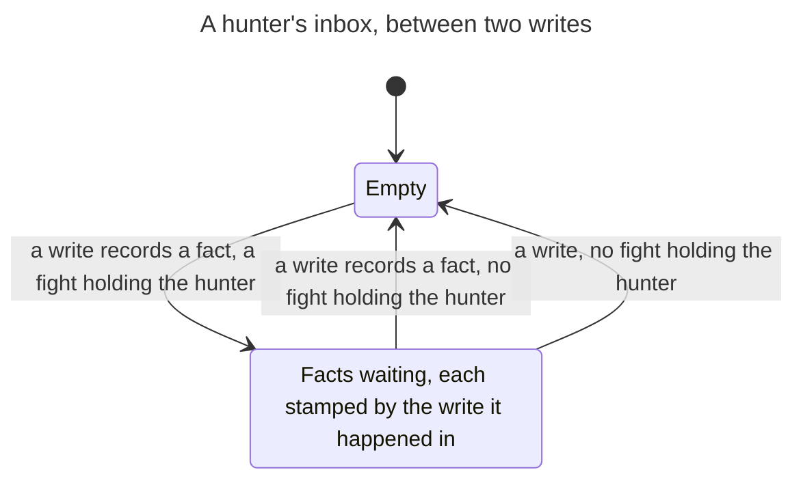

A fact is recorded in the write of the thing it tells and moved at that write's end. A fight holding the hunter keeps it waiting, stamped with that write's moment; a write in which no fight holds the hunter takes every fact, oldest first. A waiting fact is taken with the stamp of the write that frees it, as the app does today: whether it keeps its own day waits on the owner's ruling (SMX-rules-9.1), and that ruling is the cell `INBOX.waiting.free`.

2 chart states, 3 arrows. No step is hidden.

Where it lives:

| What | Where |
|---|---|
| The union | `InboxFact` in `src/core/hunter/chronicle.ts`; `InboxAt`, `InboxState`, `INBOX_STATES` in `src/core/hunter/noticed.ts` |
| What changes it | `record` (chronicle.ts) appends; `noticed` moves each fact by `INBOX` at the end of the write |
| Who calls it | `store.apply` in `src/edge/store.ts`, at the end of every write; sync.ts's release write (`released`) |
| The test to copy | `tests/chronicle.test.ts`, "a fact in a hunter's inbox"; the walk's writes are in `tests/models/feat-events.ts` |
| The recipe | docs/guide/feats-stories.md, "A fact the System remembers" |

## A fight

The 2,500 random fights of tests/fight-model.test.ts, each of 10 to 49 commands from no fight. The walk found 36617 states and 73570 steps.

### A fight, from building it to its summary

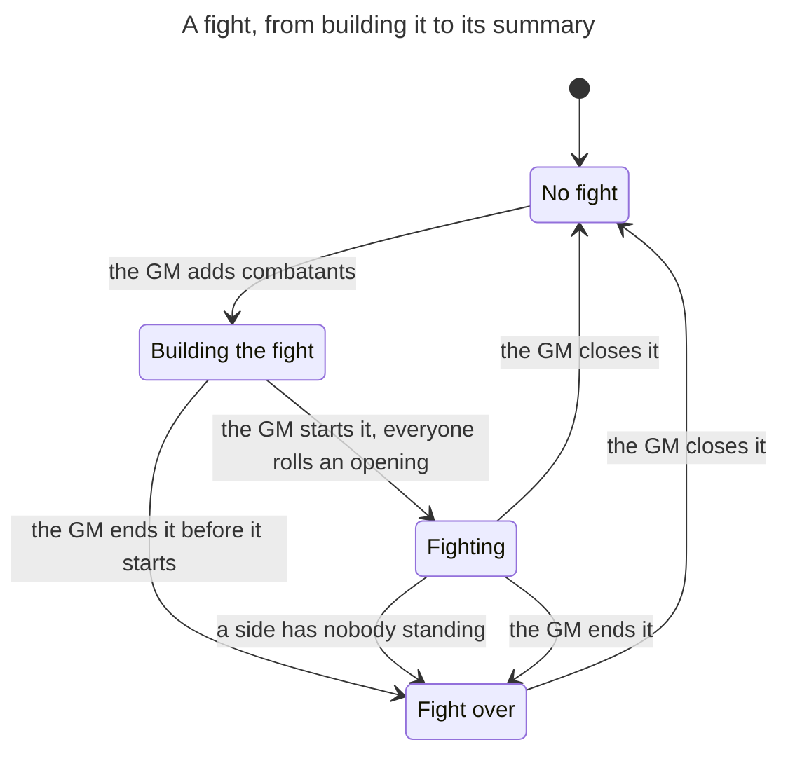

The chart shows the phase of the fight on the GM's screen. Everything inside a running fight stays in Fighting: turns and time, uses, walks, channels, statuses settling, staggers, shields, threat, intents, combatants who join or leave, the GM's hand edits and Status window. A fight ends by itself when one side has nobody up, after a use, a status, a channel going off, a hand edit or the last of a side leaving; the summary stays on screen until the GM closes it. A command the fight refuses changes nothing.

4 chart states, 7 arrows. No step is hidden.

Where it lives:

| What | Where |
|---|---|
| The union | `Fight` (`setup`, `running` or `ended`; no fight is null) and `Command` in `src/core/combat/fight-types.ts` |
| What changes it | `reduce(fight, cmd, ctx)` and its `TABLE` in `src/core/combat/fight.ts`; turns in `src/core/combat/fight-turn.ts` |
| Who calls it | `send()` in `src/views/combat.js` on the GM's phone, which stores what it answers |
| The test to copy | `tests/fight.test.ts`; random play in `tests/fight-model.test.ts` and `tests/models/fight-play.ts` |
| The recipe | docs/guide/combat.md, "A combat command" |

## A channel

Every channel reachable from none under the five events of its table, with a channel ability of max 3, breadth first. The walk found 11 states and 55 steps.

### A channel, from its start to going off

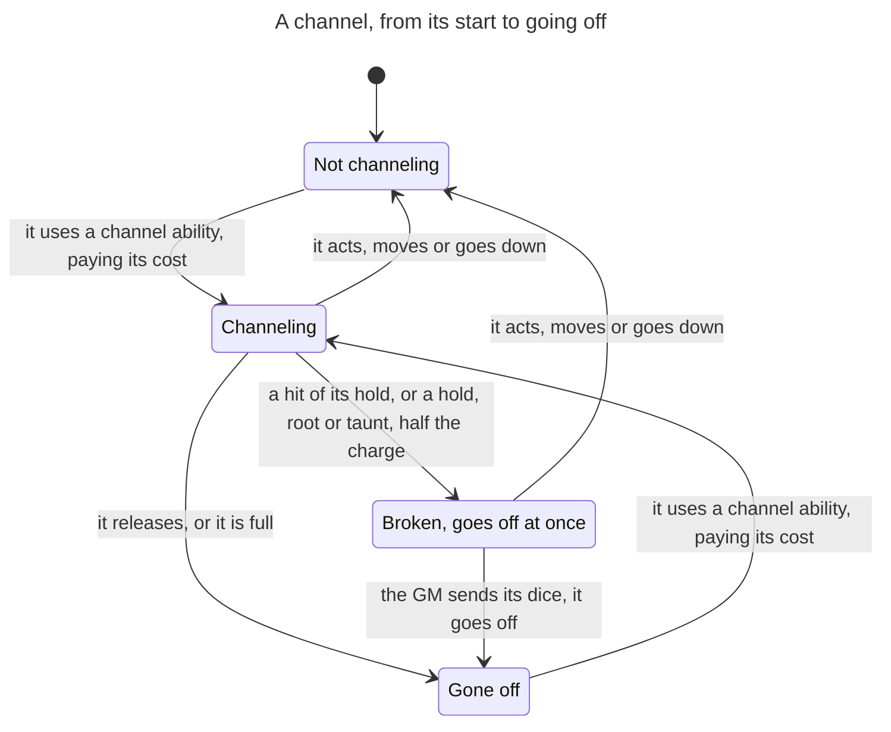

The chart shows the channel on its user's card. Its charge grows one a turn to its max and stays in Channeling. At its max the user releases it or loses it on a pass. A broken channel waits for the GM's release, which resolves it at once at its halved charge and costs its user no time out of its turn. What a release costs is read from the state it went off from (`released`); a channel broken as its user's own turn starts costs that turn today, a row that waits on a ruling (rules-3.1).

4 chart states, 7 arrows. No step is hidden.

Where it lives:

| What | Where |
|---|---|
| The union | `Channel` in `src/core/combat/effect-ops.ts`, `ChannelEvent` in `src/core/combat/fight-channel.ts` |
| What changes it | `channelStep(channel, event)` and its `TABLE` in `src/core/combat/fight-channel.ts`, called by the fight's reducer and, for every break, by `broken` in `src/core/combat/land.ts`; what a release costs is `released` and its `RELEASE` table |
| Who calls it | `src/core/combat/fight.ts`, `fight-turn.ts` and `land.ts` |
| The test to copy | `tests/fight.test.ts`, "a channel (4.1)" |
| The recipe | A new event is a member of `ChannelEvent` and its cell in every row of `TABLE` |

## A stacking status

Every count reachable from none under the 9 events of tests/models/stack-events.ts, on a rule with a cap of 5, one stack leaving a round, a fight's count and a threshold at 3 that spends, breadth first. The walk found 3 states and 27 steps.

### A stacking status on one bearer, from its first stack to its last

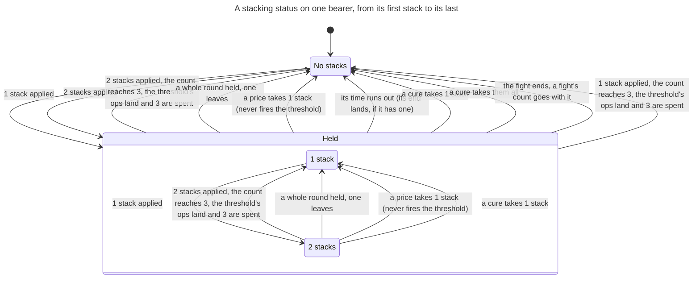

The chart follows one status's count on one bearer: Resonance, whose threshold at 3 bursts and spends, so the count never rests at 3 or more and a burst drops it back to what was over. A threshold is a cell of this table, not a state: nothing records that it fired, so a threshold that keeps its count fires again only after the count falls below it and climbs back. The bearer's event changes nothing on this rule (its stacks leave a round); on a rule whose stacks leave on an event, that event takes them all, as a cure of all does here. An apply that sets nothing off (the GM's window, a sheet) adds without firing. What the threshold's ops do, and an end that lands, are the fight's (resolve.ts, the settle).

3 chart states, 15 arrows. No step is hidden.

Where it lives:

| What | Where |
|---|---|
| The union | `Stack`, `StackEvent` and `STACK_STATES` in `src/core/combat/stacks.ts`; a def's `StackRule` in `src/core/combat/effect-ops.ts` |
| What changes it | `stackStep(stack, event, ctx)` and its `TABLE` |
| Who calls it | `applyStatus`, `cureStatus` and `settle` in `src/core/combat/effect-ops.ts`; a use's threshold in `src/core/combat/resolve.ts` (rule 18a) |
| The test to copy | `tests/effect-ops.test.ts` ("the stack machine, cell by cell"); the walk's events are in `tests/models/stack-events.ts` |
| The recipe | docs/guide/combat.md, "A stacking status" |

## A status's life

Every life reachable from not on the bearer under the 9 events of tests/models/stack-events.ts `STATUS_WALK`, breadth first. The walk found 3 states and 27 steps.

### A status on one bearer, from put on to gone

```mermaid
---
title: A status on one bearer, from put on to gone
---
stateDiagram-v2
  state "Not on the bearer" as s1
  state "Active: its time runs, and it counts" as s2
  state "Owed: its time ran out; it counts for nothing and waits for its bearer's settle" as s3
  [*] --> s1
  s1 --> s2 : a use, a land op, a spread or the GM puts it on
  s1 --> s3 : put on with its end already behind it
  s2 --> s1 : fight time passes its end, and it owes nothing
  s2 --> s3 : fight time passes its end while its settle owes a round's share or its end
  s2 --> s1 : its bearer's settle at or past its end, its end lands
  s2 --> s1 : a cure, a dispel or a spend of its last stack takes it whole
  s3 --> s2 : put on again with an end ahead, it runs again
  s3 --> s1 : fight time passes its end, and it owes nothing
  s3 --> s1 : its bearer's settle pays what it owes, and its end lands
  s3 --> s1 : a cure, a dispel or a spend of its last stack takes it whole
```

A status counts for every reader of its ops (its wards, shares, stats, dice, a hold) only while it is active: `counts` reads the row `STATUS_COUNTS`, whose `owed` cell is SMX-rules-2.1's ruling, built as not counting. Once fight time passes its end it is owed while its bearer's next settle still has a per-round share to pay or an end to land, and it is gone at that settle; with nothing owed it is gone as time moves. Its count, when it stacks, is the stack machine's, and whether its end lands at a cure is the delayed effect's.

3 chart states, 10 arrows. No step is hidden.

Where it lives:

| What | Where |
|---|---|
| The union | `StatusLife`, `StatusEvent` and `STATUS_LIVES` in `src/core/combat/standing.ts`; the owed mark `Status.owed` in `src/core/combat/effect-ops.ts` |
| What changes it | `statusStep(life, event)` and its `STATUS_TABLE`; whether it counts, `counts` and its `STATUS_COUNTS` |
| Who calls it | `applyStatus` (a land) and `settle` in `src/core/combat/effect-ops.ts`; `advance` (time) in `src/core/combat/fight-turn.ts`; every reader asks `counts` (standing.ts, `modsOf`, land.ts `live`) |
| The test to copy | `tests/effect-ops.test.ts` ("a status's own life on its bearer"); the walk's events are in `tests/models/stack-events.ts` |
| The recipe | docs/guide/combat.md, "A stacking status" |

## A trigger's limit

Every trip reachable from ready under each of 3 limits (every time, once a round, twice a fight) and the 3 events of tests/models/trip-events.ts (its event in round 0, in round 1, and a skip), breadth first. The walk found 7 states and 21 steps.

### One trigger of one status on one bearer, against its limit

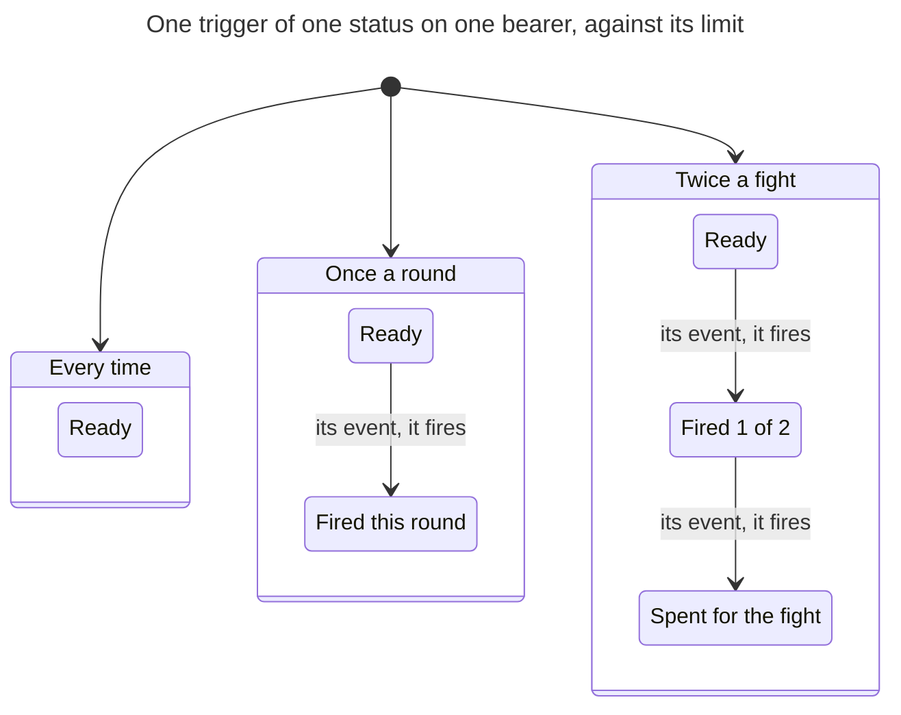

The chart follows one trigger, under each of the three limits a GM picks. Its round is the fight's, `floor(now / round)`, so a trigger that fired in round 0 fires again in round 1 and not before. The count lives on the bearer's row, keyed by the status and the trigger's place in it, so a cure and a fresh copy of the status do not reset a once-a-fight trigger. A trigger past the chain's depth (2) or past 16 firings in one command is skipped and not counted. What its ops do is the fight's (`fire`, rule 19b).

6 chart states, 3 arrows. No step is hidden.

Where it lives:

| What | Where |
|---|---|
| The union | `Trip`, `TripEvent` and `TRIP_STATES` in `src/core/combat/triggers.ts`; a def's `Trigger` and its `Limit` in the same file |
| What changes it | `tripStep(trip, event, limit)` and its `TABLE` |
| Who calls it | `fire` in `src/core/combat/triggers.ts`, called by the reducer after a use, a move and a turn's end (`fight.ts`) and at a turn's start (`fight-turn.ts`) |
| The test to copy | `tests/triggers.test.ts`; the walk's events are in `tests/models/trip-events.ts` |
| The recipe | docs/guide/combat.md, "A trigger event" |

## A delayed effect

Every state reachable from not on the bearer under the 6 events of tests/models/delayed-events.ts, for each of the two cleanses, breadth first. The walk found 10 states and 60 steps.

### A status with an end, from put on to landed or gone

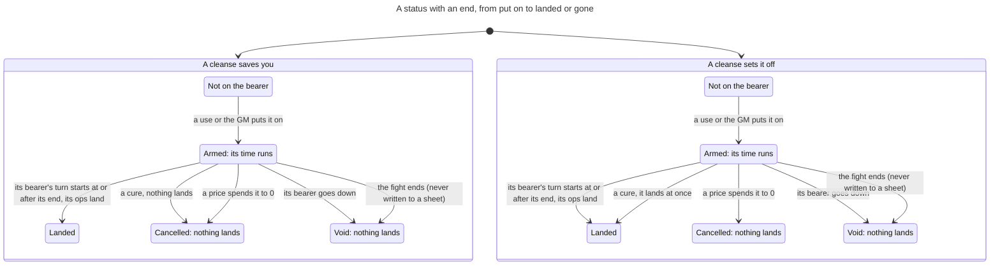

A delayed effect is a status whose `end` lands on its bearer when its time runs out (Hemoplague, a rend, a bomb). It lands at its bearer's first turn start at or after its end, from the status's source at its formulas' averages, times its stacks. A cure does what the status says: by default nothing lands, so a cleanse saves you; a detonation lands at once. A price that spends it to 0, its bearer going down (a hunter at 0 keeps it, but has no settle while it is down) and the fight's end land nothing, and it is never written to a sheet.

10 chart states, 12 arrows. No step is hidden.

Where it lives:

| What | Where |
|---|---|
| The union | `Delayed`, `DelayedEvent` and `DELAYED_STATES` in `src/core/combat/delayed.ts`; a def's `End` in `src/core/combat/effect-ops.ts` |
| What changes it | `endStep(delayed, event, end)` and its `TABLE` |
| Who calls it | the settle in `src/core/combat/fight-turn.ts` (`settleRow`), a cure in `src/core/combat/resolve.ts` (rule 18) and `src/core/combat/land.ts` (`cureLands`, `landEnd`) |
| The test to copy | `tests/fight.test.ts` ("a delayed effect"); the walk's events are in `tests/models/delayed-events.ts` |
| The recipe | docs/guide/combat.md, "A stacking status, its threshold and its end" |

## A zone with an upkeep and an end

Every state reachable from a zone on the ground under the 8 events of tests/models/zone-events.ts, breadth first. The walk found 5 states and 40 steps.

### A zone of the kits, from laid to gone

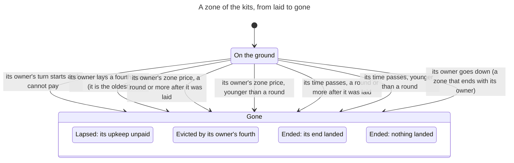

A zone an ability left may cost its owner an upkeep a round in fatigue or mana, paid at its owner's turn start for the time since it last paid; one it cannot pay lapses at once. One owner holds at most 3: a fourth evicts the oldest. Its end lands on whoever stands in it when it ends by its time or its owner's zone price, but only a round or more after it was laid, so placing and popping it in one turn is no blast with no wind-up. A lapse, an eviction and its owner going down land nothing. A zone the GM or a map put down has no upkeep and no age: its end lands when its time passes.

5 chart states, 7 arrows. No step is hidden.

Where it lives:

| What | Where |
|---|---|
| The union | `ZoneLife`, `ZoneEvent` and `ZONE_STATES` in `src/core/combat/zones.ts`; a zone's `upkeep`, `end`, `triggers`, `laid` and `paid` in `ZoneKit` |
| What changes it | `zoneStep(life, event)` and its `ZONE_TABLE`; `placeZone` (the cap), `payUpkeep` (the upkeep), `pricedZones` (a price) |
| Who calls it | `act` and `release` in `src/core/combat/fight.ts`; `grounded`, `zoneEnds` and `startTurn` in `src/core/combat/fight-turn.ts` |
| The test to copy | `tests/fight.test.ts` ("a zone on the ground: the kits' upkeep"); the walk's events are in `tests/models/zone-events.ts` |
| The recipe | docs/guide/combat.md, "A zone op" and "A way a zone can lie" |

## A timed summon

Every state reachable from present under the 6 events of tests/models/summon-events.ts, breadth first. The walk found 2 states and 12 steps.

### A summon, from called to gone

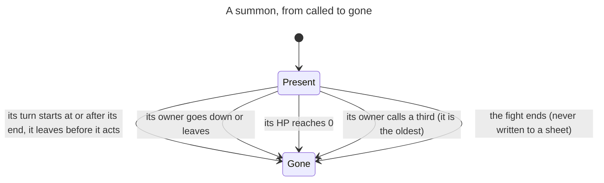

An ability that summons calls a row of its archetype's body at its user's rank to its user's side, on the free tile nearest its user, for 1 to 5 rounds. It acts on its own turns, a standard interval after it came, and its owner's phone commands it. It leaves at its first turn start at or after its end (a summon of 2 rounds acts in 2 rounds of time), when its owner goes down or leaves, at 0 HP, or when its owner calls a third. It gives no XP, is written to no sheet and keeps no side up: a fight whose side has only summons left is over.

2 chart states, 5 arrows. Hidden: a turn that starts before its end keeps it present and is not drawn (0 steps.)

Where it lives:

| What | Where |
|---|---|
| The union | `SummonState`, `SummonEvent` and `SUMMON_STATES` in `src/core/combat/summons.ts`; a row's `owner` and `until` in `Body` (`effect-ops.ts`) |
| What changes it | `summonStep(state, event)` and its `TABLE`; `dismissed`, `timeUp` and `crowded` read it |
| Who calls it | `summoned` (rule 18d) in `src/core/combat/fight.ts`; `consequences`, `sentAway` and `startTurn` in `src/core/combat/fight-turn.ts`; the row is `summonRow` in `src/core/combat/rows.ts` |
| The test to copy | `tests/fight.test.ts` ("a timed summon"), `tests/rows.test.ts` ("a summon"); the walk's events are in `tests/models/summon-events.ts` |
| The recipe | docs/guide/combat.md, "A summon" |

## A limited use

Every state reachable from all uses left, for an ability of 2 uses a fight and one of 2 a long rest, under the 4 events of tests/models/uses-events.ts, breadth first. The walk found 6 states and 24 steps.

### An ability with uses a fight or a long rest

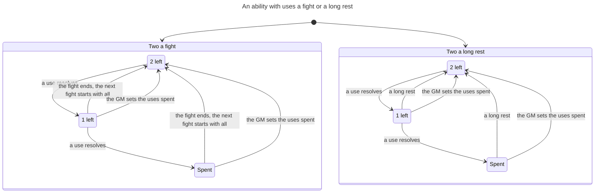

A use counts when it resolves, not when it is refused; a spent one is refused (`noUses`) and changes nothing. One limited a fight starts every fight with all its uses (its row is new). One limited a long rest starts the fight with what its hunter's sheet has spent since the last long rest, and the fight writes its count back with the hunter's vitals; a long rest gives them all back. A "per day" in the sheet reads as per long rest. The GM sets the uses spent with the fight's Adjust.

6 chart states, 12 arrows. No step is hidden.

Where it lives:

| What | Where |
|---|---|
| The union | `Uses`, `UsesEvent` and `USES_STATES` in `src/core/combat/uses.ts`; the row's count is `Body.used`, the sheet's `Vitals.used` |
| What changes it | `usesStep(uses, event, gate)` and its `TABLE`; `usesOf` reads a row, `counted` counts a use |
| Who calls it | rule 3b (`gated`) in `src/core/combat/resolve.ts`; `act` and `adjust` in `src/core/combat/fight.ts`; `writeBack` in `src/core/combat/fight-turn.ts`; a long rest in `src/core/hunter/vitals.ts` |
| The test to copy | `tests/fight.test.ts` ("a limited use"); the walk's events are in `tests/models/uses-events.ts` |
| The recipe | docs/guide/combat.md, "A price or a gate kind" |

## A reaction

Every state reachable from unarmed under the 9 events of tests/models/wave2-events.ts, breadth first. The walk found 4 states and 36 steps.

### A reaction on its reactor, from armed to spent

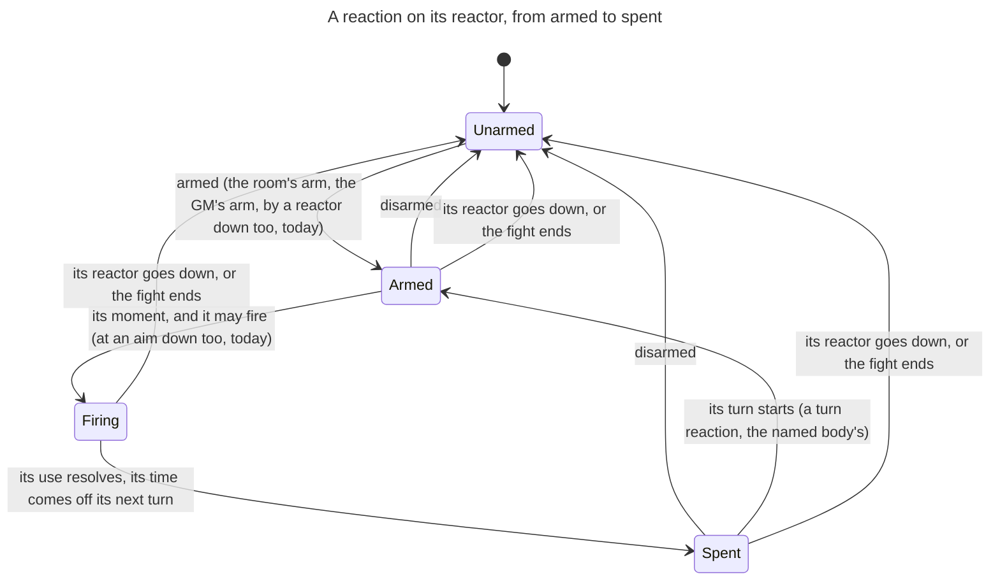

A player arms one of its hunter's reactions with the room's `arm`, the GM anyone's with the fight's. It fires by rule at its moment: before a foe's use lands on its reactor or an ally within reach, before a hit takes one of them to 0, after a foe's use landed on one, or before a named body's turn. It fires when its reactor is up, not held, its ability ready and paid for; otherwise it stays armed and says nothing. Its time comes off its reactor's next turn. A use sets off at most 4. Never written to a sheet. Two rows wait on a ruling and are drawn as the app behaves today: a reactor who is down arms (rules-4.3a), and a reaction fires at an aim already down (rules-4.2).

4 chart states, 9 arrows. Hidden: arming another while armed, and a moment while spent, change nothing and are not drawn (0 steps.)

Where it lives:

| What | Where |
|---|---|
| The union | `ReactState`, `ReactEvent` and `REACT_STATES` in `src/core/combat/fight-react.ts`; the row's `armed` in `Body` (`effect-ops.ts`) |
| What changes it | `reactStep(state, event)` and its `TABLE`; `react` fires one at every moment, `restored` restores them |
| Who calls it | `act` and `arm` in `src/core/combat/fight.ts` (rules 7c and 19c), `resolve` in `resolve.ts` (rule 13b, `Answers.lethal`), `startTurn` (`turnReaction`) and `consequences` in `fight-turn.ts` |
| The test to copy | `tests/fight.test.ts` ("a reaction"); the walk's events are in `tests/models/wave2-events.ts` |
| The recipe | docs/guide/combat.md, "A reaction moment" |

## An edge or a held die

Every state reachable from absent under the 4 events of tests/models/wave2-events.ts, to 2 stacks, breadth first. The walk found 3 states and 11 steps.

### An edge on its bearer

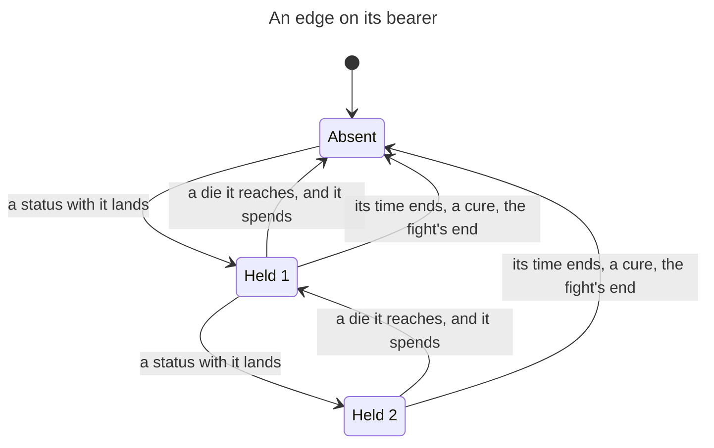

An edge is advantage on a reaction d20: the attacker's keeps the target's lower face, the defender's its higher, read through the dice notation's `2d20kl1` and `2d20kh1`. An edge and its opposite on one die cancel and both spend; two of one kind do not add. One with Spends loses a stack after the first use whose die it reached, once a use; a worn one holds. A held die moves the face and always spends.

3 chart states, 6 arrows. Hidden: a worn edge reached stays as it was and is not drawn (0 steps.)

Where it lives:

| What | Where |
|---|---|
| The union | `EdgeHold`, `EdgeEvent` and `EDGE_STATES` in `src/core/combat/standing.ts`; the ops `edge` and `boost` in `effect-ops.ts` |
| What changes it | `edgeStep` and its `EDGE_TABLE`; `edgeOn` and `boostsOn` read a die's edge |
| Who calls it | rule 7b (`keptFace`, `spendEdges`) in `src/core/combat/resolve.ts`; `needs` asks the second d20 and the held dice |
| The test to copy | `tests/resolve.test.ts` ("advantage and held dice") |
| The recipe | docs/guide/combat.md, "A status op" |

## A push or a pull

Every state reachable from standing under the 7 events of tests/models/wave2-events.ts, breadth first. The walk found 5 states and 35 steps.

### A body pushed or pulled

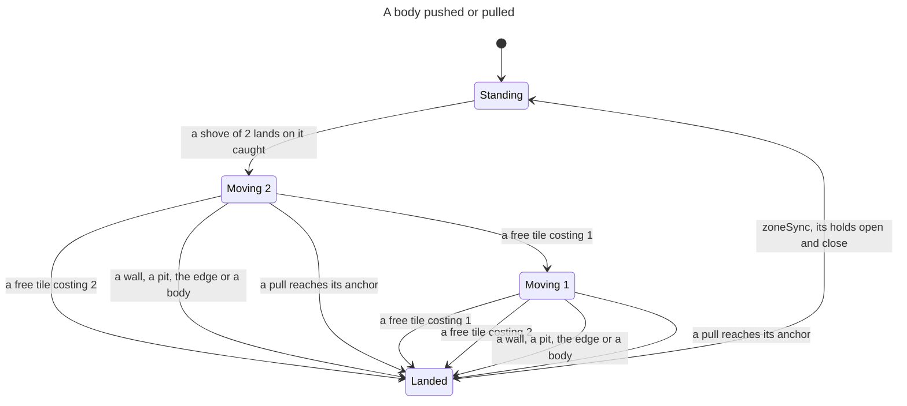

A shove lands at rule 18 on a target the use caught: a dodge is not a push. It moves its tiles times the target's control factor, rounded down (none when rooted), tile by tile on the centre line from its anchor, and stops before a wall, a pit, the map's edge or a body; a pull stops next to its anchor. A stop deals nothing. Rough ground costs two of its steps. A forced entry into a zone pays no on-entry part.

4 chart states, 10 arrows. Hidden: a push of 0 leaves the body standing and is not drawn (0 steps.)

Where it lives:

| What | Where |
|---|---|
| The union | `Shoved`, `ShoveEvent` and `SHOVE_STATES` in `src/core/combat/space.ts`; the op `shove` in `effect-ops.ts` |
| What changes it | `shoveStep` and its `SHOVE_TABLE`, stepped by `shovePath` |
| Who calls it | rule 18c (`pushed`) in `src/core/combat/resolve.ts`; `after` passes the bodies it moved to `zoneSync` (`forced`) |
| The test to copy | `tests/space.test.ts` ("a push or a pull"), `tests/fight.test.ts` ("forced movement") |
| The recipe | docs/guide/combat.md, "A status op" |

## Stealth

Every state reachable from a body seen, wearing no Stays hidden and wearing it on damage dealt, under the 6 events of tests/models/wave2-events.ts (two hides: Stealth at level 1 out of sight, ended by each of the three; Invisible at level 3 anywhere, not ended by a hurt), breadth first. The walk found 8 states and 48 steps.

### Stealth on its bearer, by each hide's own fields

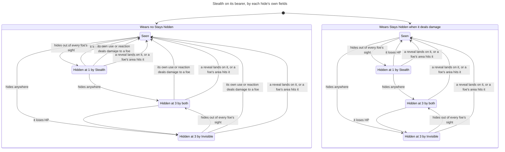

A hide is a status with a `hidden` op: its level (1 to 5, by its source's rank), where it may start (out of every foe's sight, or anywhere) and which of three events end it. A body hidden at a level is perceived only by eyes of that sight level or higher (sight.ts `perceives`). A hide out of sight while a foe that is up has the body in sight is refused (`seen`). A hurt is HP lost; damage dealt is a use or reaction of the body's own that deals HP damage to the other side (a zone or a status it left does not, the owner's ruling 6); a reveal is a `reveal` op landing on it or a foe's area hitting it (ruling 2). A foe beside a hidden body does not reveal it (ruling 4). A worn Stays hidden keeps every hide through its event. A hide's time and a cure end it as any status (its life is the status's own machine). A body seen again may hide again at once.

8 chart states, 21 arrows. Hidden: an event that ends no hide, and a hide out of sight while watched (refused), change nothing and are not drawn (0 steps.)

Where it lives:

| What | Where |
|---|---|
| The union | `Stealth`, `StealthState`, `StealthEvent` and `STEALTH_STATES` in `src/core/combat/standing.ts`, read from a body by `stealthOf`; the ops `hidden`, `stayHidden` and `reveal` in `effect-ops.ts` |
| What changes it | `stealthStep` and its `STEALTH_TABLE` (`endsOn`); `stealthAfter` in `land.ts` writes a body's hides by it |
| Who calls it | `act` in `src/core/combat/fight.ts` (a hide's `seen`, `hideLands`), `landed` (`useStealth`: damage dealt, a foe's area), `react` in `fight-react.ts` (damage dealt), `consequences` in `fight-turn.ts` (a hurt), `landOne` in `land.ts` (a reveal); `figureOf` in `sight.ts` reads its level |
| The test to copy | `tests/fight.test.ts` ("wards and stealth"), `tests/fight-doc.test.ts` ("a hidden foe") |
| The recipe | docs/guide/combat.md, "A status op" |

## A ward

Every state reachable from never under the 4 events of tests/models/wave2-events.ts, breadth first. The walk found 3 states and 12 steps.

### Untargetable or invulnerable on its bearer, once a fight

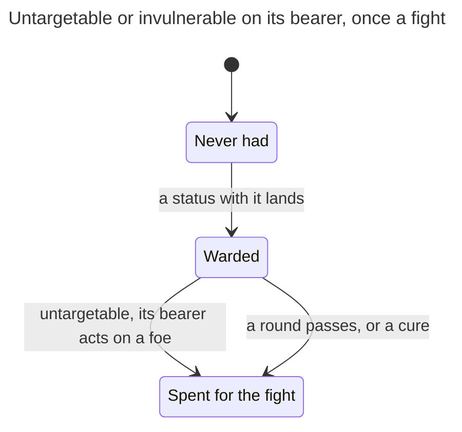

Untargetable keeps a foe from aiming at its bearer or catching it, and ends when its bearer acts on a foe or a place; invulnerable keeps HP damage from taking it under 1, past a shield. Each lasts a round at most and reaches a body once a fight: the row keeps `warded`. A safeguard lasts a round and stops a harmful status from the other side.

3 chart states, 3 arrows. Hidden: a ward landing on a warded body, and a hit held at 1, change no state and are not drawn (0 steps.)

Where it lives:

| What | Where |
|---|---|
| The union | `WardState`, `WardEvent` and `WARD_STATES` in `src/core/combat/standing.ts`; the row's `warded` in `Body` |
| What changes it | `wardStep` and its `WARD_TABLE`; `admitted` and `markWards` |
| Who calls it | rule 18 in `src/core/combat/resolve.ts` and `landOne` in `land.ts` (a status lands), `wardedDamage` (rules 13 and 14), `uncovered` in `fight-turn.ts` |
| The test to copy | `tests/fight.test.ts` ("wards and stealth") |
| The recipe | docs/guide/combat.md, "A status op" |

## A body's turn extras

Every pair of states reachable from plain and waiting under the 5 events of tests/models/wave2-events.ts, breadth first. The walk found 4 states and 20 steps.

### An extra action and a hasten

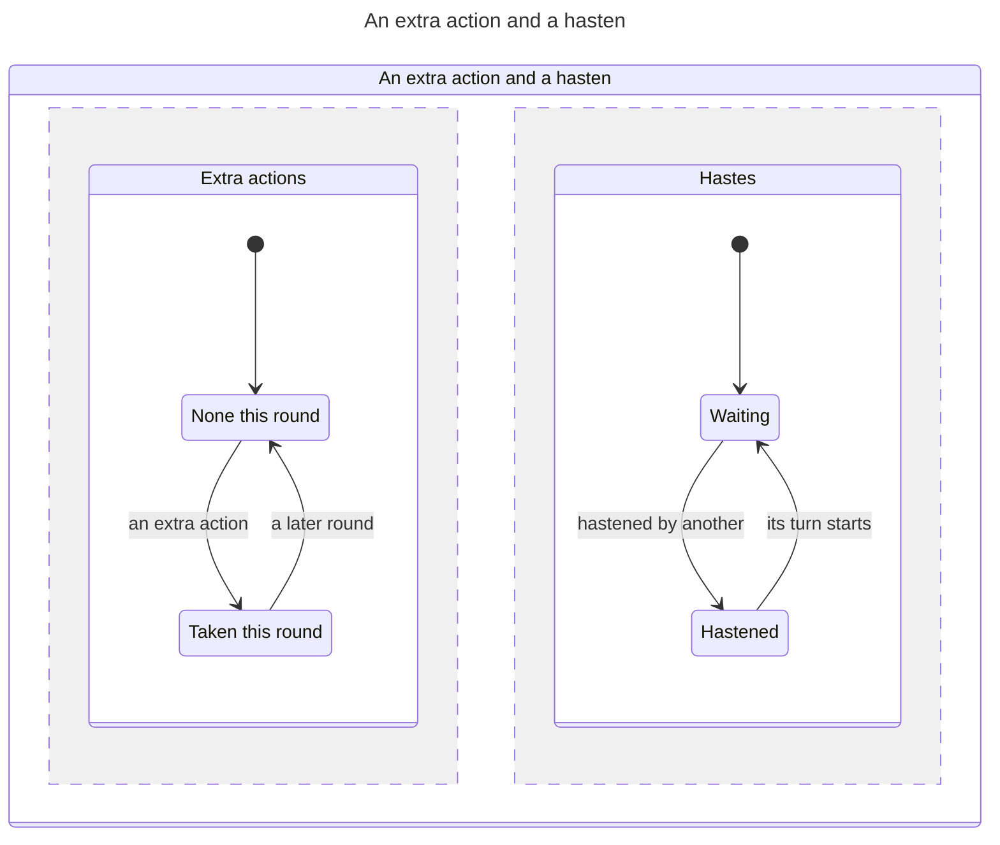

An extra action makes its user's next turn the next tick, one a round of fight time (`extraPerRound`); a second is refused (`extra`). A hasten brings another body's next turn earlier by a share of the giver's standard action, never before the next tick, once between two of its turns. No turn is ever set before the next tick.

4 chart states, 4 arrows. Hidden: a refused extra and a second hasten change nothing and are not drawn (0 steps.)

Where it lives:

| What | Where |
|---|---|
| The union | `ExtraState`, `ExtraEvent`, `HasteState`, `HasteEvent` in `src/core/combat/timeline.ts`; the row's `extras` and `hastened` |
| What changes it | `extraStep` and `hasteStep` and their tables; `extraNow` and `hastened` move the turn |
| Who calls it | `resolve` in `src/core/combat/resolve.ts` (`extraTaken`, `userTime`, the `hasten` op), `startTurn` in `fight-turn.ts` |
| The test to copy | `tests/timeline.test.ts` ("turn economy"), `tests/fight.test.ts` ("turn economy") |
| The recipe | docs/guide/combat.md, "A status op" |

## A player's held turn

Every state reachable from a free turn, under the 11 events of the hold (one command's entry and doc, and another's), breadth first. The walk found 3 states and 8 steps.

### A player's turn, held from the tap to the GM's answer

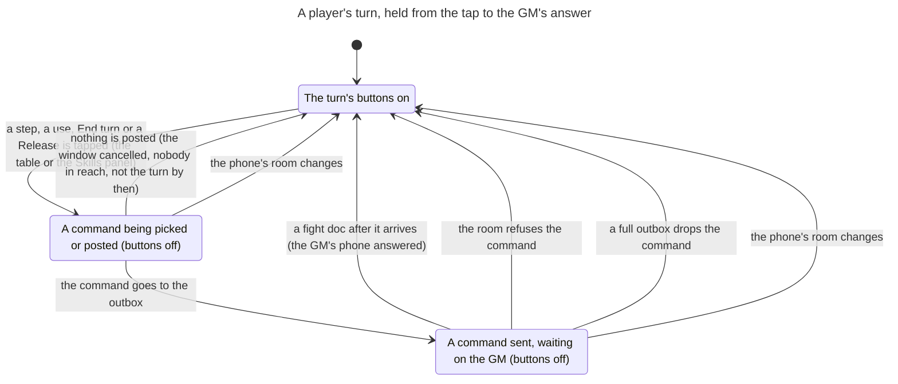

src/views/uses.js keeps the one hold for the phone (`hold`, `command`), so a command tapped on the table or in the Skills panel waits under it whichever screen is up, and the table reads it to turn its buttons off. A sent command lets go only on a doc of another `at`, or on its own outbox entry refused or dropped; a doc, a refusal or a drop of another entry moves nothing. A consumable thrown from the Bag (`via: 'bag'`) goes through the same `command` but posts unheld and leaves the turn free (ruling SMX-views-5.1; ruled the other way, it holds like a use from the map).

3 chart states, 8 arrows. No step is hidden.

Where it lives:

| What | Where |
|---|---|
| The union | `TurnHold`, `TurnHoldEvent`, `TurnHoldVia`, `TURN_HOLD_STATES` and `TURN_HOLD_EVENTS` in `src/core/combat/hold.ts` |
| What changes it | `turnHoldStep(hold, event)` and its `TABLE` in `src/core/combat/hold.ts` |
| Who calls it | `src/views/uses.js`, its one writer (`holdTo`, `hold`, `command`); the events `sync:outbox` (refused, dropped), `sync:room` and `sync:docs`; `src/views/table.js`, the Skills panel and the Bag post through `app.api.uses.command` |
| The test to copy | `tests/hold.test.ts`, the whole table |
| The recipe | docs/guide/room-sync.md, the held turn's row |

## A gate

Every gate reachable from a new detected gate (the Goblin Den of tests/models/gate-events.ts, which breaks on day 5) under the 13 events of the walk in tests/gate.test.ts, breadth first. The walk found 6 states and 78 steps.

### A gate, from detected to finished

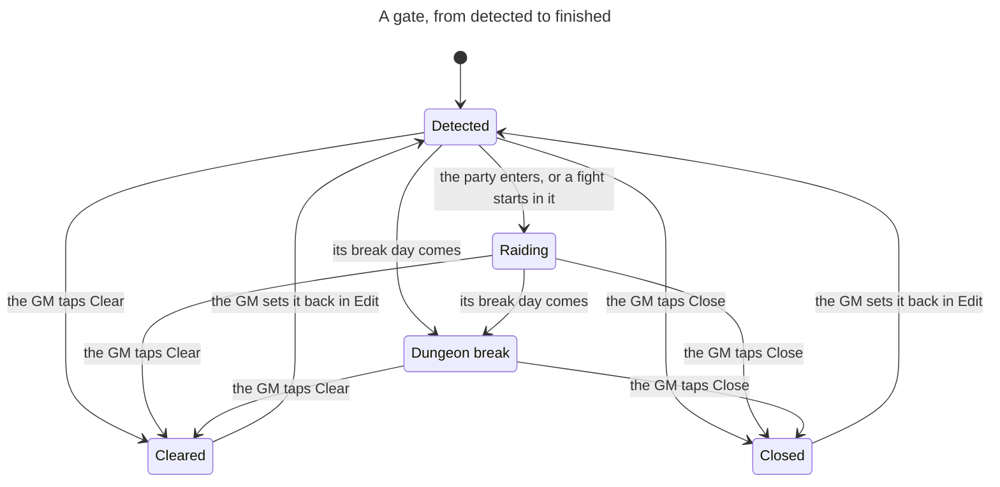

The chart shows the status on the gate card. It leaves out the XP a gate has paid, which only goes up and never moves the status, and the day a gate was cleared. A day that passes before the break day changes nothing. Entering or fighting in a gate that is already raiding or broken keeps its status.

5 chart states, 11 arrows. Hidden: the GM can set any status from any status in the Edit form. The chart draws only the edit that puts a finished gate back to detected, so each finished gate still shows its way out (21 steps.)

Where it lives:

| What | Where |
|---|---|
| The union | `Gate` and `GATE_STATUSES` in `src/core/gates/gate.ts` |
| What changes it | `transition(gate, event)` and its `TABLE`; `can(gate, eventType)` for a button |
| Who calls it | `step()` in `src/views/gates.js`, and `endEncounter` in `src/views/combat.js` |
| The test to copy | `tests/gate.test.ts`; the walk's events are in `tests/models/gate-events.ts` |
| The recipe | docs/guide/gates-solo.md, "To add a gate status or event" |

## The room link and the sheet push

Every state of the link and the push together that the model check of tests/sync-model.test.ts reaches from the four ways a page boots (tests/models/sync-world.ts), breadth first: taps, timers, and every kind of reply to each request that is out. The walk found 70350 states and 2010067 steps.

### The room link

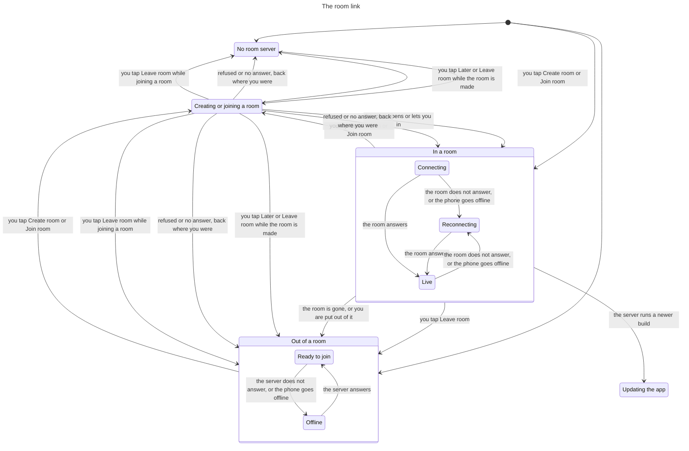

The chart shows what the room pill and the Room view say. It leaves out the waits between polls (5 s, 3 s in a fight, longer after failures; a hidden page does not poll, except a GM's page that may notify, which polls every 30 s), how many polls failed, whether a poll is out or waiting, the room code, the last room and the GM key, and whether the phone is the GM or a player, except where a step depends on it. Opening and joining a room go back to the box the phone came from when they fail. Later or Leave room while a room is made or joined goes out of every room, the one the phone was in included. Updating the app is never left: the page reloads.

8 chart states, 20 arrows. Hidden: a save replaced by an import, a restore or a reset starts the link again from the room in the new save, from any state but No room server and Updating the app. A server on a newer build sends every state to Updating the app; the chart draws that arrow from In a room only (226769 steps.)

### The room link and the sheet push

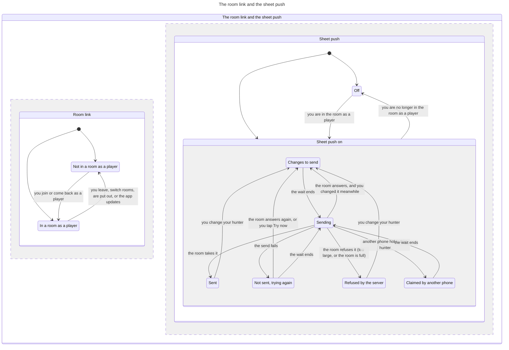

A player's phone sends its hunter to the room while it is in a room as a player, and only then. The link side is cut down to that one question. The push side leaves out the waits (3 s after a change, then 3 s doubling to 60 s after failures, 30 s while another phone holds the hunter) and how many sends failed. A GM's phone never sends a sheet.

9 chart states, 15 arrows. Hidden: a save replaced by an import, a restore or a reset, which leaves the room and enters the one in the new save; and Play as another hunter, which sends the new hunter soon from any push state but Off (352214 steps.)

Where it lives:

| What | Where |
|---|---|
| The unions | `Link` and `LinkEvent` in `src/core/sync/link.ts`; `Push` and `PushEvent` in `src/core/sync/push.ts` |
| What changes them | `reduce(link, event)` in `link.ts`; `reduce(push, event)` in `push.ts`, which hears the link through its `push` effects |
| Who calls them | `src/edge/sync.ts`, which holds the one current link and push and carries out their effects. `connection(link, push)` in `src/core/sync/connection.ts` says what the pill shows |
| The test to copy | `tests/link.test.ts` and `tests/push.test.ts`; every reachable state is checked in `tests/sync-model.test.ts`, whose world and replies are in `tests/models/sync-world.ts` |
| The recipe | docs/guide/room-sync.md, "To add a link state or a reply" |

## A player's bind

Every bind reachable from a player's save of two hunters in no room, under the 5 moves of a join (room A at two times, room B) and "Play as" each hunter, breadth first. The walk found 9 states and 34 steps.

### The hunter this phone sends, and its join of the room

```mermaid
---
title: The hunter this phone sends, and its join of the room
---
stateDiagram-v2
  state "The hunter this phone sends, and its join of the room" as all {
    state "The join" as r1 {
      state "No join" as s1
      state "Joined A, first" as s2
      state "Joined A again, later" as s3
      state "Joined B" as s4
      [*] --> s1
      s1 --> s2 : the first join of A with h1
      s1 --> s3 : a later join of A with h2
      s1 --> s4 : a join of B with h1
      s2 --> s3 : a later join of A with h2
      s2 --> s4 : a join of B with h1
      s3 --> s2 : the first join of A with h1
      s3 --> s4 : a join of B with h1
      s4 --> s2 : the first join of A with h1
      s4 --> s3 : a later join of A with h2
    }
    --
    state "The hunter bound" as r2 {
      state "no hunter bound" as s5
      state "h1 bound" as s6
      state "h2 bound" as s7
      [*] --> s5
      s5 --> s6 : the first join of A with h1
      s5 --> s7 : a later join of A with h2
      s5 --> s6 : a join of B with h1
      s5 --> s6 : Play as h1
      s5 --> s7 : Play as h2
      s6 --> s7 : a later join of A with h2
      s6 --> s7 : Play as h2
      s7 --> s6 : the first join of A with h1
      s7 --> s6 : a join of B with h1
      s7 --> s6 : Play as h1
    }
  }
```

A join writes both the hunter bound and the join (its room and the server's time); "Play as" and a delete of the bound hunter (party.ts `removeHunter`, which binds the active one) move the hunter and never the join, so a message the room took while this phone was in it is never told as one sent while it was away. A join counts only for its own room: a save swapped in with another room reads no join. The "Play as" window's answer is read where the phone is when it comes (`playAsAnswered`): once the phone has left the room or another hunter is bound there, it only shows the hunter.

7 chart states, 19 arrows. No step is hidden.

Where it lives:

| What | Where |
|---|---|
| The fields | `boundHunterId` and `joined` (`BindJoin`) of the save's sync settings (`src/core/save.ts`) |
| What changes it | `boundTo` (a join), `playAs` and `rebindTo` in `src/core/sync/bind.ts`; `joinedAt` reads the join for its room only |
| Who calls it | `src/edge/sync.ts` (a join answered, the "Play as" window through `playAsAnswered`), `src/core/party.ts` `removeHunter` (a delete of the bound hunter) |
| The test to copy | `tests/bind.test.ts`, "a player's hunter bound to the room" |
| The recipe | docs/guide/room-sync.md, the bind's row |

## The REMOVED FROM ROOM notice

Every state reachable from no notice, under the 27 events of the notice in two rooms, breadth first. The walk found 5 states and 38 steps.

### The notice that the GM removed this phone

```mermaid
---
title: The notice that the GM removed this phone
---
stateDiagram-v2
  state "No notice" as s1
  state "REMOVED FROM ROOM open" as s2
  state "Rejoin on its way" as s3
  [*] --> s1
  s1 --> s2 : the GM removes this phone
  s2 --> s3 : Rejoin is tapped
  s2 --> s1 : OK is tapped
  s2 --> s1 : the phone is in a room (Room view, invite, another tab)
  s2 --> s1 : an import, a restore or a reset
  s3 --> s2 : the GM removes this phone
  s3 --> s1 : the Rejoin is taken
  s3 --> s1 : the Rejoin fails for good (no room, campaign replaced, busy, bad code or key)
  s3 --> s2 : not allowed back yet, or no server, the window again
  s3 --> s1 : an import, a restore or a reset
```

The notice names its room and the hunter that was bound, so an answer of an old window, or a Rejoin's answer for another room, changes nothing. A removal from another room opens that room's window in place of the one up. A Rejoin that fails tells its words: where a second try can work (not allowed back yet, the server not reached) the window opens again; otherwise the notice ends.

3 chart states, 10 arrows. No step is hidden.

Where it lives:

| What | Where |
|---|---|
| The union | `RemovedNotice`, `RemovedEvent`, `RemovedEffect`, `REMOVED_STATES` and `REMOVED_EVENTS` in `src/core/sync/bind.ts` |
| What changes it | `removedStep(notice, event)` and its `AGAIN` table |
| Who calls it | `src/edge/sync.ts`, which keeps the one notice and carries out its effects (the window, the Rejoin, the toast) |
| The test to copy | `tests/bind.test.ts`, "the REMOVED FROM ROOM notice" |
| The recipe | docs/guide/room-sync.md, the bind's row |

## A code check in the Room view

Every state reachable from no code, under the 11 events of a check on one code, breadth first. The walk found 6 states and 36 steps.

### The line under a room code

```mermaid
---
title: The line under a room code
---
stateDiagram-v2
  state "No line" as s1
  state "Typed, the pause running" as s2
  state "Checking..." as s3
  state "No such room" as s4
  state "The room is there" as s5
  state "The server did not answer" as s6
  [*] --> s1
  s1 --> s2 : a whole code is typed
  s1 --> s3 : the page opens on an invite link
  s1 --> s4 : a join is refused as no such room
  s2 --> s3 : typing stops for the pause
  s2 --> s3 : the page opens on an invite link
  s2 --> s4 : a join is refused as no such room
  s2 --> s1 : Join, Create or Rejoin is tapped, or the room changes
  s3 --> s2 : a whole code is typed
  s3 --> s5 : the server finds the room
  s3 --> s4 : the server finds no room
  s3 --> s6 : the server does not answer
  s3 --> s4 : a join is refused as no such room
  s3 --> s1 : Join, Create or Rejoin is tapped, or the room changes
  s4 --> s2 : a whole code is typed
  s4 --> s3 : the page opens on an invite link
  s5 --> s2 : a whole code is typed
  s5 --> s3 : the page opens on an invite link
  s5 --> s4 : a join is refused as no such room
  s6 --> s2 : a whole code is typed
  s6 --> s3 : the page opens on an invite link
  s6 --> s4 : a join is refused as no such room
  s6 --> s3 : the server answers again
```

Two checks run this machine: the code typed under Join a room and the code of an invite link. The typed code is asked after a pause (`LOBBY_PAUSE_MS`), the invite's at once. A pause's end or an answer for a code other than the one waited on or asked is late and changes nothing; a new code typed starts its own pause. The invite's check is asked again when the server answers only while that invite is still pending. What the server said stays until a new code, a join or a dropped invite.

6 chart states, 22 arrows. Hidden: The field cut to less than a code, and a join made or the invite dropped: each goes back to no line from wherever it is. (10 steps.)

Where it lives:

| What | Where |
|---|---|
| The union | `LobbyCheck`, `LobbyCheckEvent`, `LobbyCheckEffect`, `LOBBY_CHECK_STATES` and `LOBBY_CHECK_EVENTS` in `src/core/sync/lobby.ts` |
| What changes it | `checkStep(check, event)` and its `CHECK` table, through `lobbyStep` (the join field's and the invite's check in one `Lobby`) |
| Who calls it | `src/views/room.js`, which keeps the one `lobbyNow`, moves it only through `lobbyStep` and carries out its effects (the pause's one timer, the question to `sync.check`) |
| The test to copy | `tests/lobby.test.ts` |
| The recipe | docs/guide/room-sync.md, the lobby's row |

## A GM's seat action

Every state of one key's seat reachable from none out, under the 8 events of the seat in its room and a room change, breadth first. The walk found 4 states and 9 steps.

### Remove, Release or Allow back on one seat

```mermaid
---
title: Remove, Release or Allow back on one seat
---
stateDiagram-v2
  state "No action out" as s1
  state "Remove's confirm window open" as s2
  state "Sent, its buttons waiting" as s3
  [*] --> s1
  s1 --> s2 : the GM taps Remove
  s1 --> s3 : the GM taps Release or Allow back
  s2 --> s3 : the GM confirms
  s2 --> s1 : the GM cancels
  s2 --> s1 : the phone's room changes
  s3 --> s1 : the server answers (the GM is told)
  s3 --> s1 : the phone's room changes
```

One action a key and room is out at a time: a second tap while one is out sends nothing. An action is tied to the room it was tapped in, so a room change drops it, and a confirm or an answer that comes back for it then does nothing (a Remove confirmed after the room changed removes nobody in the new room). A Remove the server took also takes the hunter out of the fight.

3 chart states, 7 arrows. No step is hidden.

Where it lives:

| What | Where |
|---|---|
| The union | `LobbySeat`, `LobbySeats`, `LobbySeatEvent`, `LobbySeatEffect`, `LOBBY_SEAT_STATES` and `LOBBY_SEAT_EVENTS` in `src/core/sync/lobby.ts` |
| What changes it | `seatStep(seats, event)`, through `lobbyStep`; `seatBusy` says whether a key's buttons wait |
| Who calls it | `src/views/room.js` (the seat buttons, the confirm window, the server's answer, `sync:room`) |
| The test to copy | `tests/lobby.test.ts` |
| The recipe | docs/guide/room-sync.md, the lobby's row |

## A hunter's life

Every life reachable from a new hunter (up at 20 of 20 HP) under the 12 events of the walk in tests/vitals.test.ts (tests/models/life-events.ts), breadth first. The walk found 54 states and 648 steps.

### A hunter's life, from up to dead and back

```mermaid
---
title: A hunter's life, from up to dead and back
---
stateDiagram-v2
  state "Up" as s1
  state "Dying" as s2
  state "Stable" as s3
  state "Dead" as s4
  [*] --> s1
  s1 --> s2 : damage takes HP to 0
  s1 --> s2 : HP set to 0 on the bar
  s2 --> s1 : healed (a heal, a rest or a refill)
  s2 --> s1 : HP set above 0 on the bar
  s2 --> s1 : a death save of 20, up at 1 HP
  s2 --> s3 : the GM taps Stabilize
  s2 --> s4 : a third death save fails (a 1 counts as two)
  s3 --> s1 : healed (a heal, a rest or a refill)
  s3 --> s1 : HP set above 0 on the bar
  s4 --> s1 : the GM taps Revive or a Resurrection Crystal is used, up at 1 HP
  s2 --> s3 : a third death save succeeds
```

The chart shows what the sheet, the GM board and a combat card say of a hunter. Everything that keeps the hunter up stays in Up: damage that leaves HP above 0, a heal, a lower maximum. A dying hunter's first and second saves, of either kind, stay in Dying; the pips count them, and getting up clears them. Damage to a hunter who is down changes nothing. Only a revive leaves Dead, the GM's Revive or a Resurrection Crystal used from the bag outside a fight: healing, a rest and a refill do not. MP, fatigue and a collapse are kept beside the life and are not drawn.

4 chart states, 11 arrows. No step is hidden.

Where it lives:

| What | Where |
|---|---|
| The union | `Life`, `LifeEvent` and `LIFE_STATES` in `src/core/hunter/vitals.ts` |
| What changes it | `lifeAfter(life, event, hpMax)` and its `TABLE`; on a sheet `vitalStep` and its `VITAL_TABLE` (the life's events through `TABLE`), called by `sheetEdit` in `src/core/hunter/grant.ts`; `can(life, eventType)` for a button |
| Who calls it | `lifeEvent` and `api.life` in `src/views/hunter.js`, through `sheetEdit` (the sheet; the GM board's Revive in `src/views/gm.js` calls `api.life`), `useItem` in `src/core/hunter/use.ts` (a Resurrection Crystal, through `sheetEdit`), and in a fight `rowLifeAfter` in `src/core/combat/row-life.ts`, the one writer of a hunter row's life, which the `vitals` write-back carries to the sheet |
| The test to copy | `tests/vitals.test.ts`; the walk's events are in `tests/models/life-events.ts` |
| The recipe | docs/guide/hunters.md, "To add a field to a hunter" (a new life state or event) |

## A hunter's fatigue and collapse

Every fatigue and collapse reachable from a rested hunter (fatigue 0 of 100) under the 8 events of tests/models/life-events.ts (`COLLAPSE_EVENTS`), with the shipped rules, breadth first. The walk found 75 states and 600 steps.

### A hunter's fatigue, from fresh to collapsed and back

```mermaid
---
title: A hunter's fatigue, from fresh to collapsed and back
---
stateDiagram-v2
  state "Fresh" as s1
  state "Collapsed (Exhausted)" as s2
  state "Tired (a check penalty)" as s3
  [*] --> s1
  s1 --> s2 : the fight writes back fatigue at the collapse share
  s1 --> s3 : the fight writes back its fatigue
  s1 --> s3 : fatigue rises
  s2 --> s1 : a long rest
  s3 --> s2 : fatigue reaches the collapse share
  s3 --> s1 : fatigue falls
  s3 --> s1 : a short rest
  s3 --> s1 : a long rest
  s3 --> s2 : the fight writes back fatigue at the collapse share
  s1 --> s3 : the capacity is lowered (today it collapses no one)
```

Tired is the rules' check penalty share of the capacity and above; Collapsed is the latch, set when fatigue reaches the collapse share and ended only by a long rest, whatever fatigue does after. Two rows wait on the owner and are drawn as the app behaves today: a capacity lowered under the fatigue does not collapse the hunter (SMX-rules-6.1), and a collapse the fight's totals reached stays after the fight brings fatigue back down (SMX-rules-6.2). The life is not drawn (the chart above); a refill changes no fatigue.

3 chart states, 10 arrows. No step is hidden.

Where it lives:

| What | Where |
|---|---|
| The union | `FatigueState` and `FATIGUE_STATES` in `src/core/hunter/vitals.ts`; the stored latch is `Vitals.collapsed` |
| What changes it | `vitalStep` and its `COLLAPSE_MOVES` (rise, keep, or a long rest's recount) |
| Who calls it | `sheetEdit` in `src/core/hunter/grant.ts` (a hand edit, a rest, the fight's totals); `fitted` in `src/core/hunter/sheet.ts` (a lowered capacity) |
| The test to copy | `tests/vitals.test.ts`, "the collapse"; the walk's events are in `tests/models/life-events.ts` |
| The recipe | docs/guide/hunters.md, "To add a field to a hunter" |

## A foe's life in a fight

Every life reachable from a foe up at 20 of 20 HP under the 12 events of the hunter's life walk (tests/models/life-events.ts), breadth first. The walk found 34 states and 408 steps.

### A monster, shadow or summon in a fight, from up to defeated and back

```mermaid
---
title: A monster, shadow or summon in a fight, from up to defeated and back
---
stateDiagram-v2
  state "Up" as s1
  state "Defeated" as s2
  [*] --> s1
  s1 --> s2 : damage takes HP to 0
  s1 --> s2 : HP set to 0
  s2 --> s1 : the GM taps Revive, up at 1 HP
```

The chart shows what a combat card says of a row that is not a hunter. Damage that leaves HP above 0, a heal and a lower maximum stay in Up. At 0 HP the row is defeated and gone from the map: no heal, no GM's hand edit and no regeneration lifts it, only the GM's Revive. A foe is never dying: death saves and Stabilize are a hunter's (see "A hunter's life").

2 chart states, 3 arrows. No step is hidden.

Where it lives:

| What | Where |
|---|---|
| The union | `FoeLife` and `FOE_LIFE_STATES` in `src/core/combat/row-life.ts`; a row holds it by its kind (`BodyLife` in `src/core/combat/effect-ops.ts`) |
| What changes it | `foeLifeAfter(life, event, hpMax)` and its `FOE_TABLE`; `rowLifeAfter(row, event)`, the one writer of a row's life, picks this table or the hunter's by the row's kind |
| Who calls it | every HP change of the fight through `rowLifeAfter` (`hurt` and `healed` in `land.ts`, `payDue` in `fight-turn.ts`, an HP price in `charge.ts`, `withStatuses` in `effect-ops.ts`, `adjust` and the `life` command in `fight.ts`) |
| The test to copy | `tests/fight.test.ts`, "a row's life" |
| The recipe | docs/guide/combat.md, "Where a fight row's life changes" |

## A missed daily's penalty

Every penalty reachable from a hunter with no penalty and one open daily under the 13 moves of the walk in tests/penalty.test.ts (tests/models/penalty-events.ts: 9 penalty events, and a player failing or reopening a quest), breadth first. The walk found 27 states and 351 steps.

### A penalty, from a missed daily to lifted

```mermaid
---
title: A penalty, from a missed daily to lifted
---
stateDiagram-v2
  state "No penalty" as s1
  state "Penalized" as s2 {
    state "Penalty Zone quest open" as s3
    state "Penalty Zone quest failed" as s4
    s3 --> s4 : the Penalty Zone quest is failed
    s4 --> s3 : another daily is missed, and the System issues a new Penalty Zone quest
    s4 --> s3 : the Penalty Zone quest is reopened
  }
  [*] --> s1
  s1 --> s2 : a daily is missed at the reset, and the System issues a Penalty Zone quest
  s2 --> s1 : the Penalty Zone quest is completed
  s2 --> s1 : the GM deletes the Penalty Zone quest (a pardon)
```

The chart shows the Penalized chip on the sheet (PENALTY on the GM board) and the card of the Penalty Zone quest it is tied to. It leaves out the days the penalty counts, which only grow while it lasts, and the −2 on checks, which holds in every Penalized box. A missed daily while the quest is open adds to the days and issues no quest. A player's phone shows no Delete on the tied quest, and its delete is refused; deleting or completing any other quest changes nothing. Failing the quest does not lift the penalty. Completing the quest lifts the penalty from Penalty Zone quest open; the GM's delete lifts it from either box.

3 chart states, 6 arrows. Hidden: completing a Penalty Zone quest that has failed: its card offers Reopen, not Complete (8 steps.)

Where it lives:

| What | Where |
|---|---|
| The state | `Penalty` (`since`, `days`, `questId`) or none, in `src/core/hunter/penalty.ts` |
| What changes it | `penaltyAfter(penalty, event, quests)` (`dailyMissed`, `questCompleted`, `questDeleted`); `canDeleteQuest` for the Delete button |
| Who calls it | `penaltyEvent` in `src/views/quests.js` (the daily rollover, Complete and Delete) |
| The test to copy | `tests/penalty.test.ts`; the walk's moves are in `tests/models/penalty-events.ts` |
| The recipe | docs/guide/hunters.md, "To add a field to a hunter" (a penalty field) |

## A Job Change chain

Every chain reachable from a level 1 hunter with no chain under the 11 moves of the walk in tests/job-chain.test.ts (tests/models/job-chain-events.ts), breadth first, with the ids left out of what makes two states the same. The walk found 31 states and 341 steps.

### A Job Change, from issued to the new job

```mermaid
---
title: A Job Change, from issued to the new job
---
stateDiagram-v2
  state "No Job Change" as s1
  state "Job Change running" as s2 {
    state "Job Change 1/3: Requirements" as s3
    state "Job Change 2/3: The Job Change Dungeon" as s4
    state "Job Change 3/3: Knight Captain" as s5
    s3 --> s4 : the hunter reaches level 10, and step 1 completes
    s4 --> s5 : the step's quest is completed
  }
  state "Job Change failed" as s6 {
    state "at step 1 of 3" as s7
    state "at step 2 of 3" as s8
    state "at step 3 of 3" as s9
  }
  [*] --> s1
  s1 --> s2 : the GM issues a Job Change
  s2 --> s6 : the step's quest fails or is deleted
  s6 --> s2 : the GM issues a Job Change
  s6 --> s1 : the GM taps Abandon
  s6 --> s2 : the GM taps Reissue
  s2 --> s1 : step 3 is completed, and the hunter takes the job
```

The chart shows the Quests tab: the card of the open step's quest while the chain runs, and the failed chain's card when a step fails. A level change moves step 1's progress and, at level 10, completes its quest, which is the arrow from step 1 to step 2; a hunter already at level 10 when the GM issues the chain goes through step 1 at once. A failed step goes to the failed card at that step, and Reissue restarts the chain there with a new quest; issuing a new Job Change instead starts again at step 1. Only the GM issues, reissues and abandons; a player's Reissue or Abandon is refused, and so is a second chain while one runs. Completing step 1 by hand below level 10 is refused. The chart leaves out the job (every job has the same three steps today) and the hunter's level.

7 chart states, 8 arrows. No step is hidden.

Where it lives:

| What | Where |
|---|---|
| The state | `JobChain` (`id`, `job`, `step`, `status`, `questId`) or none, in `src/core/hunter/job-chain.ts`; each job's steps in `src/core/registry/jobs.ts` |
| What changes it | `chainAfter(chain, event)` and its `TABLE`; `canReissue(chain)` for the failed card's buttons |
| Who calls it | `chainStep` and `chainEvent` in `src/views/quests.js` (issue, Complete, Fail, Delete, Reissue, Abandon, and the `level` event `src/views/hunter.js` sends) |
| The test to copy | `tests/job-chain.test.ts`; the walk's moves are in `tests/models/job-chain-events.ts` |
| The recipe | docs/guide/hunters.md, "To add a job" |

## A hunter's points and their allocation

Every state reachable from a new hunter in four events or fewer, under every event of the allocation on one stat (+ and − by each role, Confirm, Auto with every point free, the GM's stat edit, a level up and down, a point given and taken, a raising from death), breadth first. The walk found 518 states and 1388 steps.

### Points free, pending and confirmed

```mermaid
---
title: Points free, pending and confirmed
---
stateDiagram-v2
  state "Settled, points free" as s1
  state "Points pending Confirm, points free" as s2
  state "Points pending Confirm, no point free" as s3
  state "Settled, no point free" as s4
  [*] --> s1
  s1 --> s2 : + on a stat
  s1 --> s3 : Auto
  s2 --> s1 : − on a point pending
  s2 --> s1 : Confirm
  s2 --> s3 : Auto
  s2 --> s1 : the GM edits the stat
  s3 --> s4 : the GM's + with no point free (edits the stat)
  s3 --> s2 : − on a point pending
  s3 --> s4 : Confirm
  s3 --> s4 : the GM edits the stat
  s3 --> s2 : the level moves (XP, or the GM)
  s3 --> s2 : points given
  s4 --> s1 : the level moves (XP, or the GM)
  s4 --> s1 : points given
  s2 --> s3 : + on a stat
  s2 --> s3 : points taken (a quest's cost)
  s2 --> s3 : the level moves (XP, or the GM)
  s2 --> s3 : a raising from death (levels lost)
  s1 --> s4 : the level moves (XP, or the GM)
  s1 --> s4 : a raising from death (levels lost)
  s1 --> s3 : + on a stat
  s1 --> s4 : points taken (a quest's cost)
```

A point put on a stat is pending, not spent: it leaves the points free while it waits, and Confirm moves it into the stat. A player's − takes back only a pending point (with none, it is refused); the GM's − with nothing pending, and the GM's + with no point free, edit the stat. The GM's edit of a stat confirms what was pending on it. A level lost, by the GM or by a raising from death, keeps the points pending, so a hunter can hold fewer points than it spent (no point free), and a deduction takes only the points free (both wait on ruling SMX-rules-7.1). Every change of level, XP, points or stats is an event of `progressStep`; the chart leaves out the starting stats and the GM's points shown, which act as the GM's edits.

4 chart states, 22 arrows. No step is hidden.

Where it lives:

| What | Where |
|---|---|
| The union | `ProgressAllocation`, `ProgressEvent` and `ProgressRefusal` in `src/core/hunter/progress.ts` |
| What changes it | `progressStep(h, event, R)` and its `PROGRESS_TABLE`, named by `raise`, `lower`, `confirm`, `raiseMany`, `setStat`, `startingStats`, `addXp`, `atLevel`, `grantPoints`, `setPoints` and `raisedLevels` |
| Who calls it | `src/core/hunter/grant.ts` (rewards, `levelEdit`, a raising in `sheetEdit`), `src/views/hunter.js` (+, −, Confirm, Auto, the GM's edits) in `store.apply` |
| The test to copy | `tests/progress.test.ts`, "the allocation" |
| The recipe | docs/guide/hunters.md, "A state or event of the ... machine" |

## A hunter's rank

Every state reachable from a new hunter, under the 5 moves of the level between the first levels of ranks E and D, Re-evaluate and the GM's choice of E or D, breadth first. The walk found 6 states and 13 steps.

### Where a hunter's rank stands against its level

```mermaid
---
title: Where a hunter's rank stands against its level
---
stateDiagram-v2
  state "The rank the level earns" as s1
  state "Below the level's rank (Re-evaluate offered)" as s2
  state "Above the level's rank (the GM's, or kept after levels lost)" as s3
  [*] --> s1
  s1 --> s2 : the level rises past a rank's first level
  s1 --> s3 : the GM sets a rank
  s2 --> s1 : the level drops below it
  s2 --> s1 : the GM taps Re-evaluate
  s2 --> s1 : the GM sets a rank
  s3 --> s1 : the level rises past a rank's first level
  s3 --> s1 : the GM sets a rank
  s1 --> s3 : the level drops below it
  s1 --> s2 : the GM sets a rank
```

Only the rank is stored; where it stands is read with the level (`rankStanding`). A level moved keeps the rank: a rank behind waits for the GM's Re-evaluate, and a rank above stays, with its check bonus and the path tiers it opened (ruling SMX-rules-7.2 waits; it needs a GM's mark stored beside the rank). Re-evaluate is refused (`not-eligible`) unless the rank is behind. A new rank is a fact of the chronicle.

3 chart states, 9 arrows. No step is hidden.

Where it lives:

| What | Where |
|---|---|
| The union | `ProgressRank` and `ProgressRankEvent` in `src/core/hunter/record.ts` |
| What changes it | `rankStep(h, event, R)` and its `RANK_TABLE`, named by `setRank` and `reevaluate`; `rankStanding` reads where it stands |
| Who calls it | `src/core/hunter/grant.ts` `levelled` (`levelMoved`), `src/views/hunter.js` (Re-evaluate, the GM's rank) in `store.apply` |
| The test to copy | `tests/record.test.ts`, the rank |
| The recipe | docs/guide/hunters.md, "A state or event of the ... machine" |

## Gear

Every state of one shield reachable from a hunter with it in the bag (tests/models/gear-events.ts) under the 7 events of its wear and the hunter's fight, breadth first. The walk found 6 states and 18 steps.

### One item, from the bag to worn to gone

```mermaid
---
title: One item, from the bag to worn to gone
---
stateDiagram-v2
  state "In the bag" as s1
  state "Worn" as s2
  state "Gone" as s3
  state "In the bag, in a fight" as s4
  state "Worn, locked by the fight" as s5
  [*] --> s1
  s1 --> s2 : Equip
  s1 --> s3 : Sell or remove
  s1 --> s4 : a fight with the hunter starts
  s2 --> s1 : Unequip
  s2 --> s1 : Edit it to another slot or a stack
  s2 --> s3 : Sell or remove
  s2 --> s5 : a fight with the hunter starts
  s4 --> s3 : Sell or remove
  s4 --> s1 : the fight ends
  s5 --> s2 : the fight ends
```

The chart follows one shield, a single one. It leaves out a stack: Equip on one splits a single item off and wears that, and the stack stays in the bag. It leaves out which slot a worn item is in (a ring takes the first free ring slot) and the item a new one swaps out of its slot, which goes back to the bag. A save is read to these states by `parseWorn`: one item in two slots stays in the first; a stack or an item in a slot it does not fit goes back to the bag. A worn item used up or given away leaves through `takeItems`, which no tap offers in a fight.

5 chart states, 10 arrows. No step is hidden.

Where it lives:

| What | Where |
|---|---|
| The union | `WearState`, `WearEvent`, `WEAR_STATES` and `WEAR_EVENTS` in `src/core/hunter/inventory.ts` |
| What changes it | `TABLE` and `wearMove` in `src/core/hunter/inventory.ts`, asked by `equip`, `unequip`, `editItem`, `removeItem` and `sell`; `wearIn` and `emptySlot` are the writes of a slot (`swapLoadout` in loadouts.ts too); `parseWorn` reads a save |
| Who calls it | `src/views/inventory.js` (Equip, Unequip, Edit, Sell, Remove; `wearRefused` before a confirm), `src/views/custom.js` (a loadout's swap) |
| The test to copy | `tests/inventory.test.ts`, "what one item is"; the walk's events are in `tests/models/gear-events.ts` |
| The recipe | docs/guide/hunters.md, "A state or event of the ... machine" |

## A coin call

Every coin reachable from a natural 20 that called the coin (tests/models/coin-events.ts) under the 4 events of the walk in tests/coin.test.ts, breadth first. The walk found 7 states and 28 steps.

### A coin, from the natural 1 or 20 to its landing

```mermaid
---
title: A coin, from the natural 1 or 20 to its landing
---
stateDiagram-v2
  state "Heads or tails? (no call yet)" as s1
  state "In the air (the GM is asked)" as s2
  state "Landed" as s3
  [*] --> s1
  s1 --> s2 : the player taps Heads or Tails
  s2 --> s3 : the landing arrives (the GM's Right, Wrong or coin, or a flip when alone)
```

The chart shows the coin on the player's phone; the GM's phone holds the same coin from the call on. It leaves out which side was called and which side it landed on: both sides move the same. A second call, a landing before the call and a second landing change nothing, so a replayed message is not drawn. The coin does not land by itself: a coin the GM never answers stays in the air.

3 chart states, 2 arrows. No step is hidden.

Where it lives:

| What | Where |
|---|---|
| The union | `Coin`, `CoinEvent` and `COIN_STATES` in `src/core/coin.ts` |
| What changes it | `transition(coin, event)` and its `TABLE`; `stepCoin` for a phone's list |
| Who calls it | `src/views/coin.js` (the player's call and coin, the GM's window) and the `coinLand` applier in `src/edge/room-events.ts` |
| The test to copy | `tests/coin.test.ts`; the walk's events are in `tests/models/coin-events.ts` |
| The recipe | docs/guide/hunters.md, "A state or event of the ... machine" |

## The GM's window for the coin calls

Every state reachable from no call to rule, over two calls, under the 8 events of tests/models/coin-events.ts, breadth first. The walk found 9 states and 33 steps.

### The GM's window for the coin calls, one at a time

```mermaid
---
title: The GM's window for the coin calls, one at a time
---
stateDiagram-v2
  state "No call to rule" as s1
  state "A call's window open" as s2
  state "Calls put off (the coin card offers Rule)" as s3
  state "A call's window open, a call put off" as s4
  [*] --> s1
  s1 --> s2 : a call arrives (or the page opens with calls in the air)
  s2 --> s1 : the GM taps Right, Wrong or Let the coin decide
  s2 --> s3 : the GM taps Later, presses Escape or taps beside the window
  s3 --> s1 : the put-off calls are ruled elsewhere or leave
  s3 --> s2 : a call arrives (or the page opens with calls in the air)
  s3 --> s4 : a call arrives (or the page opens with calls in the air)
  s3 --> s2 : the GM taps Rule on a put-off call
  s4 --> s2 : a put-off call is ruled elsewhere or leaves
  s4 --> s3 : the GM taps Right, Wrong or Let the coin decide
  s4 --> s3 : the GM taps Later, presses Escape or taps beside the window
  s3 --> s4 : the GM taps Rule on a put-off call
```

The GM's phone only. Two calls, the older asked first; which call and in what order the GM put them off is left out. A change of the save never asks a put-off call again (audit SMX-views-7: closing the window once opened it again at once); only a tap on Rule in the coin card does, and a newer call opens its own window. An open window stays on screen whatever the save does, so the GM answers it. The prompt lives on the page: a new page asks each call in the air again. A ruling the save refuses is put off like Later.

4 chart states, 11 arrows. No step is hidden.

Where it lives:

| What | Where |
|---|---|
| The union | `CoinPrompt`, `CoinPromptEvent`, `COIN_PROMPT_STATES` and `COIN_PROMPT_EVENTS` in `src/core/coin.ts` |
| What changes it | `coinPromptStep(prompt, event)` and its `PROMPT_TABLE`, through `prompted` in `src/views/coin.js`, which keeps the value, opens the window on entering asking and draws the put-off calls |
| Who calls it | `src/views/coin.js`: every change of the save (`seen`), the window's answer (`ruled`, `putOff`), the coin card's Rule (`reopen`) |
| The test to copy | `tests/coin.test.ts` ("the GM's window for the calls"); the walk's events are in `tests/models/coin-events.ts`; on screen, `tests/e2e/coin.e2e.ts` ("is not asked again") |
| The recipe | docs/guide/hunters.md, "A state or event of the ... machine" |

## The quick check's DC

Every state reachable from a Dice view opened on a hunter of rank E, under the 3 events of each kind, breadth first. The walk found 3 states and 4 steps.

### The Dice view's quick check DC

```mermaid
---
title: The Dice view's quick check DC
---
stateDiagram-v2
  state "The hunter's rank, Standard" as s1
  state "The player's pick" as s2
  [*] --> s1
  s1 --> s2 : the player picks a DC in the select (the one shown too)
```

The view opens on the active hunter's rank at Standard. A pick in the select, the option shown included, makes the DC the player's until the view is drawn anew from its start (another visit to Dice). A pick is a rank and a level, or no DC, never a number: the roll reads its number from the rules' rank table then, so a GM's change to the table moves the number and keeps the pick. The hunter's rank read at a draw moves nothing today (ruling SMX-views-13.1; ruled yes, a defaulted DC follows it).

2 chart states, 1 arrows. No step is hidden.

Where it lives:

| What | Where |
|---|---|
| The union | `DcPick`, `DcPickEvent`, `DC_PICK_STATES` and `DC_PICK_EVENTS` in `src/core/dc-pick.ts` |
| What changes it | `dcPickStep(dc, event)` and its `TABLE` in `src/core/dc-pick.ts` |
| Who calls it | `src/views/dice.js`, which keeps one `dc` and moves it only by `dcPickStep` (the select's change, each draw) |
| The test to copy | `tests/dc-pick.test.ts`, "every state against every event" |
| The recipe | docs/guide/hunters.md, "A state or event of the ... machine" |

## First-run setup

Every state reachable from no window under the 24 events of tests/models/onboarding-events.ts, breadth first. The walk found 17 states and 53 steps.

### The first-run window, from a new install to the app, and the ? guide

```mermaid
---
title: The first-run window, from a new install to the app, and the ? guide
---
stateDiagram-v2
  state "No window" as s1
  state "Welcome (Accept?)" as s2
  state "Join a room (invite link)" as s3 {
    state "Join" as s4
    state "Checking the room" as s5
    state "No room: Try again" as s6
    state "Checking again" as s7
    s4 --> s5 : Join
    s5 --> s6 : no room, or no answer
    s5 --> s4 : the save refuses the write
    s6 --> s7 : Join
    s7 --> s6 : no room, or no answer
    s7 --> s6 : the save refuses the write
  }
  state "How it works (the ? guide)" as s8
  state "Who are you?" as s9
  state "Name your hunter" as s10 {
    state "Begin" as s11
    state "Checking the room code" as s12
    s11 --> s12 : Begin with a room code
    s12 --> s11 : no room, or no answer
    s12 --> s11 : the save refuses the write
  }
  state "Run the game (starter or blank)" as s13
  state "Hunter created (next steps, onboarded)" as s14
  state "Campaign ready (next steps, onboarded)" as s15 {
    state "Create room or Later" as s16
    state "Creating the room" as s17
    state "Create failed: why, try again" as s18
    s16 --> s17 : Create room
    s17 --> s18 : the create fails
    s18 --> s17 : Create room
  }
  [*] --> s1
  s1 --> s2 : the app opens, not onboarded
  s1 --> s3 : the app opens from an invite link
  s1 --> s8 : the ? button
  s2 --> s9 : Yes
  s2 --> s1 : Skip or Escape (marks)
  s3 --> s2 : other options or Escape
  s8 --> s1 : Got it, Skip or Escape
  s9 --> s10 : I'm a Player
  s9 --> s13 : I'm the GM
  s9 --> s1 : Skip or Escape (marks)
  s3 --> s14 : the room is there (marks)
  s10 --> s9 : Back
  s10 --> s1 : Skip or Escape (marks)
  s10 --> s14 : Begin (marks)
  s13 --> s9 : Back
  s13 --> s1 : Skip or Escape (marks)
  s13 --> s15 : Load starter campaign (marks)
  s13 --> s15 : Blank (marks)
  s3 --> s2 : Continue without a room or Escape (drops the invite)
  s14 --> s1 : Open my sheet or Escape
  s14 --> s1 : Join a room
  s10 --> s14 : the room is there (marks)
  s15 --> s1 : Later, Continue or Escape
  s15 --> s1 : the room is made
  s15 --> s1 : Later or Escape (cancels the create)
```

An arrow marked "(marks)" writes the onboarded mark in the same write as the choice it makes (the seed hunter made the player's own, the starter campaign); a reload before it starts setup over, a reload after it does not. A write the save refuses (a tab that cannot save) keeps the step: Skip and Begin stay where they were, and a Join under way goes back to how it was before the tap. A second tap while a check or a create is out, and an answer that comes after its window went, change nothing. Hunter created and Campaign ready list the role's next steps (src/core/first-run.ts); Campaign ready offers Create room only with a room server and no invite pending, else its one button is Continue. Why a check or a create failed (no answer, no such room) is in the words, not in the chart.

15 chart states, 37 arrows. No step is hidden.

Where it lives:

| What | Where |
|---|---|
| The states and events | `OnboardingAt`, `OnboardingEvent` and `TABLE` in `src/core/onboarding.ts`; the sub-states `OnboardingJoin`, `OnboardingBegin`, `OnboardingCreate` |
| What changes it | `onboardStep(at, event)`; `joinShows` and `createShows` for what a tap under way shows |
| Who calls it | `go` in `src/views/onboard.js`, started by the app's `ready` event and the ? button |
| The test to copy | `tests/onboarding.test.ts`; the walk's events are in `tests/models/onboarding-events.ts` |
| The recipe | docs/guide/hunters.md, "A state or event of the ... machine" |

## A gesture on the map

Every gesture reachable from no finger down under the 20 pointer events of tests/models/gesture-events.ts, breadth first. The walk found 78 states and 735 steps.

### A gesture on the map and its controls, from a finger touching to the last finger lifting

```mermaid
---
title: A gesture on the map and its controls, from a finger touching to the last finger lifting
---
stateDiagram-v2
  state "No finger down" as s1
  state "A press (a tap if it lifts now)" as s2
  state "A press on a token (the GM's map)" as s3
  state "Painting" as s4
  state "A press on a control" as s5
  state "A press on a hotbar slot (held: its detail)" as s6
  state "Pinching" as s7
  state "Panning" as s8
  state "A token held up" as s9
  state "Fingers left, doing nothing" as s10
  state "A hotbar slot held: its detail shows" as s11
  state "A token carried" as s12
  [*] --> s1
  s1 --> s2 : a finger touches the map
  s1 --> s3 : the GM touches a token
  s1 --> s4 : a finger touches in paint mode
  s1 --> s5 : a finger touches a control
  s1 --> s6 : a finger touches a hotbar slot
  s2 --> s7 : another finger touches
  s2 --> s8 : the finger moves past 8 px
  s2 --> s1 : the finger lifts (tap)
  s2 --> s1 : a finger lifts or the browser takes it
  s3 --> s8 : the finger moves past 8 px
  s3 --> s1 : the finger lifts (tap)
  s3 --> s1 : a finger lifts or the browser takes it
  s3 --> s9 : held 450 ms
  s4 --> s1 : the finger lifts (paint)
  s4 --> s1 : a finger lifts or the browser takes it
  s5 --> s1 : the finger lifts (press)
  s5 --> s1 : a finger lifts or the browser takes it
  s6 --> s5 : the finger slides past 8 px (no longer a hold)
  s6 --> s1 : the finger lifts (press)
  s6 --> s1 : a finger lifts or the browser takes it
  s6 --> s11 : held 350 ms (detail)
  s7 --> s10 : another finger touches
  s7 --> s10 : a finger lifts or the browser takes it
  s8 --> s1 : a finger lifts or the browser takes it
  s9 --> s12 : the finger carries the token
  s9 --> s1 : the finger lifts (tap)
  s9 --> s8 : it had moved past 8 px before the hold (heard late)
  s9 --> s1 : a finger lifts or the browser takes it
  s11 --> s1 : a finger lifts or the browser takes it
  s11 --> s1 : the finger lifts before the hold (heard late) (press)
  s11 --> s5 : it had slid before the hold (heard late)
  s10 --> s1 : a finger lifts or the browser takes it
  s12 --> s1 : a finger lifts or the browser takes it
  s12 --> s1 : the finger lifts (drop)
```

An arrow marked (tap), (press), (drop) or (paint) ends the gesture in that; a gesture ends in at most one, and a press only when the finger lifts on the control it came down on (tests/gesture.test.ts walks random pointer sequences to hold it). A control acts at the lift, never on the browser's click (Chrome sends none for a tap right after a touch pan); a hotbar slot held 350 ms shows its detail instead. A press on the map is a tap until its finger moves past 8 px; on the GM's map a press on a token is held up after 450 ms (the view starts the timer when the gesture says `timer`), and let go without moving it is still a tap. A finger that only moves within 8 px, or a move of the pan or the pinch, stays in its box and draws no arrow. The pan and zoom each move gives the view are effects, not states.

12 chart states, 34 arrows. Hidden: a second finger on any one-finger gesture but a press on the map (each starts a pinch, or on a control the fingers rest, as the arrows from the press on the map and from Pinching show) (44 steps.)

Where it lives:

| What | Where |
|---|---|
| The states, events and effects | `Gesture`, `GestureEvent`, `GestureFx` and `TABLE` in `src/core/combat/gesture.ts` |
| What changes it | `gesture(g, event)`; `zoomAbout` for the wheel |
| Who calls it | `feed` in `src/views/map.js`, from the frame's pointer events; a `tap` goes on to the map's choice (`choose`) |
| The test to copy | `tests/gesture.test.ts` (its last case walks random pointer sequences); the chart's events are in `tests/models/gesture-events.ts` |
| The recipe | docs/guide/combat.md, "A machine of the map" |

## What the map has chosen

Every choice reachable from a turn just begun under the 14 events of tests/models/choice-events.ts (a hunter with a foe beside it and one far off, a Strike and a self Ward), breadth first. The walk found 150 states and 2100 steps.

### What the map has chosen, from a turn begun to a command sent

```mermaid
---
title: What the map has chosen, from a turn begun to a command sent
---
stateDiagram-v2
  state "Nothing chosen: the movement area shows" as s1
  state "A tile chosen: Move shows" as s2
  state "An ability picked: its reach shows" as s3
  state "An ability aimed: Use shows" as s4
  state "Watching (another body's turn)" as s5
  [*] --> s1
  s1 --> s2 : tap a tile in reach
  s1 --> s3 : pick an ability
  s1 --> s4 : pick an ability
  s1 --> s5 : the turn passes on
  s2 --> s1 : Cancel, a tap off it, or the same ability again
  s2 --> s3 : pick an ability
  s2 --> s4 : pick an ability
  s2 --> s1 : Move (move)
  s2 --> s1 : End turn (pass)
  s2 --> s5 : the turn passes on
  s3 --> s1 : Cancel, a tap off it, or the same ability again
  s3 --> s4 : tap a target
  s3 --> s4 : pick an ability
  s3 --> s1 : End turn (pass)
  s3 --> s5 : the turn passes on
  s3 --> s1 : the aimed ability leaves the kit
  s4 --> s1 : Cancel, a tap off it, or the same ability again
  s4 --> s3 : pick an ability
  s4 --> s1 : Use (use)
  s4 --> s1 : End turn (pass)
  s4 --> s5 : the turn passes on
  s5 --> s1 : the turn comes back
  s4 --> s1 : the aimed ability leaves the kit
```

An arrow marked (move), (use) or (pass) sends that command, and the same step puts the choice down, so a second press before the map redraws sends nothing (tests/map-view.test.ts walks random taps and stale scenes to hold it). The More drawer, a card or a zone opened by a tap, and the way of a sent move drawn until its answer are effects or fields that change no box. A tile chosen that the scene stops offering is put down at the next draw (`drawn`), which this fight with bodies that do not move never shows.

5 chart states, 23 arrows. Hidden: a double tap, which puts back what its two taps chose and so can lead from any box to any other (84 steps.)

Where it lives:

| What | Where |
|---|---|
| The states, events and effects | `Choice`, `Chosen`, `ChoiceEvent`, `ChoiceFx` and `CHOICE_TABLE` in `src/core/combat/map-view.ts` |
| What changes it | `choose(choice, event)` |
| Who calls it | `act` in `src/views/map.js`: a tap from the gesture, the hotbar's buttons, Move, Use, Cancel, and `seen` and `drawn` in each draw |
| The test to copy | `tests/map-view.test.ts`, "what the map has chosen"; the chart's events are in `tests/models/choice-events.ts` |
| The recipe | docs/guide/combat.md, "A machine of the map" |

## A shadow

Every state of one shadow reachable from a hunter with that shadow resting at full HP (tests/models/shadow-events.ts) under the 6 events of its life, breadth first. The walk found 7 states and 30 steps.

### A shadow, from its extraction to its release

```mermaid
---
title: A shadow, from its extraction to its release
---
stateDiagram-v2
  state "In the army" as s1
  state "Summoned" as s2
  state "Released (gone)" as s3
  state "In the army at 0 HP" as s4
  state "Summoned at 0 HP" as s5
  [*] --> s1
  s1 --> s2 : Summon (pays its rank's summon mana)
  s1 --> s3 : Release, after a confirm
  s1 --> s4 : it falls to 0 HP in a fight
  s2 --> s1 : Dismiss (no mana back)
  s2 --> s3 : Release, after a confirm
  s2 --> s5 : it falls to 0 HP in a fight
  s4 --> s5 : Summon (pays its rank's summon mana)
  s4 --> s3 : Release, after a confirm
  s4 --> s1 : a fight leaves it above 0 HP
  s4 --> s1 : Full HP
  s5 --> s4 : Dismiss (no mana back)
  s5 --> s3 : Release, after a confirm
  s5 --> s2 : a fight leaves it above 0 HP
  s5 --> s2 : Full HP
```

The chart starts when a shadow has joined the army (an extraction that passed, or the GM's grant). Its HP is in its state, and a box is drawn for a shadow at 0 HP; a fight that leaves it hurt but above 0, and Full HP on a shadow above 0, stay in their box. Two cells wait on the owner (rules-10.1): a shadow that falls stays Summoned, and one at 0 HP may be summoned. A summon the hunter has not the mana for is refused before the event; its name and notes do not move the state.

5 chart states, 14 arrows. No step is hidden.

Where it lives:

| What | Where |
|---|---|
| The union | `ShadowState` (where it is, with its HP), `ShadowEvent`, the table's `ShadowCase` and `ShadowColumn` in `src/core/hunter/shadows.ts` |
| What changes it | `stepShadow(hunter, id, event)` and its `TABLE`; `setShadowHp` (a fight's write-back) and `healShadow` (Full HP) step it; `can` for the panel's buttons |
| Who calls it | `src/views/shadows.js` (Summon, Dismiss, Full HP, Release), `src/core/combat/fight-save.ts` and `src/core/gates/solo.ts` (a fight's HP) |
| The test to copy | `tests/shadows.test.ts`; the walk's events are in `tests/models/shadow-events.ts` |
| The recipe | docs/guide/hunters.md, "A state or event of the ... machine" |

## A fallen monster's extraction

Every state reachable from a corpse with no attempt made, at the rules' 3 attempts, under the 3 outcomes of tests/models/extraction-events.ts, breadth first. The walk found 6 states and 9 steps.

### The attempts on one corpse

```mermaid
---
title: The attempts on one corpse
---
stateDiagram-v2
  state "3 of 3 attempts left" as s1
  state "2 of 3 attempts left" as s2
  state "Crumbled to dust" as s3
  state "Risen as a shadow" as s4
  state "1 of 3 attempts left" as s5
  state "No attempts left" as s6
  [*] --> s1
  s1 --> s2 : the roll misses the DC
  s1 --> s3 : a natural 1
  s1 --> s4 : the roll meets the DC, or a natural 20, the shadow joins the army in the same write
  s2 --> s5 : the roll misses the DC
  s2 --> s3 : a natural 1
  s2 --> s4 : the roll meets the DC, or a natural 20, the shadow joins the army in the same write
  s5 --> s6 : the roll misses the DC
  s5 --> s3 : a natural 1
  s5 --> s4 : the roll meets the DC, or a natural 20, the shadow joins the army in the same write
```

The fight's `extract` command moves it, on a monster at 0 HP, while the fight is set up, running or over; nothing else changes it, and no time passes. A corpse with no attempt left is refused (`noAttempts`). The DC and the roll are src/views/shadows.js and `extractDc` in src/core/hunter/shadows.ts.

6 chart states, 9 arrows. No step is hidden.

Where it lives:

| What | Where |
|---|---|
| The union | `Extraction`, `ExtractionOutcome`, `EXTRACTION_STATES` and `EXTRACTION_OUTCOMES` in `src/core/combat/extraction.ts`; the row's is `Body.extraction` |
| What changes it | `extractionStep(extraction, outcome, max)` and its `TABLE`, through the fight's `extract` (`src/core/combat/fight.ts`) |
| Who calls it | `app.api.combat.extracted` (`src/views/combat.js`), from the extraction roll in `src/views/shadows.js` |
| The test to copy | `tests/fight.test.ts` ("a fallen monster's extraction"); the walk's outcomes are in `tests/models/extraction-events.ts` |
| The recipe | docs/guide/combat.md, "A combat command" |

## A quest

Every quest reachable from an active side quest and an active daily (tests/models/quest-events.ts) under the 6 events of the walk in tests/quests.test.ts, breadth first. The walk found 10 states and 20 steps.

### A quest, from issued to its end

```mermaid
---
title: A quest, from issued to its end
---
stateDiagram-v2
  state "Active" as s1
  state "Active (daily)" as s2
  state "Completed" as s3
  state "Completed, its window waiting" as s4
  state "Failed" as s5
  state "Completed (daily)" as s6
  state "Completed, its window waiting (daily)" as s7
  state "Failed (daily)" as s8
  [*] --> s1
  [*] --> s2
  s1 --> s3 : Complete tapped (the objectives fill)
  s1 --> s4 : the System counts its last objective full
  s1 --> s5 : Fail, or an urgent quest past its due time
  s2 --> s6 : Complete tapped (the objectives fill)
  s2 --> s7 : the System counts its last objective full
  s2 --> s8 : Fail, or an urgent quest past its due time
  s4 --> s3 : its QUEST COMPLETE window answered
  s5 --> s1 : Reopen (not a Job Change step)
  s6 --> s2 : the daily rollover (a daily only)
  s7 --> s6 : its QUEST COMPLETE window answered
  s7 --> s2 : the daily rollover (a daily only)
  s8 --> s2 : Reopen (not a Job Change step)
  s8 --> s2 : the daily rollover (a daily only)
```

Both the side quest and the daily are drawn; only a daily is reset by the rollover, from any phase. A completed quest stays completed (a daily until its next reset). A quest the System completes waits for its window to be answered; a daily reset before that is not told (as when the window was kept in the phone's memory). Deleting a quest takes it off the list from any status and is not drawn. Progress on an objective is not a status: it changes only while the quest is active.

8 chart states, 13 arrows. No step is hidden.

Where it lives:

| What | Where |
|---|---|
| The union | `QuestState` and `questState` in `src/core/hunter/hunter.ts` (a done quest's `told`); `QUEST_PHASES`, `questPhase` and `QuestEvent` in `src/core/hunter/quests.ts` |
| What changes it | `questStep(quest, event, at)` and its `TABLE`; the steps `completeQuest` (by a tap or the System), `failQuest`, `reopenQuest`, `questTold`, `rollover` |
| Who calls it | `src/views/quests.js` through `store.apply` (`tellDone` writes `questTold`); `countQuests` in `src/core/hunter/noticed.ts` (the System's completion) |
| The test to copy | `tests/quests.test.ts`; the walk's events are in `tests/models/quest-events.ts` |
| The recipe | docs/guide/hunters.md, "A state or event of the ... machine" |

## The quest form

Every state reachable from a closed form, under the 8 events of tests/models/quest-events.ts (FORM_WALK: two hunters, a player and the GM), breadth first. The walk found 3 states and 16 steps.

### The Quests view's form, from the tap that opens it to Save or Cancel

```mermaid
---
title: The Quests view's form, from the tap that opens it to Save or Cancel
---
stateDiagram-v2
  state "Closed" as s1
  state "New quest" as s2
  state "Editing a quest" as s3
  [*] --> s1
  s1 --> s2 : + New quest
  s1 --> s3 : Edit, or Reopen with its due time past
  s2 --> s3 : Edit, or Reopen with its due time past
  s2 --> s1 : Save quest, saved
  s2 --> s1 : Cancel
  s2 --> s1 : another hunter chosen, or the GM/Player switch
  s3 --> s2 : + New quest
  s3 --> s1 : Save quest, saved
  s3 --> s1 : Cancel
  s3 --> s1 : another hunter chosen, or the GM/Player switch
```

The form is opened as a player on hunter 1, so the screen seen on hunter 2 or as the GM closes it; seen as it was it is no move and is not drawn. The GM's form is the same machine with the role swapped. A Save the form refuses (a field missing, no hunter picked, a refused write) keeps it open and is not drawn. The GM view's Issue quest and the story maker draw the same fields in forms of their own.

3 chart states, 10 arrows. No step is hidden.

Where it lives:

| What | Where |
|---|---|
| The union | `QuestFormState`, `QuestFormEvent` and `QUEST_FORM_STATES` in `src/core/hunter/quest-form.ts` |
| What changes it | `questFormStep(state, event)`, through `formMoved` in `src/views/quests.js`, which keeps the value (`form`) and shows the form while it is open |
| Who calls it | `src/views/quests.js`: + New quest, Edit, Reopen, Save quest, Cancel, and every draw of the view (`seen`) |
| The test to copy | `tests/quests.test.ts` ("the Quests view's quest form"); the walk's events are `FORM_WALK` in `tests/models/quest-events.ts`; on screen, `tests/e2e/gates-quests-dailies.e2e.ts` |
| The recipe | docs/guide/hunters.md, "A state or event of the ... machine" |

## The room server's database

Every state reachable from the server's start (tests/models/db-events.ts) under the 4 events of the walk, breadth first. The walk found 5 states and 20 steps.

### The rooms' database, from the server's start (with DATABASE_URL)

```mermaid
---
title: The rooms' database, from the server's start (with DATABASE_URL)
---
stateDiagram-v2
  state "Starting (Postgres asked)" as s1
  state "Rooms served" as s2
  state "No rooms: health 503, the log says why" as s3
  state "Shut down: no rooms, no more tries" as s4
  [*] --> s1
  s1 --> s2 : Postgres answers
  s1 --> s3 : Postgres does not answer
  s1 --> s4 : the server shuts down
  s2 --> s4 : the server shuts down
  s3 --> s2 : Postgres answers a try (every 10 s)
  s3 --> s4 : the server shuts down
```

Without DATABASE_URL the rooms are in memory and the database is ready from the start. With it, the rooms are in Postgres and nowhere else: while it is down no room route answers (503, never "no such room", so no phone takes its room for gone), the site itself still loads, and the server opens it again every 10 s. A query that fails once the database is ready is that request's 500, and /api/health asks Postgres each time, so it answers 503 then too; the chart leaves that out, since nothing is reopened. A shutdown closes it from any state, and a try that answers after it is closed again.

4 chart states, 6 arrows. No step is hidden.

Where it lives:

| What | Where |
|---|---|
| The union | `Db`, `DbEvent`, `DB_STATES` and `DB_EVENTS` in `src/core/room-server.ts` |
| What changes it | `dbStep(db, event)` and its `TABLE`; `dbHealth` for what /api/health answers |
| Who calls it | `database(url)` and `openDatabase(store)` in `server.ts`: the first opens Postgres and tries again while it is down; both hold their `Db` as their one state and close through it |
| The test to copy | `tests/room-server.test.ts`; the walk's events are in `tests/models/db-events.ts`; a down Postgres end to end in `tests/server-rooms.test.ts` and `tests/server-start.test.ts` |
| The recipe | docs/guide/hunters.md, "A state or event of the ... machine" |

## The app update

Every state reachable from a tab running its build under the 15 events of tests/models/upgrade-events.ts (a worker of two files), breadth first. The walk found 8 states and 120 steps.

### The app update, from a refusal to the new build

```mermaid
---
title: The app update, from a refusal to the new build
---
stateDiagram-v2
  state "Runs its build" as s1
  state "Notes that it reloads for the new build" as s2
  state "Says it is out of date, never reloads" as s3
  state "The new worker caches the app (Updating 40%)" as s4
  state "Every file cached, the new worker takes over (Updating 100%)" as s5
  state "Reloads into the new build" as s6
  [*] --> s1
  s1 --> s2 : the room server runs another build
  s1 --> s3 : refused again for the build it reloaded for
  s2 --> s4 : the note is kept
  s2 --> s3 : it cannot keep the note (storage blocked or full)
  s4 --> s5 : the new worker is found installed, waiting to take over
  s4 --> s6 : no new worker installs (none, blocked, the same build, or it already took over)
  s4 --> s6 : a file does not cache
  s4 --> s5 : the last file is cached
  s4 --> s6 : the new worker takes control
  s4 --> s6 : no word from the worker for 4 s
  s5 --> s6 : the new worker takes control
  s5 --> s6 : no word from the worker for 4 s
```

The chart shows one tab. A worker installing while no server refused the tab changes nothing on it, so those arrows are not drawn. The quiet time starts again at each word of the worker, so a phone still counting is never reloaded mid-count. After a reload the page is the new build and its update starts again at "Runs its build"; a tab refused again for the build it reloaded for is stuck. What the worker does with a file that fails (it drops its cache and never takes over) is in src/sw.js.

6 chart states, 12 arrows. No step is hidden.

Where it lives:

| What | Where |
|---|---|
| The union | `Update`, `UpdateEvent` and `UPDATE_STATES` in `src/core/upgrade.ts`; the worker's `Count`, `counted` and `installOf` beside them |
| What changes it | `updateStep(update, event)` and its `TABLE`; `decideUpgrade` is the refusal's decision; the note that the tab reloads for a build is the `note` effect, written only on the way out of `none` |
| Who calls it | `src/edge/upgrade.ts` (`upgradeRefused`, called by `src/edge/sync.ts` on a 426), the one writer, one step at a time (an event told while a step's effects run waits in its `queue`); `src/views/room-pill.ts` reads it; `src/sw.js` posts the count |
| The test to copy | `tests/upgrade.test.ts`, `tests/sw.test.ts`; the walk's events are in `tests/models/upgrade-events.ts` |
| The recipe | docs/guide/hunters.md, "A state or event of the ... machine" |

## A message to the room

Every state reachable from a message just posted, under the 6 events of tests/models/outbox-events.ts, breadth first. The walk found 5 states and 18 steps.

### One message in the outbox: a use, a roll, a coin call, an award, a deleted hunter's tombstone

```mermaid
---
title: One message in the outbox: a use, a roll, a coin call, an award, a deleted hunter's tombstone
---
stateDiagram-v2
  state "Kept on this phone, waiting" as s1
  state "On its way to the room" as s2
  state "Refused by the room (kept to show)" as s3
  state "Let go" as s4
  state "The room has it" as s5
  [*] --> s1
  s1 --> s2 : a good poll, or the post itself [first of its room]
  s1 --> s3 : the room no longer exists
  s1 --> s4 : its hunter is bound again, or a full box
  s2 --> s5 : the room takes it
  s2 --> s1 : no answer, or the server fails
  s2 --> s3 : the room refuses it (4xx), or no longer exists
  s2 --> s1 : the page reloads, or this phone leaves the room
  s2 --> s4 : its hunter (a tombstone's) is bound again
  s3 --> s4 : a newer refusal, or a full box
```

The outbox is in the save, so a message posted offline or before a reload is still there after it. Messages of one room go one at a time, oldest first, and only while this phone is in that room; another room's wait. Leaving the room drops a send on its way, and its answer is never heard. A message whose send got no answer may have reached the room: it is sent again, and the room takes an event id once (server.ts `addEvent`; a tombstone is a sheet put), so it is never a second message. A full box (100) lets the oldest refusal go, then the oldest waiting message, and says so.

5 chart states, 9 arrows. No step is hidden.

Where it lives:

| What | Where |
|---|---|
| The union | `Entry`, `Letter`, `EntryEvent`, `ENTRY_STATES` and `ENTRY_EVENTS` in `src/core/sync/outbox.ts`; the box is the save's `settings.sync.outbox` |
| What changes it | `entryStep` and its `TABLE`; the box's `post`, `step`, `next`, `reloaded`, `roomGone`, `rebound` |
| Who calls it | `postLetter`, `flush` and `deliver` in `src/edge/sync.ts` (`app.api.sync.post`, `forget`), after each good poll; the room's answer through `callOf` and `sentEvent` |
| The test to copy | `tests/outbox.test.ts`; the walk's events are in `tests/models/outbox-events.ts`; two and three phones in `tests/room-system-model.test.ts` |
| The recipe | docs/guide/room-sync.md, "A room message" |

## A room doc the GM publishes

Every state reachable from nothing due, under the 7 events of tests/models/publish-events.ts, breadth first. The walk found 4 states and 28 steps.

### One room doc on the GM's phone: the fight, the world, the rules, the codex, the solo gates, the feats

```mermaid
---
title: One room doc on the GM's phone: the fight, the world, the rules, the codex, the solo gates, the feats
---
stateDiagram-v2
  state "Nothing to put" as s1
  state "Changed: waiting for the burst of changes to end" as s2
  state "One put on its way to the room" as s3
  state "One put on its way, and the doc changed since" as s4
  [*] --> s1
  s1 --> s2 : the save, a poll or the link changes
  s2 --> s3 : the timer fires, the doc is built and put if the room holds another
  s2 --> s1 : the GM leaves the room or opens another, the timer and the put are dropped
  s3 --> s4 : a change while the put is out
  s3 --> s1 : the room takes it
  s3 --> s1 : the room refuses it as too big
  s3 --> s1 : no answer, or another refusal
  s3 --> s1 : nothing to put, the room holds it already, or there is none
  s3 --> s1 : the GM leaves the room or opens another, the timer and the put are dropped
  s4 --> s2 : the put is answered, build it again
  s4 --> s1 : the GM leaves the room or opens another, the timer and the put are dropped
```

One machine per doc. The doc itself is not in the machine: when a put is due the GM's phone builds it and puts it only when the room holds another, so a failed put is tried again at the next change or poll. Each timer and put belongs to the stretch of the link it was set going in: only that stretch's room is put to, and an answer or a timer of a stretch the link has left moves nothing. A doc the room refused as too big is marked, and the pill says so, until the room takes one, there is nothing to put, or the GM leaves the room; the chart leaves the mark out.

4 chart states, 11 arrows. No step is hidden.

Where it lives:

| What | Where |
|---|---|
| The union | `Publish`, `PublishEvent`, `PublishEffect`, `PUBLISH_STATES`, `PUBLISH_EVENTS` and `PUTS` in `src/core/sync/publish.ts` |
| What changes it | `publishStep` and its `TABLE` |
| Who calls it | `publishDo` in `src/edge/sync.ts`: `republish` raises `changed` for each doc, the timer `due`, `publishNow` `answered`, `stretchLeft` `left` at the link's `abort` |
| The test to copy | `tests/publish.test.ts`; the walk's events are in `tests/models/publish-events.ts` |
| The recipe | docs/guide/machines.md and docs/guide/room-sync.md, "A state or event of the ... machine" |

## A Create or Join tap

Every state reachable from no tap out, under the 21 events of tests/models/attempt-events.ts (a create never ends with a join's notice), breadth first, a state's tap and who it is for making a state (not which promise it answers). The walk found 9 states and 63 steps.

### One tap at a time, from Create or Join until the view that tapped is answered

```mermaid
---
title: One tap at a time, from Create or Join until the view that tapped is answered
---
stateDiagram-v2
  state "No tap out" as s1
  state "Handed to the link" as s2
  state "Creating a room" as s3
  state "Joining a room" as s4 {
    state "As the GM" as s5
    state "As a hunter of the party" as s6
    state "As a new hunter, made once in the room" as s7
  }
  [*] --> s1
  s1 --> s2 : Create tapped
  s1 --> s2 : Join tapped
  s2 --> s3 : the link takes it
  s2 --> s1 : the link does not take it, fails as busy
  s2 --> s4 : the link takes it
  s2 --> s1 : no server, or an update, fails as net
  s3 --> s1 : out with no word, fails as net
  s3 --> s1 : in the room, answers the code, gm or player
  s3 --> s1 : no answer, fails as net
  s3 --> s1 : the server fails, fails as net
  s3 --> s1 : the campaign is replaced, fails, with no words
  s3 --> s1 : you tap Leave room or Later, fails as left, with no words
  s4 --> s1 : out with no word, fails as net
  s4 --> s1 : in the room, answers the code, gm or player
  s4 --> s1 : no such room, fails
  s4 --> s1 : the key is refused, fails
  s4 --> s1 : not allowed back, fails as removed
  s4 --> s1 : no answer, fails as net
  s4 --> s1 : the server fails, fails as net
  s4 --> s1 : the campaign is replaced, fails, with no words
  s4 --> s1 : you tap Leave room or Later, fails as left, with no words
```

The link does the room's side (its requests, its stretch, where a failed tap returns); this machine answers the tap. A tap while one is out starts nothing and is answered at once as busy, which the view words "Another create or join is under way". A join for a typed name makes its hunter only once the phone is in the room, in the write that binds it, so a join that fails made nothing. Page memory: a reload starts with no tap out.

6 chart states, 21 arrows. Hidden: Each event that changes nothing: a tap while one is out (answered busy, the state unchanged), and a link step that stays in the stretch. (0 steps.)

Where it lives:

| What | Where |
|---|---|
| The union | `Attempt`, `AttemptEvent`, `AttemptEffect`, `JoinsAs`, `ATTEMPT_STATES` and `ATTEMPT_EVENTS` in `src/core/sync/attempt.ts` |
| What changes it | `attemptStep` and its table |
| Who calls it | `attemptDo` in `src/edge/sync.ts`, the only mover of `attempt`: `begin` raises `tap`, `drain` raises `linked` after each link step, `bindJoin` and the head read who a join is for through `joinBinds` |
| The test to copy | `tests/attempt.test.ts`; the walk's events are in `tests/models/attempt-events.ts`; on screen, `tests/e2e/room-sync-fixes.e2e.ts` ("a GM who taps New room while Open as GM is on its way", "a player whose join as a new hunter fails") |
| The recipe | docs/guide/machines.md and docs/guide/room-sync.md, the Create or Join tap rows |

## The store

Every state reachable from the five lives a load opens in (no storage, a newer app's save, this app's, a text storage was too full to back up, a save whose fight storage was too full to back up) under the 11 events of tests/models/store-events.ts, breadth first. The walk found 13 states and 143 steps.

### The store, from the load to a save written

```mermaid
---
title: The store, from the load to a save written
---
stateDiagram-v2
  state "Plays in memory (Storage is unavailable)" as s1
  state "Shows a newer app's save, refuses every change (Newer version)" as s2
  state "A change waits for its write, a frame later" as s3
  state "Will not write over a save it could not open nor back up (Storage too full)" as s4
  state "Shows the save without its unreadable fight, will not write over it (Storage too full)" as s5
  state "Saved" as s6
  state "A change is not saved (Saving failed)" as s7
  state "Puts its own save in Backups before it shows another tab's" as s8
  state "A newer change waits for its write (Saving failed)" as s9
  state "Refuses every change, its own kept in Backups (Another tab saved)" as s10
  state "Still shows its own save, refuses every change (Another tab saved; storage too full to keep yours: export it)" as s11
  [*] --> s1
  [*] --> s2
  [*] --> s3
  [*] --> s4
  [*] --> s5
  s2 --> s3 : a backup is restored, a file imported or the campaign reset
  s3 --> s6 : storage takes the write
  s3 --> s7 : storage is full or blocked
  s3 --> s8 : another tab saves, whatever it stores
  s4 --> s3 : a backup is restored, a file imported or the campaign reset
  s5 --> s3 : a backup is restored, a file imported or the campaign reset
  s6 --> s3 : the player changes something
  s6 --> s2 : another tab of a newer app saves
  s6 --> s8 : another tab stores what this app cannot read
  s6 --> s3 : a backup is restored, a file imported or the campaign reset
  s7 --> s9 : the player changes something
  s7 --> s6 : storage takes the write
  s7 --> s8 : another tab saves, whatever it stores
  s7 --> s9 : a backup is restored, a file imported or the campaign reset
  s8 --> s10 : the backups take this tab's save
  s8 --> s11 : storage is too full to back it up
  s9 --> s6 : storage takes the write
  s9 --> s7 : storage is full or blocked
  s9 --> s8 : another tab saves, whatever it stores
  s10 --> s3 : a backup is restored, a file imported or the campaign reset
  s11 --> s3 : a backup is restored, a file imported or the campaign reset
```

The chart shows one tab. A write is an effect the store carries out at once; its answer is the arrow after it ("storage takes the write", "storage is full or blocked"). In "Refuses every change" a player's change is refused with the banner's words, and the tab takes no part in a room (its save keeps the room for a tab that may write); the GM's fight until combat.js `send` is one step still changes memory, dropped at the reload. A reload opens the tab again from the load.

11 chart states, 21 arrows. No step is hidden.

Where it lives:

| What | Where |
|---|---|
| The union | `StoreLife`, `StoreEvent`, `STORE_STATES` and `WRITES` in `src/core/store-life.ts` |
| What changes it | `storeStep(life, event)` and its `TABLE`; `opened` is the load's |
| Who calls it | `src/edge/store.ts` (`carry`, `run`): its writes, the frame's timer, the page hidden or left, the `storage` event, a replace; `noticesOf` is what the banners say, `mayChange` what `store.apply` refuses |
| The test to copy | `tests/store-life.test.ts`, `tests/e2e/save.e2e.ts`; the walk's events are in `tests/models/store-events.ts` |
| The recipe | docs/guide/hunters.md, "A state or event of the ... machine" |

## The odds of a fight

Every state reachable from no run, under the 5 events of tests/models/odds-events.ts (a run of one fight), breadth first. The walk found 4 states and 20 steps.

### A run of the odds engine on the GM's fight screen or a solo gate's card

```mermaid
---
title: A run of the odds engine on the GM's fight screen or a solo gate's card
---
stateDiagram-v2
  state "Play it out 100 times" as s1
  state "Playing, the count shown" as s2
  state "The odds: one line and its detail" as s3
  state "The odds, marked: the fight changed since" as s4
  [*] --> s1
  s1 --> s2 : the GM taps Play it out
  s2 --> s3 : the last fight ends
  s2 --> s1 : the fight on screen changes
  s2 --> s1 : the GM taps Stop
  s3 --> s2 : the GM taps Play it out again
  s3 --> s4 : the fight on screen changes
  s4 --> s2 : the GM taps Play it out again
```

It runs only when the GM asks. Each frame plays commands of the fight on the real reducer for `ODDS_FRAME_MS`, so the screen keeps its frames, and the count is real. It writes nothing: the run lives in the fight screen's page memory, never in the save, a backup or the room. An answer for a fight that has changed since stays, marked; a run under way for one is dropped.

4 chart states, 7 arrows. Hidden: Ask while running (it starts again, an arrow to the same state). (0 steps.)

Where it lives:

| What | Where |
|---|---|
| The union | `OddsRun`, `OddsEvent`, `ODDS_STATES` and `ODDS_EVENTS` in `src/core/combat/odds.ts` |
| What changes it | `oddsStep` and its `TABLE`; a play of one fight is `playBegin` and `playStep` (src/core/combat/play.ts), every row on `sensible` (policy.ts) |
| Who calls it | `app.api.odds` (`paint`, `ask`) in `src/views/odds-box.js`, mounted by `src/views/combat.js` and `src/views/gates.js`; the seed is `oddsSeed` (src/edge/roll.ts); a solo run is one more play, asked by `enterAlone` in gates.js |
| The test to copy | `tests/odds.test.ts`; the walk's events are in `tests/models/odds-events.ts` |
| The recipe | docs/guide/combat.md, "A policy's new choice" |

## A hunter's personal gates

Every state reachable from a new hunter with its clock off, under the 7 events of tests/models/solo-events.ts (time, the switch, a death and a revive, each followed by the tick the one timer runs), breadth first, the clock's next spawn read from now. The walk found 19 states and 133 steps.

### The System's clock and the gates it opens for one hunter

```mermaid
---
title: The System's clock and the gates it opens for one hunter
---
stateDiagram-v2
  state "Off, no gate open" as s1
  state "On, 1 gate open" as s2
  state "On, 2 gates open" as s3
  state "On, 3 gates open" as s4
  state "Off, 1 gate open" as s5
  state "Off, 2 gates open" as s6
  state "Off, 3 gates open" as s7
  [*] --> s1
  s1 --> s2 : a spawn time comes [fewer than the cap open]
  s1 --> s2 : personal gates turned on, a gate at once
  s1 --> s2 : the hunter is revived, a gate at once
  s2 --> s3 : a spawn time comes [fewer than the cap open]
  s2 --> s4 : a spawn time comes [fewer than the cap open]
  s2 --> s5 : personal gates turned off
  s2 --> s5 : the hunter dies
  s3 --> s4 : a spawn time comes [fewer than the cap open]
  s3 --> s6 : personal gates turned off
  s3 --> s6 : the hunter dies
  s4 --> s7 : personal gates turned off
  s4 --> s7 : the hunter dies
  s5 --> s1 : a gate's time is up, it closes
  s5 --> s3 : personal gates turned on, a gate at once
  s5 --> s3 : the hunter is revived, a gate at once
  s6 --> s1 : a gate's time is up, it closes
  s6 --> s4 : personal gates turned on, a gate at once
  s6 --> s4 : the hunter is revived, a gate at once
  s7 --> s6 : a gate's time is up, it closes
  s7 --> s1 : a gate's time is up, it closes
  s7 --> s4 : personal gates turned on, a gate at once
  s7 --> s4 : the hunter is revived, a gate at once
```

The clock runs while personal gates are on (the rules, with the room's switch over them) and the hunter may have them: not the starter hunter, not a dead one, and on a GM's phone only one that has completed a daily. The gate opened as the clock turns on is the even one (one monster of the hunter's own rank, `EVEN_PACK`); on, it opens a gate every `RULES.solo.hours`, at most `held` at once, each open `stays` hours; a phone closed for days opens to the gates still open now, each at its own time. A run that clears a gate takes it out of the list (`soloRan`, not drawn). Every tick is one write, and a tick at the same moment again writes nothing.

7 chart states, 22 arrows. Hidden: A tick that changes neither the clock nor the number of gates (an arrow to the same state). (0 steps.)

Where it lives:

| What | Where |
|---|---|
| The union | `SoloClock`, `PersonalGate` and `Solo` in `src/core/gates/personal.ts`, the hunter's `solo` |
| What changes it | `soloTick` in `src/core/gates/solo.ts`, and `soloRan` for a cleared gate; `soloWake` is its term of the one timer (`nextWake`) |
| Who calls it | `tick` in `src/views/gates.js`, run by the one timer in `src/views/quests.js` (`checkDaily`, on the app's ready and at each wake) |
| The test to copy | `tests/solo.test.ts`; the walk's events are in `tests/models/solo-events.ts` |
| The recipe | docs/guide/hunters.md, "A rule of the day's time"; docs/guide/save-store.md, "A field of a saved thing" |

## A solo run waiting for the GM

Every state reachable from a player's won run just written, under the 8 events of tests/models/solo-events.ts (the outbox's steps of its letter, the GM's answer, the room gone, a dismissal), breadth first. The walk found 13 states and 104 steps.

### A player's won run of a room's solo gate, until the GM's phone answers

```mermaid
---
title: A player's won run of a room's solo gate, until the GM's phone answers
---
stateDiagram-v2
  state "Cleared. Waiting for the room" as s1
  state "Lost: the cost stays, nothing paid" as s2
  state "Answered or put away" as s3
  state "Cleared. Waiting for the GM's phone" as s4
  [*] --> s1
  s1 --> s2 : the room refuses the run
  s1 --> s2 : the outbox lets it go
  s1 --> s3 : the GM's phone answers, paid, or taken
  s1 --> s2 : the room is gone
  s1 --> s4 : the room takes the run
  s2 --> s3 : the player puts it away
  s4 --> s3 : the GM's phone answers, paid, or taken
  s4 --> s2 : the room is gone
  s4 --> s3 : the player stops waiting
```

The gate is the GM's phone's alone: the player's phone keeps only its claim, by the run's event id, and pays the answer only while the run waits, so a second answer pays nothing. Its cost was written with the run. Posted and lost are read from the outbox (the letter queued or on its way; refused or let go), taken and gone are stored; a reload changes nothing, and leaving the room only makes it wait. A run the room took can be put away after a question (a GM's phone that missed it would hold it and its gate for good); an answer after that pays nothing.

4 chart states, 9 arrows. Hidden: The letter's own sends and failed sends (they stay in Waiting for the room), and each event that does not apply. (0 steps.)

Where it lives:

| What | Where |
|---|---|
| The union | `WaitingRun`, `WaitState`, `WaitEvent`, `WAIT_STATES` and `WAIT_EVENTS` in `src/core/gates/solo-wait.ts`; the list is the save's `settings.sync.runs` |
| What changes it | `waitStep` and its `TABLE`; `runPosted`, `runTaken`, `runsGone`, `runAnswered`, `runDismissed` |
| Who calls it | `soloRan` (gates/solo.ts) writes it; `boxDo` in `src/edge/sync.ts` hears the room take it or the room gone; `landSoloAnswer` in `src/edge/room-events.ts` answers it; `src/views/gates.js` puts a lost or taken one away (`mayDismiss`) |
| The test to copy | `tests/solo-wait.test.ts`; the walk's events are in `tests/models/solo-events.ts`; two players in `tests/room-system-model.test.ts` |
| The recipe | docs/guide/room-sync.md, "A room message" |

## A solo run on this phone

Every state reachable from no run, under the 6 events of tests/models/solo-run-events.ts over a personal and a world gate, breadth first, a run's gate and phase making a state (not its round). The walk found 7 states and 14 steps.

### One run at a time, from the tap to its window

```mermaid
---
title: One run at a time, from the tap to its window
---
stateDiagram-v2
  state "No run: Enter alone may be tapped" as s1
  state "Asking: the odds, then the question" as s2
  state "Playing: its round and moves on its card" as s3
  state "Written: its window open" as s4
  [*] --> s1
  s1 --> s2 : Enter alone tapped on the personal gate
  s1 --> s2 : Enter alone tapped on the world gate
  s2 --> s3 : the question answered Enter alone, the hunter still ready
  s2 --> s1 : refused, no odds, or Not now
  s3 --> s4 : the run ended and its one write was taken
  s3 --> s1 : no end, or the write refused
  s4 --> s1 : its window closed
```

A run plays the hunter as it stands and stores nothing until its one write, so a phone has at most one in flight: every Enter alone is disabled until it is over, and a tap meanwhile changes nothing. The panel draws the run from this value, so a redraw in the middle of a run (the minute's clock, a room poll) draws its card again with its round and moves. Each new round or move count is a step within Playing, not drawn. Page memory: a reload starts with no run, and nothing of a run before its write was stored.

4 chart states, 7 arrows. Hidden: A new round or move count within Playing, and each event that changes nothing (a tap while a run is in flight among them). (0 steps.)

Where it lives:

| What | Where |
|---|---|
| The union | `RunPhase`, `RunPhaseEvent`, `RUN_PHASES` and `RUN_PHASE_EVENTS` in `src/core/gates/solo-run.ts` |
| What changes it | `runPhaseStep(run, event)` and its `TABLE`, through `runMoved` in `src/views/gates.js`, which keeps the one value and redraws |
| Who calls it | `enterAlone` and `runAlone` in `src/views/gates.js`; the solo panel reads it through `mayEnter` and `playingOn` |
| The test to copy | `tests/solo-run.test.ts`; the walk's events are in `tests/models/solo-run-events.ts`; on screen, `tests/e2e/solo.e2e.ts` ("Enter alone cannot be tapped again", "a redraw of the solo panel") |
| The recipe | docs/guide/gates-solo.md, the solo run rows |

## A player's solo run on the GM's phone

A run of each of the 3 outcomes arriving, against each of the 5 ways `PLAN_TABLE` finds the GM's gate. The walk found 8 states and 15 steps.

### What the GM's phone does with a run

```mermaid
---
title: What the GM's phone does with a run
---
stateDiagram-v2
  state "A won run arrives" as s1
  state "A lost run arrives" as s2
  state "A stalled run arrives" as s3
  state "Refused: the gate is gone" as s4
  state "Refused: already cleared" as s5
  state "Refused: the gate is closed" as s6
  state "Paid as the gate's Clear for one" as s7
  state "Noted (it enters a detected gate)" as s8
  [*] --> s1
  [*] --> s2
  [*] --> s3
  s1 --> s4 : its gate is gone
  s1 --> s5 : its gate is already cleared
  s1 --> s6 : its gate cannot be cleared
  s1 --> s7 : open to solo runs, or taken out of them meanwhile
  s2 --> s8 : whatever its gate
  s3 --> s8 : whatever its gate
```

The table is asked when the run arrives and again inside its one write (`soloTaken`), which is refused (`changed`) when the plan no longer holds. A paid run is the gate's Clear for a party of one, paid at once (ruling SMX-gates-2.3 waits). A gate the GM took out of solo runs while the run played still pays a won run (ruling SMX-gates-2.2 waits; ruled the other way, its won cell is a refusal). A lost or stalled run is noted whatever the gate. The player's phone hears the answer as `soloAnswer`; a run nobody answers waits (`soloWait`).

8 chart states, 6 arrows. No step is hidden.

Where it lives:

| What | Where |
|---|---|
| The table | `PLAN_TABLE`, `SoloGateFound`, `SOLO_GATE_FOUND` and `SoloPlan` in `src/core/gates/solo.ts`; the refusals `SOLO_REFUSED` in `src/core/protocol.ts` |
| What reads it | `soloPlan(save, run, R)`, asked again by `soloTaken` inside the write |
| Who calls it | `src/views/gates.js`, on a player's `soloRun` arriving at the GM's phone |
| The test to copy | `tests/solo.test.ts`, the plan of a run |
| The recipe | docs/guide/gates-solo.md, the solo run rows |

## A feat on a hunter

Every state reachable from each feat's start, for a feat earned at a count of 2 under each of its 4 rules of when it is shown, under the 6 events of tests/models/feat-events.ts, breadth first. The walk found 23 states and 95 steps.

### A feat, earned at 2, by when it is shown

```mermaid
---
title: A feat, earned at 2, by when it is shown
---
stateDiagram-v2
  state "Shown from the start" as s1 {
    state "Shown, 0 of 2" as s2
    state "Shown, 1 of 2" as s3
    state "Earned" as s4
    state "Shown, 2 of 2" as s5
    s2 --> s3 : a fact counts it to 1
    s2 --> s4 : a fact counts it to 2
    s2 --> s5 : a fact counts it to 2, its state tests failing
    s3 --> s4 : a fact counts it to 2
    s3 --> s5 : a fact counts it to 2, its state tests failing
    s3 --> s2 : a fact breaks its row
    s5 --> s3 : a fact counts it to 1
    s5 --> s4 : a fact counts it to 2
    s5 --> s2 : a fact breaks its row
  }
  state "Shown at a count of 1" as s6 {
    state "Hidden, 0 of 2" as s7
    state "Shown, 1 of 2" as s8
    state "Earned" as s9
    state "Shown, 2 of 2" as s10
    state "Shown, 0 of 2" as s11
    s7 --> s8 : a fact counts it to 1
    s7 --> s9 : a fact counts it to 2
    s7 --> s10 : a fact counts it to 2, its state tests failing
    s7 --> s11 : the feat it waits on is earned
    s8 --> s9 : a fact counts it to 2
    s8 --> s10 : a fact counts it to 2, its state tests failing
    s8 --> s11 : a fact breaks its row
    s10 --> s8 : a fact counts it to 1
    s10 --> s9 : a fact counts it to 2
    s10 --> s11 : a fact breaks its row
    s11 --> s8 : a fact counts it to 1
    s11 --> s9 : a fact counts it to 2
    s11 --> s10 : a fact counts it to 2, its state tests failing
  }
  state "Shown after another feat" as s12 {
    state "Hidden, 0 of 2" as s13
    state "Hidden, 1 of 2" as s14
    state "Earned" as s15
    state "Hidden, 2 of 2" as s16
    state "Shown, 0 of 2" as s17
    state "Shown, 1 of 2" as s18
    state "Shown, 2 of 2" as s19
    s13 --> s14 : a fact counts it to 1
    s13 --> s15 : a fact counts it to 2
    s13 --> s16 : a fact counts it to 2, its state tests failing
    s13 --> s17 : the feat it waits on is earned
    s14 --> s15 : a fact counts it to 2
    s14 --> s16 : a fact counts it to 2, its state tests failing
    s14 --> s13 : a fact breaks its row
    s14 --> s18 : the feat it waits on is earned
    s16 --> s14 : a fact counts it to 1
    s16 --> s15 : a fact counts it to 2
    s16 --> s13 : a fact breaks its row
    s16 --> s19 : the feat it waits on is earned
    s17 --> s18 : a fact counts it to 1
    s17 --> s15 : a fact counts it to 2
    s17 --> s19 : a fact counts it to 2, its state tests failing
    s18 --> s15 : a fact counts it to 2
    s18 --> s19 : a fact counts it to 2, its state tests failing
    s18 --> s17 : a fact breaks its row
    s19 --> s18 : a fact counts it to 1
    s19 --> s15 : a fact counts it to 2
    s19 --> s17 : a fact breaks its row
  }
  state "Hidden until earned" as s20 {
    state "Hidden, 0 of 2" as s21
    state "Hidden, 1 of 2" as s22
    state "Earned" as s23
    state "Hidden, 2 of 2" as s24
    state "Shown, 0 of 2" as s25
    state "Shown, 1 of 2" as s26
    state "Shown, 2 of 2" as s27
    s21 --> s22 : a fact counts it to 1
    s21 --> s23 : a fact counts it to 2
    s21 --> s24 : a fact counts it to 2, its state tests failing
    s21 --> s25 : the feat it waits on is earned
    s22 --> s23 : a fact counts it to 2
    s22 --> s24 : a fact counts it to 2, its state tests failing
    s22 --> s21 : a fact breaks its row
    s22 --> s26 : the feat it waits on is earned
    s24 --> s22 : a fact counts it to 1
    s24 --> s23 : a fact counts it to 2
    s24 --> s21 : a fact breaks its row
    s24 --> s27 : the feat it waits on is earned
    s25 --> s26 : a fact counts it to 1
    s25 --> s23 : a fact counts it to 2
    s25 --> s27 : a fact counts it to 2, its state tests failing
    s26 --> s23 : a fact counts it to 2
    s26 --> s27 : a fact counts it to 2, its state tests failing
    s26 --> s25 : a fact breaks its row
    s27 --> s26 : a fact counts it to 1
    s27 --> s23 : a fact counts it to 2
    s27 --> s25 : a fact breaks its row
  }
  [*] --> s1
  [*] --> s6
  [*] --> s12
  [*] --> s20
```

The notice step (src/core/hunter/noticed.ts) moves a feat by each fact its count takes. Earned is final: nothing moves it, so a feat is earned once and the notice loop ends. A hidden feat is shown by its count or by another feat earned; one hidden until earned is never shown before. A count in a row starts again at 0, with no values seen, when a fact of its kind fails its tests. Two rows wait on a ruling and are drawn as the app behaves today: a fact that leaves a full count as it was moves nothing, even when its state tests now hold (SMX-gates-6.1, `AGAIN`), and the feat it waits on earned shows a feat hidden until earned (SMX-gates-6.2, `UNLOCKED_TO`; the notice step sends that event only to a feat shown after another).

23 chart states, 64 arrows. No step is hidden.

Where it lives:

| What | Where |
|---|---|
| The union | `FeatState` in `src/core/hunter/chronicle.ts`, `FeatEvent`, `FEAT_STATES` in `src/core/hunter/feats.ts` |
| What changes it | `featStep(state, event, def, now)` and its `TABLE`; a count moves by `countStep` (`src/core/hunter/counts.ts`) |
| Who calls it | `noticed` in `src/core/hunter/noticed.ts`, at the end of every `store.apply` |
| The test to copy | `tests/feats.test.ts`; the walk's events are in `tests/models/feat-events.ts` |
| The recipe | docs/guide/feats-stories.md, "A built-in feat" |

## The campaign's told memory

Every state of one hunter's feat and one room's gate reachable from a campaign opened with the hunter holding no feat, under the events of tests/models/told-events.ts (the room looked at, each piece answered in this campaign and the one before, the campaign replaced), breadth first; two campaigns' records holding the same pieces are one state. The walk found 6 states and 23 steps.

### A piece of news, from its window to told

```mermaid
---
title: A piece of news, from its window to told
---
stateDiagram-v2
  state "A piece of news, from its window to told" as all {
    state "A hunter's feat" as r1 {
      state "Not told: its window shows" as s1
      state "Told" as s2
      [*] --> s1
      s1 --> s2 : its window is answered
      s1 --> s2 : a reset, an import or a restore, its hunter holding the feat
      s2 --> s1 : a reset, an import or a restore, its hunter without the feat
    }
    --
    state "A room's gate" as r2 {
      state "The room never looked at" as s3
      state "Told" as s2
      state "Not told: its window shows" as s1
      [*] --> s3
      s3 --> s2 : a first look at the room, showing it
      s3 --> s1 : a first look at the room, before it appears
      s3 --> s2 : its window is answered
      s2 --> s3 : a reset, an import or a restore, its hunter without the feat
      s2 --> s3 : a reset, an import or a restore, its hunter holding the feat
      s1 --> s2 : its window is answered
      s1 --> s3 : a reset, an import or a restore, its hunter without the feat
      s1 --> s3 : a reset, an import or a restore, its hunter holding the feat
    }
  }
```

A hunter's personal gate is told as its feat is. A record belongs to one campaign: a reset, an import or a restore starts a new one that takes what its hunters hold as told and has seen no room, and a window answered in the campaign before changes nothing. A room's first look tells every gate it shows (a broken one as broken too), so joining replays nothing. A gate's break is a second piece of the same gate, told the same way; the chart leaves it out. A phone that could keep no record (blocked storage) tells nothing and asks nothing.

5 chart states, 11 arrows. No step is hidden.

Where it lives:

| What | Where |
|---|---|
| The union | `ToldMemory`, `ToldEvent`, `ToldAt` and `TOLD_STATES` in `src/core/told.ts` |
| What changes it | `toldStep(memory, event)` in `src/core/told.ts`, through `store.tell(event)` in `src/edge/store.ts`, its one writer (a replace on the store's own `replaced`); read by `store.told()` with `hunterNews` and `gateNews` |
| Who calls it | `src/views/feats.js` (a feat's window answered) and `src/views/gates.js` (a room's world doc looked at, a room gate's window answered through `gateTold`, a personal gate's window answered) |
| The test to copy | `tests/told.test.ts`, "the told memory of one piece of news" |
| The recipe | docs/guide/gates-solo.md and docs/guide/feats-stories.md, the told rows |

## An offer in the room

Every state reachable from no offer, under the 6 events of tests/models/trade-events.ts (the offer, and one of each kind of end), breadth first. The walk found 7 states and 42 steps.

### An offer between two hunters, as the room holds it

```mermaid
---
title: An offer between two hunters, as the room holds it
---
stateDiagram-v2
  state "No offer" as s1
  state "Open: the room holds the offer" as s2
  state "Settled: the goods change hands" as s3
  state "Void: an end that does not fit; nothing moves" as s4
  state "Refused: each side's goods go back" as s5
  state "Taken back: each side's goods go back" as s6
  state "Stopped by the GM: each side's goods go back" as s7
  [*] --> s1
  s1 --> s2 : the giver offers [the room takes the offer]
  s2 --> s3 : the first end, the taker accepts with the asked goods
  s2 --> s4 : the first end, an accept that does not fit (another hunter, other goods)
  s2 --> s5 : the first end, the taker refuses
  s2 --> s6 : the first end, the giver takes it back
  s2 --> s7 : the first end, the GM stops it
```

Every end of an offer (an accept, a refuse, a take back, the GM's stop) carries one event id made from the offer's (`endIdOf`), and the room keeps the first event of an id and answers a later one with its seq, storing nothing (server.ts `addEvent`). So the only branch is which end the room took first, and every phone reads the same end. How it came out is `outcomeOf`, a pure function of the offer and that end. Every end state is final.

7 chart states, 6 arrows. Hidden: A second end (the room answers it with the first's seq) and an end before the offer. (0 steps.)

Where it lives:

| What | Where |
|---|---|
| The union | `Offer`, `OfferEnd`, `OfferOutcome` and `OFFER_OUTCOMES` in `src/core/trade/offer.ts`; the messages `offer`, `offerEnd` and `offerStop` in `src/core/protocol.ts` |
| What changes it | The room's rule that an event id is taken once (`addEvent` in `server.ts`); `outcomeOf` reads the end |
| Who calls it | The taps of `src/core/trade/offer.ts` post the letters; the fold `offersSeen` reads the end on every phone (sync.ts, unit 2) |
| The test to copy | `tests/offer.test.ts` ("how an offer came out"), `tests/server-rooms.test.ts` ("an offer ends once") |
| The recipe | docs/guide/room-sync.md, "A room message"; notes-5-trade.md 1.5 |

## The giver's side of an offer

Every state reachable from an offer just posted, under the 13 events of tests/models/trade-events.ts, breadth first. The walk found 16 states and 91 steps.

### The giving phone's record of its offer

```mermaid
---
title: The giving phone's record of its offer
---
stateDiagram-v2
  state "Posting: never sent (goods aside)" as s1
  state "Ended: taken back before it was sent, goods back" as s2
  state "Posting: sent once (goods aside)" as s3
  state "Open: the room has it (goods aside)" as s4
  state "Ended: never sent, goods back" as s5
  state "Ended: the room closed first, goods back" as s6
  state "Taking back: never sent" as s7
  state "Ended: settled" as s8
  state "Ended: void, goods back" as s9
  state "Ended: refused, goods back" as s10
  state "Ended: taken back, goods back" as s11
  state "Ended: stopped, goods back" as s12
  state "Stranded: the room closed first (goods aside)" as s13
  state "Taking back: sent once" as s14
  state "Taking back: the room has it" as s15
  state "Ended: stranded and taken back, goods back" as s16
  [*] --> s1
  s1 --> s2 : the player taps Take back
  s1 --> s3 : its letter leaves once
  s1 --> s4 : the room takes its offer, or a page shows it
  s1 --> s5 : its letter is let go before it left
  s1 --> s6 : the room is gone
  s3 --> s7 : the player taps Take back
  s3 --> s4 : the room takes its offer, or a page shows it
  s3 --> s8 : its end is read, settled
  s3 --> s9 : its end is read, void
  s3 --> s10 : its end is read, refused
  s3 --> s11 : its end is read, withdrawn
  s3 --> s12 : its end is read, stopped
  s3 --> s13 : the room is gone
  s4 --> s7 : the player taps Take back
  s4 --> s8 : its end is read, settled
  s4 --> s9 : its end is read, void
  s4 --> s10 : its end is read, refused
  s4 --> s11 : its end is read, withdrawn
  s4 --> s12 : its end is read, stopped
  s4 --> s13 : the room is gone
  s7 --> s14 : its letter leaves once
  s7 --> s15 : the room takes its letter
  s7 --> s4 : its letter is let go before it left
  s7 --> s8 : its end is read, settled
  s7 --> s9 : its end is read, void
  s7 --> s10 : its end is read, refused
  s7 --> s11 : its end is read, withdrawn
  s7 --> s12 : its end is read, stopped
  s7 --> s13 : the room is gone
  s13 --> s16 : the player taps Take back
  s13 --> s8 : its end is read, settled
  s13 --> s9 : its end is read, void
  s13 --> s10 : its end is read, refused
  s13 --> s11 : its end is read, withdrawn
  s13 --> s12 : its end is read, stopped
  s14 --> s15 : the room takes its letter
  s14 --> s4 : its letter is refused or let go after it left
  s14 --> s8 : its end is read, settled
  s14 --> s9 : its end is read, void
  s14 --> s10 : its end is read, refused
  s14 --> s11 : its end is read, withdrawn
  s14 --> s12 : its end is read, stopped
  s14 --> s13 : the room is gone
  s15 --> s8 : its end is read, settled
  s15 --> s9 : its end is read, void
  s15 --> s10 : its end is read, refused
  s15 --> s11 : its end is read, withdrawn
  s15 --> s12 : its end is read, stopped
  s15 --> s13 : the room is gone
```

Its goods wait aside in the record from the tap's write until its phone reads the offer's one end: settled drops them and gains the other side's, every other close gives them back, in the write that ends the record, so a second read finds nothing to move. What the box heard of its current letter is stored in the row (never sent, sent once, taken): only a letter never sent is provably not in the room, so only it gives the goods back when let go. Take back works whether or not the room has the offer: it posts the end under the offer's end id, which races any accept for the one end. Stranded (the room gone after a send) keeps the goods aside until the player takes them back after a window that says what the app cannot know.

16 chart states, 49 arrows. Hidden: Events a row does not take. (0 steps.)

Where it lives:

| What | Where |
|---|---|
| The union | `OfferRecord` (its giver arm) and its rows in `src/core/trade/offer.ts`; the save's `settings.sync.offers` |
| What changes it | `recordStep` and its `GIVER`; the taps `offerPosted`, `offerAnswered`, `offerTakenBack`, `offerStopped`; `offersHeard`, `lettersKept`, `offersGone`, `offersSeen` |
| Who calls it | The trade view (unit 4) for the taps; sync.ts (unit 2) for what the box heard, the fold of each page and a join's history, and the room gone; the store runs `lettersKept` after every step (unit 2) |
| The test to copy | `tests/offer.test.ts` ("every cell of the three records", the walk of two players and the GM); the walk's events are in `tests/models/trade-events.ts` |
| The recipe | docs/guide/room-sync.md, "A room message"; notes-5-trade.md 1.6 and 12.1 |

## The taker's side of an offer

Every state reachable from an offer just read, under the 13 events of tests/models/trade-events.ts, breadth first. The walk found 15 states and 104 steps.

### The taking phone's record of an offer to its hunter

```mermaid
---
title: The taking phone's record of an offer to its hunter
---
stateDiagram-v2
  state "Offered" as s1
  state "Accepting: never sent (asked goods aside)" as s2
  state "Refusing: never sent" as s3
  state "Ended: settled" as s4
  state "Ended: void, goods back" as s5
  state "Ended: refused, goods back" as s6
  state "Ended: taken back, goods back" as s7
  state "Ended: stopped, goods back" as s8
  state "Ended: the room closed first, goods back" as s9
  state "Accepting: sent once (asked goods aside)" as s10
  state "Accepting: the room has it (asked goods aside)" as s11
  state "Refusing: sent once" as s12
  state "Refusing: the room has it" as s13
  state "Stranded: the room closed first (asked goods aside)" as s14
  state "Ended: stranded and taken back, goods back" as s15
  [*] --> s1
  s1 --> s2 : the player taps Accept [the asked goods go aside]
  s1 --> s3 : the player taps Refuse
  s1 --> s4 : its end is read, settled
  s1 --> s5 : its end is read, void
  s1 --> s6 : its end is read, refused
  s1 --> s7 : its end is read, withdrawn
  s1 --> s8 : its end is read, stopped
  s1 --> s9 : the room is gone
  s2 --> s10 : its letter leaves once
  s2 --> s11 : the room takes its letter
  s2 --> s1 : its letter is let go before it left
  s2 --> s4 : its end is read, settled
  s2 --> s5 : its end is read, void
  s2 --> s6 : its end is read, refused
  s2 --> s7 : its end is read, withdrawn
  s2 --> s8 : its end is read, stopped
  s2 --> s9 : the room is gone
  s3 --> s12 : its letter leaves once
  s3 --> s13 : the room takes its letter
  s3 --> s1 : its letter is let go before it left
  s3 --> s4 : its end is read, settled
  s3 --> s5 : its end is read, void
  s3 --> s6 : its end is read, refused
  s3 --> s7 : its end is read, withdrawn
  s3 --> s8 : its end is read, stopped
  s3 --> s9 : the room is gone
  s10 --> s11 : the room takes its letter
  s10 --> s4 : its end is read, settled
  s10 --> s5 : its end is read, void
  s10 --> s6 : its end is read, refused
  s10 --> s7 : its end is read, withdrawn
  s10 --> s8 : its end is read, stopped
  s10 --> s14 : the room is gone
  s11 --> s4 : its end is read, settled
  s11 --> s5 : its end is read, void
  s11 --> s6 : its end is read, refused
  s11 --> s7 : its end is read, withdrawn
  s11 --> s8 : its end is read, stopped
  s11 --> s14 : the room is gone
  s12 --> s13 : the room takes its letter
  s12 --> s4 : its end is read, settled
  s12 --> s5 : its end is read, void
  s12 --> s6 : its end is read, refused
  s12 --> s7 : its end is read, withdrawn
  s12 --> s8 : its end is read, stopped
  s12 --> s9 : the room is gone
  s13 --> s4 : its end is read, settled
  s13 --> s5 : its end is read, void
  s13 --> s6 : its end is read, refused
  s13 --> s7 : its end is read, withdrawn
  s13 --> s8 : its end is read, stopped
  s13 --> s9 : the room is gone
  s14 --> s15 : the player taps Take back
  s14 --> s4 : its end is read, settled
  s14 --> s5 : its end is read, void
  s14 --> s6 : its end is read, refused
  s14 --> s7 : its end is read, withdrawn
  s14 --> s8 : its end is read, stopped
```

Its goods wait aside in the record from the tap's write until its phone reads the offer's one end: settled drops them and gains the other side's, every other close gives them back, in the write that ends the record, so a second read finds nothing to move. What the box heard of its current letter is stored in the row (never sent, sent once, taken): only a letter never sent is provably not in the room, so only it gives the goods back when let go. An accept cannot be taken back, since it may already be the end; the giver's Take back or the GM's Stop ends a stuck one. A taker that was only offered gains nothing from any end.

15 chart states, 58 arrows. Hidden: Events a row does not take. (0 steps.)

Where it lives:

| What | Where |
|---|---|
| The union | `OfferRecord` (its taker arm) and its rows in `src/core/trade/offer.ts`; the save's `settings.sync.offers` |
| What changes it | `recordStep` and its `TAKER`; the taps `offerPosted`, `offerAnswered`, `offerTakenBack`, `offerStopped`; `offersHeard`, `lettersKept`, `offersGone`, `offersSeen` |
| Who calls it | The trade view (unit 4) for the taps; sync.ts (unit 2) for what the box heard, the fold of each page and a join's history, and the room gone; the store runs `lettersKept` after every step (unit 2) |
| The test to copy | `tests/offer.test.ts` ("every cell of the three records", the walk of two players and the GM); the walk's events are in `tests/models/trade-events.ts` |
| The recipe | docs/guide/room-sync.md, "A room message"; notes-5-trade.md 1.6 and 12.1 |

## The GM's record of an offer

Every state reachable from an offer the GM's phone just read, under the 13 events of tests/models/trade-events.ts, breadth first. The walk found 10 states and 52 steps.

### The GM's phone's record of an open offer, to show and stop it

```mermaid
---
title: The GM's phone's record of an open offer, to show and stop it
---
stateDiagram-v2
  state "Open: shown with Stop" as s1
  state "Stopping: never sent" as s2
  state "Ended: settled" as s3
  state "Ended: void, goods back" as s4
  state "Ended: refused, goods back" as s5
  state "Ended: taken back, goods back" as s6
  state "Ended: stopped, goods back" as s7
  state "Ended: the room closed first, goods back" as s8
  state "Stopping: sent once" as s9
  state "Stopping: the room has it" as s10
  [*] --> s1
  s1 --> s2 : the GM taps Stop
  s1 --> s3 : its end is read, settled
  s1 --> s4 : its end is read, void
  s1 --> s5 : its end is read, refused
  s1 --> s6 : its end is read, withdrawn
  s1 --> s7 : its end is read, stopped
  s1 --> s8 : the room is gone
  s2 --> s9 : its letter leaves once
  s2 --> s10 : the room takes its letter
  s2 --> s1 : its letter is let go before it left
  s2 --> s3 : its end is read, settled
  s2 --> s4 : its end is read, void
  s2 --> s5 : its end is read, refused
  s2 --> s6 : its end is read, withdrawn
  s2 --> s7 : its end is read, stopped
  s2 --> s8 : the room is gone
  s9 --> s10 : the room takes its letter
  s9 --> s1 : its letter is refused or let go after it left
  s9 --> s3 : its end is read, settled
  s9 --> s4 : its end is read, void
  s9 --> s5 : its end is read, refused
  s9 --> s6 : its end is read, withdrawn
  s9 --> s7 : its end is read, stopped
  s9 --> s8 : the room is gone
  s10 --> s3 : its end is read, settled
  s10 --> s4 : its end is read, void
  s10 --> s5 : its end is read, refused
  s10 --> s6 : its end is read, withdrawn
  s10 --> s7 : its end is read, stopped
  s10 --> s8 : the room is gone
```

It holds no goods. A stop is the offer's end letter under the end id, so it races an accept and a take back; two GM phones' stops are one. Each end it reads is a line of the session log.

10 chart states, 30 arrows. Hidden: Events a row does not take. (0 steps.)

Where it lives:

| What | Where |
|---|---|
| The union | `OfferRecord` (its GM arm) and its rows in `src/core/trade/offer.ts`; the save's `settings.sync.offers` |
| What changes it | `recordStep` and its `WATCH`; the taps `offerPosted`, `offerAnswered`, `offerTakenBack`, `offerStopped`; `offersHeard`, `lettersKept`, `offersGone`, `offersSeen` |
| Who calls it | The trade view (unit 4) for the taps; sync.ts (unit 2) for what the box heard, the fold of each page and a join's history, and the room gone; the store runs `lettersKept` after every step (unit 2) |
| The test to copy | `tests/offer.test.ts` ("every cell of the three records", the walk of two players and the GM); the walk's events are in `tests/models/trade-events.ts` |
| The recipe | docs/guide/room-sync.md, "A room message"; notes-5-trade.md 1.6 and 12.1 |

## A story on the table

Every run reachable from no run, for a story of three chapters, under the 8 events of tests/models/story-events.ts, breadth first; a run is the same state at the same chapter whatever its count of opens. The walk found 7 states and 10 steps.

### A story on the table, by the GM's taps

```mermaid
---
title: A story on the table, by the GM's taps
---
stateDiagram-v2
  state "No run" as s1
  state "Running at chapter 1" as s2
  state "Running at chapter 2" as s3
  state "Ended at chapter 1" as s4
  state "Running at chapter 3" as s5
  state "Ended at chapter 2" as s6
  state "Ended at chapter 3" as s7
  [*] --> s1
  s1 --> s2 : the GM turns it on (chapter 1 opens)
  s2 --> s3 : the GM opens a chapter
  s2 --> s4 : the GM ends it
  s3 --> s5 : the GM opens a chapter
  s3 --> s2 : the GM opens a chapter
  s3 --> s6 : the GM ends it
  s5 --> s2 : the GM opens a chapter
  s5 --> s7 : the GM ends it
```

Every arrow is a tap of the GM's on the GM's phone; no clock, count, fact, quest's end or room message moves a run. An open goes to the next chapter, an earlier one or the same one again, for the hunters the GM ticks. A stale tap (a window drawn before the last open, an End held under Undo while the story was opened again) and an open for nobody are refused and stay in their state, so they are not drawn. Ended is final: turning the story on again makes a new run.

7 chart states, 8 arrows. No step is hidden.

Where it lives:

| What | Where |
|---|---|
| The union | `StoryRun`, `RunState`, `RunEvent` and `RUN_STATES` in `src/core/story/run.ts` |
| What changes it | `runStep(run, event, story)` and its `TABLE`; `storyMove`, the one write of a move |
| Who calls it | the taps of `src/views/stories.js` (the GM view's Stories section, its turn-on and open windows, End's held toast) |
| The test to copy | `tests/run.test.ts`; the walk's events are in `tests/models/story-events.ts` |
| The recipe | docs/guide/hunters.md, "A state or event of the ... machine" |

## A maker's form

Every state reachable from a form just opened, under the 6 events of the form, breadth first. The walk found 4 states and 9 steps.

### A maker's form, from open to close

```mermaid
---
title: A maker's form, from open to close
---
stateDiagram-v2
  state "Open, unchanged" as s1
  state "Open, changed" as s2
  state "Closed" as s3
  state "'Discard changes?' up" as s4
  [*] --> s1
  s1 --> s2 : a field typed, picked or ticked, or a button of the form
  s1 --> s2 : a tile painted (the map maker's grid)
  s1 --> s3 : Escape, or a press beside the window
  s1 --> s3 : Cancel or Save
  s2 --> s4 : Escape, or a press beside the window
  s2 --> s3 : Cancel or Save
  s4 --> s2 : the question cancelled
  s4 --> s3 : Discard tapped
  s4 --> s3 : Cancel or Save
```

Every maker runs this one form in the maker shell (src/views/maker.js). Only the step's answer asks "Discard changes?" or closes the window, so a form closes once. Cancel and Save are the GM's own choice and close without asking; a change cannot arrive while the question covers the form, and a second Escape there is the question's own. At Save the story maker reads every chapter, open or folded (`storyProblem`), and puts the cursor on the first thing that stops it.

4 chart states, 9 arrows. No step is hidden.

Where it lives:

| What | Where |
|---|---|
| The union | `Draft`, `DraftEvent`, `DraftThen`, `DRAFTS` and `DRAFT_EVENTS` in `src/core/draft.ts` |
| What changes it | `draftStep(draft, event)` and its `MOVES` |
| Who calls it | `src/views/maker.js`, the maker shell, which holds the one `draft` of an open maker and moves it only by `draftStep` |
| The test to copy | `tests/draft.test.ts` |
| The recipe | docs/guide/makers.md, the maker's form row |

## A list's open detail

Every state reachable from a closed list of two things, under the 5 events of tests/models/detail-open-events.ts, breadth first. The walk found 3 states and 10 steps.

### One list's open detail

```mermaid
---
title: One list's open detail
---
stateDiagram-v2
  state "All closed" as s1
  state "Thing a open" as s2
  state "Thing b open" as s3
  [*] --> s1
  s1 --> s2 : a tap on thing a (on the map, a hold)
  s1 --> s3 : a tap on thing b (on the map, a hold)
  s2 --> s1 : a tap on thing a (on the map, a hold)
  s2 --> s3 : a tap on thing b (on the map, a hold)
  s2 --> s1 : closed (a tap on the map's detail, an ability picked)
  s2 --> s1 : thing a dropped (a hold that was not one, or gone from the screen)
  s3 --> s2 : a tap on thing a (on the map, a hold)
  s3 --> s1 : a tap on thing b (on the map, a hold)
  s3 --> s1 : closed (a tap on the map's detail, an ability picked)
  s3 --> s1 : thing b dropped (a hold that was not one, or gone from the screen)
```

A list is the things one view draws together (the sheet's status chips, the GM card's abilities, the map's hotbar and zones), two of them here. Each move is drawn by the view's redraw, a close as an open; an event that changes nothing (a close on a closed list, a drop of a thing not open) is no move and draws nothing. Every list is closed when the app opens.

3 chart states, 10 arrows. No step is hidden.

Where it lives:

| What | Where |
|---|---|
| The union | `DetailOpen`, `DetailEvent`, `DETAIL_OPEN_STATES` and `DETAIL_EVENTS` in `src/core/detail-open.ts` |
| What changes it | `detailStep(open, event)` and its `TABLE`, through `move` in `src/views/detail.js`, which keeps each list's value and redraws |
| Who calls it | a tap on a control `wire` sees (every view that draws a detail), and `src/views/map.js` (a hold on the hotbar, a zone tapped, its detail tapped, an ability picked, a thing gone) |
| The test to copy | `tests/detail-open.test.ts`; the walk's events are in `tests/models/detail-open-events.ts`; on screen, `tests/e2e/look.e2e.ts` ("opens it again") |
| The recipe | docs/guide/makers.md, "More info on a thing" |

## The battle map on the page

Every state reachable from a map just mounted, under the 13 events of tests/models/map-mount-events.ts over two fights, breadth first. The walk found 8 states and 33 steps.

### A battle map from its mount in a screen's box to its removal

```mermaid
---
title: A battle map from its mount in a screen's box to its removal
---
stateDiagram-v2
  state "Blank: no fight to show (hidden)" as s1
  state "Opening fight f1, not framed yet" as s2
  state "Opening fight f2, not framed yet" as s3
  state "Gone: off the page, listening to nothing" as s4
  state "Fight f1 framed" as s5
  state "Fight f2 framed" as s6
  [*] --> s1
  s1 --> s2 : a draw shows fight f1
  s1 --> s3 : a draw shows fight f2
  s1 --> s4 : the screen takes it off the page (stop)
  s2 --> s3 : a draw shows fight f2 (forget)
  s2 --> s1 : the source shows no fight (forget)
  s2 --> s5 : the frame read with a size (frame)
  s2 --> s4 : the screen takes it off the page (stop)
  s3 --> s2 : a draw shows fight f1 (forget)
  s3 --> s1 : the source shows no fight (forget)
  s3 --> s6 : the frame read with a size (frame)
  s3 --> s4 : the screen takes it off the page (stop)
  s5 --> s3 : a draw shows fight f2 (forget)
  s5 --> s1 : the source shows no fight (forget)
  s5 --> s2 : the window resized while the frame was hidden
  s5 --> s4 : the screen takes it off the page (stop)
  s6 --> s2 : a draw shows fight f1 (forget)
  s6 --> s1 : the source shows no fight (forget)
  s6 --> s3 : the window resized while the frame was hidden
  s6 --> s4 : the screen takes it off the page (stop)
```

One map is mounted in the GM's fight screen or a player's HUD and outlives the fights it shows. A fight is its id, so the next fight on the same ground forgets what the last left (the gesture and its hold timer, the choice, the brush, the tokens' and zones' last draw, the open detail) and is framed afresh. A draw moves nothing itself: where the frame's size decides a move (a fight opening, new words over a framed one) it asks for it (measure), and the view reads it once and answers. An effect that leaves the fight framed draws no arrow: new words over the frame work its height out again (reheight), a resize of a shown map frames it again, and a draw whose turn came to a body out of sight frames it again at the frame's last size.

6 chart states, 19 arrows. No step is hidden.

Where it lives:

| What | Where |
|---|---|
| The union | `MapMount`, `MapMountEvent`, `MapMountFx`, `MAP_MOUNT_STATES` and `MAP_MOUNT_EVENTS` in `src/core/combat/map-mount.ts` |
| What changes it | `mapMount(mount, event)` and its `TABLE`, through `live` in `src/views/map.js`, its one writer |
| Who calls it | `draw` in `src/views/map.js` (a draw begins, a draw is on the page, the frame's size read when the map asks), the window's resize, and `destroy`, which `src/views/combat.js` and `src/views/table.js` call when they take the map's box off the page |
| The test to copy | `tests/map-mount.test.ts`; the walk's events are in `tests/models/map-mount-events.ts`; on screen, `tests/e2e/battle-map.e2e.ts` ("zoomed the map out in one fight") |

## The fight screen's map box

Both states of the box under its two draws, breadth first from an empty box. The walk found 2 states and 2 steps.

### The GM's fight box holds a map only while it shows one

```mermaid
---
title: The GM's fight box holds a map only while it shows one
---
stateDiagram-v2
  state "No map in the box" as s1
  state "A map in the box, drawn with the fight" as s2
  [*] --> s1
  s1 --> s2 : the box shows the fight on the map (mount)
  s2 --> s1 : the box hides the map (destroy)
```

The screen draws its box with the fight on the map (Map view, the GM seat, a fight with rows) or hides it (List view, the Player seat, no fight, or the box about to be replaced). A hidden map is destroyed: it stops listening, closes its open detail and empties the box; showing the map again mounts a new one, framed afresh. A draw of a shown map draws it and moves nothing.

2 chart states, 2 arrows. No step is hidden.

Where it lives:

| What | Where |
|---|---|
| The union | `MapSlot`, `MapSlotEvent`, `MapSlotFx`, `MAP_SLOT_STATES` and `MAP_SLOT_EVENTS` in `src/core/combat/map-mount.ts` |
| What changes it | `mapSlot(slot, event)` and its table, through `slotTo` in `src/views/combat.js`, the one writer of the screen's `mapView` |
| Who calls it | `render` in `src/views/combat.js`: each draw of a fight, and before the box's markup is replaced |
| The test to copy | `tests/map-mount.test.ts` ("the fight screen's map box"); on screen, `tests/e2e/battle-map.e2e.ts` ("leaves no map behind in the hidden box") |

## Who holds the Build drawer

Every state reachable from the screen's drawer, under the 9 events of tests/models/map-mount-events.ts over two fights and none, breadth first. The walk found 4 states and 21 steps.

### Add to the fight: the screen's, or the GM's for one fight

```mermaid
---
title: Add to the fight: the screen's, or the GM's for one fight
---
stateDiagram-v2
  state "The screen's: open, closed on a desktop once a fight is under way" as s1
  state "The GM's, for the fight it was moved in" as s2
  [*] --> s1
  s1 --> s2 : the GM opens or closes it against the screen
  s2 --> s1 : the screen draws another fight, or none (a fight that ended is none)
```

The screen opens the drawer, and closes it on a desktop once a fight is under way. A toggle against what the screen wants makes it the GM's for the fight on screen (none, when no fight is on or it has ended); the GM keeps it through that fight, and a draw of another fight, no fight, or that fight ended gives it back to the screen.

2 chart states, 2 arrows. No step is hidden.

Where it lives:

| What | Where |
|---|---|
| The union | `BuildDrawer`, `BuildDrawerEvent`, `BUILD_DRAWER_STATES` and `SCREEN` in `src/core/combat/map-mount.ts` |
| What changes it | `buildDrawer(drawer, event)` and its table, through `drawerTo` in `src/views/combat.js`, its one writer |
| Who calls it | `render` in `src/views/combat.js` (each draw, with the fight on screen) and the document's `toggle` listener for `[data-build]` |
| The test to copy | `tests/map-mount.test.ts` ("who opens the Build drawer"); on screen, `tests/e2e/battle-map.e2e.ts` ("folds away again when the next fight starts") |

## The windows

Every state reachable from no window, under the 20 events of tests/models/window-events.ts over two System windows, the first-run window and the dice roller's sheet, breadth first. The walk found 256 states and 1297 steps.

### The System windows, the first-run window and a sheet

```mermaid
---
title: The System windows, the first-run window and a sheet
---
stateDiagram-v2
  state "The System windows, the first-run window and a sheet" as all {
    state "System windows" as r1 {
      state "None" as s1
      state "One waiting" as s2
      state "2 waiting" as s3
      state "One open" as s4
      state "One waiting behind the first-run window" as s5
      state "One open, one waiting" as s6
      state "2 waiting behind the first-run window" as s7
      state "One leaving" as s8
      state "One leaving, one waiting" as s9
      state "One leaving, one waiting behind the first-run window" as s10
      state "One open, one leaving" as s11
      state "2 leaving" as s12
      [*] --> s1
      s1 --> s2 : a System window is asked for
      s2 --> s3 : a System window is asked for
      s2 --> s4 : its turn, the oldest waiting opens on top
      s2 --> s5 : setup or the quick start guide opens on top
      s1 --> s5 : a System window is asked for
      s3 --> s6 : its turn, the oldest waiting opens on top
      s3 --> s7 : setup or the quick start guide opens on top
      s4 --> s6 : a System window is asked for
      s4 --> s8 : the open System window is answered
      s5 --> s7 : a System window is asked for
      s5 --> s2 : setup or the guide closes
      s6 --> s9 : the open System window is answered
      s6 --> s4 : Confirm all of the open one answers it
      s7 --> s3 : setup or the guide closes
      s8 --> s9 : a System window is asked for
      s8 --> s1 : its move out ends
      s6 --> s10 : the open System window is answered
      s9 --> s11 : its turn, the oldest waiting opens on top
      s9 --> s10 : setup or the quick start guide opens on top
      s9 --> s2 : its move out ends
      s8 --> s10 : a System window is asked for
      s10 --> s9 : setup or the guide closes
      s10 --> s5 : its move out ends
      s11 --> s12 : the open System window is answered
      s11 --> s4 : its move out ends
      s12 --> s8 : its move out ends
    }
    --
    state "The first-run window" as r2 {
      state "Not up" as s13
      state "Open, on top (takes the keys)" as s14
      state "Leaving" as s15
      [*] --> s13
      s13 --> s14 : setup or the quick start guide opens on top
      s14 --> s15 : setup or the guide closes
      s15 --> s13 : its move out ends
    }
    --
    state "The dice roller" as r3 {
      state "Closed" as s16
      state "Open, on top (takes Escape)" as s17
      state "Open, under a window" as s18
      [*] --> s16
      s16 --> s17 : the dice roller opens on top
      s17 --> s18 : setup or the quick start guide opens on top
      s17 --> s16 : its × is tapped
      s17 --> s16 : Escape is pressed
      s17 --> s16 : a tab is tapped (the one shown too)
      s17 --> s18 : its turn, the oldest waiting opens on top
      s18 --> s17 : setup or the guide closes
      s18 --> s16 : its × is tapped
      s18 --> s16 : a tab is tapped (the one shown too)
      s18 --> s17 : the open System window is answered
    }
  }
```

A System window (a notice, a confirm, a prompt) opens one at a time and not over the first-run window, which takes the whole screen (its quick start guide too): asked while either is open, it waits, and the oldest waiting opens a task after the one before it closes. A maker, the shelf of awards and a story's window open at once over whatever is up and hold no System window. A sheet over the page (the dice roller here; the Fight tools and a card over a map act the same) is up while its owner shows it and goes at once: by its own close, by Escape while it is on top wherever the focus is, or by a tap on a tab, the one shown too. Every window that opens goes on top, so the order of the windows is the order on screen, and the top open window takes the keys (a sheet only Escape). Confirm all on the open System window answers it and the waiting ones that have one answer.

18 chart states, 39 arrows. No step is hidden.

Where it lives:

| What | Where |
|---|---|
| The union | `Windows`, `WindowEvent`, `WindowFx`, `WINDOW_STATES` and `WINDOW_EVENTS` in `src/core/windows.ts` |
| What changes it | `windowStep(windows, event)` and its `TABLE`, through `move` in `src/views/ui.js`, its one writer, which carries out each effect |
| Who calls it | `system` (and `confirm`, `promptNum`, `promptText`), `openWindow` and `closeWindow` (`maker.js`, `onboard.js`, `give-shelf.js`, `stories.js`), `sheet` (`dice.js`, `combat.js`, `table.js`, each with its `WindowSheet`), all in `src/views/ui.js`; `went` from `route` in `src/app.js` |
| The test to copy | `tests/windows.test.ts`; the walk's events are in `tests/models/window-events.ts`; on screen, `tests/e2e/windows.e2e.ts` |
| The recipe | docs/guide/makers.md, "A window on screen" |

## A view's part or a panel on the page

Every place reachable from a part not drawn yet, under the 9 draws (each answer of its `when`, with no call, its mount or its update throwing), breadth first. The walk found 3 states and 10 steps.

### A part from its first draw to mounted or failed

```mermaid
---
title: A part from its first draw to mounted or failed
---
stateDiagram-v2
  state "Not mounted yet" as s1
  state "Mounted, updated each draw it shows" as s2
  state "'This section failed to load'" as s3
  [*] --> s1
  s1 --> s2 : a draw where it shows
  s1 --> s3 : its when, mount or update throws
  s2 --> s3 : its when, mount or update throws
```

Each draw of its view asks the part's `when` once. A `when` that says no hides the part wherever it is and changes nothing. A part is mounted once, the first time it shows, and updated each draw it shows after. A `when` or a call that throws is a bug, logged: the part shows "This section failed to load" whenever its `when` does not say no, and runs nothing more until a reload; a part whose `when` threw before it showed is never mounted.

3 chart states, 3 arrows. No step is hidden.

Where it lives:

| What | Where |
|---|---|
| The union | `PanelState`, `PanelSaid`, `PanelCall`, `PanelDraw`, `PANEL_STATES` and `PANEL_SAID` in `src/core/panel.ts` |
| What changes it | `panelDrawn(at, said, ran)` and its `TABLE`; `panelDraw` says whether the part shows |
| Who calls it | `src/app.js`, which keeps each part's place (`part.at`) and moves it only by `panelDrawn` as it draws a view |
| The test to copy | `tests/views.test.ts`, the life of a part |
| The recipe | docs/guide/makers.md, the panel row |
