# State machines of the world

Generated by `bun docs/world/machines.ts --write`. Do not edit this file by hand. Edit `machines.ts`.

Each thing in the world that moves between states has one machine here. The other files give the reasons and the
prices and point here for the states. A box is what a person at the table can see. An arrow is what makes it change.
Words in brackets on an arrow are a condition. The script refuses to write this file if a machine names a state it
does not declare, has a state nothing reaches, has a state with no way out that is not an end, or has two arrows a
reader cannot tell apart.

| Machine | What it is the state of |
|---|---|
| A world gate | One world gate, from opening to closing (`power.md` section 8, `economy.md` section 8). |
| A break | A city's answer to one broken gate (`history.md` section 6). |
| A personal gate | One personal gate, which a gate key or the GM opens for one hunter (`power.md` section 4, `items.md`). |
| A person and the System | What one person is to the System, from birth (`power.md` sections 1 to 5, `story.md` section 2). |
| Registration | A hunter's standing with the Bureau (`careers.md` section 1). |
| Revive standing | the owner's revive ladder for one hunter (`economy.md` section 13, `power.md` section 8, `story.md` section 3). |
| A death | One hunter's life, death and raising under the revive ladder (`economy.md` section 13, `power.md` section 8, `story.md` section 3). |
| A crystal debt | What a hunter owes for their single debt revive or for a pre-bought crystal bought on lender credit (`careers.md` section 4, `economy.md` section 13). |
| A guild contract | One hunter's contract with one guild (`careers.md` sections 3, 4 and 7). |
| A guild gear lien | Gear a hunter buys on guild credit (`careers.md` section 4 trap 5, `economy.md` section 7). |
| A party bond | A deposit an unsigned party lodges with the Bureau for queue priority (`careers.md` section 6). |
| Shadow extraction | One corpse a Necromancer tries to extract (`power.md` section 7, `factions.md` Gravewardens). |
| A piece of gear's grade | One weapon, armor piece or accessory, as enhancement stones are used on it (`items.md` section 5). |
| A profession | One crafter's tier in their profession (`items.md` section 4). A hunter's cap does not stop it. |
| A crystal cover policy | One hunter's policy for one year (`economy.md` section 12, `careers.md` section 6). |
| The daily quest | One hunter's daily quest, day after day (`power.md` section 3). Finishing it never heals HP, restores mana, or clears fatigue. |
| A System message or reward | Every System window line, viewer tip, scenario, or reward before players see it (the owner's ruling; `README.md`, `story.md` sections 6 and 7). |
| Sponsor patronage | One uncapped hunter's relationship with viewers and a Patron (`story.md` Act 3 and section 7). For the GM only. |
| A keepsake | One memory or bond the System takes as collateral at a raising (`story.md` section 3 and Act 4). For the GM only. |
| A scenario | One city-wide quest of the season's second half (`story.md` act 3). For the GM only. |
| The season | Earth's season of the game, which is the campaign (`story.md` section 4). For the GM only. |

## A world gate

One world gate, from opening to closing (`power.md` section 8, `economy.md` section 8).

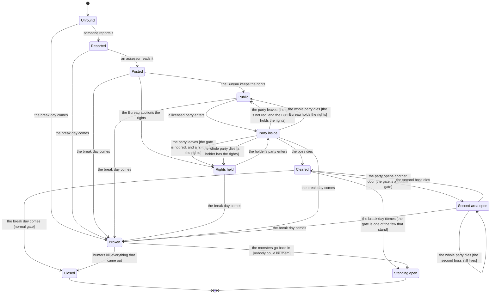

| State | What a person sees |
|---|---|
| Unfound (start) | The gate is open and nobody has reported it. Its break day is counting down. |
| Reported | A finder has told the Bureau. An assessor is on the way. |
| Posted | The Bureau has read its rank and listed it on Doorwatch with its days left. |
| Public | The Bureau holds the rights. A licensed party may pay the entry fee and enter. |
| Rights held | A guild or company bought the rights at auction. Only its party may enter. |
| Party inside | A party is in the gate. A red gate has sealed behind it. |
| Cleared | The boss is dead. The gate is empty and stays open. Reclaimers may work. |
| Second area open | A double gate: the door beyond the boss's room has been opened, and the second boss lives. |
| Broken | The break day came. The monsters are in the street. |
| Closed (end) | The gate is gone. |
| Standing open (end) | The gate did not close and nobody knows why. Port Sarn's is one. |

| From | When this happens | Only if | To |
|---|---|---|---|
| Unfound | someone reports it |  | Reported |
| Unfound | the break day comes |  | Broken |
| Reported | an assessor reads it |  | Posted |
| Reported | the break day comes |  | Broken |
| Posted | the Bureau keeps the rights |  | Public |
| Posted | the Bureau auctions the rights |  | Rights held |
| Posted | the break day comes |  | Broken |
| Public | a licensed party enters |  | Party inside |
| Public | the break day comes |  | Broken |
| Rights held | the holder's party enters |  | Party inside |
| Rights held | the break day comes |  | Broken |
| Party inside | the boss dies |  | Cleared |
| Party inside | the party leaves | the gate is not red, and the Bureau holds the rights | Public |
| Party inside | the party leaves | the gate is not red, and a holder has the rights | Rights held |
| Party inside | the whole party dies | the Bureau holds the rights | Public |
| Party inside | the whole party dies | a holder has the rights | Rights held |
| Party inside | the break day comes |  | Broken |
| Cleared | the party opens another door | the gate is a double gate | Second area open |
| Cleared | the break day comes | normal gate | Closed |
| Cleared | the break day comes | the gate is one of the few that stand | Standing open |
| Second area open | the second boss dies |  | Cleared |
| Second area open | the party leaves | the gate is not red, and the second boss still lives | Second area open |
| Second area open | the whole party dies | the second boss still lives | Second area open |
| Second area open | the break day comes |  | Broken |
| Broken | hunters kill everything that came out |  | Closed |
| Broken | the monsters go back in | nobody could kill them | Standing open |

## A break

A city's answer to one broken gate (`history.md` section 6).

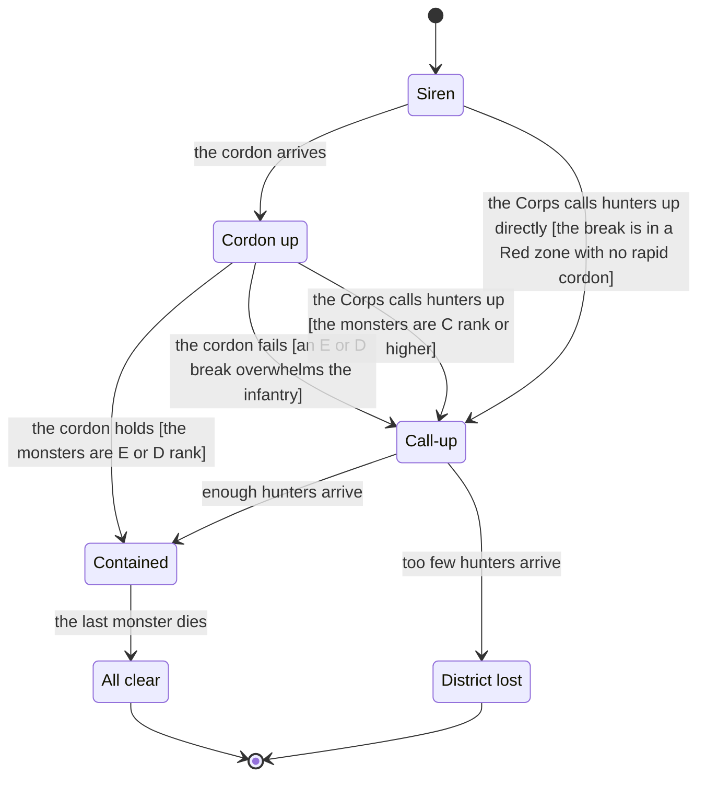

| State | What a person sees |
|---|---|
| Siren (start) | The rising tone sounds. Residents' windows show "Survive". |
| Cordon up | Soldiers ring the area and move people out. |
| Call-up | The Hunter Corps has ordered every licensed hunter in the district to the break. |
| Contained | Nothing is getting past the cordon. Hunters are killing what is left. |
| All clear (end) | The siren stops. Insurers' assessors walk in. |
| District lost (end) | The cordon fell back. The Bureau redraws the zone as Red. |

| From | When this happens | Only if | To |
|---|---|---|---|
| Siren | the cordon arrives |  | Cordon up |
| Siren | the Corps calls hunters up directly | the break is in a Red zone with no rapid cordon | Call-up |
| Cordon up | the cordon holds | the monsters are E or D rank | Contained |
| Cordon up | the cordon fails | an E or D break overwhelms the infantry | Call-up |
| Cordon up | the Corps calls hunters up | the monsters are C rank or higher | Call-up |
| Call-up | enough hunters arrive |  | Contained |
| Call-up | too few hunters arrive |  | District lost |
| Contained | the last monster dies |  | All clear |

## A personal gate

One personal gate, which a gate key or the GM opens for one hunter (`power.md` section 4, `items.md`).

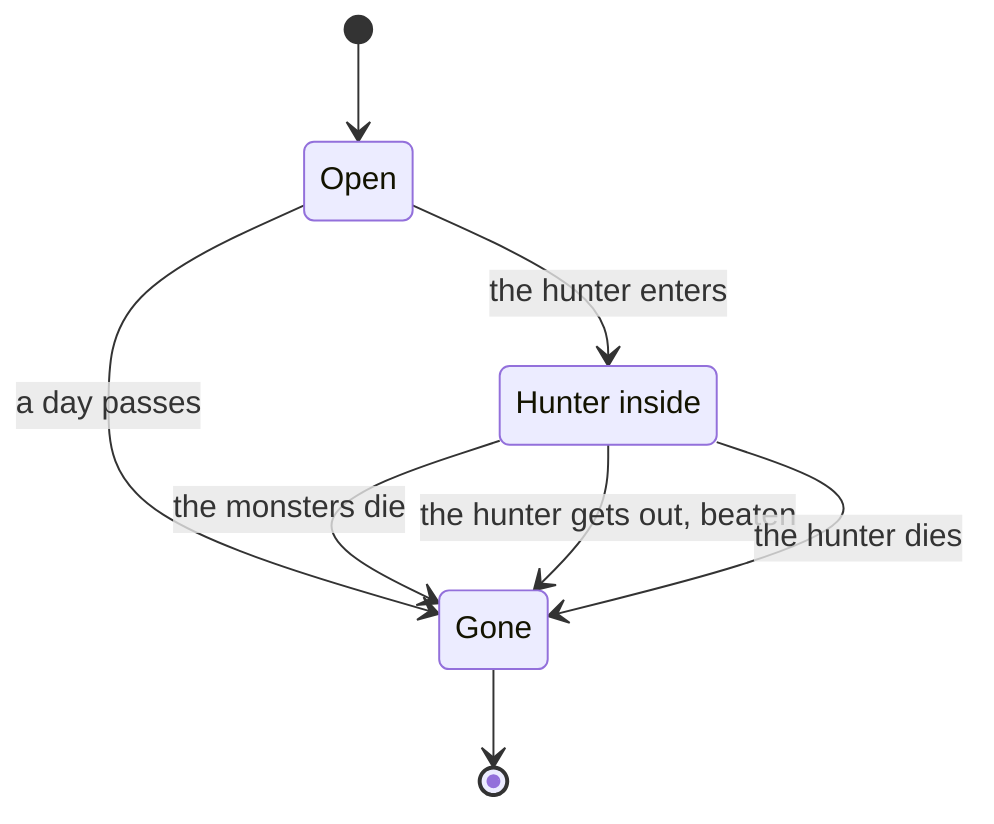

| State | What a person sees |
|---|---|
| Open (start) | The gate stands beside the hunter for a day. Nobody else can enter it. |
| Hunter inside | The hunter is fighting one or two monsters alone. |
| Gone (end) | The gate has closed. |

| From | When this happens | Only if | To |
|---|---|---|---|
| Open | the hunter enters |  | Hunter inside |
| Open | a day passes |  | Gone |
| Hunter inside | the monsters die |  | Gone |
| Hunter inside | the hunter gets out, beaten |  | Gone |
| Hunter inside | the hunter dies |  | Gone |

## A person and the System

What one person is to the System, from birth (`power.md` sections 1 to 5, `story.md` section 2).

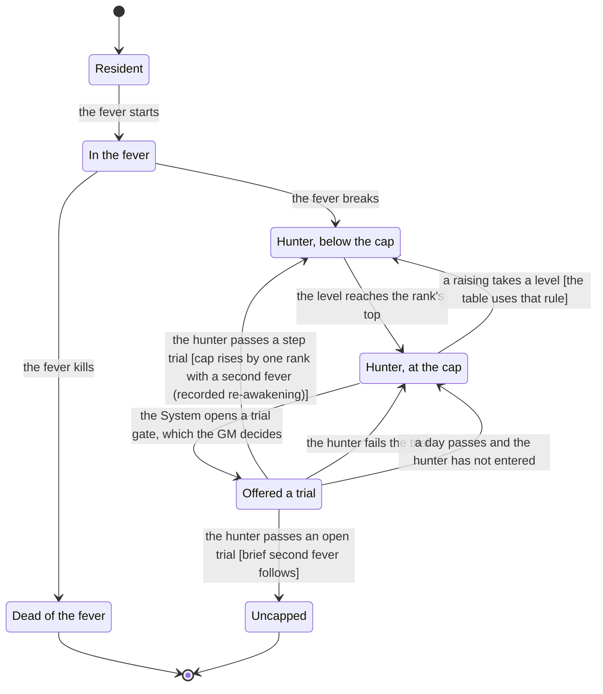

| State | What a person sees |
|---|---|
| Resident (start) | The window reads "Resident. Level 0. Cap: 0." |
| In the fever | Three days above 40 degrees, with blue veins at the wrists. |
| Dead of the fever (end) | About one person in sixty does not come out of it. |
| Hunter, below the cap | The window shows a job, a rank and a level. XP raises the level. |
| Hunter, at the cap | The XP bar has stopped. The daily quest still comes. |
| Offered a trial | A personal gate of an unusual colour is open for the hunter. |
| Uncapped (end) | The window reads "Cap: none". The level rises through every rank. |

| From | When this happens | Only if | To |
|---|---|---|---|
| Resident | the fever starts |  | In the fever |
| In the fever | the fever breaks |  | Hunter, below the cap |
| In the fever | the fever kills |  | Dead of the fever |
| Hunter, below the cap | the level reaches the rank's top |  | Hunter, at the cap |
| Hunter, at the cap | the System opens a trial gate, which the GM decides |  | Offered a trial |
| Offered a trial | the hunter passes an open trial | brief second fever follows | Uncapped |
| Offered a trial | the hunter passes a step trial | cap rises by one rank with a second fever (recorded re-awakening) | Hunter, below the cap |
| Offered a trial | the hunter fails the trial |  | Hunter, at the cap |
| Offered a trial | a day passes and the hunter has not entered |  | Hunter, at the cap |
| Hunter, at the cap | a raising takes a level | the table uses that rule | Hunter, below the cap |

## Registration

A hunter's standing with the Bureau (`careers.md` section 1).

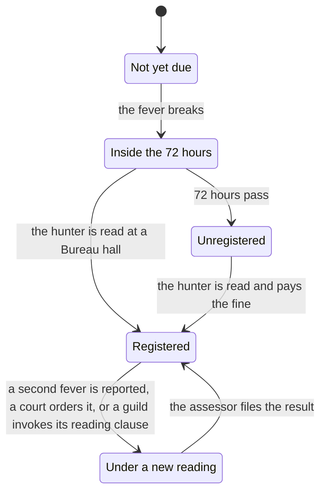

| State | What a person sees |
|---|---|
| Not yet due (start) | The person has not awakened, or is still in the fever. |
| Inside the 72 hours | The fever has broken. The Bureau's card gives the deadline. |
| Registered | The rank is in the Register and public. The hunter holds a licence. |
| Unregistered | The 72 hours have passed. The hunter has no licence and owes a fine. |
| Under a new reading | The Bureau or a guild has ordered the hunter read again. |

| From | When this happens | Only if | To |
|---|---|---|---|
| Not yet due | the fever breaks |  | Inside the 72 hours |
| Inside the 72 hours | the hunter is read at a Bureau hall |  | Registered |
| Inside the 72 hours | 72 hours pass |  | Unregistered |
| Unregistered | the hunter is read and pays the fine |  | Registered |
| Registered | a second fever is reported, a court orders it, or a guild invokes its reading clause |  | Under a new reading |
| Under a new reading | the assessor files the result |  | Registered |

## Revive standing

the owner's revive ladder for one hunter (`economy.md` section 13, `power.md` section 8, `story.md` section 3).

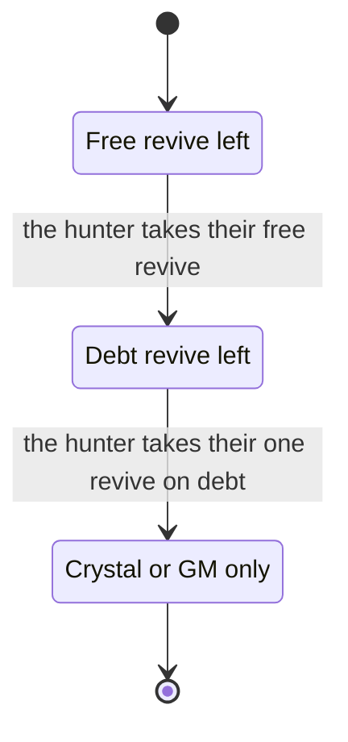

| State | What a person sees |
|---|---|
| Free revive left (start) | The hunter has never died. Their first revive within the hour is free of gold cost. |
| Debt revive left | The free revive is spent. One revive on debt (ten Clears) remains. |
| Crystal or GM only (end) | Both System revives are spent. Only a Resurrection Crystal bought before death, or a GM grant, can raise the hunter. Gold held after death does not help. |

| From | When this happens | Only if | To |
|---|---|---|---|
| Free revive left | the hunter takes their free revive |  | Debt revive left |
| Debt revive left | the hunter takes their one revive on debt |  | Crystal or GM only |

## A death

One hunter's life, death and raising under the revive ladder (`economy.md` section 13, `power.md` section 8, `story.md` section 3).

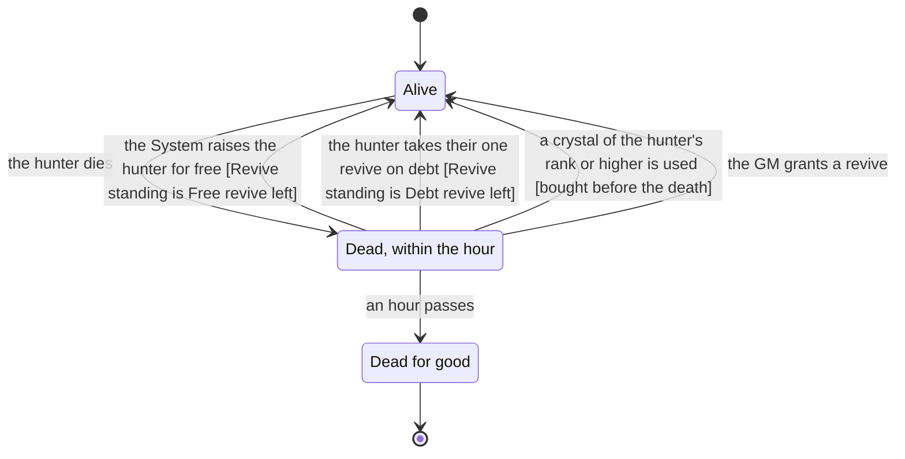

| State | What a person sees |
|---|---|
| Alive (start) | The hunter is alive. |
| Dead, within the hour | The hunter has died. Only the revive ladder, a crystal bought before death, or a GM grant can raise them within an hour. Gold held after death does not help. |
| Dead for good (end) | The hour has passed. The will takes effect and the death benefit falls due. |

| From | When this happens | Only if | To |
|---|---|---|---|
| Alive | the hunter dies |  | Dead, within the hour |
| Dead, within the hour | the System raises the hunter for free | Revive standing is Free revive left | Alive |
| Dead, within the hour | the hunter takes their one revive on debt | Revive standing is Debt revive left | Alive |
| Dead, within the hour | a crystal of the hunter's rank or higher is used | bought before the death | Alive |
| Dead, within the hour | the GM grants a revive |  | Alive |
| Dead, within the hour | an hour passes |  | Dead for good |

## A crystal debt

What a hunter owes for their single debt revive or for a pre-bought crystal bought on lender credit (`careers.md` section 4, `economy.md` section 13).

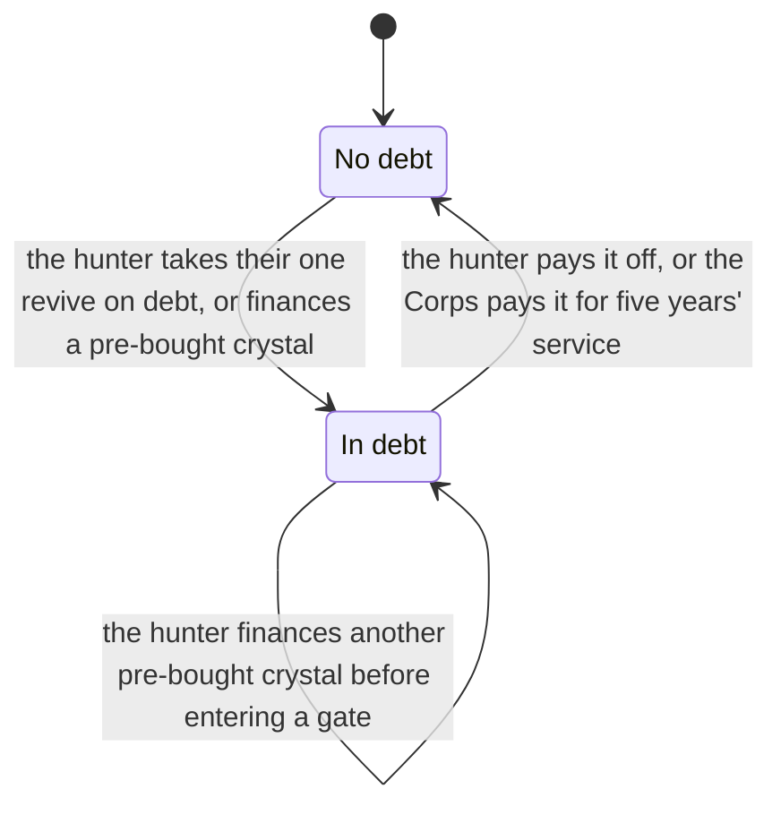

| State | What a person sees |
|---|---|
| No debt (start) | The hunter owes nothing for a revive or a crystal. |
| In debt | The hunter owes ten Clears (for their one debt revive, or a lender's pre-bought crystal), with monthly interest if refinanced by a guild or lender. |

| From | When this happens | Only if | To |
|---|---|---|---|
| No debt | the hunter takes their one revive on debt, or finances a pre-bought crystal |  | In debt |
| In debt | the hunter finances another pre-bought crystal before entering a gate |  | In debt |
| In debt | the hunter pays it off, or the Corps pays it for five years' service |  | No debt |

## A guild contract

One hunter's contract with one guild (`careers.md` sections 3, 4 and 7).

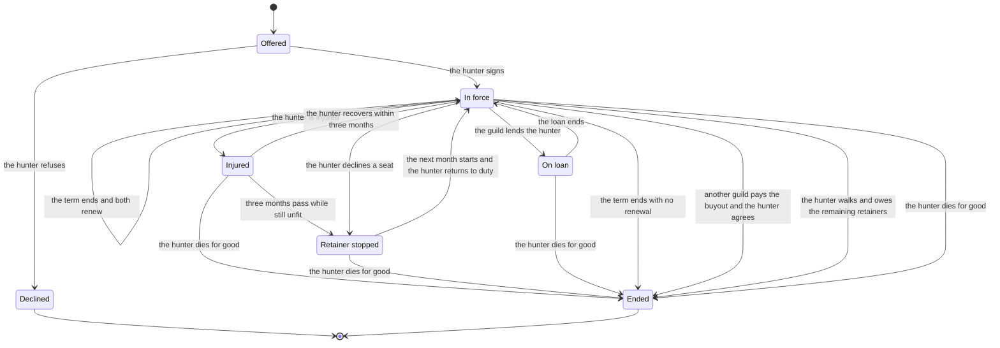

| State | What a person sees |
|---|---|
| Offered (start) | A scout has put the paper in front of the hunter. |
| Declined (end) | The hunter did not sign. |
| In force | The guild pays the retainer and takes the house share. The hunter is seated at the guild's choice. |
| Injured | The hunter is unfit for gates. The guild pays the retainer for up to three months. |
| Retainer stopped | The hunter declined a seat, or stayed unfit past three months of injury pay. The guild pays no retainer until the hunter returns to duty. |
| On loan | The hunter is working another guild's gate. The lending guild keeps the fee. |
| Ended (end) | The term ran out with no renewal, another guild bought the contract, the hunter walked, or the hunter died for good. |

| From | When this happens | Only if | To |
|---|---|---|---|
| Offered | the hunter signs |  | In force |
| Offered | the hunter refuses |  | Declined |
| In force | the hunter is injured |  | Injured |
| Injured | the hunter recovers within three months |  | In force |
| Injured | three months pass while still unfit |  | Retainer stopped |
| Injured | the hunter dies for good |  | Ended |
| In force | the hunter declines a seat |  | Retainer stopped |
| Retainer stopped | the next month starts and the hunter returns to duty |  | In force |
| Retainer stopped | the hunter dies for good |  | Ended |
| In force | the guild lends the hunter |  | On loan |
| On loan | the loan ends |  | In force |
| On loan | the hunter dies for good |  | Ended |
| In force | the term ends and both renew |  | In force |
| In force | the term ends with no renewal |  | Ended |
| In force | another guild pays the buyout and the hunter agrees |  | Ended |
| In force | the hunter walks and owes the remaining retainers |  | Ended |
| In force | the hunter dies for good |  | Ended |

## A guild gear lien

Gear a hunter buys on guild credit (`careers.md` section 4 trap 5, `economy.md` section 7).

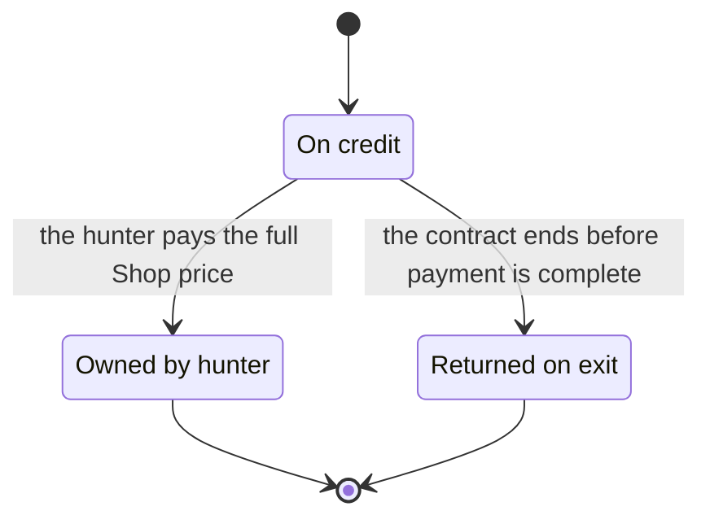

| State | What a person sees |
|---|---|
| On credit (start) | The hunter wears the gear. The guild owns it until the full Shop price is paid. |
| Owned by hunter (end) | The hunter paid the full Shop price and owns the gear outright. |
| Returned on exit (end) | The hunter left the guild, returned the gear, and still owes any unpaid balance. |

| From | When this happens | Only if | To |
|---|---|---|---|
| On credit | the hunter pays the full Shop price |  | Owned by hunter |
| On credit | the contract ends before payment is complete |  | Returned on exit |

## A party bond

A deposit an unsigned party lodges with the Bureau for queue priority (`careers.md` section 6).

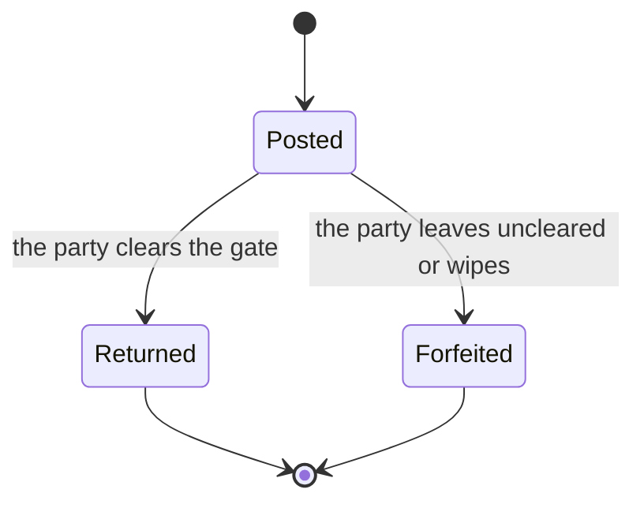

| State | What a person sees |
|---|---|
| Posted (start) | Two Clears per hunter sit with the Bureau. The party is seated ahead of unbonded parties. |
| Returned (end) | The gate was cleared. The Bureau returns the whole deposit. |
| Forfeited (end) | The party left the gate uncleared or wiped. The Bureau keeps the deposit. |

| From | When this happens | Only if | To |
|---|---|---|---|
| Posted | the party clears the gate |  | Returned |
| Posted | the party leaves uncleared or wipes |  | Forfeited |

## Shadow extraction

One corpse a Necromancer tries to extract (`power.md` section 7, `factions.md` Gravewardens).

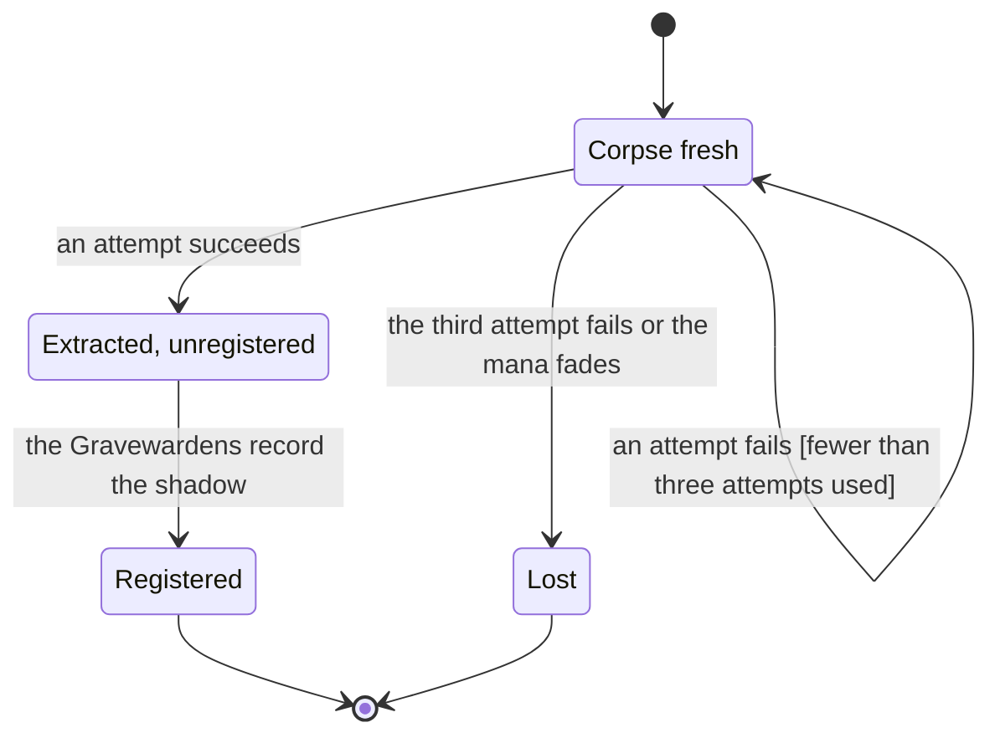

| State | What a person sees |
|---|---|
| Corpse fresh (start) | The Necromancer has up to three extraction attempts before the mana fades. |
| Extracted, unregistered | The shadow serves the Necromancer. The law requires logging it with the Gravewardens. |
| Registered (end) | The shadow is recorded in the Gravewardens' register. |
| Lost (end) | Three attempts failed, or the corpse decayed without extraction. |

| From | When this happens | Only if | To |
|---|---|---|---|
| Corpse fresh | an attempt fails | fewer than three attempts used | Corpse fresh |
| Corpse fresh | an attempt succeeds |  | Extracted, unregistered |
| Corpse fresh | the third attempt fails or the mana fades |  | Lost |
| Extracted, unregistered | the Gravewardens record the shadow |  | Registered |

## A piece of gear's grade

One weapon, armor piece or accessory, as enhancement stones are used on it (`items.md` section 5).

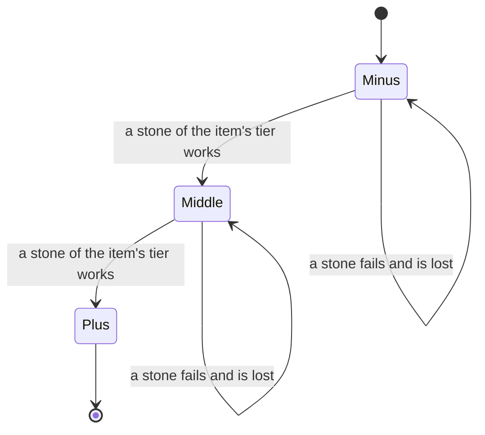

| State | What a person sees |
|---|---|
| Minus (start) | The item is weaker than its tier's middle and costs two thirds of a Clear. |
| Middle | The item is its tier's middle and costs one Clear. |
| Plus (end) | The item is its tier's best grade and costs one and a half Clears. No stone raises it further. |

| From | When this happens | Only if | To |
|---|---|---|---|
| Minus | a stone of the item's tier works |  | Middle |
| Minus | a stone fails and is lost |  | Minus |
| Middle | a stone of the item's tier works |  | Plus |
| Middle | a stone fails and is lost |  | Middle |

## A profession

One crafter's tier in their profession (`items.md` section 4). A hunter's cap does not stop it.

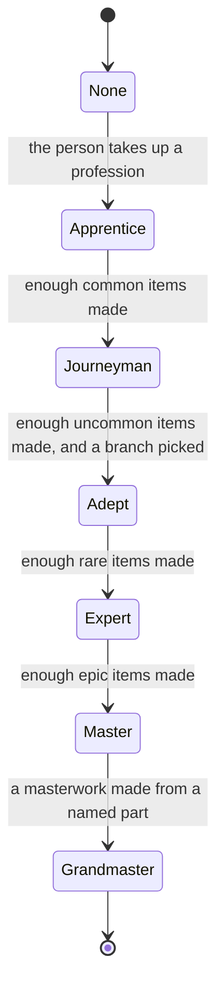

| State | What a person sees |
|---|---|
| None (start) | The person has learned no profession. |
| Apprentice | Makes common items. |
| Journeyman | Makes uncommon items. |
| Adept | Makes rare items. The crafter has picked a branch. |
| Expert | Makes epic items. |
| Master | Makes legendary items. |
| Grandmaster (end) | Makes mythic items. |

| From | When this happens | Only if | To |
|---|---|---|---|
| None | the person takes up a profession |  | Apprentice |
| Apprentice | enough common items made |  | Journeyman |
| Journeyman | enough uncommon items made, and a branch picked |  | Adept |
| Adept | enough rare items made |  | Expert |
| Expert | enough epic items made |  | Master |
| Master | a masterwork made from a named part |  | Grandmaster |

## A crystal cover policy

One hunter's policy for one year (`economy.md` section 12, `careers.md` section 6).

```mermaid
stateDiagram-v2
  state "In force" as s1
  state "Claim made" as s2
  state "Used for the year" as s3
  state "Lapsed" as s4
  [*] --> s1
  s1 --> s2 : a pre-bought crystal raises the hunter
  s2 --> s3 : the insurer pays [the death was in a licensed world gate with a party]
  s2 --> s1 : the insurer refuses [the death was in a personal gate, a gate entered alone or an unlicensed gate, or another hunter caused it]
  s3 --> s1 : the year ends and the premium is paid
  s1 --> s1 : the year ends and the premium is paid
  s1 --> s4 : the year ends and the premium is not paid
  s3 --> s4 : the year ends and the premium is not paid
  s4 --> [*]
```

| State | What a person sees |
|---|---|
| In force (start) | The premium is paid. One pre-bought crystal used on the hunter this year will be repaid. |
| Claim made | A pre-bought crystal was used on the hunter. The insurer's assessor is checking where the death happened. |
| Used for the year | The insurer has repaid one crystal. It repays no second one before renewal. |
| Lapsed (end) | The premium was not paid. |

| From | When this happens | Only if | To |
|---|---|---|---|
| In force | a pre-bought crystal raises the hunter |  | Claim made |
| Claim made | the insurer pays | the death was in a licensed world gate with a party | Used for the year |
| Claim made | the insurer refuses | the death was in a personal gate, a gate entered alone or an unlicensed gate, or another hunter caused it | In force |
| Used for the year | the year ends and the premium is paid |  | In force |
| In force | the year ends and the premium is paid |  | In force |
| In force | the year ends and the premium is not paid |  | Lapsed |
| Used for the year | the year ends and the premium is not paid |  | Lapsed |

## The daily quest

One hunter's daily quest, day after day (`power.md` section 3). Finishing it never heals HP, restores mana, or clears fatigue.

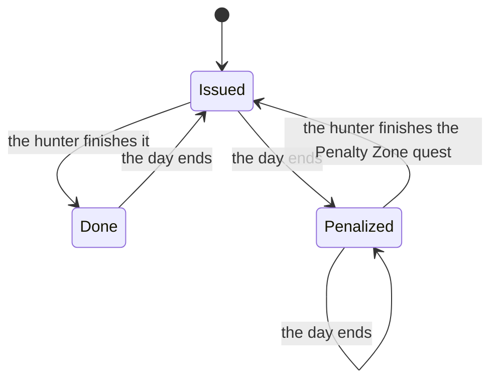

| State | What a person sees |
|---|---|
| Issued (start) | Today's quest is in the window and not finished. |
| Done | The hunter finished it. A hunter below the cap gained XP. No HP, mana, or fatigue was restored. |
| Penalized | The hunter missed yesterday's quest. Every check takes a penalty until the Penalty Zone quest is finished. |

| From | When this happens | Only if | To |
|---|---|---|---|
| Issued | the hunter finishes it |  | Done |
| Issued | the day ends |  | Penalized |
| Done | the day ends |  | Issued |
| Penalized | the hunter finishes the Penalty Zone quest |  | Issued |
| Penalized | the day ends |  | Penalized |

## A System message or reward

Every System window line, viewer tip, scenario, or reward before players see it (the owner's ruling; `README.md`, `story.md` sections 6 and 7).

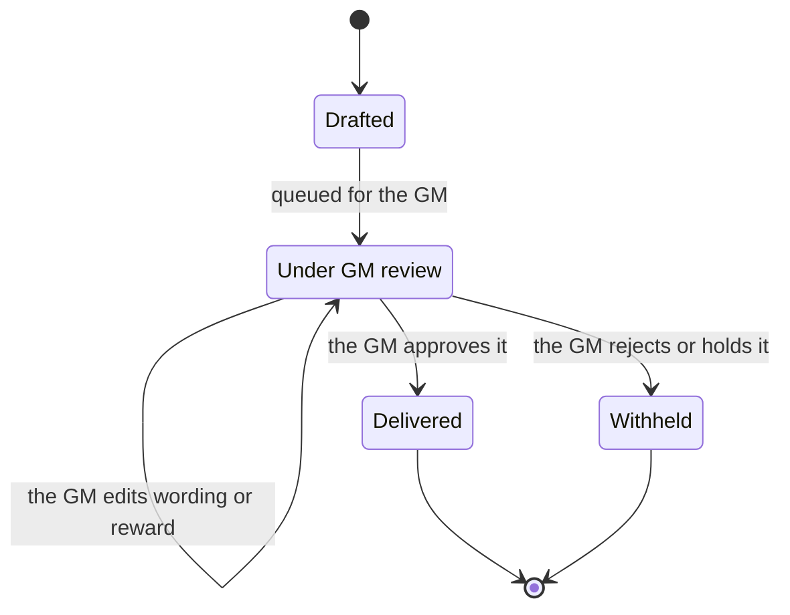

| State | What a person sees |
|---|---|
| Drafted (start) | A System notice, scenario, reward, or Patron message has been proposed. |
| Under GM review | The GM reads the exact text and reward amounts and may edit either. |
| Delivered (end) | The GM approved the message or reward. Players see it in their windows. |
| Withheld (end) | The GM rejected or held it. Players see nothing. |

| From | When this happens | Only if | To |
|---|---|---|---|
| Drafted | queued for the GM |  | Under GM review |
| Under GM review | the GM edits wording or reward |  | Under GM review |
| Under GM review | the GM approves it |  | Delivered |
| Under GM review | the GM rejects or holds it |  | Withheld |

## Sponsor patronage

One uncapped hunter's relationship with viewers and a Patron (`story.md` Act 3 and section 7). For the GM only.

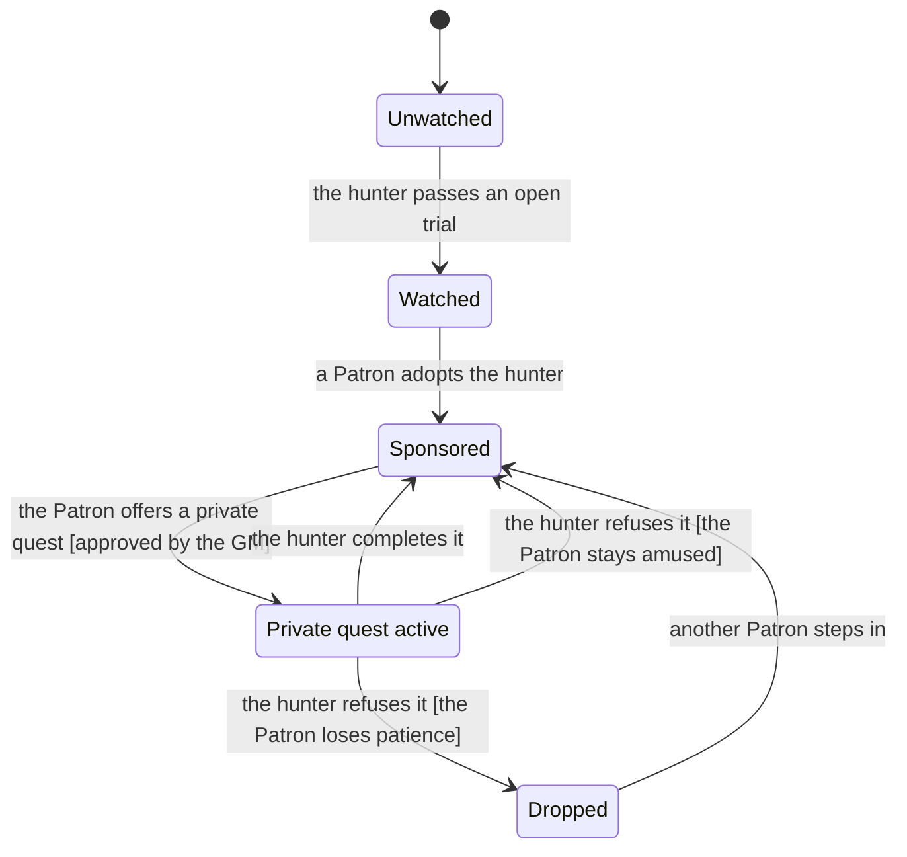

| State | What a person sees |
|---|---|
| Unwatched (start) | The hunter is capped. No viewer count appears. |
| Watched | The window shows a Viewers count. Named viewers may send tips through GM review. |
| Sponsored | One Patron has adopted the hunter and sends regular gold and gear. |
| Private quest active | The Patron has offered a private quest (GM-approved) with a Shop reward. |
| Dropped | The Patron cut the hunter off after a refusal or boring play. Other viewers still watch. |

| From | When this happens | Only if | To |
|---|---|---|---|
| Unwatched | the hunter passes an open trial |  | Watched |
| Watched | a Patron adopts the hunter |  | Sponsored |
| Sponsored | the Patron offers a private quest | approved by the GM | Private quest active |
| Private quest active | the hunter completes it |  | Sponsored |
| Private quest active | the hunter refuses it | the Patron stays amused | Sponsored |
| Private quest active | the hunter refuses it | the Patron loses patience | Dropped |
| Dropped | another Patron steps in |  | Sponsored |

## A keepsake

One memory or bond the System takes as collateral at a raising (`story.md` section 3 and Act 4). For the GM only.

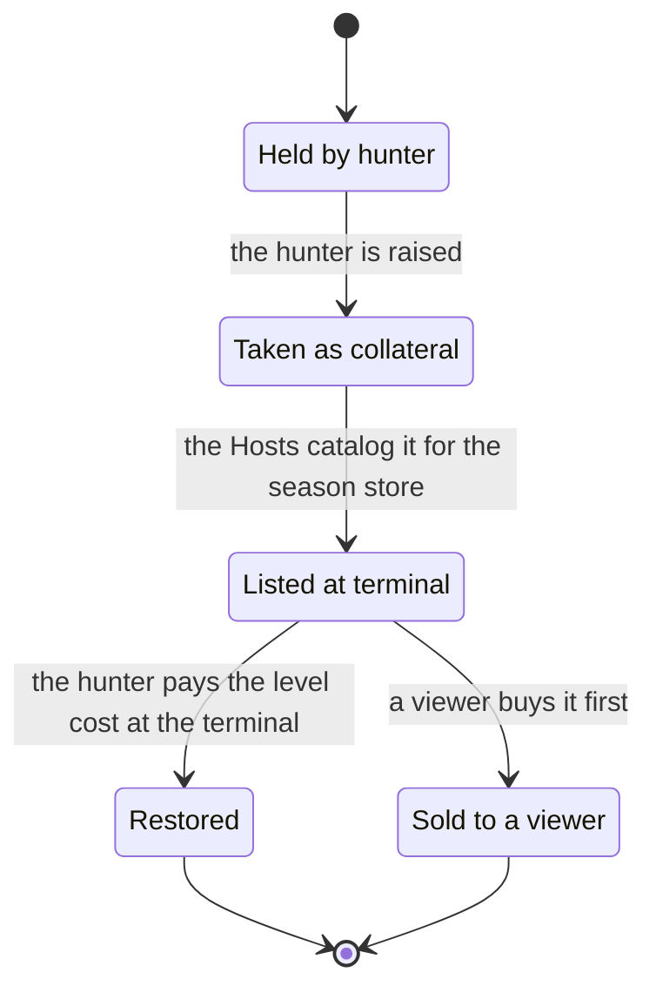

| State | What a person sees |
|---|---|
| Held by hunter (start) | The hunter still has the memory or relationship. |
| Taken as collateral | The hunter was raised. The window showed "Collateral taken". |
| Listed at terminal | The memory sits on the Act 4 Keepsakes terminal for sale. |
| Restored (end) | The hunter paid the terminal's price in levels and recovered the memory. |
| Sold to a viewer (end) | A viewer bought the memory as a season keepsake. It cannot be bought back. |

| From | When this happens | Only if | To |
|---|---|---|---|
| Held by hunter | the hunter is raised |  | Taken as collateral |
| Taken as collateral | the Hosts catalog it for the season store |  | Listed at terminal |
| Listed at terminal | the hunter pays the level cost at the terminal |  | Restored |
| Listed at terminal | a viewer buys it first |  | Sold to a viewer |

## A scenario

One city-wide quest of the season's second half (`story.md` act 3). For the GM only.

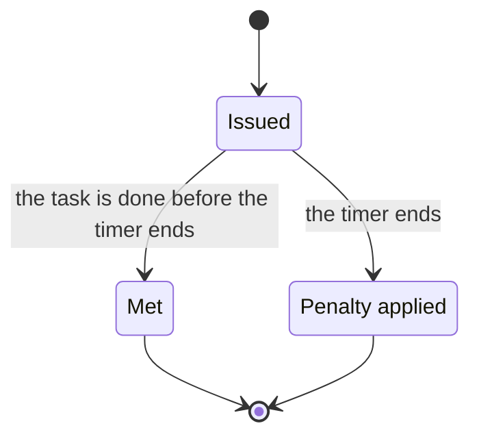

| State | What a person sees |
|---|---|
| Issued (start) | Every window in the city shows the GM-approved task, the timer and the penalty. |
| Met (end) | The city did what was asked. Viewers pay out. |
| Penalty applied (end) | The timer ran out. The System did what it said it would. |

| From | When this happens | Only if | To |
|---|---|---|---|
| Issued | the task is done before the timer ends |  | Met |
| Issued | the timer ends |  | Penalty applied |

## The season

Earth's season of the game, which is the campaign (`story.md` section 4). For the GM only.

```mermaid
stateDiagram-v2
  state "First half" as s1
  state "Second half" as s2
  state "Finale" as s3
  state "Season complete" as s4
  state "Earth is lost" as s5
  state "Control room" as s6
  state "The seat is empty" as s7
  state "The party holds the seat" as s8
  [*] --> s1
  s1 --> s2 : the party passes a trial gate and hits the viewer threshold
  s2 --> s3 : the Tide's countdown ends
  s3 --> s4 : Earth's hunters win
  s3 --> s5 : Earth's hunters lose
  s5 --> s6 : the party survives and finds the last gate
  s4 --> s6 : the party enters the last gate
  s6 --> s7 : the party kills the Hosts and leaves
  s6 --> s8 : the party kills the Hosts and stays
  s7 --> [*]
  s8 --> [*]
```

| State | What a person sees |
|---|---|
| First half (start) | Twenty years of gates. The System has stated no goal. Acts 1 and 2. |
| Second half | An uncapped party crosses the broadcast's cast and viewer threshold, so the System issues scenarios and viewers sponsor hunters. Acts 3 and 4. |
| Finale | The first season's winners come through Port Sarn's gate. Act 5. |
| Season complete | Earth won. Every uncapped hunter is offered the Finale contract. |
| Earth is lost | The Finale won. Earth's people become the next world's monsters. |
| Control room | The party is among the Hosts. Act 6. |
| The seat is empty (end) | The Hosts are dead and nobody runs the game. Gates still open. |
| The party holds the seat (end) | The party runs the game. |

| From | When this happens | Only if | To |
|---|---|---|---|
| First half | the party passes a trial gate and hits the viewer threshold |  | Second half |
| Second half | the Tide's countdown ends |  | Finale |
| Finale | Earth's hunters win |  | Season complete |
| Finale | Earth's hunters lose |  | Earth is lost |
| Earth is lost | the party survives and finds the last gate |  | Control room |
| Season complete | the party enters the last gate |  | Control room |
| Control room | the party kills the Hosts and leaves |  | The seat is empty |
| Control room | the party kills the Hosts and stays |  | The party holds the seat |
